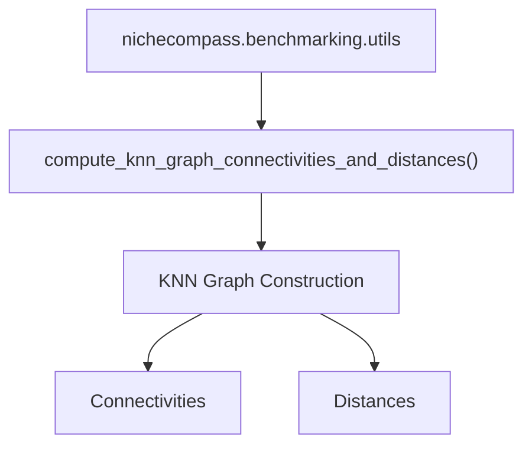
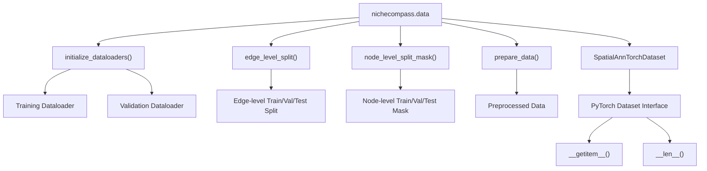
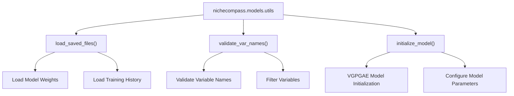
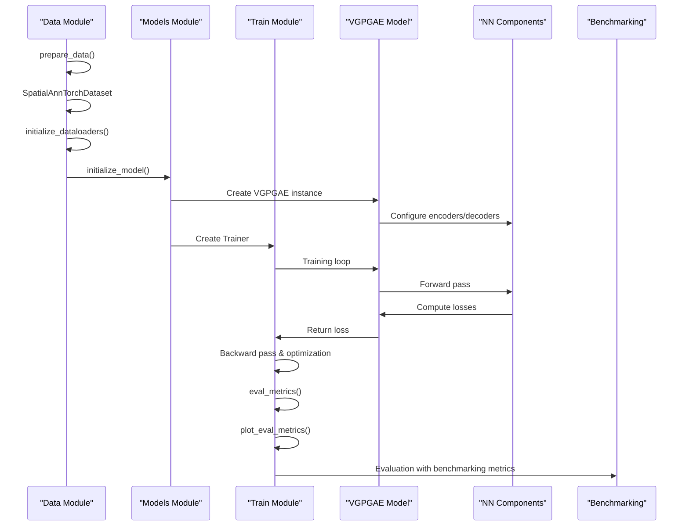

# Developer API

<details>
<summary>Relevant source files</summary>

The following files were used as context for generating this wiki page:

- [docs/api/developer.md](docs/api/developer.md)
- [docs/api/index.md](docs/api/index.md)
- [docs/api/user.md](docs/api/user.md)
- [docs/tutorials/index.md](docs/tutorials/index.md)

</details>


This page documents the lower-level components of NicheCompass that are primarily of interest to developers who want to extend, modify, or contribute to the codebase. For information about the user-facing API designed for researchers conducting analyses with NicheCompass, see [User API](#6.1).

## Overview of Developer Components

The developer API of NicheCompass comprises several interconnected modules that handle the core functionality of the package. These components form the foundation upon which the user-facing API is built.

```mermaid
classDiagram
    class "NicheCompass System" {
        Core architecture
    }
    "NicheCompass System" --> "Benchmarking Module"
    "NicheCompass System" --> "Data Module" 
    "NicheCompass System" --> "Models Module"
    "NicheCompass System" --> "Modules Module"
    "NicheCompass System" --> "NN Module"
    "NicheCompass System" --> "Train Module"

    class "Benchmarking Module" {
        Evaluation metrics
        Graph utilities
    }
    class "Data Module" {
        Data preparation
        Dataset implementation
        Data splitting
    }
    class "Models Module" {
        Model initialization
        Model utilities
    }
    class "Modules Module" {
        Core architecture components
        Loss functions
    }
    class "NN Module" {
        Neural networks
        Graph encoders/decoders
    }
    class "Train Module" {
        Training loop
        Evaluation functions
    }
```

Sources: [docs/api/developer.md]()

## Benchmarking Module

The benchmarking module provides low-level utilities for computing graph connectivities and distances, which are used by the higher-level benchmarking functions in the user API.



Sources: [docs/api/developer.md:3-13]()

## Data Module

The data module contains components for data preparation, loading, and dataset management. It handles the transformation of AnnData objects into PyTorch-compatible datasets and provides utilities for data splitting.



The `SpatialAnnTorchDataset` class is a PyTorch dataset implementation specifically designed for spatial transcriptomics data stored in AnnData format. It provides the bridge between the AnnData objects and the PyTorch training pipeline.

Sources: [docs/api/developer.md:15-29]()

## Models Module

The models module contains utilities for model initialization, parameter validation, and loading saved model states.



These utilities enable proper model initialization with validated parameters and facilitate model persistence through saving and loading functionality.

Sources: [docs/api/developer.md:31-43]()

## Modules Module

The modules module defines the core model architecture components, including the Variational Gene Program Graph Autoencoder (VGPGAE) and various loss functions.

```mermaid
classDiagram
    class "BaseModuleMixin" {
        Base functionality
    }
    class "VGAEModuleMixin" {
        Variational functionality
    }
    class "VGPGAE" {
        Core model implementation
    }
    
    BaseModuleMixin <|-- VGAEModuleMixin
    VGAEModuleMixin <|-- VGPGAE
    
    class "Loss Functions" {
        compute_cat_covariates_contrastive_loss()
        compute_edge_recon_loss()
        compute_gp_group_lasso_reg_loss()
        compute_gp_l1_reg_loss()
        compute_kl_reg_loss()
        compute_omics_recon_nb_loss()
    }
    
    VGPGAE --> "Loss Functions"
```

The VGPGAE class is the central component of NicheCompass, implementing the variational graph autoencoder with gene program integration. It inherits from both `BaseModuleMixin` and `VGAEModuleMixin` to incorporate base module functionality and variational components.

The various loss functions implement specific aspects of the model's training objective, such as edge reconstruction, KL divergence regularization, and gene program-specific regularization.

Sources: [docs/api/developer.md:45-63]()

## NN Module

The NN module defines neural network components used in the encoder and decoder parts of the model. These include node aggregators, graph decoders, and feature decoders.

```mermaid
classDiagram
    class "Node Aggregators" {
        OneHopAttentionNodeLabelAggregator
        OneHopGCNNormNodeLabelAggregator
        OneHopSumNodeLabelAggregator
    }
    
    class "Graph Decoders" {
        CosineSimGraphDecoder
    }
    
    class "Feature Decoders" {
        FCOmicsFeatureDecoder
        MaskedOmicsFeatureDecoder
    }
    
    class "Encoder" {
        Graph neural network encoder
    }
    
    class "Layer Components" {
        MaskedLinear
        AddOnMaskedLayer
    }
    
    "Encoder" --> "Node Aggregators"
    "Feature Decoders" --> "Layer Components"
```

The Node Aggregators implement different mechanisms for aggregating information from neighboring nodes in the spatial graph, with options for attention-based, GCN-norm, or simple sum aggregation.

The Graph Decoder (`CosineSimGraphDecoder`) reconstructs the spatial graph from the latent representation.

The Feature Decoders reconstruct the omics features (gene expression or chromatin accessibility) from the latent representation, with `MaskedOmicsFeatureDecoder` incorporating gene program masks.

Sources: [docs/api/developer.md:65-83]()

## Train Module

The train module provides components for model training and evaluation. The central `Trainer` class orchestrates the training process, while evaluation utilities help track model performance.

```mermaid
classDiagram
    class "Trainer" {
        +__init__()
        +train()
        +save_model()
        +load_checkpoint()
        +evaluate()
    }
    
    class "Evaluation Utilities" {
        +eval_metrics()
        +plot_eval_metrics()
    }
    
    "Trainer" --> "Evaluation Utilities"
```

The `Trainer` class encapsulates the training loop logic, including forward and backward passes, loss computation, and optimization. It also handles model checkpointing and evaluation.

The evaluation utilities (`eval_metrics` and `plot_eval_metrics`) compute and visualize various performance metrics during and after training.

Sources: [docs/api/developer.md:85-97]()

## Developer Workflow and Component Interaction

This section illustrates how the different components interact during the typical workflow of training and using a NicheCompass model.



This diagram shows the complete workflow from data preparation to model training and evaluation, highlighting the interactions between different components of the developer API.

Sources: [docs/api/developer.md]()

## Key Interfaces for Extension

For developers looking to extend NicheCompass, several key interfaces provide extension points:

### Custom Encoders and Decoders

The modular design of the NN components allows for custom encoder and decoder implementations:

```mermaid
classDiagram
    class "BaseEncoder" {
        +forward()
    }
    class "BaseDecoder" {
        +forward()
    }
    class "CustomEncoder" {
        +forward()
    }
    class "CustomDecoder" {
        +forward()
    }
    
    BaseEncoder <|-- "CustomEncoder"
    BaseDecoder <|-- "CustomDecoder"
```

### Custom Loss Functions

New loss functions can be implemented and integrated into the training process:

| Loss Function Type | Implementation Location | Purpose |
|-------------------|-------------------------|---------|
| Reconstruction Loss | `nichecompass.modules` | Measure accuracy of reconstructed data |
| Regularization Loss | `nichecompass.modules` | Control model complexity/properties |
| Custom Task Loss | `nichecompass.modules` | Specific to extension tasks |

### Dataset Extensions

The `SpatialAnnTorchDataset` can be extended to support new data modalities:

```mermaid
classDiagram
    class "SpatialAnnTorchDataset" {
        +__init__()
        +__getitem__()
        +__len__()
    }
    class "ExtendedModalityDataset" {
        +__init__()
        +__getitem__()
        +__len__()
        +process_new_modality()
    }
    
    SpatialAnnTorchDataset <|-- "ExtendedModalityDataset"
```

Sources: [docs/api/developer.md]()

## Best Practices for Developers

When extending or modifying NicheCompass components:

1. **Maintain Compatibility**: Ensure any new components implement the required interfaces for seamless integration
2. **Follow Loss Function Pattern**: New loss functions should be implemented as standalone functions in the `modules` module
3. **Neural Network Extensions**: Custom encoders and decoders should follow the existing patterns in the `nn` module
4. **Data Preparation**: Extend the data preparation utilities when adding support for new data types
5. **Testing**: Add appropriate tests for new components using the existing testing framework
6. **Documentation**: Document new components following the existing documentation style

## Technical Requirements and Dependencies

The developer API components have specific dependencies that may differ from the user-facing API. Key technical requirements include:

- PyTorch and PyTorch Geometric for graph neural network components
- Specific versions of AnnData and scanpy for data handling
- CUDA compatibility for GPU acceleration
- Integration with visualization libraries for evaluation plotting

Consult the package requirements for specific version constraints and additional dependencies.

Sources: [docs/api/developer.md]()

---