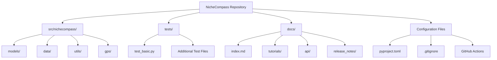
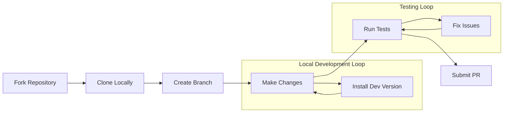
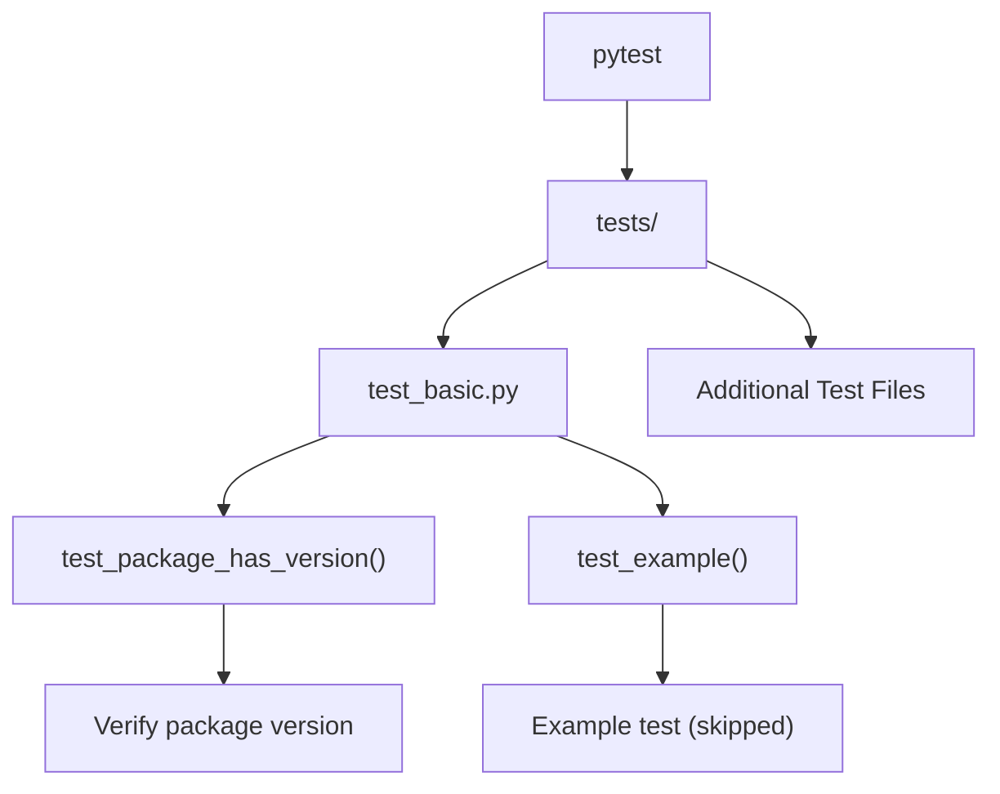
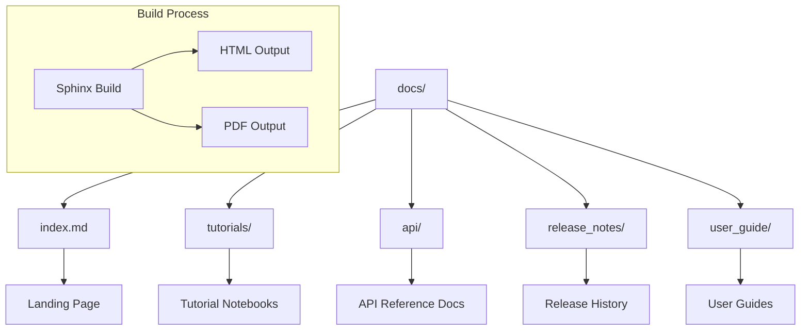
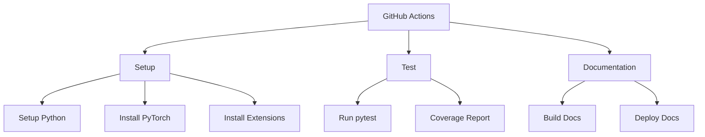

# Development

<details>
<summary>Relevant source files</summary>

The following files were used as context for generating this wiki page:

- [.github/actions/setup/action.yaml](.github/actions/setup/action.yaml)
- [.gitignore](.gitignore)
- [docs/index.md](docs/index.md)
- [docs/release_notes/index.md](docs/release_notes/index.md)
- [docs/user_guide/index.md](docs/user_guide/index.md)
- [pyproject.toml](pyproject.toml)
- [src/nichecompass/utils/analysis.py](src/nichecompass/utils/analysis.py)
- [tests/test_basic.py](tests/test_basic.py)

</details>


This page provides essential information for developers who want to contribute to the NicheCompass project. It covers development environment setup, coding standards, testing procedures, and documentation guidelines. For information about using the NicheCompass API, see [API Reference](#6).

## Environment Setup

NicheCompass requires Python 3.9 or later. The project uses a modern Python development stack with dependencies managed via pip and project configuration defined in `pyproject.toml`.

### Dependencies

NicheCompass relies on several key dependencies:

- **Core dependencies**: PyTorch, PyTorch Geometric, scanpy, NumPy, etc.
- **Development dependencies**: pre-commit, pytest, coverage, etc.
- **Documentation dependencies**: Sphinx and related extensions

To set up a development environment, install the package with development extras:

```bash
# Clone the repository
git clone https://github.com/Lotfollahi-lab/nichecompass
cd nichecompass

# Install with development dependencies
pip install -e ".[dev,tests]"
```

For full development including documentation building and tutorials:

```bash
pip install -e ".[all]"
```

Sources: [pyproject.toml:1-81]()

## Project Structure

The NicheCompass repository follows a standard Python package structure.



Sources: [pyproject.toml:1-81](), [.gitignore:1-144](), [docs/index.md:1-66]()

## Coding Standards

NicheCompass enforces coding standards using Ruff, which combines multiple linting and formatting tools into one package. The configuration is defined in `pyproject.toml`.

### Style Guide

The project follows these style requirements:

- Line length: 120 characters maximum
- Docstrings: NumPy style (enforce with pydocstyle)
- Import sorting: Using isort rules
- Code formatting: Enforced by Ruff format

### Linting Rules

The configured linters include:
- Pyflakes (F): For detecting logical errors
- Pycodestyle (E, W): For PEP 8 compliance
- isort (I): For import ordering
- pydocstyle (D): For docstring style
- flake8-bugbear (B): For detecting bug risk
- Several others (TID, C4, BLE, UP, RUF100)

Certain rules are explicitly ignored to better fit the project's needs, such as allowing lambda expressions and specific variable names like `I` (identity matrix).

Sources: [pyproject.toml:96-152]()

## Development Workflow

The typical development workflow for contributing to NicheCompass:



Sources: [.github/actions/setup/action.yaml:1-44]()

## Testing Framework

NicheCompass uses pytest for testing. The test configuration is specified in `pyproject.toml` under the `[tool.pytest.ini_options]` section.

### Running Tests

To run all tests:

```bash
pytest
```

To run tests with coverage reporting:

```bash
coverage run -m pytest
coverage report
```

### Test Structure

Tests are organized in the `tests/` directory. The basic structure includes a simple test to verify the package has a version.



When creating new tests, follow these principles:
- Place tests in the `tests/` directory
- Name test files with `test_` prefix
- Name test functions with `test_` prefix
- Use fixtures for setup/teardown when appropriate
- Use markers to categorize tests when needed

Sources: [tests/test_basic.py:1-13](), [pyproject.toml:89-94]()

## Documentation System

The documentation for NicheCompass is built using Sphinx with MyST for Markdown support. The documentation source files are in the `docs/` directory.

### Documentation Structure

The documentation is organized into several sections:



### Building Documentation

Documentation dependencies are specified in the `docs` and `docsbuild` extras. To build the documentation:

```bash
# Install documentation dependencies
pip install -e ".[docs]"

# Build HTML documentation
cd docs
make html
```

### Documentation Guidelines

When writing documentation:
- Use Markdown (`.md`) for regular documentation pages
- Use MyST-NB for notebooks (`.ipynb`)
- Follow the NumPy docstring style for API documentation
- Include examples where appropriate
- Keep the API reference up-to-date with code changes

Sources: [pyproject.toml:42-62](), [docs/index.md:1-66]()

## Release Process

NicheCompass follows semantic versioning. The release process is documented in the release notes.

### Version Numbering

- **Major version**: Incompatible API changes
- **Minor version**: Add functionality in a backward-compatible manner
- **Patch version**: Backward-compatible bug fixes

### Release Steps

1. Update version in `pyproject.toml`
2. Update the release notes in `docs/release_notes/index.md`
3. Create a Git tag
4. Build distribution packages
5. Upload to PyPI

### Recent Releases

The project maintains detailed release notes for each version, documenting all significant changes.

Sources: [docs/release_notes/index.md:1-50](), [pyproject.toml:5-7]()

## Continuous Integration

NicheCompass uses GitHub Actions for continuous integration. The setup action configures Python, PyTorch, and necessary extension packages.



The CI/CD pipeline ensures that:
- Tests pass on all supported Python versions
- Code meets style requirements
- Documentation builds successfully

Sources: [.github/actions/setup/action.yaml:1-44]()

## Analysis Utilities Development

When developing analysis utilities, focus on ensuring the functions are well-documented and include appropriate validation. The analysis utilities in NicheCompass provide powerful tools for downstream analysis of model results.

Key considerations when developing analysis utilities:
- Include proper parameter validation
- Provide informative error messages
- Document expected input and output formats
- Support different visualization backends when applicable
- Consider performance implications for large datasets

Sources: [src/nichecompass/utils/analysis.py:1-1148]()

## Best Practices

Here are some best practices to follow when contributing to NicheCompass:

1. **Code Design**:
   - Keep functions and classes focused on a single responsibility
   - Use type hints to improve code readability and IDE support
   - Implement proper error handling with informative messages

2. **Testing**:
   - Write tests for all new functionality
   - Include edge cases in your tests
   - Use parametrized tests when testing similar functionality with different inputs

3. **Documentation**:
   - Document all public APIs
   - Include examples in docstrings
   - Keep docstrings up-to-date with code changes

4. **Performance**:
   - Be mindful of memory usage, especially when working with large datasets
   - Use appropriate data structures (e.g., sparse matrices for sparse data)
   - Profile code when optimizing for performance

Sources: [pyproject.toml:96-152](), [src/nichecompass/utils/analysis.py:1-1148]()

---