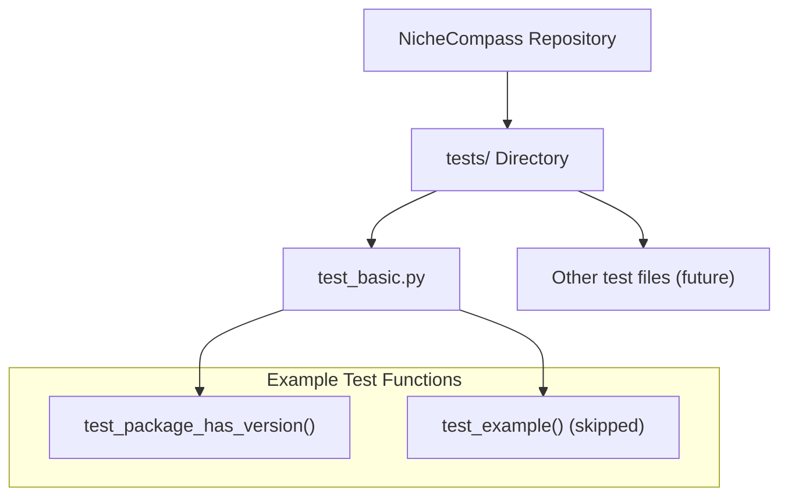
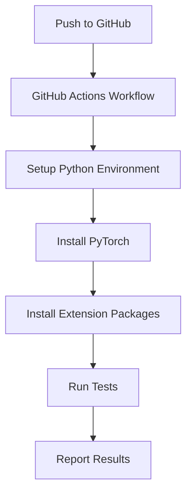
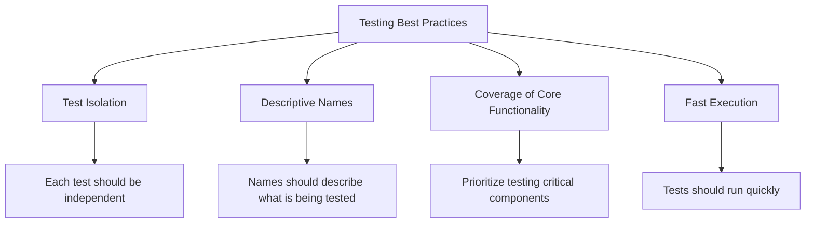
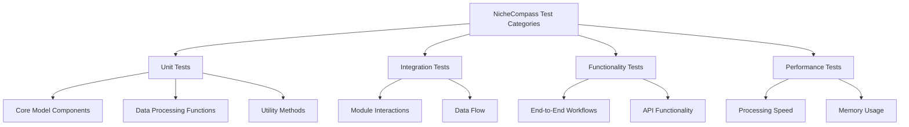

# Testing Framework

<details>
<summary>Relevant source files</summary>

The following files were used as context for generating this wiki page:

- [.github/actions/setup/action.yaml](.github/actions/setup/action.yaml)
- [tests/test_basic.py](tests/test_basic.py)

</details>


## Purpose and Scope

This document explains the testing infrastructure used in the NicheCompass repository. It covers the current testing setup, how to run tests, and best practices for adding new tests when contributing to the project. This testing framework is intended for developers who are contributing to NicheCompass.

For information about the broader development process, see [Development](#7).

## Testing Structure

NicheCompass uses pytest as its testing framework. The test files are organized in a dedicated `tests` directory at the repository root.



Sources: [tests/test_basic.py]()

Currently, the testing suite is minimal, consisting primarily of basic package verification tests. As the project grows, the testing framework will likely expand to include more comprehensive test cases.

## Test File Organization

Tests are organized in Python files with names that start with `test_` to ensure they're automatically discovered by pytest. Each test function within these files should also be prefixed with `test_`.

The current file structure is:

| File | Purpose |
|------|---------|
| `tests/test_basic.py` | Basic package verification tests |

The basic test file contains:
- A test to verify the package has a version number
- A skipped example test (intended as a template for future tests)

Sources: [tests/test_basic.py]()

## Running Tests

### Local Test Execution

To run tests locally, ensure you have pytest installed and run the following command from the repository root:

```
pytest
```

You can also run specific test files:

```
pytest tests/test_basic.py
```

Or specific test functions:

```
pytest tests/test_basic.py::test_package_has_version
```

### Continuous Integration

NicheCompass uses GitHub Actions for continuous integration, which automatically runs tests when code is pushed to the repository.



The setup process includes:
1. Setting up a Python environment (default: Python 3.9)
2. Installing PyTorch (default: version 2.0.0)
3. Installing extension packages (scipy, torch-scatter, torch-sparse)
4. Running the test suite

Sources: [.github/actions/setup/action.yaml]()

## Adding New Tests

When contributing to NicheCompass, follow these guidelines for adding new tests:

### Test Function Structure

```python
def test_your_feature():
    # Setup
    # ...
    
    # Execute
    result = some_function()
    
    # Assert
    assert result == expected_value
```

### Using Test Decorators

Pytest provides several useful decorators for test functions:

```python
# Skip a test
@pytest.mark.skip(reason="Explain why this test is skipped")
def test_skipped():
    pass

# Mark a test as expected to fail
@pytest.mark.xfail
def test_expected_to_fail():
    pass

# Parameterize a test
@pytest.mark.parametrize("input,expected", [
    (1, 2),
    (3, 4)
])
def test_calculation(input, expected):
    assert input + 1 == expected
```

Sources: [tests/test_basic.py:10-12]()

## Testing Best Practices



When writing tests for NicheCompass, follow these best practices:

1. **Isolation**: Each test should be independent and not rely on the state from previous tests
2. **Descriptive Names**: Use clear, descriptive names for test functions
3. **Focus on Core Functionality**: Prioritize testing critical components:
   - Core model functionality
   - Gene program creation and processing
   - Data loading and transformation
   - Integration capabilities

4. **Documentation**: Add comments to explain complex test setups or assertions
5. **Fixtures**: Use pytest fixtures for common setup and teardown operations
6. **Mocking**: Use mock objects when testing components that have external dependencies

## Recommended Test Categories

For comprehensive coverage of the NicheCompass codebase, consider adding tests in these categories:



| Test Category | Purpose | Examples |
|---------------|---------|----------|
| Unit Tests | Test individual functions and classes | Encoder/decoder components, data transformations |
| Integration Tests | Test interaction between modules | Data loading → model training workflow |
| Functionality Tests | Test end-to-end workflows | Complete analysis pipeline execution |
| Performance Tests | Measure speed and resource usage | Training time, memory footprint |

## Future Testing Roadmap

As NicheCompass evolves, the testing framework should expand to include:

1. More comprehensive unit tests for all components
2. Integration tests for module interactions
3. End-to-end workflow tests
4. Data validation tests
5. Performance benchmarks

Sources: [tests/test_basic.py](), [.github/actions/setup/action.yaml]()

---