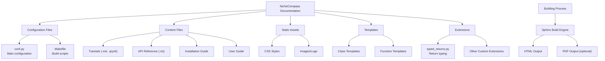
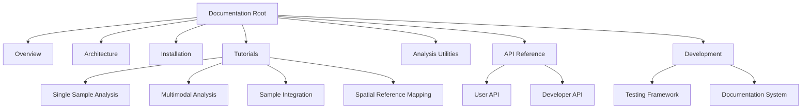
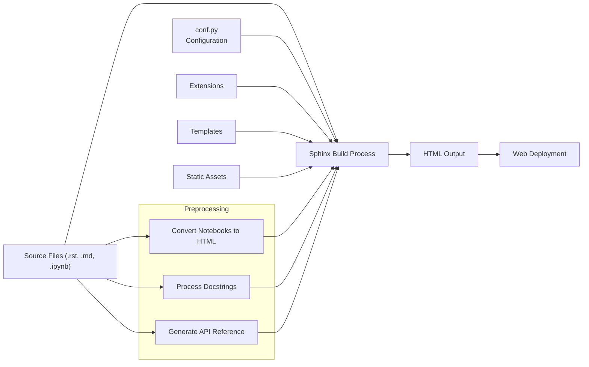
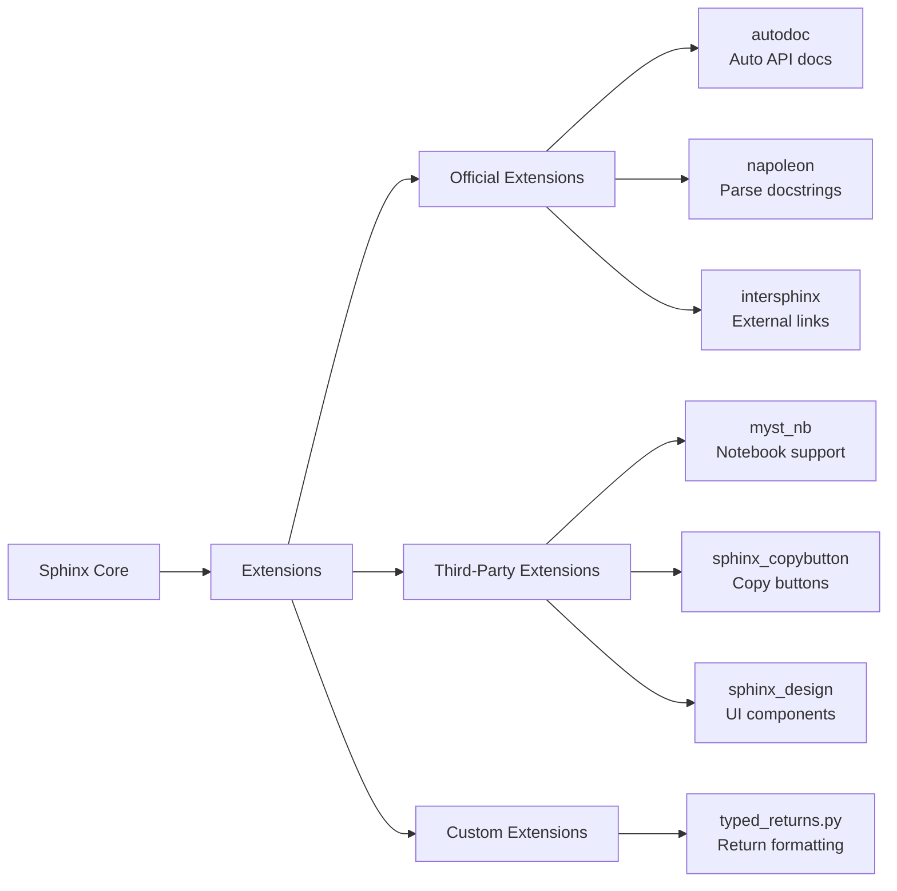

# Documentation System

Relevant source files

The following files were used as context for generating this wiki page:

- [LICENSE](LICENSE)
- [docs/Makefile](docs/Makefile)
- [docs/_static/css/custom.css](docs/_static/css/custom.css)
- [docs/_templates/autosummary/class.rst](docs/_templates/autosummary/class.rst)
- [docs/conf.py](docs/conf.py)
- [docs/extensions/typed_returns.py](docs/extensions/typed_returns.py)
- [docs/tutorials/multimodal_tutorials.md](docs/tutorials/multimodal_tutorials.md)
- [docs/tutorials/sample_integration_tutorials.md](docs/tutorials/sample_integration_tutorials.md)
- [docs/tutorials/single_sample_tutorials.md](docs/tutorials/single_sample_tutorials.md)
- [docs/tutorials/spatial_reference_mapping_tutorials.md](docs/tutorials/spatial_reference_mapping_tutorials.md)

## Overview

This document describes the documentation system used in the NicheCompass repository, including its architecture, build process, and maintenance. The documentation system is designed to provide comprehensive information about the NicheCompass package, from installation and tutorials to API references and development guidelines.

The NicheCompass documentation uses Sphinx as its core documentation engine, with various extensions and customizations to support different content types and enhance the user experience.

For information about contributing code to NicheCompass, see [Development](#7), and for information about running tests, see [Testing Framework](#7.1).

## Documentation Architecture

The NicheCompass documentation system is structured as follows:

Sources: [docs/conf.py:1-133](), [docs/Makefile:1-21](), [docs/_templates/autosummary/class.rst:1-62](), [docs/extensions/typed_returns.py:1-33]()

## Documentation Technologies

NicheCompass uses the following key technologies for its documentation system:

| Technology | Purpose | Configuration |
|------------|---------|--------------|
| Sphinx | Core documentation engine | Primary configuration in conf.py |
| MyST-NB | Support for Jupyter notebooks | Enabled in extensions list |
| ReadTheDocs Theme | Documentation styling | Set as html_theme |
| Autosummary | API reference generation | Enabled with autosummary_generate = True |
| Napoleon | Parse NumPy/Google docstrings | Configured for NumPy style |
| Intersphinx | Link to external docs | Mappings to Python, anndata, numpy |
| Sphinx-Design | Enhanced layout components | Enabled in extensions |
| Custom CSS | Visual customization | Located in _static/css/custom.css |

Sources: [docs/conf.py:46-65](), [docs/conf.py:108-124](), [docs/_static/css/custom.css:1-17]()

## Documentation Content Organization

The documentation content is organized into several key sections, following a logical structure:

Sources: [docs/tutorials/single_sample_tutorials.md:1-7](), [docs/tutorials/multimodal_tutorials.md:1-7](), [docs/tutorials/sample_integration_tutorials.md:1-6](), [docs/tutorials/spatial_reference_mapping_tutorials.md:1-7]()

## Documentation Build Process

The documentation build process converts source files into a structured website:

Sources: [docs/conf.py:7-14](), [docs/conf.py:90-94](), [docs/Makefile:1-21]()

## Key Components

### Sphinx Configuration

The Sphinx configuration file (`conf.py`) is the central control point for the documentation system. It defines:

- Project information and versioning
- Theme and styling options
- Extensions and their settings
- Document processing options
- Output customization

The configuration uses dynamic metadata extraction from the package to ensure documentation stays in sync with the codebase version.

Sources: [docs/conf.py:16-31](), [docs/conf.py:108-124]()

### Extension System

NicheCompass uses numerous Sphinx extensions to enhance documentation capabilities:

Sources: [docs/conf.py:49-64](), [docs/extensions/typed_returns.py:1-33]()

### Content File Types

The documentation system supports multiple file formats:

| File Type | Extension | Purpose | Processor |
|-----------|-----------|---------|-----------|
| reStructuredText | .rst | Main documentation | Sphinx |
| Markdown with MyST | .md | Tutorial content | MyST-Parser |
| Jupyter Notebooks | .ipynb | Interactive tutorials | MyST-NB |
| Python Source | .py | API documentation | Autodoc |

Sources: [docs/conf.py:90-94](), [docs/conf.py:75-84]()

### Templates

The documentation system uses templates to standardize the presentation of API elements. The most significant template is for class documentation, which provides:

1. Class overview
2. Attributes table (summary)
3. Methods table (summary)
4. Detailed attributes documentation
5. Detailed methods documentation

This template ensures consistent presentation of all classes in the API reference.

Sources: [docs/_templates/autosummary/class.rst:1-62]()

## Documentation Building and Deployment

### Local Building

To build the documentation locally:

1. Navigate to the `docs` directory
2. Run `make html` to build HTML documentation
3. The output will be in `_build/html/`

For development purposes, you can also use `make clean` to remove previous builds before rebuilding.

Sources: [docs/Makefile:1-21]()

### GitHub Integration

The documentation is configured for GitHub integration, with:

- Source code links to GitHub
- Edit on GitHub buttons
- Repository buttons in the theme

This integration facilitates contribution to the documentation by making it easy for users to suggest changes.

Sources: [docs/conf.py:37-43](), [docs/conf.py:119-123]()

## Customization

### Visual Styling

The documentation uses the ReadTheDocs theme with custom CSS modifications to:

1. Adjust data frame font sizes
2. Customize navigation sidebar background
3. Style the search section
4. Control home icon appearance

These customizations create a consistent visual identity for the NicheCompass documentation.

Sources: [docs/conf.py:112](), [docs/_static/css/custom.css:1-17]()

### Mathematical Content

The documentation system supports mathematical notation through:

1. MathJax integration
2. MyST extensions for math notation:
   - amsmath
   - dollarmath

This allows for clear presentation of mathematical concepts in the documentation.

Sources: [docs/conf.py:76-80](), [docs/conf.py:59]()

## Best Practices for Contributors

When contributing to the NicheCompass documentation, follow these guidelines:

1. Use NumPy-style docstrings in Python code
2. Structure tutorial notebooks with clear sections
3. Place new tutorials in the appropriate category
4. Follow the established naming conventions
5. Test documentation builds locally before submitting changes
6. Ensure cross-references are valid
7. Use relative links for internal documentation references

## Conclusion

The NicheCompass documentation system provides a comprehensive framework for documenting the package's functionality, usage, and API. By using Sphinx with various extensions, it supports multiple content types and ensures a consistent user experience across all documentation areas.

The system is designed to be maintainable and extensible, facilitating contributions from the community while maintaining high documentation standards.