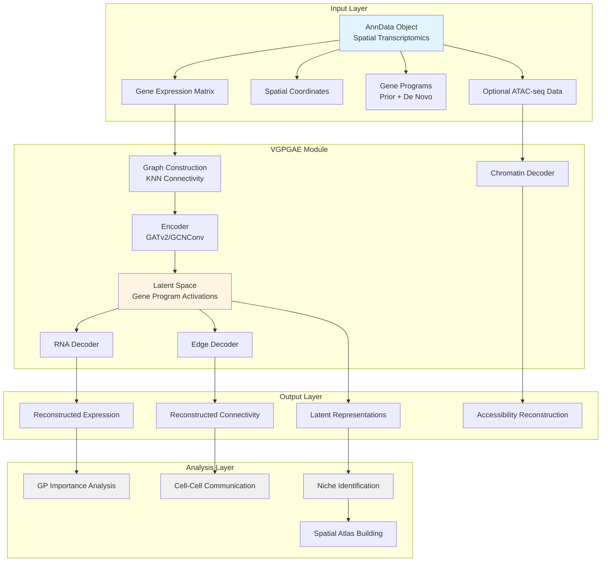

**NicheCompass** (Niche Identification based on Cellular grapH Embeddings of COMmunication Programs Aligned across Spatial Samples) is a comprehensive Python package for end-to-end analysis of spatial multi-omics data. Designed for spatial transcriptomics and spatial proteomics workflows, NicheCompass enables researchers to identify and characterize cellular niches, integrate multiple spatial samples, and perform spatial reference mapping across datasets [README.md](https://github.com/Lotfollahi-lab/nichecompass/blob/main/README.md#L11-L11).

## What is NicheCompass?

NicheCompass is a deep learning framework built on graph neural networks that leverages gene programs—coordinated sets of genes involved in specific biological processes—to understand cellular interactions in spatially resolved data. The framework combines prior knowledge from biological databases with data-driven discovery through de novo gene program extraction, enabling both interpretable and exploratory analysis of spatial tissue organization [docs/index.md](https://github.com/Lotfollahi-lab/nichecompass/blob/main/docs/index.md#L3-L4).

The core innovation is the **Variational Gene Program Graph Autoencoder (VGPGAE)**, a specialized neural architecture that learns low-dimensional latent representations of cells while simultaneously reconstructing both gene expression patterns and spatial connectivity patterns. This dual-reconstruction approach captures the complex interplay between cellular state and spatial context [src/nichecompass/modules/vgpgae.py](https://github.com/Lotfollahi-lab/nichecompass/blob/main/src/nichecompass/modules/vgpgae.py#L1-L4).

## Core Architecture

NicheCompass implements a sophisticated modular architecture designed for flexibility and scalability in spatial omics analysis.



The architecture processes spatial data through several key stages: graph construction from spatial coordinates, encoding via graph neural networks, latent representation learning through gene program activations, and dual reconstruction of both expression patterns and spatial relationships [src/nichecompass/models/nichecompass.py](https://github.com/Lotfollahi-lab/nichecompass/blob/main/src/nichecompass/models/nichecompass.py#L24-L248).

> [!TIP]
> The encoder supports both GCNConv (Graph Convolutional Network) and GATv2Conv (Graph Attention Network v2) layers, with GATv2Conv recommended for most applications as it learns attention weights that highlight the most important neighbors for each cell [docs/user_guide/index.md](https://github.com/Lotfollahi-lab/nichecompass/blob/main/docs/user_guide/index.md#L13-L13).

## Key Features and Capabilities

NicheCompass provides a comprehensive suite of tools for spatial omics analysis, ranging from basic data processing to advanced analytical capabilities.

### Spatial Analysis Workflows

The framework supports three primary analysis paradigms tailored to different experimental designs:

| Workflow Type | Description | Use Case | Tutorial |
|--------------|-------------|----------|----------|
| **Single-Sample Analysis** | Process one spatial sample independently | Initial exploration, pilot studies | [mouse_cns_single_sample.ipynb](https://github.com/Lotfollahi-lab/nichecompass/blob/main/docs/tutorials/notebooks/mouse_cns_single_sample.ipynb) |
| **Sample Integration** | Combine multiple samples into spatial atlas | Multi-slide studies, tissue atlases | [mouse_cns_sample_integration.ipynb](https://github.com/Lotfollahi-lab/nichecompass/blob/main/docs/tutorials/notebooks/mouse_cns_sample_integration.ipynb) |
| **Spatial Reference Mapping** | Map new samples to existing reference | Clinical applications, cross-study comparison | [mouse_cns_spatial_reference_mapping.ipynb](https://github.com/Lotfollahi-lab/nichecompass/blob/main/docs/tutorials/notebooks/mouse_cns_spatial_reference_mapping.ipynb) |

### Multi-Modal Support

Beyond standard RNA-based spatial transcriptomics, NicheCompass supports joint modeling of RNA and ATAC-seq (Assay for Transposase-Accessible Chromatin) data, enabling researchers to link chromatin accessibility patterns with gene expression in spatial contexts [docs/index.md](https://github.com/Lotfollahi-lab/nichecompass/blob/main/docs/index.md#L3-L4).

The multimodal tutorial provides guidance on working with paired data, which is particularly valuable for understanding regulatory mechanisms in spatial tissue organization [mouse_brain_multimodal.ipynb](https://github.com/Lotfollahi-lab/nichecompass/blob/main/docs/tutorials/notebooks/mouse_brain_multimodal.ipynb).

### Gene Program Analysis

Gene programs are the conceptual core of NicheCompass, representing coordinated gene sets that drive specific biological processes. The framework supports two types:

- **Prior Gene Programs**: Curated from biological databases (e.g., MSigDB, GO, KEGG) based on known biology
- **De Novo Gene Programs**: Discovered from the data through unsupervised learning, capturing novel patterns [src/nichecompass/utils/gene_programs.py](https://github.com/Lotfollahi-lab/nichecompass/blob/main/src/nichecompass/utils/gene_programs.py)

The package provides comprehensive tools for gene program analysis including importance scoring, differential testing, and biological interpretation [src/nichecompass/models/nichecompass.py](https://github.com/Lotfollahi-lab/nichecompass/blob/main/src/nichecompass/models/nichecompass.py#L1053-L1056).

## Project Structure

The NicheCompass codebase is organized into six main packages, each handling specific aspects of the analysis pipeline.

```
src/nichecompass/
├── data/                 # Data loading and preprocessing
│   ├── dataloaders.py    # PyTorch Geometric dataloaders
│   ├── dataprocessors.py # Data transformation utilities
│   ├── datareaders.py    # File format readers
│   └── datasets.py       # Dataset classes
├── models/               # Model definitions and training
│   ├── nichecompass.py   # Main NicheCompass model class
│   └── utils.py          # Model utilities
├── modules/              # Neural network modules
│   ├── vgpgae.py         # VGPGAE implementation
│   └── losses.py         # Loss function definitions
├── nn/                   # Neural network components
│   ├── encoders.py       # Graph encoder architectures
│   ├── decoders.py       # Graph decoder architectures
│   ├── layers.py         # Custom layer implementations
│   └── aggregators.py    # Node label aggregators
├── train/                # Training infrastructure
│   ├── trainer.py        # Training loop implementation
│   └── metrics.py        # Evaluation metrics
└── utils/                # Analysis utilities
    ├── analysis.py       # Niche characterization tools
    ├── gene_programs.py  # GP management functions
    └── multimodal_mapping.py # Cross-modal mapping
```

The data package handles AnnData integration and graph construction, the models package provides the high-level training interface, the modules package contains the core VGPGAE neural network, the nn package implements specific graph neural network components, the train package manages the training process, and the utils package provides downstream analysis capabilities [src/nichecompass/__init__.py](https://github.com/Lotfollahi-lab/nichecompass/blob/main/src/nichecompass/__init__.py#L3-L5).

## User API Overview

NicheCompass provides a streamlined user API centered around the `NicheCompass` model class, which integrates analysis capabilities directly into the model interface for ease of use [docs/api/user.md](https://github.com/Lotfollahi-lab/nichecompass/blob/main/docs/api/user.md#L31-L41).

### Core Methods

| Method | Purpose | Output |
|--------|---------|--------|
| `train()` | Train the VGPGAE model on spatial data | Trained model with latent representations |
| `get_latent_representation()` | Extract learned cell embeddings | Low-dimensional latent coordinates |
| `run_differential_gp_tests()` | Identify differentially active gene programs | Statistical test results |
| `compute_gp_gene_importances()` | Score gene importance for specific GPs | Ranked gene importance scores |
| `get_neighbor_importances()` | Analyze cell-cell communication | Neighborhood attention weights |
| `get_gp_summary()` | Get overview of all gene programs | Summary DataFrame |

The API is designed to be intuitive for users familiar with single-cell analysis tools like Scanpy, with methods following similar naming conventions and return patterns [docs/api/user.md](https://github.com/Lotfollahi-lab/nichecompass/blob/main/docs/api/user.md#L31-L41).

> [!TIP]
> All analysis results are stored directly in the AnnData object using standardized keys prefixed with `nichecompass_`, ensuring seamless integration with downstream single-cell analysis workflows and facilitating reproducible analyses [src/nichecompass/models/nichecompass.py](https://github.com/Lotfollahi-lab/nichecompass/blob/main/src/nichecompass/models/nichecompass.py#L194-L221).

## System Requirements

NicheCompass requires Python 3.10 and recommends GPU support for training, particularly for larger datasets. The package has been tested on CUDA-enabled GPUs but does not yet support Apple silicon or multi-GPU training [docs/installation.md](https://github.com/Lotfollahi-lab/nichecompass/blob/main/docs/installation.md#L3-L5).

Installation requires several external dependencies including PyTorch, PyTorch Geometric libraries, and bedtools (for ATAC-seq integration) [docs/installation.md](https://github.com/Lotfollahi-lab/nichecompass/blob/main/docs/installation.md#L25-L32).

## Documentation Structure

The NicheCompass documentation is organized into four main sections:

- **Get Started**: Installation and quick-start guides
- **Tutorials**: Step-by-step examples for different analysis workflows
- **User Guide**: Best practices and hyperparameter recommendations
- **API Reference**: Detailed documentation of all functions and classes

Each section builds upon the previous ones, providing a progressive learning path from initial installation to advanced usage [docs/index.md](https://github.com/Lotfollahi-lab/nichecompass/blob/main/docs/index.md#L6-L50).

## Getting Started with NicheCompass

To begin using NicheCompass, you should follow this recommended learning path:

1. **Install and Setup**: Configure your environment with required dependencies [Installation and Setup](3-installation-and-setup)
2. **Quick Start**: Run a simple example to understand the workflow [Quick Start](2-quick-start)
3. **Learn Architecture**: Understand the VGPGAE model and design principles [NicheCompass Model Architecture and Core Concepts](4-nichecompass-model-architecture-and-core-concepts)
4. **Explore Tutorials**: Work through hands-on examples matching your analysis needs
5. **Deep Dive**: Consult specialized documentation for specific analysis techniques

The user guide provides valuable hyperparameter recommendations based on ablation experiments, helping you optimize model performance for your specific dataset and biological question [docs/user_guide/index.md](https://github.com/Lotfollahi-lab/nichecompass/blob/main/docs/user_guide/index.md#L3-L14).

## Citation

If you find NicheCompass useful for your research, please cite the manuscript:

> Birk, S. et al. (2025). Quantitative characterization of cell niches in spatially resolved omics data. Nature Genetics. DOI: 10.1038/s41588-025-02120-6 [README.md](https://github.com/Lotfollahi-lab/nichecompass/blob/main/README.md#L20-L28)

## Contributing

NicheCompass is developed and maintained by the Lotfollahi Lab at the Wellcome Sanger Institute. The project welcomes contributions through bug reports, feature requests, and code submissions via the GitHub issues system [docs/index.md](https://github.com/Lotfollahi-lab/nichecompass/blob/main/docs/index.md#L4-L4). For detailed contribution guidelines, please refer to the contributing documentation in the repository.