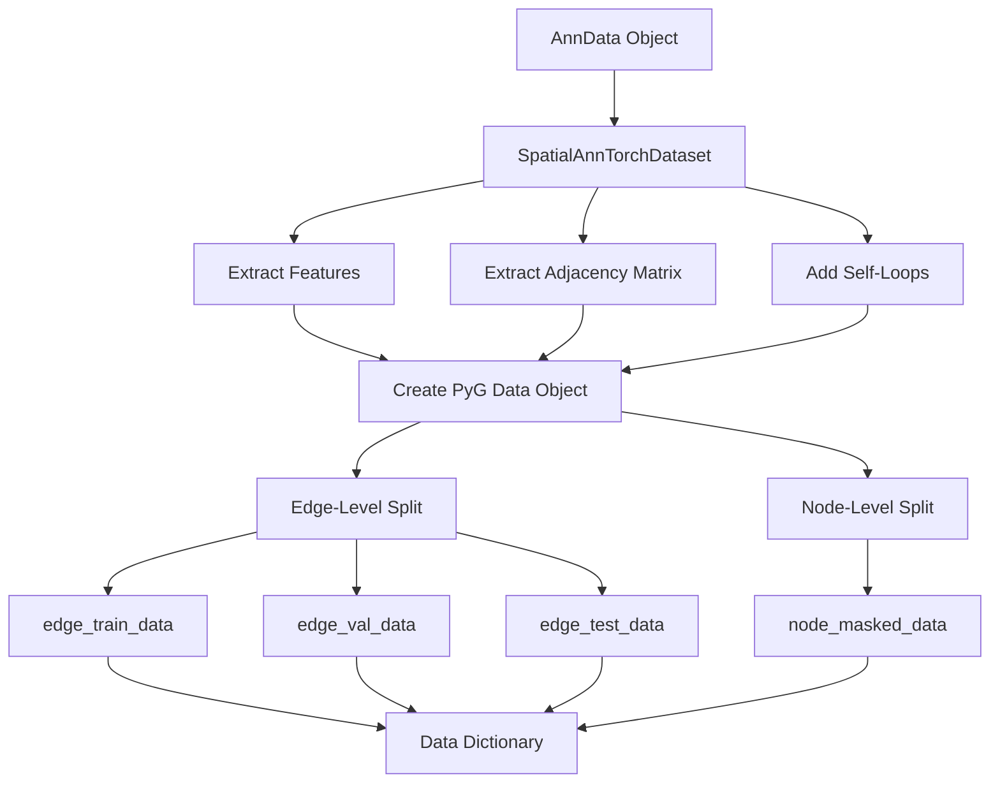

This page explains how NicheCompass constructs spatial graphs from single-cell and spatial transcriptomics data, manages neighbor connectivity relationships, and implements efficient graph data structures for training spatially-aware models. Understanding graph construction is essential for analyzing cell-cell interactions and spatial organization in biological tissues.

## Spatial Graph Fundamentals

NicheCompass models cells as nodes in a graph where edges represent spatial proximity relationships between cells. The graph structure enables the model to capture local tissue organization and learn spatially-informed representations through graph neural network operations. Spatial adjacency matrices define which cells communicate, forming the foundation for analyzing cell-cell interactions and identifying tissue microenvironments (niches).

The graph construction pipeline transforms raw spatial coordinates or predefined adjacency matrices into standardized PyTorch Geometric (PyG) data objects, ensuring compatibility with graph convolution operations and neighbor sampling strategies used during model training.

Sources: [datareaders.py](src/nichecompass/data/datareaders.py#L12-L54), [datasets.py](src/nichecompass/data/datasets.py#L16-L117)

## Graph Data Input and Loading

Spatial graphs are loaded into NicheCompass through AnnData objects, which store the adjacency matrix in the sparse matrix format within `adata.obsp`. The primary key for spatial connectivity is `"spatial_connectivities"` by default, though custom keys can be specified. The system supports loading from CSV files containing gene expression counts and adjacency matrices:

```python
# Load spatial data from CSV files
adata = load_spatial_adata_from_csv(
    counts_file_path="counts.csv",
    adj_file_path="adjacency.csv",
    cell_type_file_path="cell_types.csv",
    adj_key="spatial_connectivities"
)
```

The adjacency matrix should be symmetric and sparse, containing non-zero values for cells that are spatial neighbors. The `load_spatial_adata_from_csv` function converts the adjacency DataFrame to a compressed sparse row (CSR) format, then to coordinate (COO) format for compatibility with PyG operations. Cell type annotations are optionally loaded and stored in `adata.obs`.

Sources: [datareaders.py](src/nichecompass/data/datareaders.py#L12-L54)

## SpatialAnnTorchDataset: Graph Standardization

The `SpatialAnnTorchDataset` class serves as the core interface for converting AnnData objects into standardized PyG data structures. This class handles several critical graph construction tasks:

### Adjacency Matrix Processing

The adjacency matrix is converted from SciPy sparse format to PyTorch's sparse tensor format using the `sparse_mx_to_sparse_tensor` utility function. This conversion enables efficient GPU-accelerated operations required for graph neural networks:

```python
# Convert adjacency matrix to PyG SparseTensor
self.adj = sparse_mx_to_sparse_tensor(adata.obsp[adj_key])
```

The system validates that the adjacency matrix is symmetric, which is required for undirected spatial graphs. The edge index is extracted from the sparse tensor representation, providing the connectivity information needed for message passing.

### Self-Loop Addition for Autocrine Communication

Spatial graphs in NicheCompass include self-loops (edges connecting nodes to themselves) to model autocrine signaling—where a cell's signals affect itself. The system ensures self-loops are added correctly by first removing any existing self-loops and then adding a single self-loop per node:

```python
if self_loops:
    self.edge_index, _ = remove_self_loops(self.edge_index)
    self.edge_index, _ = add_self_loops(self.edge_index, 
                                        num_nodes=self.x.size(0))
```

This prevents duplicate self-loops and ensures consistent handling across different input graph formats.

### Edge Label Adjacency for Reconstruction

NicheCompass supports separate adjacency matrices for message passing versus edge reconstruction tasks. The `edge_label_adj_key` parameter specifies a secondary adjacency matrix used for edge reconstruction loss computation. This allows the model to use different neighbor definitions for different objectives—for example, using immediate spatial neighbors for message passing while reconstructing broader tissue neighborhood relationships.

Sources: [datasets.py](src/nichecompass/data/datasets.py#L45-L117), [utils.py](src/nichecompass/data/utils.py#L52-L74)

## Graph Construction Pipeline

The complete graph construction and data preparation pipeline is orchestrated by the `prepare_data` function, which creates training, validation, and test splits at both edge and node levels:



The PyG Data object contains:
- `x`: Node features (gene expression, optionally concatenated with ATAC features)
- `edge_index`: Edge connectivity in COO format (2 × E tensor)
- `edge_attr`: Edge attributes storing target node indices for weight retrieval

The `edge_attr` stores the transposed edge index, which enables efficient retrieval of aggregation weights during mini-batch training when only a subset of neighbors is sampled.

Sources: [dataprocessors.py](src/nichecompass/data/dataprocessors.py#L133-L221)

## Edge-Level Data Splitting

Spatial graphs are split at the edge level to enable edge reconstruction tasks, where the model learns to predict spatial connectivity patterns. The `edge_level_split` function implements this separation:

### Splitting Strategy

Edges are divided into training, validation, and test sets using `RandomLinkSplit` from PyTorch Geometric. Critical implementation details include:

- **Self-Loop Removal**: Self-loops are temporarily removed before splitting since they shouldn't be treated as edges for reconstruction
- **Edge Label Filtering**: When `edge_label_adj` is provided, only edges present in this matrix receive label=1, others receive label=0
- **Undirected Graph Handling**: The `is_undirected` parameter ensures edge pairs don't leak across splits
- **Self-Loop Restoration**: Self-loops are re-added after splitting for message passing operations

```python
# Edge-level split for edge reconstruction
edge_train_data, edge_val_data, edge_test_data = edge_level_split(
    data=data,
    edge_label_adj=dataset.edge_label_adj,
    val_ratio=edge_val_ratio,
    test_ratio=edge_test_ratio)
```

The resulting split objects contain:
- `edge_label_index`: Edges to be reconstructed
- `edge_label`: Binary labels (1 for existing edges, 0 for negative samples)
- Full node set with self-loops for message passing

Sources: [dataprocessors.py](src/nichecompass/data/dataprocessors.py#L17-L97)

## Node-Level Data Splitting

Node-level splitting creates separate training, validation, and test sets for gene expression reconstruction tasks. Unlike edge-level splits, nodes are not removed from the graph; instead, boolean masks indicate which nodes belong to each split:

- `train_mask`: Nodes used for training
- `val_mask`: Nodes used for validation  
- `test_mask`: Nodes used for testing

This approach ensures all nodes participate in message passing (preserving spatial context), but only the masked nodes' features are used for computing reconstruction loss in each split. The `node_level_split_mask` function uses `RandomNodeSplit` to create these masks with specified ratios.

Sources: [dataprocessors.py](src/nichecompass/data/dataprocessors.py#L99-L131)

## Neighbor Sampling and Mini-Batching

Efficient training on large spatial graphs requires mini-batch operations with neighbor sampling. The `initialize_dataloaders` function creates specialized PyG loaders that sample local neighborhoods for each batch:

### NeighborLoader for Node-Level Tasks

The `NeighborLoader` creates mini-batches by:
1. Selecting a batch of target nodes
2. Recursively sampling `n_direct_neighbors` for `n_hops` levels
3. Including all sampled nodes and their features in the batch
4. Preserving edge connectivity between sampled nodes

Key parameters:
- `num_neighbors`: List specifying neighbors to sample at each hop level (e.g., `[20, 10]` samples 20 direct neighbors and 10 second-hop neighbors)
- `n_hops`: Number of neighbor levels to include
- `directed=False`: Treats graph as undirected (includes symmetric edges)

```python
loader_dict["node_train_loader"] = NeighborLoader(
    node_masked_data,
    num_neighbors=[n_direct_neighbors] * n_hops,
    batch_size=node_batch_size,
    directed=False,
    shuffle=shuffle,
    input_nodes=node_masked_data.train_mask)
```

### LinkNeighborLoader for Edge-Level Tasks

Edge reconstruction uses `LinkNeighborLoader`, which samples neighborhoods around the source and target nodes of each edge in the batch. Negative edges are sampled based on `neg_edge_sampling_ratio` to provide negative examples for link prediction. The `edge_label_index` parameter limits edges to those in `edge_label_adj`, ensuring reconstruction targets match the intended spatial connectivity definition.

Sources: [dataloaders.py](src/nichecompass/data/dataloaders.py#L11-L102)

## Neighbor Importance Computation

NicheCompass can compute the importance each node assigns to its neighbors for omics reconstruction tasks. The `get_neighbor_importances` method retrieves aggregation weights from the node label aggregator:

### Aggregation Weight Extraction

When attention-based aggregation is used (`one-hop-attention` node label method), the model learns attention weights that quantify neighbor importance. The method:
1. Creates a global sparse matrix to store all aggregation weights
2. Processes the graph in batches using the trained model
3. Extracts attention coefficients (alpha) from the node label aggregator
4. For multi-head attention, computes the mean across heads
5. Maps batch-local edge indices back to global indices
6. Inserts weights into the global matrix

The resulting sparse CSR matrix has dimensions (n_obs × n_obs), where each row contains the aggregation weights for a cell's neighbors. These weights are asymmetric (A → B ≠ B → A) because they represent importance for reconstruction tasks from each node's perspective.

```python
@torch.no_grad()
def get_neighbor_importances(self, node_batch_size=None) -> sp.csr_matrix:
    agg_weights = sp.lil_matrix((len(self.adata), len(self.adata)))
    for i, node_batch in enumerate(node_loader):
        _, alpha = self.model.node_label_aggregator(
            x=node_batch.x,
            edge_index=node_batch.edge_index,
            return_agg_weights=True)
        # Process alpha and insert into agg_weights
    return agg_weights
```

> [!TIP]
> Neighbor importances provide interpretable measures of cell-cell communication strength. High weights indicate that a neighbor's gene expression is particularly important for reconstructing the target cell's omics profile, suggesting strong functional or signaling relationships in the tissue microenvironment.

Sources: [nichecompass.py](src/nichecompass/models/nichecompass.py#L1599-L1680)

## Graph Configuration Options

The following table summarizes key graph construction parameters:

| Parameter | Default | Description | Impact |
|-----------|---------|-------------|--------|
| `adj_key` | `"spatial_connectivities"` | Key for adjacency matrix in `adata.obsp` | Determines which spatial connections to use |
| `edge_label_adj_key` | `"edge_label_spatial_connectivities"` | Key for edge reconstruction adjacency | Enables separate neighbor definitions for reconstruction |
| `self_loops` | `True` | Add self-loops to adjacency matrix | Enables autocrine communication modeling |
| `n_direct_neighbors` | `-1` | Number of neighbors to sample (`-1` = all) | Controls neighborhood size in mini-batches |
| `n_hops` | `1` | Number of neighbor hops to include | Balances local vs. multi-hop context |
| `node_label_method` | `"one-hop-norm"` | Aggregation method for neighbor features | Affects how neighbor information is combined |
| `edge_val_ratio` | `0.1` | Fraction of edges for validation | Splits graph for validation of reconstruction |

Sources: [nichecompass.py](src/nichecompass/models/nichecompass.py#L189-L248), [dataloaders.py](src/nichecompass/data/dataloaders.py#L11-L102)

## Best Practices for Graph Construction

### Adjacency Matrix Quality

The quality of spatial graph construction directly impacts model performance. Key considerations include:

1. **Appropriate Neighborhood Definition**: The spatial neighborhood size should reflect the biological scale of cell-cell communication. Too small neighborhoods may miss important interactions, while overly large neighborhoods can dilute spatial specificity.
2. **Symmetry Validation**: Ensure adjacency matrices are symmetric before training. Asymmetric matrices can cause issues with undirected message passing.
3. **Sparsity**: Spatial graphs should be sparse for computational efficiency. Dense adjacency matrices can lead to excessive memory usage and slower training.

### Splitting Strategy Selection

Choose splitting ratios based on dataset size and task requirements:

- **Small datasets (< 1000 cells)**: Use lower validation ratios (0.05-0.1) to maximize training data
- **Medium datasets (1000-10000 cells)**: Standard ratios (0.1 validation) work well
- **Large datasets (> 10000 cells)**: Can use higher validation ratios (0.15-0.2) for reliable validation

For edge reconstruction, consider setting `edge_test_ratio > 0` if you plan to evaluate link prediction performance on held-out edges.

### Neighbor Sampling Configuration

The neighbor sampling parameters significantly impact training speed and model quality:

```python
# Recommended configurations by dataset size
small_dataset = {"n_direct_neighbors": -1, "n_hops": 1}  # All 1-hop neighbors
medium_dataset = {"n_direct_neighbors": 20, "n_hops": 2}  # 20 1-hop, 20 2-hop
large_dataset = {"n_direct_neighbors": 15, "n_hops": 2}  # Balance speed/quality
```

> [!TIP]
> Start with default sampling parameters and adjust based on training time vs. validation performance. If validation loss plateaus, try increasing `n_hops` to capture more multi-hop context. If training is too slow, reduce `n_direct_neighbors` while monitoring for performance degradation.

Sources: [dataprocessors.py](src/nichecompass/data/dataprocessors.py#L133-L221), [dataloaders.py](src/nichecompass/data/dataloaders.py#L11-L102)

## Integration with Model Architecture

The constructed graph integrates directly with NicheCompass's graph neural network architecture. The encoder uses graph convolution operations to aggregate information from neighbors:

1. **Encoder**: Receives node features and edge index, performs multi-layer graph convolution to compute node representations
2. **Gene Expression Decoder**: Uses neighbor information aggregated through the graph to reconstruct gene expression
3. **Edge Decoder**: Predicts edge probabilities by combining source and target node representations
4. **Node Label Aggregator**: Computes neighbor importances based on attention coefficients or simple averaging

The graph structure is fundamental to the model's ability to learn spatially-aware representations and perform tasks like niche identification and cell-cell communication analysis.

Sources: [nichecompass.py](src/nichecompass/models/nichecompass.py#L590-L619)

## Next Steps

Understanding graph construction prepares you for:

- **Data Splitting**: Learn about [Data Splitting Strategies for Training and Validation](11-data-splitting-strategies-for-training-and-validation) to optimize model evaluation
- **Model Training**: Explore [Training Process and Optimization Strategy](15-training-process-and-optimization-strategy) to see how graphs are used during training
- **Spatial Analysis**: Apply [Single-Sample Niche Identification](19-single-sample-niche-identification) using learned spatial representations
- **Parameter Tuning**: Refer to [Neighborhood Graph Size Selection](28-neighborhood-graph-size-selection) for optimizing graph parameters

For hands-on examples, see the [spatial reference mapping tutorials](/docs/tutorials/spatial_reference_mapping_tutorials.md) demonstrating graph construction on real spatial transcriptomics datasets.