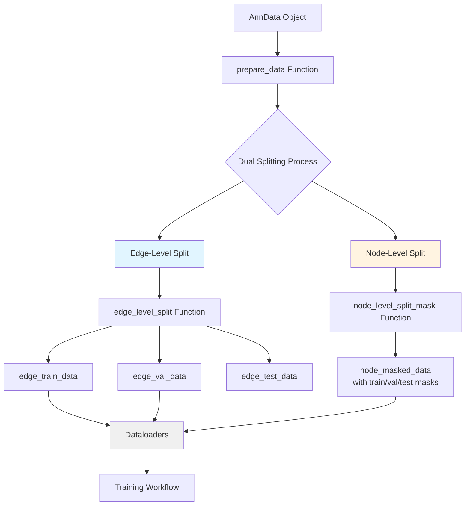
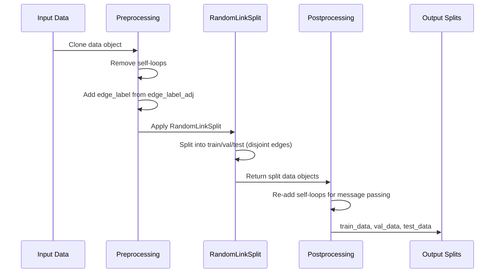
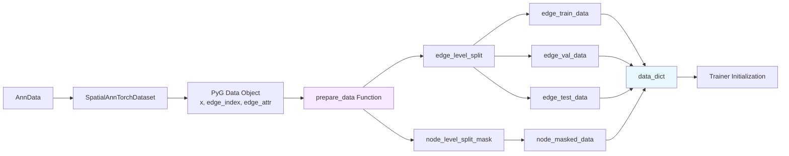

NicheCompass employs a sophisticated dual-level data splitting strategy that separates edge-level connectivity patterns from node-level feature reconstruction. This architecture enables the model to simultaneously learn spatial neighborhood relationships while preserving gene expression reconstruction capabilities, providing a robust foundation for both edge reconstruction and node reconstruction tasks.

## Dual-Level Splitting Architecture

The core innovation in NicheCompass's data splitting strategy is the separation of validation sets at two distinct levels: edge-level for spatial connectivity and node-level for gene expression reconstruction. This bifurcated approach ensures that model evaluation captures both spatial relationship learning and feature reconstruction performance independently.

The architecture implements two complementary splitting mechanisms:

1. **Edge-level splitting**: Validates the model's ability to reconstruct spatial connectivity patterns between cells
2. **Node-level splitting**: Validates the model's ability to reconstruct gene expression profiles



Sources: [trainer.py](src/nichecompass/train/trainer.py#L171-L182), [dataprocessors.py](src/nichecompass/data/dataprocessors.py#L117-L221)

## Edge-Level Splitting Strategy

Edge-level splitting is implemented through PyTorch Geometric's `RandomLinkSplit` transform, which partitions spatial adjacency edges into training, validation, and test sets. This strategy is critical for evaluating the model's capacity to learn cell-cell communication patterns and spatial relationships.

### Implementation Mechanism

The `edge_level_split` function handles the separation of edges while preserving graph connectivity for message passing:



**Key implementation details**:

- **Self-loop handling**: Self-loops are temporarily removed during splitting to prevent replication issues in `RandomLinkSplit`, then re-added post-split for autocrine signal modeling [dataprocessors.py](src/nichecompass/data/dataprocessors.py#L48-L52)
- **Edge labeling**: When `edge_label_adj` is provided, edges receive binary labels (1 for edges in `edge_label_adj`, 0 otherwise) to restrict sampling to relevant connectivity patterns [dataprocessors.py](src/nichecompass/data/dataprocessors.py#L55-L59)
- **Undirected graph assumption**: The default `is_undirected=True` parameter ensures positive and negative samples don't leak reverse edge connectivity across splits [dataprocessors.py](src/nichecompass/data/dataprocessors.py#L61-L64)
- **Negative sampling**: Controlled via `neg_sampling_ratio`, set to 0 by default as negative sampling is handled by the dataloader [dataprocessors.py](src/nichecompass/data/dataprocessors.py#L66-L73)

Sources: [dataprocessors.py](src/nichecompass/data/dataprocessors.py#L13-L83)

### Configuration Parameters

| Parameter | Type | Default | Description |
|-----------|------|---------|-------------|
| `edge_val_ratio` | float | 0.1 | Fraction of edges reserved for validation |
| `edge_test_ratio` | float | 0.0 | Fraction of edges reserved for testing |
| `is_undirected` | bool | True | Treat graph as undirected to prevent edge leakage |
| `neg_sampling_ratio` | float | 0.0 | Ratio of negative edge sampling (0 = dataloader handles) |

Sources: [trainer.py](src/nichecompass/train/trainer.py#L100-L101)

## Node-Level Splitting Strategy

Node-level splitting utilizes PyTorch Geometric's `RandomNodeSplit` transform to partition cells (nodes) into training, validation, and test sets. This approach evaluates the model's reconstruction capability for gene expression profiles and multi-modal features.

### Mask-Based Splitting

Unlike edge-level splitting which creates separate data objects, node-level splitting adds boolean masks to the original data object:

- `train_mask`: Boolean tensor marking nodes for training
- `val_mask`: Boolean tensor marking nodes for validation  
- `test_mask`: Boolean tensor marking nodes for testing

The `node_level_split_mask` function applies these masks while preserving the full graph structure, ensuring that message passing can utilize all nodes during training [dataprocessors.py](src/nichecompass/data/dataprocessors.py#L86-L114).

**Key design considerations**:

- **Unified graph structure**: All nodes remain accessible during message passing, preventing information loss from disconnected subgraphs
- **Mask-based filtering**: Training/validation logic filters nodes based on mask attributes rather than creating disjoint data objects
- **Split key flexibility**: The `split_key` parameter defaults to "x" (node features) but can target other attributes when needed

Sources: [dataprocessors.py](src/nichecompass/data/dataprocessors.py#L86-L114)

### Configuration Parameters

| Parameter | Type | Default | Description |
|-----------|------|---------|-------------|
| `node_val_ratio` | float | 0.1 | Fraction of nodes reserved for validation |
| `node_test_ratio` | float | 0.0 | Fraction of nodes reserved for testing |
| `split_key` | str | "x" | Attribute key to use for splitting logic |

Sources: [trainer.py](src/nichecompass/train/trainer.py#L101)

## Data Preparation and Integration

The `prepare_data` function orchestrates both splitting strategies, creating a unified data dictionary that feeds into the training pipeline. This function serves as the central hub for converting AnnData objects into PyG Data objects with appropriate splits.

### Data Flow Architecture



### Output Data Dictionary Structure

The `prepare_data` function returns a dictionary with four key components:

| Key | Value Type | Purpose |
|-----|------------|---------|
| `edge_train_data` | PyG Data | Training edges for reconstruction loss |
| `edge_val_data` | PyG Data | Validation edges for reconstruction evaluation |
| `edge_test_data` | PyG Data | Test edges for final model evaluation |
| `node_masked_data` | PyG Data | Node features with train/val/test masks |

Sources: [dataprocessors.py](src/nichecompass/data/dataprocessors.py#L117-L221)

### Trainer Integration

The Trainer class consumes the prepared data dictionary during initialization:

```python
# Trainer initialization extracts and splits data
data_dict = prepare_data(
    adata=adata,
    cat_covariates_label_encoders=self.model.cat_covariates_label_encoders_,
    adata_atac=adata_atac,
    counts_key=self.counts_key,
    adj_key=self.adj_key,
    cat_covariates_keys=self.cat_covariates_keys,
    edge_val_ratio=self.edge_val_ratio_,
    edge_test_ratio=0.,
    node_val_ratio=self.node_val_ratio_,
    node_test_ratio=0.)
```

After splitting, the Trainer logs statistics for transparency:

- Number of training nodes
- Number of validation nodes  
- Number of training edges
- Number of validation edges

This visibility helps users understand data distribution across splits [trainer.py](src/nichecompass/train/trainer.py#L182-L190).

Sources: [trainer.py](src/nichecompass/train/trainer.py#L171-L190)

## Dataloader Configuration

The `initialize_dataloaders` function converts split data objects into PyG dataloaders optimized for efficient mini-batch training. This step is crucial for handling large spatial transcriptomics datasets that don't fit entirely in memory.

### Edge-Level Dataloaders

**LinkNeighborLoader** is used for edge-level training and validation:

- **Batch sampling**: Samples edge indices and their neighboring node features
- **Negative sampling**: Generates non-existent edges for link prediction evaluation
- **Neighbor inclusion**: Controls how many neighbor hops to include via `n_hops` parameter
- **Directed vs undirected**: The `edges_directed` parameter controls whether symmetric edge pairs are batched together [dataloaders.py](src/nichecompass/data/dataloaders.py#L61-L72)

> [!TIP]
> The edge_label_index parameter filters edges to only those from edge_label_adj, ensuring that the dataloader samples from the intended connectivity subset rather than all possible edges.

### Node-Level Dataloaders

**NeighborLoader** handles node-level sampling for gene expression reconstruction:

- **Input nodes selection**: Uses `train_mask` or `val_mask` to specify which nodes to sample from
- **Multi-hop sampling**: The `n_hops` parameter controls neighbor inclusion depth (default=1 for direct neighbors)
- **Neighbor count control**: `n_direct_neighbors` limits sampled neighbors (-1 includes all) [dataloaders.py](src/nichecompass/data/dataloaders.py#L27-L40)

Sources: [dataloaders.py](src/nichecompass/data/dataloaders.py#L11-L102)

### Dataloader Parameters

| Parameter | Default | Description |
|-----------|---------|-------------|
| `edge_batch_size` | 64 | Number of edges per batch for reconstruction |
| `node_batch_size` | 64 | Number of nodes per batch for reconstruction |
| `n_direct_neighbors` | -1 | Number of neighbors to sample (-1 = all) |
| `n_hops` | 1 | Number of neighbor hops to include |
| `shuffle` | True | Shuffle batches each epoch |
| `neg_edge_sampling_ratio` | 1.0 | Negative sampling ratio for edges |

Sources: [dataloaders.py](src/nichecompass/data/dataloaders.py#L14-L20)

## Training Workflow Integration

The dual-level splitting strategy is tightly integrated with the training loop, where edge-level and node-level batches are processed jointly to optimize multiple loss components simultaneously.

### Joint Training Loop

The training method implements a coordinated approach:

```mermaid
flowchart LR
    A[Start Epoch] --> B{Gene Program Phase}
    B -->|< n_epochs_all_gps| C[Use All Gene Programs]
    B -->|>= n_epochs_all_gps| D[Use Only Active Gene Programs]
    C --> E[Initialize Iteration Logs]
    D --> E
    E --> F[Joint Batch Loop]
    F --> G[Edge-Level Batch<br/>Message Passing]
    F --> H[Node-Level Batch<br/>Feature Reconstruction]
    G --> I[Edge Reconstruction Loss]
    H --> J[Gene Expression Loss]
    I --> K[Combined Optimization Loss]
    J --> K
    K --> L[Backpropagation & Optimizer Step]
    L --> M{More Batches?}
    M -->|Yes| F
    M -->|No| N{Validation Available?}
    N -->|Yes| O[Run eval_epoch]
    N -->|No| P[Skip Validation]
    O --> Q[Compute Epoch Metrics]
    P --> Q
    Q --> R[Early Stopping Check]
    R --> S{Continue Training?}
    S -->|Yes| T{More Epochs?}
    S -->|No| U[Reload Best Model]
    T -->|Yes| A
    T -->|No| U
```



Sources: [trainer.py](src/nichecompass/train/trainer.py#L334-L453)

### Batch Coordination Strategy

The training loop uses `_cycle_iterable` to repeat node-level batches until edge-level batches are exhausted:

```python
for edge_train_data_batch, node_train_data_batch in zip(
        self.edge_train_loader,
        _cycle_iterable(self.node_train_loader)):
```

This design ensures:
1. **Balanced optimization**: Both edge reconstruction and gene expression reconstruction receive adequate gradient updates
2. **Memory efficiency**: Node-level batches are reused rather than oversampling
3. **Synchronized progress**: Training progresses based on edge-level iteration count [trainer.py](src/nichecompass/train/trainer.py#L347-L350)

Sources: [trainer.py](src/nichecompass/train/trainer.py#L347-L350)

### Validation Execution

Validation is conditionally executed based on split availability:

```python
if (self.edge_val_loader is not None and 
    self.node_val_loader is not None):
    self.eval_epoch()
```

Warnings are issued if only one validation set exists, as comprehensive evaluation requires both edge and node validation data [trainer.py](src/nichecompass/train/trainer.py#L428-L435).

Sources: [trainer.py](src/nichecompass/train/trainer.py#L428-L435)

## Early Stopping and Model Selection

The dual-level validation strategy supports sophisticated early stopping logic that considers both edge reconstruction performance and node reconstruction metrics.

### Early Stopping Configuration

The `EarlyStopping` class monitors validation metrics with configurable parameters:

| Parameter | Default | Description |
|-----------|---------|-------------|
| `early_stopping_metric` | "val_global_loss" | Metric to monitor for early stopping |
| `metric_improvement_threshold` | 0.0 | Minimum improvement to count as progress |
| `patience` | 8 | Epochs to wait without improvement before stopping |
| `reduce_lr_on_plateau` | True | Reduce learning rate when plateau occurs |
| `lr_patience` | 4 | Epochs to wait before reducing learning rate |
| `lr_factor` | 0.1 | Multiplicative factor for learning rate reduction |

Sources: [utils.py](src/nichecompass/train/utils.py#L39-L46)

### Metric Selection Logic

The Trainer automatically selects the appropriate early stopping metric based on validation availability:

```python
if edge_val_ratio > 0 and node_val_ratio > 0:
    self.early_stopping_kwargs_["early_stopping_metric"] = "val_global_loss"
else:
    self.early_stopping_kwargs_["early_stopping_metric"] = "train_global_loss"
```

This ensures robust monitoring when both splits are available, with fallback to training metrics when validation is limited [trainer.py](src/nichecompass/train/trainer.py#L121-L126).

Sources: [trainer.py](src/nichecompass/train/trainer.py#L121-L126)

## Best Practices and Considerations

### Split Ratio Selection

Choosing appropriate validation ratios requires balancing representativeness with training data sufficiency:

| Scenario | Recommended `edge_val_ratio` | Recommended `node_val_ratio` |
|----------|-------------------------------|------------------------------|
| Small datasets (<1000 cells) | 0.05-0.1 | 0.05-0.1 |
| Medium datasets (1000-10000 cells) | 0.1-0.15 | 0.1-0.15 |
| Large datasets (>10000 cells) | 0.1-0.2 | 0.1-0.2 |

> [!TIP]
> For spatial transcriptomics datasets with heterogeneous cell type distributions, consider using stratified splitting to ensure representative validation sets across cell types and spatial regions.

### Batch Size Computation

The Trainer can automatically determine node batch size based on edge batch size and dataset characteristics:

```python
if self.node_batch_size_ is None:
    self.node_batch_size_ = int(self.edge_batch_size_ / math.floor(
        self.n_edges_train / self.n_nodes_train))
```

This heuristic ensures balanced computational load between edge and node processing [trainer.py](src/nichecompass/train/trainer.py#L192-L194).

Sources: [trainer.py](src/nichecompass/train/trainer.py#L192-L194)

### Common Pitfalls and Solutions

| Issue | Cause | Solution |
|-------|-------|----------|
| Asymmetric adjacency matrix | Incorrect graph construction | Validate symmetry before training: `adj == adj.T` |
| Self-loop replication | RandomLinkSplit bug with self-loops | Ensure temporary self-loop removal during splitting |
| Edge label leakage | Incorrect `is_undirected` setting | Keep `is_undirected=True` for spatial graphs |
| Insufficient validation data | High val_ratio on small datasets | Reduce ratios or implement cross-validation |

Sources: [dataprocessors.py](src/nichecompass/data/dataprocessors.py#L43-L46), [datasets.py](src/nichecompass/data/datasets.py#L68-L70)

### Advanced Configuration

For specialized use cases, consider these advanced strategies:

1. **Custom edge labels**: Use `edge_label_adj_key` to specify custom connectivity for edge reconstruction tasks
2. **Neighbor sampling optimization**: Adjust `n_direct_neighbors` and `n_hops` based on graph density and memory constraints
3. **Negative sampling tuning**: Increase `neg_edge_sampling_ratio` for more challenging link prediction tasks

Sources: [datasets.py](src/nichecompass/data/datasets.py#L50-L51), [dataloaders.py](src/nichecompass/data/dataloaders.py#L16-L17)

## Next Steps

Understanding data splitting strategies is essential for effective model training. To deepen your understanding of the complete training pipeline:

- **Training Process**: Learn about the full training optimization strategy in [Training Process and Optimization Strategy](15-training-process-and-optimization-strategy)
- **Loss Functions**: Explore how edge and node reconstruction losses are computed in [Loss Functions and Optimization Objectives](8-loss-functions-and-optimization-objectives)
- **Model Architecture**: Understand the neural network components that process these split data in [Encoder Design and Graph Convolution Strategies](6-encoder-design-and-graph-convolution-strategies)