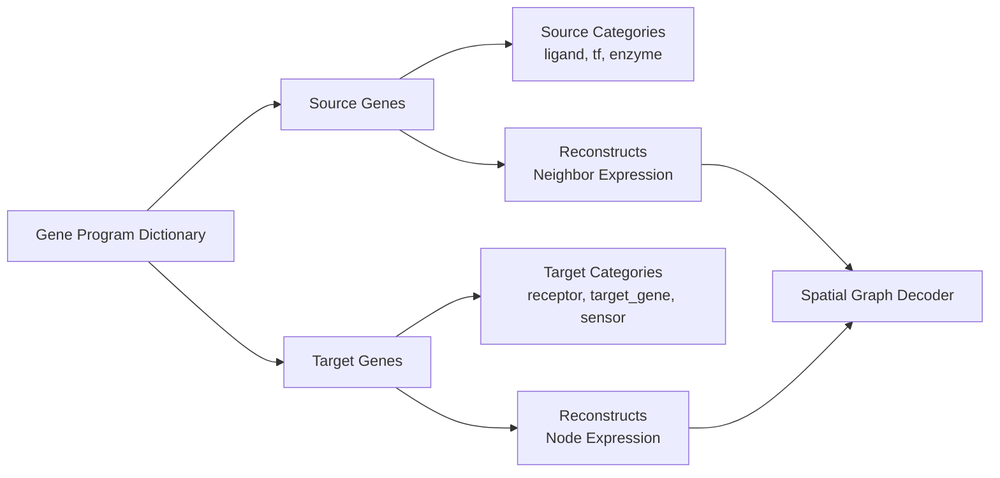
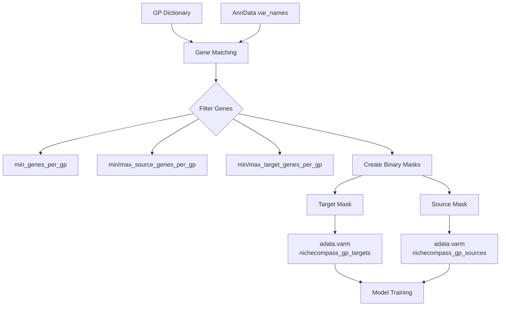
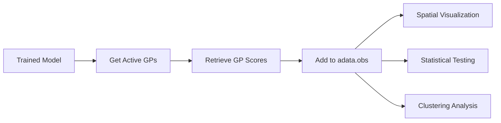

This page explains how NicheCompass leverages prior biological knowledge through gene programs (GPs) to provide biologically interpretable latent representations. Gene programs are structured collections of genes that work together to perform specific cellular functions or participate in biological processes like cell-cell communication. NicheCompass integrates these programs from multiple curated databases, enabling the model to learn interpretable representations grounded in established biological knowledge.

## Gene Program Structure and Architecture

Gene programs in NicheCompass follow a structured architecture that distinguishes between **source genes** (transmitting entities like ligands or transcription factors) and **target genes** (receiving entities like receptors or downstream targets). This directional structure is fundamental to modeling intercellular communication and regulatory relationships.

Each gene program is represented as a nested dictionary containing:
- `sources`: List of genes that transmit signals or regulatory information
- `targets`: List of genes that receive signals or are regulated
- `sources_categories`: Categorical labels for source genes (e.g., "ligand", "tf", "enzyme")
- `targets_categories`: Categorical labels for target genes (e.g., "receptor", "target_gene", "sensor")

This structure enables the model to reconstruct gene expression for both the receiving node (target genes) and neighboring transmitting nodes (source genes), capturing bidirectional aspects of biological interactions.

When gene programs are integrated into AnnData objects, they are converted to **binary masks** that indicate which genes belong to each program [gene_programs.py#L18-L121](src/nichecompass/utils/gene_programs.py#L18-L121). These masks are stored in `adata.varm` with keys for targets and sources, enabling efficient matrix operations during model training.

## Prior Knowledge Gene Program Sources

NicheCompass provides utilities to extract gene programs from multiple curated biological databases, each capturing different aspects of cellular communication and regulation.

### CollecTRI Transcription Factor Networks

CollecTRI provides comprehensive transcription factor (TF) target gene networks compiled from 12 different resources, offering superior coverage and performance compared to DoRothEA. The `extract_gp_dict_from_collectri_tf_network()` function retrieves 1072 mouse or 1186 human TF target gene programs [gene_programs.py#L286-L356](src/nichecompass/utils/gene_programs.py#L286-L356).

Structure of CollecTRI programs:
- **Sources**: Empty (TFs are placed in targets for regulatory modeling)
- **Targets**: TF gene + all target genes
- **Categories**: TF labeled as "tf", targets labeled as "target_gene"

This design allows the model to learn regulatory relationships where TFs drive expression changes in their target genes.

| Database | Programs (Mouse) | Programs (Human) | Primary Use Case |
|----------|------------------|------------------|------------------|
| CollecTRI | 1,072 | 1,186 | Transcriptional regulation |
| NicheNet v2 | 1,287 | 1,226 | Ligand-receptor signaling |
| OmniPath | ~724 | ~724 | Curated ligand-receptor pairs |
| MEBOCOST | 115 | 116 | Metabolite-mediated communication |

### NicheNet Ligand-Receptor-Target Networks

NicheNet provides ligand-receptor networks coupled with ligand target gene regulatory potential scores. The `extract_gp_dict_from_nichenet_lrt_interactions()` function extracts comprehensive signaling programs [gene_programs.py#L359-L599](src/nichecompass/utils/gene_programs.py#L359-L599).

Key parameters:
- `version`: Choose between v1 (requires ortholog mapping for mouse) or v2 (species-specific)
- `keep_target_genes_ratio`: Fraction of target genes to retain based on regulatory potential
- `max_n_target_genes_per_gp`: Maximum target genes per ligand (default: 250, following MultiNicheNet)

Structure of NicheNet programs:
- **Sources**: Ligand gene
- **Targets**: Receptor gene + top target genes ranked by regulatory potential
- **Categories**: Ligand labeled as "ligand", receptor as "receptor", targets as "target_gene"

This captures the complete signaling cascade from ligand binding to downstream transcriptional changes.

### OmniPath Curated Ligand-Receptor Interactions

OmniPath aggregates intercellular communication data from multiple resources with curation effort annotations. The `extract_gp_dict_from_omnipath_lr_interactions()` function retrieves high-confidence ligand-receptor pairs [gene_programs.py#L600-L764](src/nichecompass/utils/gene_programs.py#L600-L764).

Key parameters:
- `min_curation_effort`: Minimum number of literature/database mentions required (default: 2)
- **Sources**: Ligand gene
- **Targets**: Receptor gene
- **Categories**: "ligand" and "receptor"

For mouse data, human interactions are automatically mapped to mouse orthologs using Ensembl BioMart annotations.

### MEBOCOST Metabolite-Enzyme-Sensor Networks

MEBOCOST models metabolite-mediated communication using enzyme and sensor gene expression as proxies for metabolite presence. The `extract_gp_dict_from_mebocost_ms_interactions()` function retrieves 115 mouse or 116 human metabolite programs [gene_programs.py#L765-L877](src/nichecompass/utils/gene_programs.py#L765-L877).

These programs are included in the NicheCompass package under `data/gene_programs/metabolite_enzyme_sensor_gps/`:
- `human_metabolite_enzymes.tsv`
- `human_metabolite_sensors.tsv`
- `mouse_metabolite_enzymes.tsv`
- `mouse_metabolite_sensors.tsv`

Structure of MEBOCOST programs:
- **Sources**: Enzyme genes (for metabolite production)
- **Targets**: Sensor genes (metabolite detectors)
- **Categories**: "enzyme" and "sensor"

> [!TIP]
> Metabolite programs are particularly valuable for studying metabolic niches in tissue microenvironments, where local metabolite gradients can significantly influence cell behavior. The enzyme-sensor framework provides a transcriptomic proxy for metabolite activity without requiring direct metabolite measurements.

## Gene Program Integration with AnnData

Gene programs must be integrated into AnnData objects before model training. The `add_gps_from_gp_dict_to_adata()` function performs this integration with comprehensive filtering and alignment capabilities [gene_programs.py#L18-L285](src/nichecompass/utils/gene_programs.py#L18-L285).

Key integration parameters:

| Parameter | Default | Purpose |
|-----------|---------|---------|
| `min_genes_per_gp` | 1 | Minimum total genes (sources + targets) required |
| `min_source_genes_per_gp` | 0 | Minimum source genes required |
| `min_target_genes_per_gp` | 0 | Minimum target genes required |
| `max_genes_per_gp` | None | Maximum total genes allowed |
| `filter_genes_not_in_masks` | False | Remove genes not in any GP from adata |
| `add_fc_gps_instead_of_gp_dict_gps` | False | Create fully-connected GPs (ablation studies) |

The function also handles gene name case sensitivity (`genes_uppercase`) and can visualize gene count distributions (`plot_gp_gene_count_distributions`) to assess program quality before training.

## Gene Program Filtering and Combination

To reduce redundancy and improve model interpretability, gene programs can be filtered and combined using the `filter_and_combine_gp_dict_gps()` function [gene_programs.py#L880-L1087](src/nichecompass/utils/gene_programs.py#L880-L1087).

### Filtering Modes

Two filtering strategies are available:

1. **Subset filtering**: Removes gene programs that are subsets of other programs
   - Useful for eliminating overly specific programs contained within broader programs
   - Retains the most comprehensive programs

2. **Superset filtering**: Removes gene programs that are supersets of other programs
   - Useful for eliminating overly broad programs that obscure specific pathways
   - Retains the most specific programs

### Overlap Combination

Overlapping gene programs can be combined based on configurable thresholds:

| Parameter | Default | Purpose |
|-----------|---------|---------|
| `overlap_thresh_source_genes` | 1.0 | Minimum source gene overlap ratio (0-1) |
| `overlap_thresh_target_genes` | 1.0 | Minimum target gene overlap ratio (0-1) |
| `overlap_thresh_genes` | 1.0 | Minimum total gene overlap ratio (0-1) |

When programs exceed all thresholds, they are combined into a new program with:
- Combined source genes
- Combined target genes
- Merged categories from both programs
- Naming convention: `_GP` suffix after joining component names

The algorithm handles cross-overlaps (where GP A overlaps GP B, GP B overlaps GP C, but A and C don't overlap) through iterative sequential combination until convergence [gene_programs.py#L1030-L1051](src/nichecompass/utils/gene_programs.py#L1030-L1051).

## Active Gene Program Identification

After training, NicheCompass identifies **active gene programs**—those that contribute meaningfully to reconstructing the data. The `get_active_gp_mask()` method in the VGPGAE module determines activity based on aggregated gene weights [vgpgae.py#L1204-L1334](src/nichecompass/modules/vgpgae.py#L1204-L1334).

### Weight Aggregation Modes

Multiple aggregation strategies are supported:

| Mode | Description | Bias |
|------|-------------|------|
| `sum` | Sum of absolute weights | Favors programs with many genes |
| `nzmeans` | Mean of non-zero absolute weights | Normalizes for gene count |
| `nzmedians` | Median of non-zero absolute weights | Robust to outliers |
| `sum+nzmeans` | Combination of sum and mean | Balanced approach |
| `sum+nzmedians` | Combination of sum and median | Balanced, robust approach |

### Activity Threshold

A gene program is considered active if its aggregated weight exceeds `active_gp_thresh_ratio` (default: 0.01-0.03) times the maximum aggregated weight across all programs [nichecompass.py#L1235-L1262](src/nichecompass/models/nichecompass.py#L1235-L1262). This threshold:
- Excludes noise-dominated programs
- Adapts to the data distribution
- Balances sensitivity and specificity

> [!TIP]
> The `sum+nzmeans` aggregation mode is recommended for most analyses as it balances the influence of large programs (sum) with the strength of individual gene connections (mean of non-zero weights), preventing large but weak programs from overshadowing small but highly specific programs.

## Biological Interpretation Methods

NicheCompass provides comprehensive tools for interpreting the biological meaning of learned gene programs and their activity across cells.

### Gene and Peak Importance Analysis

**Gene importance analysis** (`compute_gp_gene_importances()`) quantifies the contribution of each gene to a specific program's activity [nichecompass.py#L1053-L1105](src/nichecompass/models/nichecompass.py#L1053-L1105). The function:

1. Retrieves normalized weights from RNA decoders
2. Computes importance as the fraction of absolute gene weight contribution
3. Returns a DataFrame with:
   - Gene name
   - Gene entity (source/target)
   - Gene weight (raw)
   - Gene importance (normalized)

For multi-modal models, **peak importance analysis** (`compute_gp_peak_importances()`) provides analogous information for chromatin accessibility peaks [nichecompass.py#L1107-L1164](src/nichecompass/models/nichecompass.py#L1107-L1164), linking programs to regulatory regions.

### Gene Program Summary

The `get_gp_summary()` method provides a comprehensive overview of all gene programs and their status after training [nichecompass.py#L1689-L1870](src/nichecompass/models/nichecompass.py#L1689-L1870). The returned DataFrame includes:

| Column | Description |
|--------|-------------|
| `gp_name` | Gene program identifier |
| `all_gp_idx` | Index in full GP list |
| `gp_active` | Boolean active status |
| `active_gp_idx` | Index among active GPs |
| `n_source_genes` | Total source genes in GP |
| `n_non_zero_source_genes` | Source genes with non-zero weights |
| `n_target_genes` | Total target genes in GP |
| `n_non_zero_target_genes` | Target genes with non-zero weights |
| `gp_source_genes` | List of source genes sorted by importance |
| `gp_target_genes` | List of target genes sorted by importance |
| `gp_source_genes_weights` | Sorted source gene weights |
| `gp_target_genes_weights` | Sorted target gene weights |
| `gp_source_genes_importances` | Sorted source gene importances |
| `gp_target_genes_importances` | Sorted target gene importances |

For multi-modal analyses with ATAC-seq data, peak information is also included with analogous columns.

### Active GP Scores in Observations

The `add_active_gp_scores_to_obs()` method adds the expression/activity scores of all active gene programs directly to `adata.obs` for convenient visualization and downstream analysis [nichecompass.py#L1968-L1987](src/nichecompass/models/nichecompass.py#L1968-L1987). This enables:
- Spatial visualization of program activity
- Correlation with cell type annotations
- Differential activity analysis across conditions

## Best Practices for Gene Program Analysis

### Gene Program Selection

- **Start with comprehensive collections**: Use CollecTRI + NicheNet for broad coverage of transcriptional regulation and signaling
- **Add specialized programs as needed**: Include MEBOCOST metabolite programs for metabolic tissue studies
- **Filter strategically**: Use subset filtering to eliminate redundancy, but keep biologically distinct programs even if they overlap
- **Validate with marker genes**: Confirm that known marker genes appear in expected programs

### Parameter Tuning

- **Activity threshold**: Start with `active_gp_thresh_ratio=0.01-0.03`; increase if too many programs are active, decrease if too few
- **Aggregation mode**: Use `sum+nzmeans` for balanced interpretation, switch to `nzmeans` if comparing programs of vastly different sizes
- **Overlap thresholds**: Keep high thresholds (≥0.9) when combining to avoid merging biologically distinct pathways

### Interpretation Workflow

1. **Examine GP summary**: Review which programs are active and their gene composition
2. **Check gene importances**: Verify top genes match known biology of the pathway
3. **Visualize spatial patterns**: Use `add_active_gp_scores_to_obs()` for spatial plots
4. **Test differential activity**: Use `run_differential_gp_tests()` to find condition-specific programs
5. **Cross-reference with cell types**: Correlate GP activity with cell type annotations

## Integration with Model Training

Gene programs are seamlessly integrated into the VGPGAE architecture through source and target masks that guide reconstruction [vgpgae.py#L146-L190](src/nichecompass/modules/vgpgae.py#L146-L190). During training:
- Gene program weights are learned in the decoder layers
- Source masks enable neighbor expression reconstruction
- Target masks enable self-expression reconstruction
- Activity is monitored through weight aggregation

The training process supports **addon gene programs** (`n_addon_gp`)—unconstrained programs that can capture novel biology not in prior knowledge sources, allowing the model to discover new pathways while maintaining interpretability [nichecompass.py#L232-L243](src/nichecompass/models/nichecompass.py#L232-L243).

For detailed information on training with gene programs, see the [Training Process and Optimization Strategy](15-training-process-and-optimization-strategy) documentation.

## Next Steps

Now that you understand prior knowledge gene programs and biological interpretation, explore these related topics:

- [Gene Program Extraction from External Databases](13-gene-program-extraction-from-external-databases) - Learn more about extracting custom gene programs
- [Gene Program Filtering and Combination Methods](14-gene-program-filtering-and-combination-methods) - Advanced techniques for program refinement
- [Differential Gene Program Testing](23-differential-gene-program-testing) - Statistical analysis of program activity
- [Latent Representation Extraction and Visualization](22-latent-representation-extraction-and-visualization) - Visualizing program-based embeddings