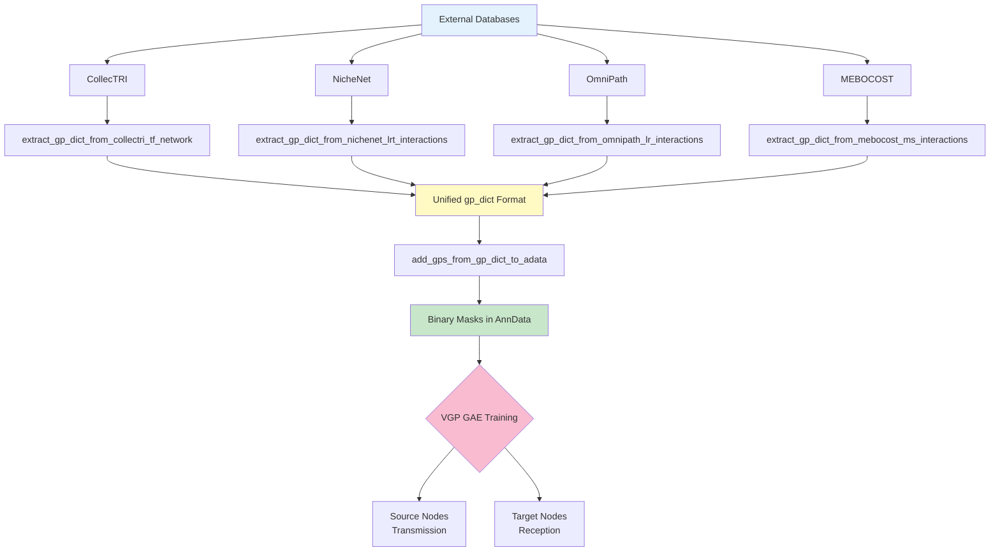
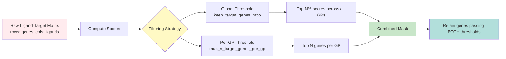
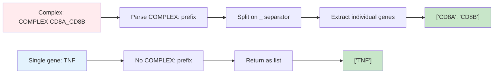
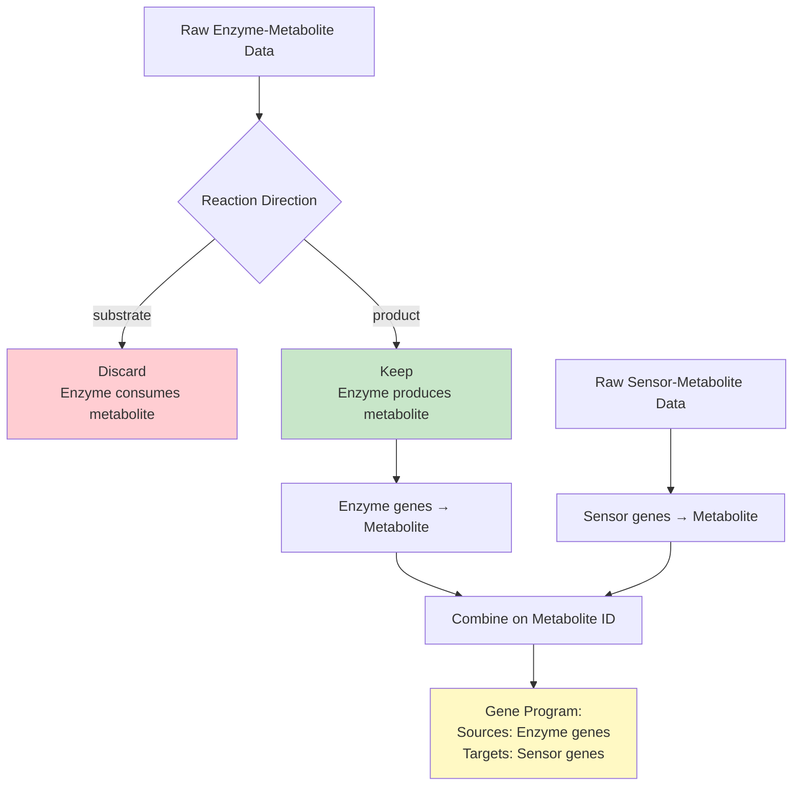
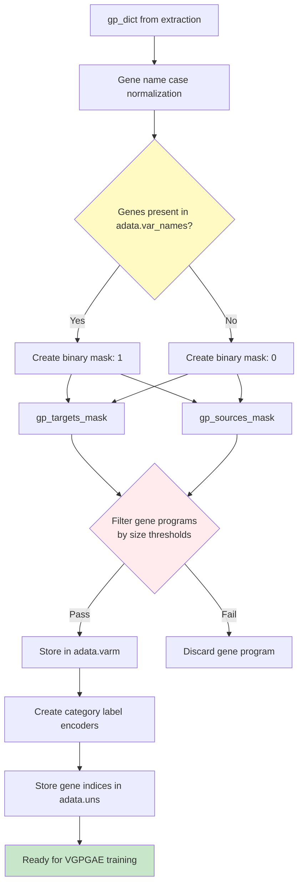

This page documents the architecture and implementation of gene program extraction from external biological databases within NicheCompass. Gene programs serve as prior knowledge representations that guide the model in learning biologically interpretable spatial communication patterns, encoding relationships between regulatory molecules (sources) and their target genes (targets).

The extraction framework provides a unified interface to retrieve curated gene programs from multiple complementary databases, each capturing different aspects of intercellular communication and transcriptional regulation. These programs are integrated into AnnData objects as binary masks, enabling the VGPGAE architecture to leverage prior biological knowledge during spatial transcriptomics analysis.

## Gene Program Architecture Overview

Gene programs in NicheCompass follow a structured dictionary format that encodes directional biological relationships. Each program contains **sources** (regulatory molecules like transcription factors, ligands, or enzymes) and **targets** (genes whose expression is modulated by these sources), along with categorical labels for each gene type.



The unified gene program dictionary structure provides consistent representation across all extraction methods:

| Field | Description | Example Values |
|-------|-------------|----------------|
| `sources` | List of regulatory molecule names | `["TNF", "IL6"]` |
| `targets` | List of target gene names | `["CXCL8", "CCL2", "IL1B"]` |
| `sources_categories` | Category labels for each source | `["ligand", "ligand"]` |
| `targets_categories` | Category labels for each target | `["receptor", "target_gene", "target_gene"]` |

## Supported External Databases

NicheCompass integrates four primary biological databases, each capturing distinct regulatory mechanisms:

| Database | Gene Program Type | Coverage | Species Support | Primary Use Case |
|----------|-------------------|----------|-----------------|------------------|
| **CollecTRI** | Transcription factor → target genes | 1072 mouse, 1186 human GPs | Mouse, Human | Intracellular transcriptional regulation |
| **NicheNet** | Ligand → receptor + target genes | ~1287 mouse, ~1226 human GPs | Mouse, Human | Intercellular signaling with downstream effects |
| **OmniPath** | Ligand → receptor interactions | 724 human GPs | Human (mapped to mouse) | High-confidence ligand-receptor pairs |
| **MEBOCOST** | Metabolite enzymes → sensors | 115 mouse, 116 human GPs | Mouse, Human | Metabolite-mediated cell communication |

Sources: [gene_programs.py](src/nichecompass/utils/gene_programs.py#L286-L356)

## Transcription Factor Networks: CollecTRI

CollecTRI provides comprehensive transcription factor (TF) regulons compiled from 12 different resources, offering superior TF coverage and perturbation identification performance compared to DoRothEA. The extraction process retrieves TF-target gene relationships and structures them as gene programs where the TF serves as both source and target.

**Extraction Process:**

```mermaid
flowchart TD
    A[decoupler.op.collectri] --> B[TF Network DataFrame<br/>source, target columns]
    B --> C[Group by source TF]
    C --> D[Aggregate target genes]
    D --> E[Create GP per TF<br/>sources: [], targets: TF + genes]
    E --> F[Assign categories<br/>sources_categories: [], targets_categories: TF + target_gene]
    F --> G[Optional distribution plots]
    
    style A fill:#bbdefb
    style B fill:#e1bee7
    style E fill:#fff9c4
    style G fill:#c8e6c9
```

**Implementation:**

```python
from nichecompass.utils import extract_gp_dict_from_collectri_tf_network

# Extract TF gene programs for mouse
tf_gp_dict = extract_gp_dict_from_collectri_tf_network(
    species="mouse",
    tf_network_file_path="collectri_tf_network.csv",
    load_from_disk=False,
    save_to_disk=False,
    plot_gp_gene_count_distributions=True
)

# Result structure:
# {
#     "TF_NAME_TF_target_genes_GP": {
#         "sources": [],
#         "targets": ["TF_NAME", "target_gene1", "target_gene2", ...],
#         "sources_categories": [],
#         "targets_categories": ["tf", "target_gene", "target_gene", ...]
#     },
#     ...
# }
```

Sources: [gene_programs.py](src/nichecompass/utils/gene_programs.py#L286-L356)

**Key Features:**
- Automatic retrieval via decoupler library or loading from disk
- Each TF creates one gene program
- TF is included in both source and target positions for bidirectional influence
- Configurable distribution plotting for quality assessment

> [!TIP]
> The TF gene programs include the transcription factor itself in the targets list, enabling self-regulatory modeling. This design choice allows the VGPGAE architecture to capture both autocrine and paracrine signaling effects within the same gene program structure.

## Signaling Networks: NicheNet

NicheNet provides sophisticated ligand-receptor target gene predictions based on regulatory potential scores derived from gene regulatory network priors. The extraction process retrieves both the ligand-receptor network and the ligand-target matrix, filtering target genes based on confidence thresholds.

**Version Selection:**

| Version | Data Separation | Files | Recommended For |
|---------|----------------|-------|-----------------|
| v1 | Human only (mouse mapped) | Single pair of RDS files | Legacy compatibility |
| v2 | Separate mouse/human files | Species-specific RDS files | Production use (improved accuracy) |

Sources: [gene_programs.py](src/nichecompass/utils/gene_programs.py#L359-L597)

**Dual Filtering Strategy:**



**Implementation:**

```python
from nichecompass.utils import extract_gp_dict_from_nichenet_lrt_interactions

# Extract NicheNet gene programs for mouse
nichenet_gp_dict = extract_gp_dict_from_nichenet_lrt_interactions(
    species="mouse",
    version="v2",  # Use v2 for species-specific files
    keep_target_genes_ratio=1.0,  # Keep all genes by default
    max_n_target_genes_per_gp=250,  # Max targets per ligand (MultiNicheNet standard)
    load_from_disk=False,
    save_to_disk=True,  # Cache for faster reload
    lr_network_file_path="nichenet_lr_network.csv",
    ligand_target_matrix_file_path="nichenet_ligand_target_matrix.csv",
    plot_gp_gene_count_distributions=True
)

# Result structure:
# {
#     "LIGAND_NAME_ligand_receptor_target_gene_GP": {
#         "sources": ["LIGAND_NAME"],
#         "targets": ["receptor1", "receptor2", "target_gene1", "target_gene2", ...],
#         "sources_categories": ["ligand"],
#         "targets_categories": ["receptor", "receptor", "target_gene", "target_gene", ...]
#     },
#     ...
# }
```

Sources: [gene_programs.py](src/nichecompass/utils/gene_programs.py#L359-L597)

**Ortholog Mapping (v1 only):**

When using version v1 with mouse species, human genes are automatically mapped to mouse orthologs using Ensembl BioMart mappings. The implementation handles one-to-many ortholog relationships by creating multiple entries per human gene.

## Ligand-Receptor Interactions: OmniPath

OmniPath provides high-confidence ligand-receptor interactions aggregated from multiple databases, with curation effort scores indicating the evidence level for each interaction. The extraction process filters interactions based on minimum curation effort and resolves protein complexes into individual genes.

**Curation Effort Levels:**

| Curation Effort | Evidence Level | Typical Interactions Retained |
|-----------------|----------------|------------------------------|
| 1 | Low evidence | Maximum (~1000+ interactions) |
| 2 | Medium evidence | Moderate (~700 interactions) |
| 3+ | High evidence | High confidence (~400 interactions) |

Sources: [gene_programs.py](src/nichecompass/utils/gene_programs.py#L600-L762)

**Protein Complex Resolution:**



**Implementation:**

```python
from nichecompass.utils import extract_gp_dict_from_omnipath_lr_interactions

# Extract OmniPath gene programs for human
omnipath_gp_dict = extract_gp_dict_from_omnipath_lr_interactions(
    species="human",
    min_curation_effort=2,  # Require at least medium evidence
    load_from_disk=False,
    save_to_disk=True,
    lr_network_file_path="omnipath_lr_network.csv",
    gene_orthologs_mapping_file_path="human_mouse_gene_orthologs.csv",
    plot_gp_gene_count_distributions=True
)

# Result structure:
# {
#     "LIGAND_NAME_ligand_receptor_GP": {
#         "sources": ["LIGAND_NAME"],  # May include multiple if from complex
#         "targets": ["receptor1", "receptor2", ...],
#         "sources_categories": ["ligand"],
#         "targets_categories": ["receptor", "receptor", ...]
#     },
#     ...
# }
```

Sources: [gene_programs.py](src/nichecompass/utils/gene_programs.py#L600-L762)

**Species Mapping:**

For mouse species, human interactions are automatically mapped to mouse orthologs using the provided gene orthologs mapping file. The mapping uses one-to-many ortholog relationships when available.

> [!TIP]
> OmniPath's curation effort threshold provides a powerful quality control mechanism. For most applications, a minimum curation effort of 2 balances coverage and reliability well, ensuring only interactions with substantial literature/database support are retained.

## Metabolite Communication: MEBOCOST

MEBOCOST provides curated metabolite-sensor interactions derived from the Human Metabolome Database (HMDB), using enzyme expression as a proxy for metabolite presence. This captures a distinct mode of intercellular communication through small molecule signaling.

**Data Structure:**

The MEBOCOST data comes packaged with NicheCompass under `data/gene_programs/metabolite_enzyme_sensor_gps/`:

```
metabolite_enzyme_sensor_gps/
├── human_metabolite_enzymes.tsv    # Enzyme-reaction mappings
├── human_metabolite_sensors.tsv     # Metabolite-sensor mappings
├── mouse_metabolite_enzymes.tsv
└── mouse_metabolite_sensors.tsv
```

Sources: [gene_programs.py](src/nichecompass/utils/gene_programs.py#L765-L877)

**Direction Filtering:**



**Implementation:**

```python
from nichecompass.utils import extract_gp_dict_from_mebocost_ms_interactions

# Extract MEBOCOST gene programs for human
mebocost_gp_dict = extract_gp_dict_from_mebocost_ms_interactions(
    species="human",
    dir_path="../data/gene_programs/metabolite_enzyme_sensor_gps",
    plot_gp_gene_count_distributions=True
)

# Result structure:
# {
#     "METABOLITE_NAME_metabolite_enzyme_sensor_GP": {
#         "sources": ["enzyme1", "enzyme2", ...],
#         "targets": ["sensor1", "sensor2", ...],
#         "sources_categories": ["enzyme", "enzyme", ...],
#         "targets_categories": ["sensor", "sensor", ...]
#     },
#     ...
# }
```

Sources: [gene_programs.py](src/nichecompass/utils/gene_programs.py#L765-L877)

**Key Processing Steps:**
1. Filter enzymes to retain only those where metabolite is a product (not substrate)
2. Parse multi-gene enzyme complexes (separated by "; ")
3. Aggregate enzymes and sensors per metabolite
4. Join enzymes and sensors on metabolite HMDB_ID
5. Create gene program per metabolite with enzymes as sources, sensors as targets

## Integration with AnnData Objects

Once gene programs are extracted from external databases, they must be integrated into AnnData objects as binary masks for use in model training. The `add_gps_from_gp_dict_to_adata()` function handles this integration with comprehensive filtering and alignment capabilities.

Sources: [gene_programs.py](src/nichecompass/utils/gene_programs.py#L18-L285)

**Integration Pipeline:**



**Gene Filtering Parameters:**

| Parameter | Description | Typical Values |
|-----------|-------------|----------------|
| `min_genes_per_gp` | Minimum total genes (sources + targets) | 1-10 |
| `min_source_genes_per_gp` | Minimum source genes | 0-5 |
| `min_target_genes_per_gp` | Minimum target genes | 0-10 |
| `max_genes_per_gp` | Maximum total genes | None or 500 |
| `max_source_genes_per_gp` | Maximum source genes | None or 100 |
| `max_target_genes_per_gp` | Maximum target genes | None or 500 |

**Implementation:**

```python
from nichecompass.utils import add_gps_from_gp_dict_to_adata

# Integrate gene programs into AnnData object
add_gps_from_gp_dict_to_adata(
    gp_dict=nichenet_gp_dict,  # From NicheNet extraction
    adata=adata,
    genes_uppercase=True,  # Ensure case matching
    
    # Storage keys
    gp_targets_mask_key="nichecompass_gp_targets",
    gp_sources_mask_key="nichecompass_gp_sources",
    gp_names_key="nichecompass_gp_names",
    
    # Filtering thresholds
    min_genes_per_gp=2,
    min_source_genes_per_gp=1,
    min_target_genes_per_gp=1,
    max_target_genes_per_gp=250,
    
    # Optional: filter genes not in any GP
    filter_genes_not_in_masks=False,
    plot_gp_gene_count_distributions=True
)

# Access stored information:
print(adata.uns["nichecompass_gp_names"])  # List of GP names
print(adata.varm["nichecompass_gp_targets"].shape)  # (n_genes, n_gps)
print(adata.uns["nichecompass_targets_categories_label_encoder"])  # Category mappings
```

Sources: [gene_programs.py](src/nichecompass/utils/gene_programs.py#L18-L285)

**Stored Data Structures:**

After integration, the AnnData object contains:

| Key | Location | Shape/Format | Purpose |
|-----|----------|--------------|---------|
| `nichecompass_gp_targets` | `adata.varm` | (n_genes, n_gps) binary mask | Target gene membership per GP |
| `nichecompass_gp_sources` | `adata.varm` | (n_genes, n_gps) binary mask | Source gene membership per GP |
| `nichecompass_gp_targets_categories` | `adata.varm` | (n_genes, n_gps) integer mask | Target gene category IDs |
| `nichecompass_gp_sources_categories` | `adata.varm` | (n_genes, n_gps) integer mask | Source gene category IDs |
| `nichecompass_gp_names` | `adata.uns` | (n_gps,) array | Gene program names |
| `nichecompass_targets_categories_label_encoder` | `adata.uns` | dict | Category name → ID mapping |
| `nichecompass_sources_categories_label_encoder` | `adata.uns` | dict | Category name → ID mapping |

## Practical Workflow Example

Here's a complete workflow combining multiple databases for comprehensive signaling coverage:

```python
from nichecompass.utils import (
    extract_gp_dict_from_nichenet_lrt_interactions,
    extract_gp_dict_from_omnipath_lr_interactions,
    extract_gp_dict_from_mebocost_ms_interactions,
    filter_and_combine_gp_dict_gps_v2,
    add_gps_from_gp_dict_to_adata
)

# Step 1: Extract from multiple databases
print("Extracting gene programs from external databases...")

nichenet_gps = extract_gp_dict_from_nichenet_lrt_interactions(
    species="mouse", version="v2", save_to_disk=True
)

omnipath_gps = extract_gp_dict_from_omnipath_lr_interactions(
    species="mouse", min_curation_effort=2, save_to_disk=True
)

mebocost_gps = extract_gp_dict_from_mebocost_ms_interactions(
    species="mouse"
)

# Step 2: Filter and combine gene programs
print("Filtering and combining gene programs...")

# Combine with overlap filtering to remove duplicates
combined_gps = filter_and_combine_gp_dict_gps_v2(
    gp_dicts=[nichenet_gps, omnipath_gps, mebocost_gps],
    overlap_thresh_target_genes=1.0,  # Require 100% target overlap to merge
    verbose=True
)

# Step 3: Add to AnnData
print("Integrating gene programs into AnnData...")

add_gps_from_gp_dict_to_adata(
    gp_dict=combined_gps,
    adata=adata,
    min_genes_per_gp=2,
    min_target_genes_per_gp=1,
    plot_gp_gene_count_distributions=True
)

print(f"Integrated {len(adata.uns['nichecompass_gp_names'])} gene programs")
print(f"Covering {adata.uns['nichecompass_target_genes_idx'].size} target genes")
```

Sources: [mouse_cns_single_sample.ipynb](docs/tutorials/notebooks/mouse_cns_single_sample.ipynb#L1-L150)

## Summary and Next Steps

The gene program extraction framework provides a flexible, extensible architecture for integrating prior biological knowledge from multiple databases into NicheCompass models. Each database contributes unique regulatory context:

- **CollecTRI** for intracellular transcriptional regulation
- **NicheNet** for comprehensive signaling with downstream effects
- **OmniPath** for high-confidence ligand-receptor interactions
- **MEBOCOST** for metabolite-mediated communication

After extracting and integrating gene programs, you should proceed to:

**Next Steps:**
- [Gene Program Filtering and Combination Methods](14-gene-program-filtering-and-combination-methods) - Learn advanced filtering strategies for removing redundant or low-quality gene programs
- [Prior Knowledge Gene Programs and Biological Interpretation](12-prior-knowledge-gene-programs-and-biological-interpretation) - Understand how these programs enable biological interpretability in model outputs
- [Variational Gene Program Graph Autoencoder (VGPGAE)](5-variational-gene-program-graph-autoencoder-vgpgae) - See how gene programs are used in the core model architecture

The gene program extraction system forms the foundation for biologically-informed spatial analysis, enabling NicheCompass to learn interpretable representations that reflect known cellular communication mechanisms.