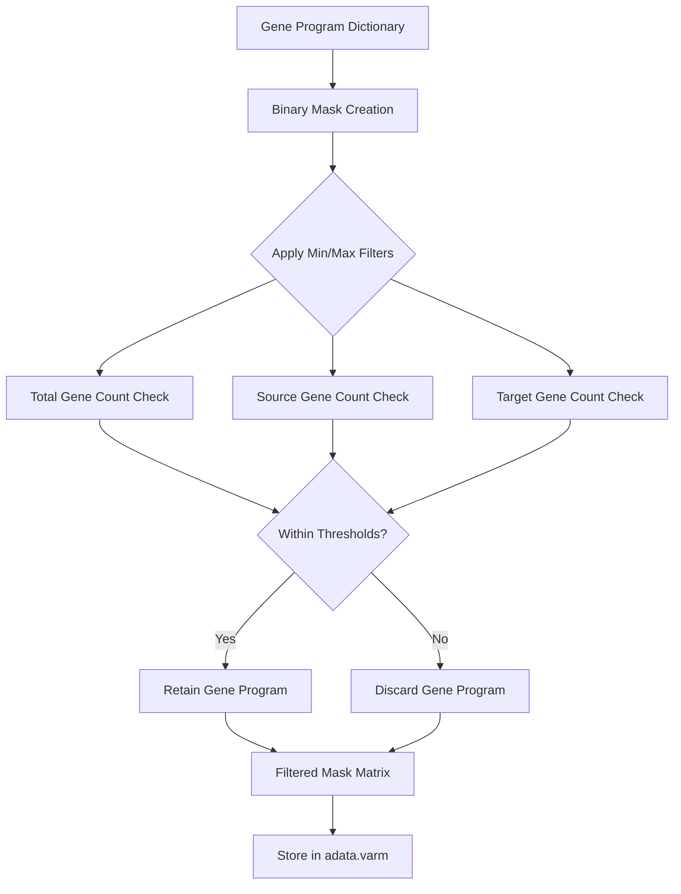
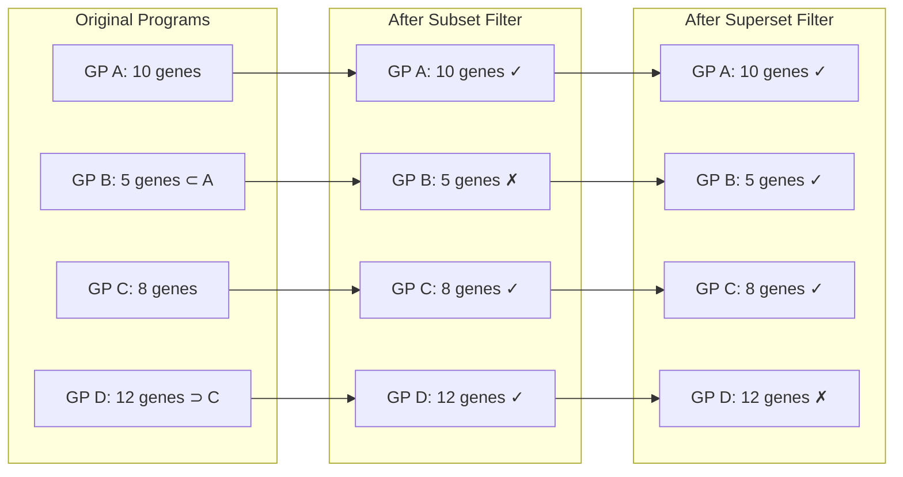
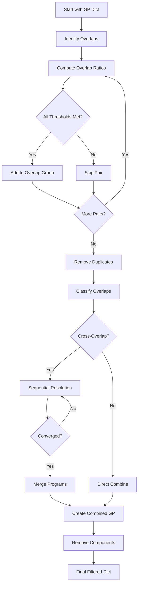
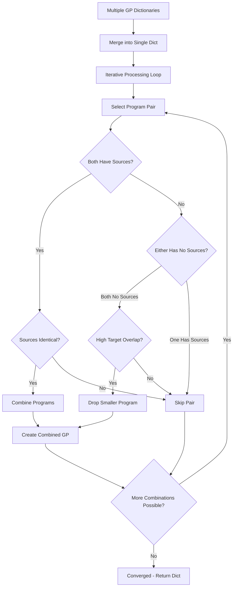

Gene programs extracted from external databases often require filtering to meet data quality requirements and combination to resolve redundancies or integrate multiple sources. This page explores the sophisticated filtering and combination strategies implemented in NicheCompass to optimize gene program dictionaries for downstream analysis.

## Filtering Gene Programs During AnnData Integration

When adding gene programs to an AnnData object, NicheCompass applies comprehensive filtering based on gene count thresholds to ensure biological relevance and computational efficiency. The filtering occurs during the gene program mask creation process, where programs falling outside specified ranges are automatically excluded.

The filtering mechanism supports both **minimum** and **maximum** thresholds for three gene categories: total genes (combined sources and targets), source genes alone, and target genes alone. This multi-dimensional filtering allows precise control over gene program characteristics based on your specific experimental requirements and computational constraints.

**Filtering Architecture**:


**Filtering Parameters**:

| Parameter | Purpose | Default | Application Level |
|-----------|---------|---------|-------------------|
| `min_genes_per_gp` | Minimum total genes (sources + targets) | 1 | Per gene program |
| `min_source_genes_per_gp` | Minimum source genes | 0 | Per gene program |
| `min_target_genes_per_gp` | Minimum target genes | 0 | Per gene program |
| `max_genes_per_gp` | Maximum total genes | None | Per gene program |
| `max_source_genes_per_gp` | Maximum source genes | None | Per gene program |
| `max_target_genes_per_gp` | Maximum target genes | None | Per gene program |

The filtering implementation computes boolean masks by summing gene presence across programs, then applies threshold comparisons to create filter vectors. Programs failing any threshold condition are removed from all mask matrices simultaneously, ensuring consistency across sources, targets, and their respective categories.
Sources: [gene_programs.py](src/nichecompass/utils/gene_programs.py#L234-L250)

> [!TIP]
> The `filter_genes_not_in_masks` parameter provides an additional optimization: when enabled, it removes genes from the AnnData object that don't appear in any gene program mask. This dramatically reduces matrix dimensions but should only be used when analysis is exclusively focused on annotated pathways.

## Subset and Superset Filtering

Within a single gene program dictionary, programs often exhibit hierarchical relationships where one program is entirely contained within another. NicheCompass provides two complementary filtering modes to handle such redundancy: subset filtering removes smaller programs that are subsets of larger ones, while superset filtering removes larger programs that encompass smaller ones.

**Subset vs Superset Filtering Strategy**:


The subset/superset detection examines both source and target gene sets independently. A program is only considered a subset or superset if both its source genes AND target genes satisfy the set relationship condition. This dual requirement ensures that functional relationships between source and target genes are preserved during filtering.

**Implementation Details**:

The filtering algorithm performs pairwise comparisons between all gene programs in the dictionary. For each comparison, it checks:
- Source gene set subset/superset relationship using `issubset()` or `issuperset()` methods
- Target gene set subset/superset relationship using the same methods
- Both conditions must be satisfied simultaneously for removal

When `gp_filter_mode="subset"`, the algorithm removes programs where both source and target genes are complete subsets of another program. Conversely, `gp_filter_mode="superset"` removes programs where both gene sets are complete supersets. The verbose mode logs each removal decision, enabling audit trails of the filtering process.
Sources: [gene_programs.py](src/nichecompass/utils/gene_programs.py#L936-L961)

## Overlap-Based Gene Program Combination

Redundant gene programs often share substantial gene overlap without being complete subsets or supersets. NicheCompass implements a sophisticated overlap-based combination strategy that merges programs exceeding configurable overlap thresholds, creating consolidated programs with unified gene sets and preserved categorical information.

**Overlap Calculation Methodology**:

The overlap algorithm computes three distinct overlap ratios for each program pair:
1. **Source gene overlap ratio**: proportion of shared source genes relative to the average source gene count of both programs
2. **Target gene overlap ratio**: proportion of shared target genes relative to the average target gene count
3. **Combined gene overlap ratio**: proportion of shared total genes relative to the average total gene count

The overlap ratios use the average gene count as the denominator to ensure symmetry—programs A and B are compared using the same metric regardless of which serves as the reference. This prevents bias toward smaller or larger programs during combination decisions.
Sources: [gene_programs.py](src/nichecompass/utils/gene_programs.py#L989-L1004)

**Combination Process Flow**:


**Overlap Resolution Strategies**:

The algorithm distinguishes between two types of overlap scenarios:

1. **No-cross overlaps**: Disjoint overlap groups where each program belongs to only one overlap set. These are combined directly by creating a new program with the union of source genes, union of target genes, and aggregated category information.

2. **Cross overlaps**: Complex scenarios where overlap groups intersect (e.g., program A overlaps with B, and B overlaps with C, but A doesn't overlap with C). These require sequential resolution where overlapping groups are iteratively merged until convergence is reached.
Sources: [gene_programs.py](src/nichecompass/utils/gene_programs.py#L1019-L1050)

**Combined Program Naming Convention**:

When programs are combined, the new program name is constructed by concatenating the base names of component programs (removing the "_GP" suffix) and appending "_GP". For example, combining "IL6_GP" and "STAT3_GP" creates "IL6_STAT3_GP". This naming convention preserves the biological context of the original programs while indicating their combined nature.
Sources: [gene_programs.py](src/nichecompass/utils/gene_programs.py#L1060)

**Overlap Threshold Configuration**:

| Threshold Parameter | Range | Effect | Recommended Use |
|--------------------|-------|--------|-----------------|
| `overlap_thresh_source_genes` | 0.0-1.0 | Minimum source gene overlap | Higher for strict ligand-specific analysis |
| `overlap_thresh_target_genes` | 0.0-1.0 | Minimum target gene overlap | Lower to capture pathway convergence |
| `overlap_thresh_genes` | 0.0-1.0 | Minimum combined gene overlap | Balances both dimensions |

Setting all three thresholds to 1.0 requires exact gene set matching (effectively only combining identical programs). Lowering thresholds increases combination aggressiveness, useful for consolidating highly redundant pathways. The default of 1.0 for all thresholds ensures only exact duplicates are combined unless explicitly configured otherwise.
Sources: [gene_programs.py](src/nichecompass/utils/gene_programs.py#L883-L886)

> [!TIP]
> Category information is preserved during combination by aggregating source and target categories from all component programs. When a gene appears in multiple categories across combined programs, only the first occurrence is retained, preventing duplicate gene entries while maintaining category diversity.

## Multi-Dictionary Integration and Filtering (Version 2)

When working with multiple gene program dictionaries from different sources (e.g., combining NicheNet and OmniPath programs), a more sophisticated approach is required. The `filter_and_combine_gp_dict_gps_v2` function implements a two-stage process: first merging dictionaries, then applying overlap-based filtering with specific rules for programs with and without source genes.

**Dictionary Integration Strategy**:

The v2 algorithm begins by concatenating all input dictionaries into a single combined dictionary. It then applies an iterative combination process that continues until convergence—each pass through the dictionary identifies combinable program pairs, merges them, and repeats until no further combinations are possible.
Sources: [gene_programs.py](src/nichecompass/utils/gene_programs.py#L1119-L1131)

**Program Classification Rules**:

The algorithm classifies programs into three categories with distinct handling rules:

| Program Type | Characteristic | Combination Rule | Dropping Rule |
|--------------|----------------|------------------|---------------|
| **With source genes** | Non-empty source list | Combine if sources are identical | Never dropped |
| **Without source genes** | Empty source list | Never combined | Dropped if highly overlapping targets |
| **Mixed** | Different source genes | Never combined | Never dropped |

**Combination Logic**:

When two programs have exactly the same source genes (and those sources are not empty), they are combined regardless of target gene overlap. The new program inherits the shared source genes and the union of target genes, with category information aggregated. The naming convention uses the base name of the first program with a "_combined_GP" suffix.
Sources: [gene_programs.py](src/nichecompass/utils/gene_programs.py#L1150-L1177)

**Dropping Logic for Source-Less Programs**:

Programs without source genes are candidates for dropping when their target genes overlap substantially with another program. The algorithm computes the overlap ratio as the proportion of the smaller program's target genes that appear in the larger program. If this ratio exceeds `overlap_thresh_target_genes`, the smaller program is dropped. This strategy preserves the most comprehensive program while eliminating redundant variants.
Sources: [gene_programs.py](src/nichecompass/utils/gene_programs.py#L1179-L1195)

**Multi-Dictionary Processing Flow**:


**Version Comparison**:

| Feature | v1 (`filter_and_combine_gp_dict_gps`) | v2 (`filter_and_combine_gp_dict_gps_v2`) |
|---------|--------------------------------------|------------------------------------------|
| Input | Single dictionary | List of dictionaries |
| Subset/superset filtering | Yes | No |
| Overlap combination | Yes (3 thresholds) | Limited (target-only) |
| Source gene handling | Combined via overlap | Combined only if identical |
| Convergence check | Single pass | Iterative until stable |
| Category preservation | Yes | Yes |

> [!TIP]
> Use v2 when integrating multiple databases with different conventions (e.g., NicheNet's rich source-target relationships combined with simpler annotation databases). Use v1 for refining a single dictionary through hierarchical filtering and aggressive overlap consolidation.

## Practical Application Examples

**Example 1: NicheNet Program Filtering**

When extracting NicheNet ligand-receptor programs, apply target gene limits during extraction:

```python
# Extract with default MultiNicheNet limits (250 target genes per GP)
gp_dict = extract_gp_dict_from_nichenet_lrt_interactions(
    species="mouse",
    version="v2",
    max_n_target_genes_per_gp=250
)

# Add to AnnData with additional size filtering
add_gps_from_gp_dict_to_adata(
    gp_dict=gp_dict,
    adata=adata,
    min_target_genes_per_gp=10,
    max_target_genes_per_gp=200
)
```

This two-stage filtering ensures programs are biologically meaningful during extraction and computationally appropriate during integration.
Sources: [gene_programs.py](src/nichecompass/utils/gene_programs.py#L362-L409)

**Example 2: Combining Multiple Databases**

Integrate NicheNet and OmniPath programs while managing redundancy:

```python
# Extract from multiple sources
nichenet_gps = extract_gp_dict_from_nichenet_lrt_interactions(species="human")
omnipath_gps = extract_gp_dict_from_omnipath_lr_interactions(species="human")

# Combine with v2 algorithm
combined_gps = filter_and_combine_gp_dict_gps_v2(
    gp_dicts=[nichenet_gps, omnipath_gps],
    overlap_thresh_target_genes=0.8,
    verbose=True
)

# Apply further refinement
refined_gps = filter_and_combine_gp_dict_gps(
    gp_dict=combined_gps,
    gp_filter_mode="subset",
    combine_overlap_gps=True,
    overlap_thresh_source_genes=0.5,
    overlap_thresh_target_genes=0.5,
    overlap_thresh_genes=0.5
)
```

This sequence first merges databases while preserving programs with different sources, then applies hierarchical filtering and moderate overlap consolidation within the merged set.
Sources: [gene_programs.py](src/nichecompass/utils/gene_programs.py#L880-L1086), [gene_programs.py](src/nichecompass/utils/gene_programs.py#L1089-L1197)

## Next Steps

After filtering and combining gene programs, explore how these refined programs are integrated into the NicheCompass model architecture:

- **[Prior Knowledge Gene Programs and Biological Interpretation](12-prior-knowledge-gene-programs-and-biological-interpretation)** - Learn how filtered gene programs encode biological prior knowledge in the model
- **[Gene Program Extraction from External Databases](13-gene-program-extraction-from-external-databases)** - Explore the extraction processes that precede filtering
- **[Training Process and Optimization Strategy](15-training-process-and-optimization-strategy)** - Understand how filtered programs influence model training dynamics

For practical implementation details, refer to the complete API documentation in the [developer resources](api/developer.md).