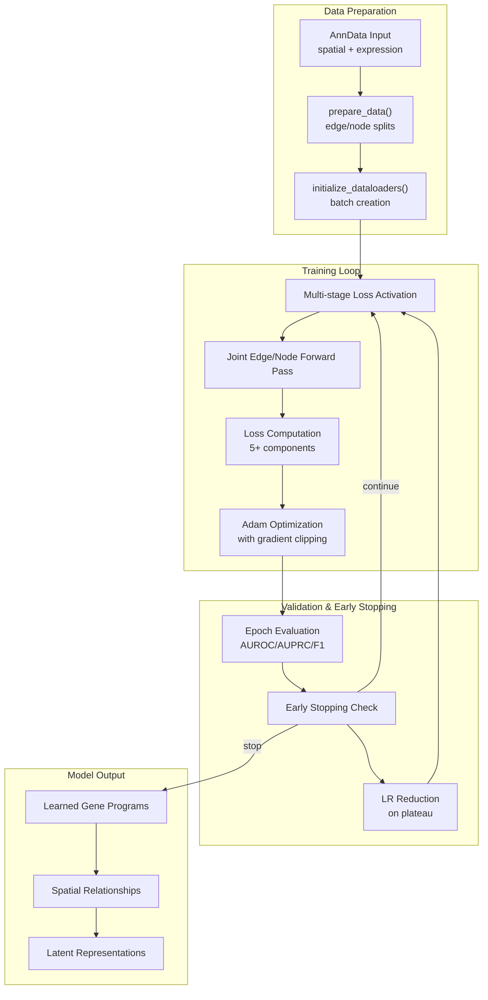
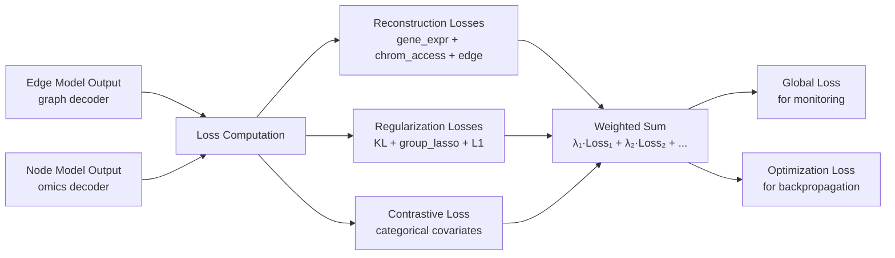
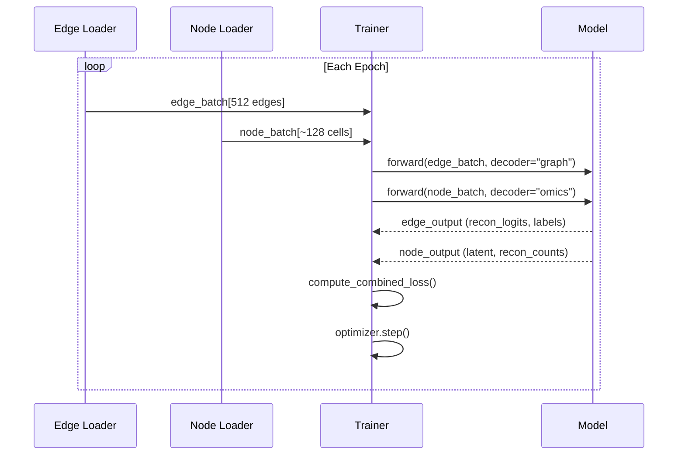

The training process in NicheCompass implements a sophisticated multi-stage optimization strategy that progressively activates different loss components to stabilize learning and improve model convergence. This architecture leverages joint edge-level and node-level training with adaptive regularization to learn biologically interpretable gene programs while preserving spatial relationships.

## Training Architecture Overview

The training infrastructure consists of three core components working in concert: the Trainer class orchestrates the entire training pipeline, the VGPGAE module implements the model and loss computation, and utility classes provide optimization stability mechanisms. The Trainer class encapsulates all training preparation and execution logic, handling data splitting, dataloader initialization, and the complete training lifecycle [trainer.py#L28-L90](src/nichecompass/train/trainer.py#L28-L90).



## Multi-Stage Training Strategy

NicheCompass employs a progressive training strategy where different loss components are activated at different epochs to stabilize learning and improve convergence. This approach addresses the challenge of simultaneously learning spatial relationships, gene program activation, and omics reconstruction [trainer.py#L344-L356](src/nichecompass/train/trainer.py#L344-L356).

### Training Phases

The training process divides into distinct phases controlled by three epoch parameters:

**Phase 1: Decoder Pretraining (0 to `n_epochs_no_edge_recon`)**
- Edge reconstruction loss deactivated
- Focuses on learning basic gene expression and chromatin accessibility patterns
- Allows decoders to establish baseline reconstruction capabilities before spatial constraints

**Phase 2: Full Gene Program Training (0 to `n_epochs_all_gps`)**
- All gene programs (both prior knowledge and learned) participate in training
- Model explores the full program space before selecting the most biologically relevant programs
- Critical for discovering novel gene programs beyond prior knowledge

**Phase 3: Active Program Refinement (after `n_epochs_all_gps`)**
- Only active gene programs (those meeting activation thresholds) continue training
- Reduces model complexity and focuses computation on the most informative programs
- Improves interpretability by eliminating noise from inactive programs

**Phase 4: Categorical Contrastive Learning (after `n_epochs_no_cat_covariates_contrastive`)**
- Categorical covariates contrastive loss activated
- Enforces separation of cell types or conditions in latent space
- Particularly useful for batch correction and cell type discrimination

> [!TIP]
> The default configuration typically sets `n_epochs_all_gps=25` and `n_epochs_no_edge_recon=0`, meaning edge reconstruction starts immediately but gene program selection occurs after 25 epochs. For large datasets (>50k cells), consider increasing `n_epochs_all_gps` to 50-100 to allow more thorough exploration.

## Loss Function Architecture

The loss function combines multiple weighted components to balance different optimization objectives. Each component serves a specific biological or computational purpose, with lambda parameters controlling their relative importance [trainer.py#L236-L306](src/nichecompass/train/trainer.py#L236-L306).

### Core Loss Components

| Loss Component | Purpose | Default Lambda | Biological Role |
|----------------|---------|----------------|-----------------|
| **Gene Expression Reconstruction** | Reconstruct RNA expression from latent space | 300 | Ensures gene programs linearly combine to explain observed expression |
| **Chromatin Accessibility Reconstruction** | Reconstruct ATAC-seq peaks from latent space | 100 | Links gene programs to regulatory element accessibility |
| **Edge Reconstruction** | Preserve spatial neighborhood relationships | 500,000 | Forces gene programs to capture spatial colocalization patterns |
| **Categorical Contrastive** | Separate different cell types/batches in latent space | 0 (optional) | Prevents batch effects, improves cell type discrimination |
| **KL Divergence** | Regularize variational distribution toward prior | 1 (implicit) | Enforces probabilistic consistency in latent space |
| **Group Lasso** | Sparsify gene program assignments | 0 (optional) | Encourages cells to use fewer, more interpretable programs |
| **L1 Masked** | Sparsify gene membership within programs | 0 (optional) | Forces each gene program to focus on relevant genes |
| **L1 Addon** | Sparsify learned (non-prior) gene programs | 30 | Prevents overfitting of learned programs to noise |

The categorical covariates contrastive loss implements a sophisticated sampling strategy. It identifies node pairs from different categories and uses their edge reconstruction logits to determine positive and negative contrastive examples [losses.py#L15-L64](src/nichecompass/modules/losses.py#L15-L64). The top `contrastive_logits_pos_ratio × 100%` of logits between different categories become positive examples (forcing similar latent representations), while the bottom `contrastive_logits_neg_ratio × 100%` become negative examples (forcing separation).

### Loss Computation Flow



## Optimization Configuration

### Optimizer and Learning Rate

NicheCompass uses the Adam optimizer with configurable learning rate and weight decay parameters [trainer.py#L340-L342](src/nichecompass/train/trainer.py#L340-L342):

```python
optimizer = torch.optim.Adam(
    params,
    lr=0.001,           # Default learning rate
    weight_decay=0.0    # L2 regularization
)
```

The default learning rate of 0.001 works well for most datasets, but adjustments may be necessary:
- **Smaller datasets (<10k cells)**: Increase to 0.005-0.01 for faster convergence
- **Large datasets (>100k cells)**: Decrease to 0.0001-0.0005 for stability
- **Multi-modal data (RNA+ATAC)**: Use 0.0005 to prevent dominance by one modality

### Gradient Clipping

Gradient clipping prevents exploding gradients during training, particularly important when edge reconstruction loss has large weight values [trainer.py#L418-L420](src/nichecompass/train/trainer.py#L418-L420):

```python
if self.grad_clip_value_ > 0:
    torch.nn.utils.clip_grad_value_(
        self.model.parameters(),
        self.grad_clip_value_
    )
```

Set `grad_clip_value` to 1.0-10.0 when using large `lambda_edge_recon` values (>100,000) or observing unstable training.

## Joint Edge-Level and Node-Level Training

A key innovation in NicheCompass is the joint training strategy that simultaneously processes edge-level and node-level batches [trainer.py#L364-L421](src/nichecompass/train/trainer.py#L364-L421). This approach ensures the model learns both spatial relationships (edges) and omics reconstruction (nodes) in a coherent manner.

### Batch Processing Architecture

The training loop iterates through edge batches while cycling through node batches, ensuring every edge batch has a corresponding node batch:



**Key Implementation Details:**
- Edge batch size typically set to 256-512 [trainer.py#L102](src/nichecompass/train/trainer.py#L102)
- Node batch size automatically calculated if not specified: `edge_batch_size / floor(n_edges_train / n_nodes_train)` [trainer.py#L194-L196](src/nichecompass/train/trainer.py#L194-L196)
- Node batches cycle repeatedly to match edge batches, preventing memory leaks from `itertools.cycle` [trainer.py#L364-L368](src/nichecompass/train/trainer.py#L364-L368)

> [!TIP]
> When training with very large spatial graphs (>500k edges), reduce `edge_batch_size` to 128-256 and increase `n_epochs` proportionally. This maintains gradient quality while keeping memory usage manageable.

## Validation and Evaluation

### Validation Strategy

NicheCompass implements comprehensive validation using separate edge-level and node-level splits [trainer.py#L424-L434](src/nichecompass/train/trainer.py#L424-L434):

- **Edge validation**: 10% of spatial connections held out by default (`edge_val_ratio=0.1`)
- **Node validation**: 10% of cells held out (`node_val_ratio=0.1`)
- **Validation loss computed** with `edge_recon_active=True` regardless of training phase [trainer.py#L538](src/nichecompass/train/trainer.py#L538)

### Evaluation Metrics

The framework computes multiple binary classification metrics on edge reconstruction [trainer.py#L574-L588](src/nichecompass/train/trainer.py#L574-L588):

| Metric | Description | Use Case |
|--------|-------------|----------|
| **AUROC** | Area Under ROC Curve | Overall edge reconstruction quality |
| **AUPRC** | Area Under Precision-Recall Curve | Performance on edge imbalance |
| **Best Accuracy** | Maximum accuracy at optimal threshold | Classification performance |
| **Best F1** | Maximum F1 score at optimal threshold | Balance precision/recall |

The validation phase accumulates predictions across all batches, then computes metrics on the complete validation set [trainer.py#L505-L578](src/nichecompass/train/trainer.py#L505-L578).

## Early Stopping Mechanism

The EarlyStopping class implements sophisticated training interruption and learning rate adjustment [utils.py#L12-L79](src/nichecompass/train/utils.py#L12-L79):

### Early Stopping Parameters

| Parameter | Default | Purpose |
|-----------|---------|---------|
| `early_stopping_metric` | "val_global_loss" | Metric monitored for improvement |
| `metric_improvement_threshold` | 0.0 | Minimum change considered improvement |
| `patience` | 8 | Epochs without improvement before stopping |
| `reduce_lr_on_plateau` | True | Enable learning rate reduction |
| `lr_patience` | 4 | Epochs without improvement before LR reduction |
| `lr_factor` | 0.1 | Factor to multiply learning rate |

### Stopping Logic

The early stopping mechanism tracks two counters [utils.py#L57-L79](src/nichecompass/train/utils.py#L57-L79):

1. **Training continuation check**: If `epochs_not_improved >= patience`, stop training
2. **Learning rate reduction**: If `epochs_not_improved_lr >= lr_patience`, reduce LR by `lr_factor`

The best model state is preserved and reloaded at training end if `reload_best_model=True` [trainer.py#L461-L464](src/nichecompass/train/trainer.py#L461-L464).

> [!TIP]
> For datasets with high biological variability or noise, increase `patience` to 15-20 epochs and `lr_patience` to 8-10 epochs. This gives the model more time to navigate challenging loss landscapes before premature stopping.

## Training Configuration Summary

### Default Training Parameters

| Parameter | Default Value | Typical Adjustment Range |
|-----------|---------------|-------------------------|
| `n_epochs` | 100 | 50-200 depending on dataset size |
| `n_epochs_all_gps` | 25 | 15-100 (larger for more programs) |
| `n_epochs_no_edge_recon` | 0 | 0-10 (for difficult reconstruction) |
| `n_epochs_no_cat_covariates_contrastive` | 5 | 5-20 |
| `lr` | 0.001 | 0.0001-0.01 |
| `weight_decay` | 0.0 | 0.0-0.0001 |
| `edge_batch_size` | 256 | 128-512 |
| `lambda_edge_recon` | 500,000 | 100,000-1,000,000 |
| `lambda_gene_expr_recon` | 300 | 100-500 |
| `lambda_chrom_access_recon` | 100 | 10-200 |

### Training Initialization

The trainer automatically handles:
- Random seed setting for reproducibility [trainer.py#L158-L165](src/nichecompass/train/trainer.py#L158-L165)
- GPU/CPU device selection [trainer.py#L159-L166](src/nichecompass/train/trainer.py#L159-L166)
- Data preparation and train/val splitting [trainer.py#L170-L191](src/nichecompass/train/trainer.py#L170-L191)
- Dataloader initialization with negative edge sampling [trainer.py#L202-L215](src/nichecompass/train/trainer.py#L202-L215)

## Integration with Model API

The training process integrates seamlessly with the NicheCompass model through the `train()` method [nichecompass.py#L590-L619](src/nichecompass/models/nichecompass.py#L590-L619), which wraps the trainer functionality with convenient defaults:

```python
model.train(
    n_epochs=100,
    n_epochs_all_gps=25,
    lr=0.001,
    lambda_gene_expr_recon=300.,  # Higher than Trainer default
    lambda_chrom_access_recon=100.,  # Higher than Trainer default
    edge_val_ratio=0.1,
    node_val_ratio=0.1,
    edge_batch_size=256
)
```

Note that model-level defaults differ from trainer-level defaults for some lambda parameters, reflecting different optimization strategies for different use cases.

## Next Steps

Understanding the training process provides the foundation for effective model development. For deeper technical understanding, explore:

- **[Loss Functions and Optimization Objectives](8-loss-functions-and-optimization-objectives)** - Detailed mathematical formulation of each loss component
- **[Data Splitting Strategies for Training and Validation](11-data-splitting-strategies-for-training-and-validation)** - Edge-level and node-level split methodologies
- **[Hyperparameter Tuning and Best Practices](27-loss-weight-balancing-and-regularization-strategies)** - Systematic approaches to lambda optimization

For practical application, refer to:
- **[Single-Sample Niche Identification](19-single-sample-niche-identification)** - Training configurations for individual samples
- **[Sample Integration and Spatial Atlas Building](20-sample-integration-and-spatial-atlas-building)** - Multi-sample training strategies