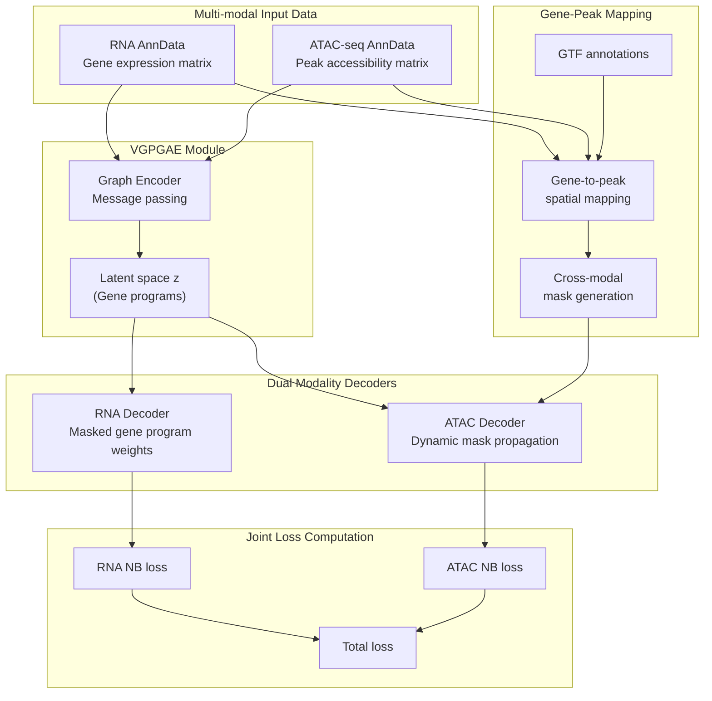
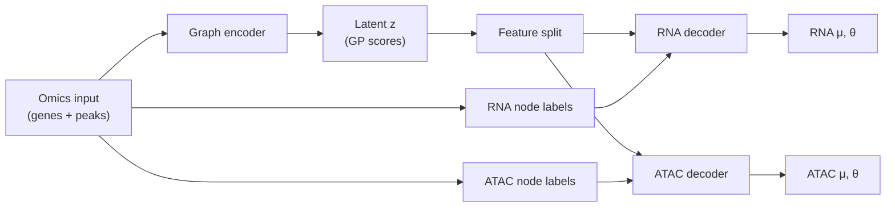
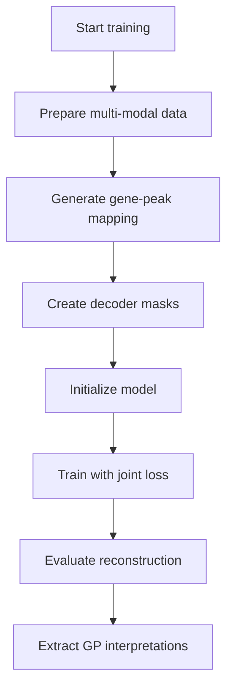

This page explains how NicheCompass jointly models RNA gene expression and ATAC-seq chromatin accessibility data within a unified variational autoencoder framework, enabling biologically interpretable gene programs that capture regulatory relationships between transcriptional activity and chromatin accessibility.

## Architecture Overview

The RNA and ATAC-seq joint modeling extends the base VGPGAE architecture with **dual modality decoders** and **cross-modal feature masking** that propagates gene program knowledge from RNA features to chromatin accessibility features based on spatial proximity.



The architecture maintains **separate decoders** for each modality while sharing a common latent space. Gene program masks learned from RNA data propagate to ATAC-seq features through a gene-to-peak mapping matrix, enabling the model to learn gene programs that simultaneously explain both expression patterns and chromatin accessibility patterns.

Sources: [vgpgae.py](src/nichecompass/modules/vgpgae.py#L146-L320), [nichecompass.py](src/nichecompass/models/nichecompass.py#L189-L248)

## Gene-to-Peak Mapping Construction

The foundation of joint modeling is establishing **spatial connections** between genes and chromatin accessibility peaks based on genomic coordinates. NicheCompass implements this through three configurable strategies for defining gene regions:

| Gene Region Strategy | Description | Biological Interpretation |
|---------------------|-------------|---------------------------|
| `gene_body` | Only gene body regions | Direct promoter-independent regulation |
| `promoter` | Upstream region (default 2000bp from TSS) | Classic transcriptional regulation |
| `combined` | Gene body + upstream promoter | Comprehensive regulatory landscape |

The mapping function uses the `scglue` library's window graph algorithm to create edges between genes and peaks based on **bp position overlaps**. When `extend_range > 0`, the system creates edges for peaks within the extended bidirectional range, using a distance-decay weight function (default: power law decay).

```python
# Example: generating gene-to-peak mapping
mapping_dict = generate_multimodal_mapping_dict(
    adata=rna_adata,
    adata_atac=atac_adata,
    gene_region="combined",  # gene body + promoter
    promoter_len=2000,
    extend_range=0  # strict overlap only
)
```

The output is a dictionary mapping uppercase gene names to lists of associated peaks, which is subsequently converted into **sparse boolean matrices** for efficient computation. This matrix has shape `(n_genes, n_peaks)` where each entry indicates whether a peak is spatially associated with a gene.

Sources: [multimodal_mapping.py](src/nichecompass/utils/multimodal_mapping.py#L107-L195)

## Cross-Modal Mask Propagation

The **core innovation** of joint modeling is propagating gene program knowledge from RNA to ATAC-seq features through the gene-to-peak mapping matrix. This occurs through two mask types:

### Static Decoder Masks

Static masks are generated during initialization and define **which gene programs can influence which features**:

- **Target masks**: Decode cell-autonomous features (cell's own expression/accessibility)
- **Source masks**: Decode non-cell-autonomous features (neighborhood-influenced expression/accessibility)

For ATAC-seq, these masks are derived by **matrix multiplication** of RNA gene program masks with the gene-to-peak mapping mask:

```
ATAC_GP_Mask = RNA_GP_Mask × Gene_Peak_Mask
```

This operation translates gene program-gene associations into gene program-peak associations. Each gene program gets associated with all peaks linked to its member genes.

Sources: [multimodal_mapping.py](src/nichecompass/utils/multimodal_mapping.py#L196-L383)

### Dynamic Decoder Masks

Dynamic masks enable **adaptive sparsity** during training. When L1 regularization eliminates a gene from a gene program in the RNA decoder, the corresponding peaks are automatically removed from the ATAC decoder:

1. **RNA decoder weights** are rounded to 4 decimals (due to L1 non-differentiability at 0)
2. **Boolean mask** identifies non-zero gene weights per gene program
3. **Matrix multiplication** propagates this to peaks: `non_zero_gene_weights.T × gene_peaks_mask`
4. Peaks with zero connections are excluded from reconstruction

The dynamic mask ensures **biological consistency**: if a gene program's RNA component indicates a gene is not contributing, the associated chromatin accessibility features are also excluded from that program's reconstruction.

Sources: [vgpgae.py](src/nichecompass/modules/vgpgae.py#L740-L900)

## Dual Modality Decoder Architecture

NicheCompass employs **separate masked omics feature decoders** for RNA and ATAC-seq, both sharing the same latent space representation `z` (gene program scores) but with different masks and output distributions.

### RNA Decoder

The RNA decoder follows the standard masked architecture:

```python
target_rna_decoder = MaskedOmicsFeatureDecoder(
    modality="rna",
    entity="target",
    n_prior_gp_input=n_prior_gp,
    n_addon_gp_input=n_addon_gp,
    n_cat_covariates_embed_input=cat_covariates_dim,
    n_output=n_output_genes,
    mask=target_rna_decoder_mask,  # Static GP→gene mask
    addon_mask=target_rna_addon_mask,
    masked_features_idx=target_masked_rna_idx,
    recon_loss="nb"  # Negative binomial
)
```

The decoder applies a **masked linear transformation** followed by softmax normalization, then scales by the observed library size. The output parameters are:
- **μ**: Mean of negative binomial distribution
- **θ**: Dispersion parameter (learned per gene)

### ATAC Decoder

The ATAC decoder has identical structure but incorporates **dynamic masking**:

```python
target_atac_decoder = MaskedOmicsFeatureDecoder(
    modality="atac",
    entity="target",
    n_prior_gp_input=n_prior_gp,
    n_addon_gp_input=n_addon_gp,
    n_cat_covariates_embed_input=cat_covariates_dim,
    n_output=n_output_peaks,
    mask=target_atac_decoder_mask,  # Static GP→peak mask
    addon_mask=target_atac_addon_mask,
    masked_features_idx=target_masked_atac_idx,
    recon_loss="nb"
)
```

Key differences from RNA decoder:
- **Input**: Peak accessibility counts instead of gene expression
- **Mask**: Gene program→peak associations instead of gene program→gene
- **Dynamic mask**: Updated during training based on RNA sparsity
- **Features**: Peaks that map only to turned-off genes are excluded

> [!TIP]
> The dynamic mask mechanism is crucial for interpretability: it ensures that if a gene program loses regulatory control over a gene through RNA sparsity, it also loses influence over the gene's associated regulatory regions, maintaining biological plausibility.

Sources: [decoders.py](src/nichecompass/nn/decoders.py#L65-L171), [vgpgae.py](src/nichecompass/modules/vgpgae.py#L320-L540)

## Joint Loss Computation

Training optimizes a **joint loss function** that balances reconstruction quality across both modalities with regularization terms.

### Reconstruction Losses

Both modalities use **negative binomial distribution** to model count data, capturing the over-dispersion characteristic of sequencing data:

For RNA:
```python
gene_expr_recon_loss = lambda_gene_expr_recon * [
    NB_loss(target_rna_observed, target_rna_reconstructed) +
    NB_loss(source_rna_observed, source_rna_reconstructed)
]
```

For ATAC-seq:
```python
chrom_access_recon_loss = lambda_chrom_access_recon * [
    NB_loss(target_atac_observed, target_atac_reconstructed) +
    NB_loss(source_atac_observed, source_atac_reconstructed)
]
```

The negative binomial loss computation uses:
- **log_theta_mu_eps**: Numerical stability term
- **theta**: Inverse dispersion parameter (positive support)
- **mu**: Mean parameter (positive support)
- **x**: Observed counts

The formula maximizes the log-likelihood of observed data given the predicted distribution parameters.

Sources: [losses.py](src/nichecompass/modules/losses.py#L169-L214), [vgpgae.py](src/nichecompass/modules/vgpgae.py#L1000-L1145)

### Loss Weight Balancing

Recommended lambda values for joint training:

| Loss Component | Default Lambda | Purpose |
|---------------|----------------|---------|
| `lambda_gene_expr_recon` | 300.0 | RNA reconstruction accuracy |
| `lambda_chrom_access_recon` | 100.0 | ATAC-seq reconstruction accuracy |
| `lambda_edge_recon` | 500000.0 | Spatial graph preservation |
| `lambda_l1_masked` | 0.0 | Gene program sparsity (prior) |
| `lambda_l1_addon` | 30.0 | Gene program sparsity (addon) |
| `lambda_group_lasso` | 0.0 | Gene program selection sparsity |

The **3:1 ratio** between RNA and ATAC reconstruction weights reflects typical differences in feature count and signal-to-noise ratio between modalities. These values can be tuned based on dataset characteristics.

Sources: [nichecompass.py](src/nichecompass/models/nichecompass.py#L590-L620)

## Forward Pass for Multi-modal Data

During forward pass, the VGPGAE module handles both modalities sequentially:



**Key processing steps**:

1. **Feature vector construction**: Concatenate RNA and ATAC features (dim: n_obs × (n_genes + n_peaks))
2. **Logarithmic transformation**: Apply `log(1 + x)` to encoder input for numerical stability
3. **Graph convolution**: Message passing encodes spatial relationships
4. **Reparameterization**: Sample latent z from learned Gaussian distribution
5. **Feature split**: Separate RNA and ATAC portions of reconstructed means
6. **Library size scaling**: Scale normalized means by observed library sizes
7. **Dynamic mask update**: Propagate RNA sparsity to ATAC decoder (if enabled)

The **dynamic mask update** occurs when `update_atac_dynamic_decoder_mask=True`:
- Retrieve current RNA decoder gene program weights
- Round to 4 decimals to handle near-zero values
- Identify non-zero gene weights per gene program
- Multiply by gene-to-peak mapping to update peak mask
- Convert to boolean mask for the next forward pass

Sources: [vgpgae.py](src/nichecompass/modules/vgpgae.py#L541-L900)

## Categorical Covariate Integration

Categorical covariates (e.g., batch, cell type, condition) can be **injected into both modality decoders** to modulate gene program effects:

```python
cat_covariates_embeds_injection=["gene_expr_decoder", "chrom_access_decoder"]
```

When enabled:
1. **Categorical covariates** are embedded via learnable embedding layers
2. **Embeddings are concatenated** with latent z before decoder
3. **Both RNA and ATAC decoders** receive the same embedding
4. **Gene program effects** are modulated by covariate-specific offsets

This enables the model to learn **batch-corrected** or **cell-type-specific** gene program effects while maintaining consistent gene-to-peak regulatory relationships.

Sources: [nichecompass.py](src/nichecompass/models/nichecompass.py#L189-L248)

## Training Configuration and Best Practices

### Recommended Training Workflow



**Step 1: Data Preparation**

```python
# Ensure both modalities have compatible spatial graphs
assert adata.obsp["spatial_connectivities"].shape == adata_atac.obsp["spatial_connectivities"].shape

# Filter peaks based on gene mapping
adata, adata_atac = add_multimodal_mask_to_adata(
    adata=rna_adata,
    adata_atac=atac_adata,
    gene_peak_mapping_dict=gene_peak_mapping,
    filter_peaks_based_on_genes=True,
    filter_hvg_peaks=True,
    n_hvg_peaks=4000
)
```

**Step 2: Model Initialization**

```python
model = NicheCompass(
    adata=rna_adata,
    adata_atac=atac_adata,  # Required for joint modeling
    ca_targets_mask_key="nichecompass_ca_targets",
    ca_sources_mask_key="nichecompass_ca_sources",
    gene_peaks_mask_key="nichecompass_gene_peaks",
    include_chrom_access_recon_loss=True,
    lambda_chrom_access_recon=100.0
)
```

**Step 3: Training with Dynamic Masks**

```python
model.train(
    n_epochs=100,
    n_epochs_all_gps=25,
    lambda_gene_expr_recon=300.0,
    lambda_chrom_access_recon=100.0,
    lambda_l1_masked=0.0,
    lambda_l1_addon=30.0,
    edge_batch_size=256,
    node_batch_size=64
)
```

> [!TIP]
> For multi-modal training, consider a two-stage approach: (1) Pretrain on RNA-only data for 10-15 epochs to establish stable gene programs, then (2) Introduce ATAC-seq data with `lambda_chrom_access_recon=50.0` and gradually increase to the target weight of 100.0 over 10 epochs.

### Hyperparameter Sensitivity

| Parameter | Sensitivity | Recommended Range | Notes |
|-----------|-------------|-------------------|-------|
| `lambda_chrom_access_recon` | High | 50-200 | Too high: ATAC dominates, RNA signal lost |
| `lambda_gene_expr_recon` | Medium | 200-500 | Maintain 2-3× ratio over ATAC weight |
| `lambda_l1_addon` | Medium | 10-50 | Controls GP sparsity, affects both modalities |
| `promoter_len` | Low-Medium | 500-5000 | Affects peak-GP associations |

### Common Issues and Solutions

| Issue | Symptoms | Solution |
|-------|----------|----------|
| **Poor ATAC reconstruction** | High chrom_access_recon_loss, low gene_expr_recon_loss | Increase `lambda_chrom_access_recon`, verify peak quality |
| **Overfitting to RNA** | ATAC decoder weights approach zero | Reduce `lambda_gene_expr_recon` ratio, increase regularization |
| **No peak-GP associations** | All peaks excluded via dynamic masks | Reduce `lambda_l1_addon`, verify gene-peak mapping quality |
| **Training instability** | Loss NaN, large fluctuations | Reduce learning rate, disable dynamic mask updates initially |

Sources: [multimodal_tutorials.md](docs/tutorials/multimodal_tutorials.md), [nichecompass.py](src/nichecompass/models/nichecompass.py#L590-L620)

## Extracting Multi-modal Interpretations

After training, gene program interpretations can be extracted for both RNA and ATAC modalities:

### Gene Program Gene Importances

```python
gp_gene_importance = model.compute_gp_gene_importances(
    selected_gp="GP_CellCycle"
)
# Returns: DataFrame with gene_name, weight, abs_weight
```

### Gene Program Peak Importances

```python
gp_peak_importance = model.compute_gp_peak_importances(
    selected_gp="GP_CellCycle"
)
# Returns: DataFrame with peak_name, weight, abs_weight
```

Peak importance is derived from:
1. **Direct GP→peak weights** from ATAC decoder
2. **Indirect contribution** via gene-to-peak mapping of RNA decoder weights

This dual interpretation enables discovery of **regulatory programs** where:
- **Genes** indicate transcriptional output
- **Peaks** indicate regulatory regions controlling those genes

### Latent Space Analysis

```python
latent_rna, latent_atac = model.get_latent_representation(
    adata=rna_adata,
    adata_atac=atac_atac,
    only_active_gps=True
)
```

The latent space is **shared** between modalities, enabling:
- Cross-modality integration in embedding space
- Joint visualization of cells with multi-modal data
- Detection of modality-specific vs. shared biological signals

Sources: [nichecompass.py](src/nichecompass/models/nichecompass.py#L1053-L1165)

## Next Steps

To deepen your understanding of multi-modal integration:

1. **[Chromatin Accessibility Integration with Gene Expression](17-chromatin-accessibility-integration-with-gene-expression)** - Explores biological interpretation of gene-to-peak relationships
2. **[Multi-modal Mapping and Reference Construction](18-multi-modal-mapping-and-reference-construction)** - Details reference atlas creation from multi-modal data
3. **[Latent Representation Extraction and Visualization](22-latent-representation-and-visualization)** - Covers joint embedding analysis techniques

For practical implementation, review the [multimodal tutorials notebook](docs/tutorials/notebooks/mouse_brain_multimodal) demonstrating end-to-end analysis workflow.
