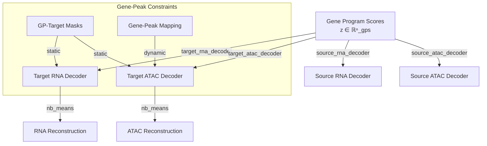
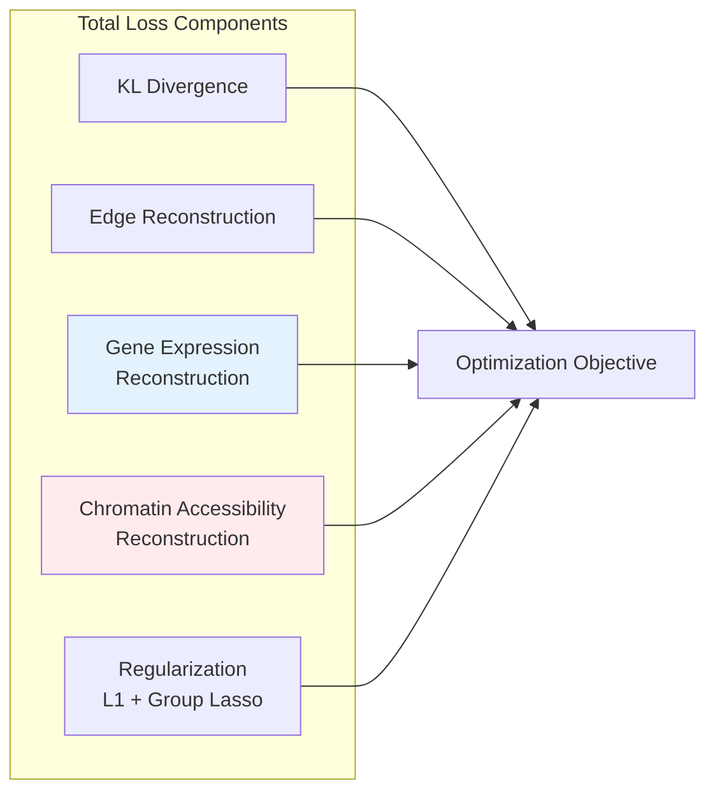
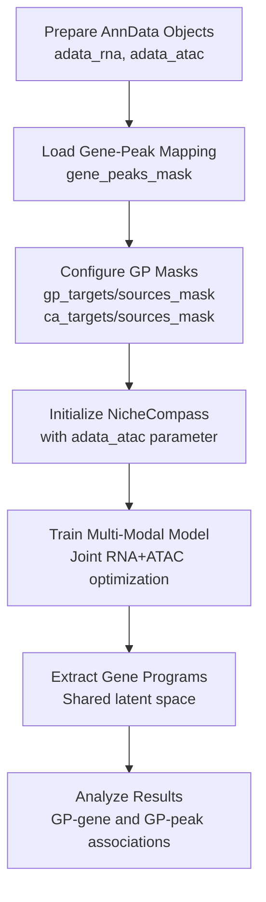

This page explains how NicheCompass integrates ATAC-seq chromatin accessibility data with RNA expression in a unified multi-modal spatial transcriptomics framework. The architecture enables joint learning of gene programs that simultaneously explain both expression patterns and chromatin accessibility profiles, providing deeper biological insights into gene regulation mechanisms.

## Multi-Modal Data Architecture

NicheCompass's multi-modal architecture treats RNA expression and ATAC-seq chromatin accessibility as complementary views of the same biological system. Both modalities are integrated at the feature level through concatenated input vectors and connected through shared gene program representations.

The core architectural principle is that gene programs serve as latent factors that explain both observed gene expression and chromatin accessibility patterns. This is achieved through:

- **Concatenated Input Features**: RNA counts and ATAC peak counts are concatenated into a single feature vector during dataset initialization
- **Shared Gene Program Space**: The same latent gene program embeddings reconstruct both RNA and ATAC data through separate decoder pathways
- **Gene-Peak Biological Mapping**: Known gene-to-peak associations guide the learning of interpretable connections

Sources: [SpatialAnnTorchDataset](src/nichecompass/data/datasets.py#L46-L54), [NicheCompass.__init__](src/nichecompass/models/nichecompass.py#L219)

## Gene-Peak Integration Mechanism

The biological connection between genes and chromatin accessibility peaks is encoded through a gene-peaks association matrix stored in the AnnData object. This sparse binary matrix (`gene_peaks_mask`) maps which regulatory peaks are associated with each gene.

```python
# Gene-peaks mapping structure
gene_peaks_mask = adata.varm[gene_peaks_mask_key]
# Shape: (n_genes, n_peaks)
# Value: 1 if peak is associated with gene, 0 otherwise
```

This mapping serves two critical functions:

1. **Biological Constraint**: Peaks are only connected to gene programs through genes that have regulatory relationships with those peaks
2. **Dynamic Regularization**: When L1 regularization turns off a gene in a gene program (sets its weight to 0), all peaks associated with that gene are automatically masked out from the corresponding gene program

The gene-peaks mapping enables biologically interpretable multi-modal gene programs where regulatory elements are linked to their target genes through shared program assignments.

Sources: [NicheCompass.__init__](src/nichecompass/models/nichecompass.py#L345-L358), [VGPGAE.forward](src/nichecompass/modules/vgpgae.py#L765-L850)

## Dual Decoder Architecture

The VGPGAE module employs separate but symmetric decoder architectures for RNA and ATAC modalities. Both decoders share the same latent space (gene program scores) but have their own parameter sets and masks.



### Decoder Components

**Target Decoders** (autocrine):
- `target_rna_decoder`: Reconstructs the cell's own gene expression
- `target_atac_decoder`: Reconstructs the cell's own chromatin accessibility

**Source Decoders** (paracrine):
- `source_rna_decoder`: Reconstructs neighborhood-aggregated gene expression
- `source_atac_decoder`: Reconstructs neighborhood-aggregated chromatin accessibility

Both decoder types use the `MaskedOmicsFeatureDecoder` class, which applies gene program masks to ensure interpretable, sparse connections. The masks are of the form:

- `target_rna_decoder_mask`: Boolean matrix (n_gps × n_genes) indicating which genes each GP can reconstruct
- `target_atac_decoder_mask`: Boolean matrix (n_gps × n_peaks) indicating which peaks each GP can reconstruct
- Corresponding `source_*_decoder_mask` matrices for paracrine reconstruction

Sources: [VGPGAE.__init__](src/nichecompass/modules/vgpgae.py#L155-L162), [MaskedOmicsFeatureDecoder](src/nichecompass/nn/decoders.py#L101-L171)

## Dynamic ATAC Masking System

A sophisticated dynamic masking mechanism ensures biological consistency between RNA and ATAC reconstructions. When L1 regularization removes a gene from a gene program (by setting its weight to 0), the system automatically masks out all peaks associated with that gene from the same gene program.

> [!TIP]
> The dynamic ATAC masking is computed on-the-fly during forward passes using matrix multiplication between the RNA decoder weights and the gene-peaks mapping. This ensures that peak-to-gene-program connections reflect the current state of gene-to-gene-program connections after regularization has been applied.

The dynamic masking process follows these steps:

1. **Extract RNA GP Weights**: Retrieve current gene program-to-gene weights from the RNA decoder
2. **Identify Active Genes**: Determine which genes have non-zero weights (`non_zero_gene_weights`)
3. **Propagate to Peaks**: Multiply the active gene mask with the gene-peaks mapping matrix
4. **Apply Dynamic Mask**: Use the resulting peak mask in the ATAC decoder forward pass

```python
# Simplified dynamic masking logic
non_zero_gene_weights = (gp_weights != 0)  # Shape: (n_genes, n_gps)
target_atac_dynamic_mask = (
    non_zero_gene_weights.T @ gene_peaks_mask
).to(torch.bool)  # Shape: (n_gps, n_peaks)
```

This mechanism ensures that:
- Peaks are only active if at least one of their associated genes is active in the GP
- Regulatory elements are biologically coupled to their target genes
- Sparsity patterns are consistent across modalities

Sources: [VGPGAE.forward](src/nichecompass/modules/vgpgae.py#L765-L850)

## Loss Function Integration

The total optimization objective combines separate reconstruction losses for both modalities, weighted by lambda parameters that control their relative importance:



### Loss Component Equations

**Gene Expression Reconstruction Loss** (Negative Binomial):
```
L_rna = λ_gene_expr_recon × [
    NB(x_target, μ_target_rna, θ_target) +
    NB(x_source, μ_source_rna, θ_source)
]
```

**Chromatin Accessibility Reconstruction Loss** (Negative Binomial):
```
L_atac = λ_chrom_access_recon × [
    NB(x_atac_target, μ_target_atac, θ_target_atac) +
    NB(x_atac_source, μ_source_atac, θ_source_atac)
]
```

**Regularization Losses** (applied to both modalities):
- L1 regularization on gene program weights (masked genes and addon gene programs)
- Group Lasso regularization to encourage gene program sparsity

The default loss weights typically set `λ_chrom_access_recon = 100` and `λ_gene_expr_recon = 300`, reflecting the different scales and noise characteristics of RNA-seq and ATAC-seq data.

Sources: [VGPGAE.loss](src/nichecompass/modules/vgpgae.py#L932-L1145), [NicheCompass.train](src/nichecompass/models/nichecompass.py#L598-L599)

## Implementation Workflow

The following workflow diagram illustrates the complete process of integrating ATAC data with RNA expression in NicheCompass:



### Key Configuration Parameters

| Parameter | Type | Purpose | Default |
|-----------|------|---------|---------|
| `adata_atac` | AnnData | ATAC-seq data object with peak counts | `None` |
| `ca_targets_mask_key` | str | Key for target ATAC GP masks in `adata_atac.varm` | `"nichecompass_ca_targets"` |
| `ca_sources_mask_key` | str | Key for source ATAC GP masks in `adata_atac.varm` | `"nichecompass_ca_sources"` |
| `gene_peaks_mask_key` | str | Key for gene-peak mapping in `adata.varm` | `"nichecompass_gene_peaks"` |
| `include_chrom_access_recon_loss` | bool | Whether to include ATAC reconstruction in loss | `True` |
| `lambda_chrom_access_recon` | float | Weight for ATAC reconstruction loss | `100.0` |
| `chrom_access_recon_dist` | str | Distribution for ATAC reconstruction | `"nb"` |

### Data Preparation Requirements

For multi-modal training, you must prepare the following components in your AnnData objects:

**RNA AnnData (`adata`)**:
- Gene expression counts in `adata.layers["counts"]` or `adata.X`
- Gene program masks in `adata.varm["nichecompass_gp_targets"]` and `adata.varm["nichecompass_gp_sources"]`
- Gene-peaks mapping in `adata.varm["nichecompass_gene_peaks"]` (sparse matrix)

**ATAC AnnData (`adata_atac`)**:
- Peak accessibility counts in `adata_atac.X`
- Peak program masks in `adata_atac.varm["nichecompass_ca_targets"]` and `adata_atac.varm["nichecompass_ca_sources"]`

The gene-peaks mapping matrix should be a sparse binary matrix where each entry `(gene_idx, peak_idx)` = 1 indicates that the peak is associated with the gene (e.g., based on promoter/enhancer annotations, correlation analysis, or prior knowledge).

Sources: [NicheCompass.__init__](src/nichecompass/models/nichecompass.py#L191-L224), [prepare_data](src/nichecompass/data/dataprocessors.py#L133-L221)

## Biological Interpretation and Analysis

After training a multi-modal NicheCompass model, you can perform several types of analysis that leverage the joint RNA-ATAC gene programs:

### Gene Program Characterization

Each gene program can be characterized by:

- **Target Genes**: Genes that the GP predicts to regulate (via target RNA decoder weights)
- **Target Peaks**: Peaks that the GP predicts to regulate (via target ATAC decoder weights)
- **Regulatory Connections**: Links between peaks and genes through shared GP membership

Use the `compute_gp_gene_importances` and `compute_gp_peak_importances` methods to extract these relationships:

```python
# Get gene program-gene importance weights
gp_gene_weights = model.compute_gp_gene_importances(selected_gp="GP_1")

# Get gene program-peak importance weights
gp_peak_weights = model.compute_gp_peak_importances(selected_gp="GP_1")
```

### Differential Gene-Peak Analysis

Differential analysis across spatial regions or cell types can identify:

- GPs that show distinct gene expression patterns
- GPs that show distinct chromatin accessibility patterns
- Peaks that are differentially accessible through specific GPs

This enables identification of regulatory programs that are transcriptionally active and epigenetically accessible in specific spatial niches.

Sources: [NicheCompass.compute_gp_gene_importances](src/nichecompass/models/nichecompass.py#L1053-L1106), [NicheCompass.compute_gp_peak_importances](src/nichecompass/models/nichecompass.py#L1107-L1165)

## Best Practices and Considerations

When integrating chromatin accessibility with gene expression, consider these key factors:

> [!TIP]
> Ensure that the gene-peaks mapping matrix is biologically validated. Poor quality mappings will propagate errors into the gene program learning, leading to spurious regulatory connections between genes and peaks.

### Data Quality Considerations

- **Peak Count Sparsity**: ATAC data is typically sparser than RNA data, requiring careful normalization
- **Peak Annotation Quality**: Gene-peak associations should be based on reliable methods (e.g., Cicero, activity-by-contact, distance-based)
- **Batch Effects**: Multi-modal data may have different technical artifacts; consider batch correction if RNA and ATAC come from different platforms

### Hyperparameter Tuning

Key hyperparameters to tune for multi-modal integration:

- `lambda_chrom_access_recon`: Adjust based on the signal-to-noise ratio of your ATAC data
- `lambda_l1_masked`: Controls sparsity in GP-gene and GP-peak connections
- `lambda_group_lasso`: Controls the number of active gene programs

**Loss Weight Balancing Strategy**:
Start with equal weights for RNA and ATAC reconstruction, then:
- Increase `lambda_gene_expr_recon` if RNA reconstruction loss is much larger than ATAC loss
- Decrease `lambda_chrom_access_recon` if ATAC reconstruction overfits to noise
- Monitor both modalities' validation losses separately

### Interpretation Guidelines

- **Active Gene Programs**: GPs should be active in both RNA and ATAC domains for biological coherence
- **Peak-Gene Consistency**: Peaks associated with a GP should primarily be linked to genes in the same GP
- **Spatial Patterns**: Gene program activity should show consistent spatial patterns across both modalities

See [Loss Weight Balancing and Regularization Strategies](27-loss-weight-balancing-and-regularization-strategies) for detailed guidance on optimizing these parameters.

Sources: [NicheCompass.train](src/nichecompass/models/nichecompass.py#L590-L619)

## Next Steps

After understanding the chromatin accessibility integration architecture, you may want to explore:

- **[Multi-modal Mapping and Reference Construction](18-multi-modal-mapping-and-reference-construction)**: Learn how to build multi-modal spatial references
- **[Loss Weight Balancing and Regularization Strategies](27-loss-weight-balancing-and-regularization-strategies)**: Detailed guidance on optimizing multi-modal training
- **[RNA and ATAC-seq Joint Modeling](16-rna-and-atac-seq-joint-modeling)**: Broader context on multi-modal approaches in spatial transcriptomics
- **[Tutorials](docs/tutorials/multimodal_tutorials.md)**: Hands-on examples with multi-modal datasets

These resources will help you apply the theoretical concepts covered here to practical multi-modal spatial analysis workflows.