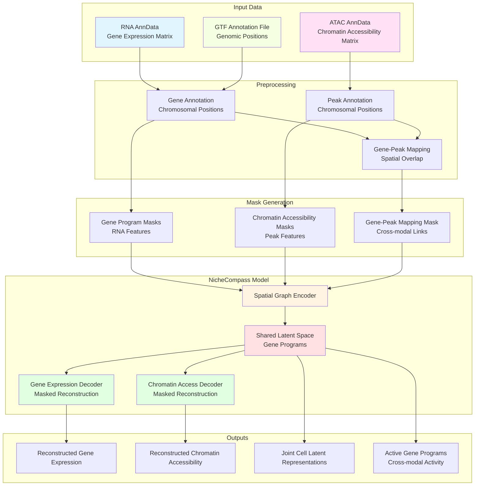
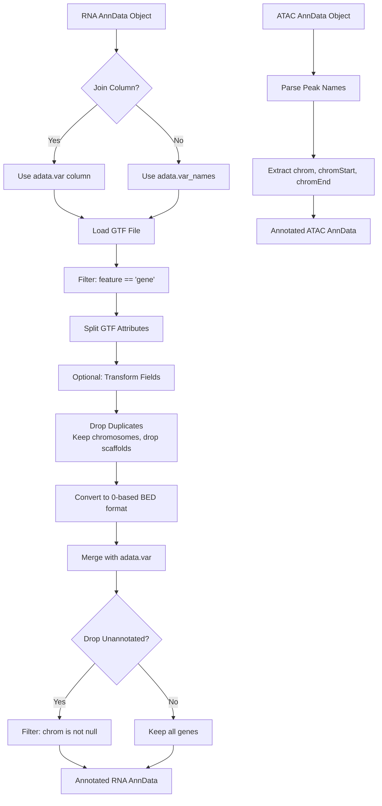
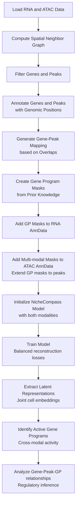

This page explains how NicheCompass integrates and constructs references from multi-modal spatial omics data, specifically combining RNA gene expression and ATAC-seq chromatin accessibility measurements. The framework enables simultaneous modeling of transcriptional activity and regulatory element accessibility through a unified graph neural network architecture.

## Multi-modal Mapping Architecture

NicheCompass achieves multi-modal integration by constructing a shared latent space that captures coordinated gene expression and chromatin accessibility patterns across spatial locations. The architecture employs modality-specific decoders while maintaining a common encoder that processes the spatial neighbor graph, enabling information flow between modalities through shared gene program representations.




The architecture centers on the **Variational Gene Program Graph Autoencoder (VGPGAE)** module which processes the spatial connectivity graph between measurement spots. Gene programs serve as the bridging latent variables that explain both gene expression patterns and chromatin accessibility patterns, with biologically-informed masks constraining which programs can reconstruct which features in each modality.

## Gene and Peak Annotation Processing

Before multi-modal integration can occur, genes and chromatin accessibility peaks must be annotated with their genomic coordinates to enable spatial proximity-based mapping. This process begins with loading a GTF annotation file from GENCODE and merging it with the RNA AnnData object's variable metadata.



The `get_gene_annotations` function performs this annotation, extracting chromosome names and base-pair start/end positions for each gene [multimodal_mapping.py#L17-L106](src/nichecompass/utils/multimodal_mapping.py#L17-L106). For ATAC-seq data, peak names are parsed assuming the format "chrom:start-end" and the genomic coordinates are extracted and stored in `adata_atac.var`. The conversion from GTF's 1-based coordinates to BED's 0-based coordinates ensures compatibility with downstream processing using the `scglue` package's genomics utilities.

> [!TIP]
> The GTF annotation file path defaults to the provided GENCODE mouse annotation but can be replaced with species-appropriate files downloaded from GENCODE. The function optionally drops genes lacking annotation, which removes pseudogenes and poorly-characterized transcripts from the analysis but may discard relevant biologically active elements.

## Gene-Peak Mapping Generation

Once genes and peaks have genomic coordinates, the core multi-modal mapping is established by identifying peaks that spatially overlap with gene regulatory regions. The `generate_multimodal_mapping_dict` function creates a dictionary mapping gene names to lists of overlapping peaks based on configurable gene region definitions [multimodal_mapping.py#L107-L195](src/nichecompass/utils/multimodal_mapping.py#L107-L195).

### Gene Region Definitions

Three gene region definitions control which genomic areas are considered when establishing gene-peak links:

| Gene Region | Description | Biological Interpretation |
|-------------|-------------|---------------------------|
| `promoter` | Only upstream promoter region (default: 2000bp upstream of TSS) | Direct transcriptional regulation via promoter accessibility |
| `gene_body` | Transcribed region from start to end codon | Intragenic regulatory elements, enhancer-gene body interactions |
| `combined` | Gene body extended with upstream promoter | Comprehensive capture of proximal regulatory elements |

The promoter length parameter (`promoter_len`, default 2000bp) controls how far upstream of the transcription start site (TSS) to search for regulatory peaks. The extend_range parameter allows linking peaks within a specified window beyond direct overlap, with a configurable distance-decay weight function (`extend_fn`) that assigns lower weights to more distant associations.

### Window Graph Construction

The mapping process constructs a bipartite graph where edges represent spatial proximity between gene regions and peak regions. Using `scglue.genomics.window_graph`, genes and peaks are connected if they overlap or fall within the `extend_range` window, with edge weights computed by the distance-decay function. The function returns a dictionary structure where:

```python
multimodal_mapping_dict = {
    "GENE_NAME": ["peak1:chr1-1000-2000", "peak2:chr1-2500-3500", ...],
    ...
}
```

This dictionary enables downstream operations to efficiently look up which peaks are associated with each gene, which is essential for extending gene program masks to the chromatin accessibility modality.

> [!TIP]
> The `uppercase` parameter defaults to True, converting all gene names to uppercase in the returned dictionary. This ensures case-insensitive matching with gene program definitions, which typically use uppercase gene symbols from external databases.

## Multi-modal Mask Construction

The critical innovation for multi-modal learning in NicheCompass is the extension of gene program masks from RNA features (genes) to ATAC features (peaks). The `add_multimodal_mask_to_adata` function performs this translation by mapping each gene in a gene program to its associated peaks, creating parallel decoder masks for both modalities [multimodal_mapping.py#L196-L383](src/nichecompass/utils/multimodal_mapping.py#L196-L383).

### Mask Translation Process

The mask construction follows a systematic translation pipeline:

```mermaid
flowchart LR
    A[RNA GP Masks<br/>adata.varm[gp_targets_mask]] --> B[Extract Genes per GP]
    C[Gene-Peak Mapping Dictionary] --> D[Map Genes to Peaks]
    B --> D
    D --> E[Collect Unique Peaks per GP]
    E --> F[Create ATAC Target Mask<br/>adata_atac.varm[ca_targets_mask]]
    A --> G[Extract Source Genes]
    G --> H[Map to Source Peaks]
    H --> I[Create ATAC Source Mask<br/>adata_atac.varm[ca_sources_mask]]
    F --> J[Identify Target Peak Indices]
    I --> K[Identify Source Peak Indices]
    J --> L[Concatenate Peak Indices<br/>adata_atac.uns[peaks_idx]]
    K --> L
```

For both target and source gene program masks, the function:
1. Retrieves all genes belonging to each gene program from the RNA masks
2. Maps each gene to its associated peaks using the gene-peak mapping dictionary
3. Removes duplicate peaks per gene program (multiple genes may share regulatory peaks)
4. Creates binary sparse matrices in `adata_atac.varm` with the same dimensions as the RNA masks (peaks × gene programs)

The resulting `ca_targets_mask` and `ca_sources_mask` (chromatin accessibility targets/sources) enable the model's ATAC decoder to use the same gene program structure as the RNA decoder, ensuring that latent representations explain both modalities through a shared set of biological programs.

### Peak Filtering Strategies

Before mask construction, peaks can be filtered to reduce computational complexity and focus on informative features:

| Filtering Strategy | Purpose | Implementation |
|-------------------|---------|----------------|
| Gene-based filtering | Retain only peaks mapped to at least one gene | `filter_peaks_based_on_genes=True` |
| Highly variable peaks | Focus on spatially informative peaks | `filter_hvg_peaks=True`, `n_hvg_peaks=4000` |
| Batch-aware selection | Account for technical variation across samples | Uses `batch_key` for Seurat-style selection |

The gene-based filter ensures all peaks in the analysis have a clear gene association, while the highly variable peak filter (using Scanpy's `highly_variable_genes` with "seurat_v3" flavor) prioritizes peaks that show spatial heterogeneity. Peak indices for features present in the source and target masks are stored in `adata_atac.uns` to enable efficient indexing during model training.

## Model Initialization with Multi-modal Data

The `NicheCompass` model class accepts both RNA and ATAC AnnData objects through the `adata` and `adata_atac` parameters [nichecompass.py#L189-L350](src/nichecompass/models/nichecompass.py#L189-L350). When multi-modal data is provided, the model:

1. Loads RNA gene program masks from `adata.varm[gp_targets_mask_key]` and `adata.varm[gp_sources_mask_key]`
2. Loads ATAC gene program masks from `adata_atac.varm[ca_targets_mask_key]` and `adata_atac.varm[ca_sources_mask_key]`
3. Loads the gene-peak mapping mask from `adata.varm[gene_peaks_mask_key]`
4. Configures dual decoders with appropriate mask constraints

The model initialization includes specific parameters controlling multi-modal behavior:

| Parameter | Default | Purpose |
|-----------|---------|---------|
| `include_chrom_access_recon_loss` | `True` | Include chromatin accessibility reconstruction in loss |
| `ca_targets_mask_key` | `"nichecompass_ca_targets"` | Key for ATAC target mask |
| `ca_sources_mask_key` | `"nichecompass_ca_sources"` | Key for ATAC source mask |
| `peaks_idx_key` | `"nichecompass_peaks_idx"` | Key for concatenated peak indices |
| `target_peaks_idx_key` | `"nichecompass_target_peaks_idx"` | Key for target peak indices |
| `source_peaks_idx_key` | `"nichecompass_source_peaks_idx"` | Key for source peak indices |

## Training Multi-modal Models

Training multi-modal models requires balancing reconstruction losses across modalities. The `train` method accepts modality-specific loss weights that control the relative importance of each reconstruction objective [nichecompass.py#L590-L620](src/nichecompass/models/nichecompass.py#L590-L620):

```python
lambda_gene_expr_recon: float = 300.,    # RNA reconstruction weight
lambda_chrom_access_recon: float = 100., # ATAC reconstruction weight
```

These weights are multiplied with their respective negative log-likelihood losses (Negative Binomial distribution by default) before being summed to form the total loss. Higher values assign greater importance to reconstruction quality for that modality.

### Loss Function Structure

The VGPGAE module's loss function combines modality-specific losses [vgpgae.py#L932-L948](src/nichecompass/modules/vgpgae.py#L932-L948):

```python
total_loss = (
    lambda_gene_expr_recon * gene_expr_recon_loss +
    lambda_chrom_access_recon * chrom_access_recon_loss +
    lambda_edge_recon * edge_recon_loss +
    ...
)
```

The chromatin accessibility reconstruction loss (`chrom_access_recon_loss`) is computed identically to the gene expression loss but operates on the ATAC decoder outputs, using the same Negative Binomial likelihood with learned dispersion parameters. This unified loss framework ensures the model learns latent representations that simultaneously explain variation in both gene expression and chromatin accessibility.

## Complete Multi-modal Workflow

The complete workflow for multi-modal analysis follows these steps:



### Practical Implementation

From the mouse brain multi-modal tutorial, the complete implementation demonstrates these steps [mouse_brain_multimodal.ipynb](docs/tutorials/notebooks/mouse_brain_multimodal.ipynb):

```python
# Annotate genes and peaks with genomic positions
adata, adata_atac = get_gene_annotations(
    adata=adata,
    adata_atac=adata_atac,
    gtf_file_path=gtf_file_path,
    drop_unannotated_genes=True
)

# Generate gene-peak mapping dictionary
multimodal_mapping_dict = generate_multimodal_mapping_dict(
    adata=adata,
    adata_atac=adata_atac,
    gene_region="combined",  # Use promoter + gene body
    promoter_len=2000,
    extend_range=0  # Require direct overlap
)

# Add multi-modal masks to ATAC data
adata, adata_atac = add_multimodal_mask_to_adata(
    adata=adata,
    adata_atac=adata_atac,
    gene_peak_mapping_dict=multimodal_mapping_dict,
    filter_peaks_based_on_genes=True,
    filter_hvg_peaks=True,
    n_hvg_peaks=15000,
    batch_key="batch"
)

# Initialize model with both modalities
model = NicheCompass(
    adata=adata,
    adata_atac=adata_atac,
    counts_key="counts",
    adj_key="spatial_connectivities",
    include_chrom_access_recon_loss=True
)

# Train with balanced loss weights
model.train(
    n_epochs=400,
    lambda_gene_expr_recon=300.,
    lambda_chrom_access_recon=300.,
    edge_batch_size=256
)
```

## Cross-modal Analysis Capabilities

After training, multi-modal models enable several advanced analyses that leverage the joint latent space:

### Joint Latent Representations

The `get_latent_representation` method extracts latent coordinates that capture both modalities' information [nichecompass.py#L1264-L1276](src/nichecompass/models/nichecompass.py#L1264-L1276). These embeddings can be used for:
- Unified cell clustering across modalities
- Visualization of cell states in shared space
- Downstream integration with other samples or modalities

### Gene Program Activity Across Modalities

Active gene programs identified through the `get_active_gps` method represent regulatory programs that explain variation in both gene expression and chromatin accessibility. Programs active across modalities likely represent fundamental cellular processes, while modality-specific programs may capture unique regulatory mechanisms.

### Gene-Peak Importance Analysis

The `compute_gp_peak_importances` method identifies which peaks are most strongly associated with each active gene program in the ATAC decoder [nichecompass.py#L1107-L1110](src/nichecompass/models/nichecompass.py#L1107-L1110). This enables:
- Identification of candidate regulatory elements for each gene program
- Cross-reference with motif databases to infer transcription factor binding
- Integration with epigenomic annotation datasets

## Reference Construction Applications

Multi-modal models trained on high-quality samples can serve as references for mapping new datasets, enabling several applications:

### Reference Atlas Building

Training on multiple multi-modal samples creates a comprehensive reference atlas capturing both transcriptional and regulatory variation across tissues or developmental stages. The resulting model can:
- Provide reference latent coordinates for new cell queries
- Enable label transfer using active gene program profiles
- Support batch correction across datasets through shared latent space

### Query Dataset Mapping

New datasets (single or multi-modal) can be projected onto a trained reference model using the encoder weights, enabling:
- Integration of new samples without retraining
- Prediction of missing modalities (e.g., inferring ATAC from RNA)
- Cross-platform data harmonization

### Spatial Reference Construction

For spatial multi-modal data, reference models capture the spatial context of regulatory interactions, enabling:
- Prediction of chromatin accessibility from spatial gene expression
- Identification of spatially coherent regulatory programs
- Cross-reference with spatial epigenomic datasets

> [!TIP]
> When building reference atlases, ensure samples span the biological variation you wish to capture (e.g., multiple tissue regions, developmental timepoints, or disease states). The reference model's generalization capacity depends on the diversity of training data.

## Next Steps

For deeper understanding of related topics, explore these pages:

- [Variational Gene Program Graph Autoencoder (VGPGAE)](5-variational-gene-program-graph-autoencoder-vgpgae) for architectural details of the underlying model
- [Decoder Architectures for Multi-modal Reconstruction](7-decoder-architectures-for-multi-modal-reconstruction) for specifics of how modality-specific decoders operate
- [Gene Program Integration](12-prior-knowledge-gene-programs-and-biological-interpretation) for how gene programs are constructed and filtered
- [Loss Functions and Optimization Objectives](8-loss-functions-and-optimization-objectives) for mathematical details of multi-modal loss balancing
- [Training Process and Optimization Strategy](15-training-process-and-optimization-strategy) for practical guidance on model convergence and hyperparameter tuning

The mouse brain multi-modal tutorial notebook provides a complete, runnable example of the entire workflow [mouse_brain_multimodal.ipynb](docs/tutorials/notebooks/mouse_brain_multimodal.ipynb).