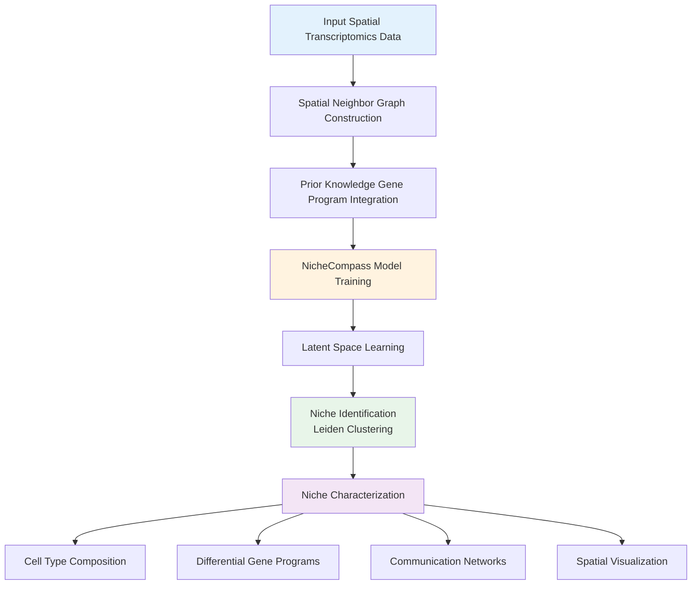
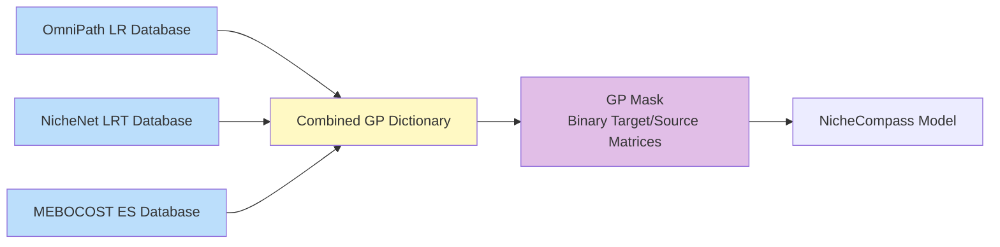
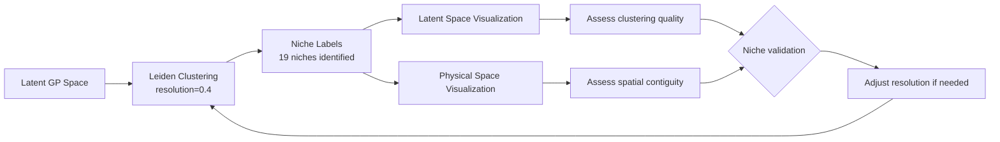

Single-sample niche identification enables the discovery and characterization of spatially coherent cellular niches within individual spatial transcriptomics samples using NicheCompass's gene program-based representation learning framework. This workflow identifies functionally distinct microenvironments by analyzing spatial relationships and gene program activation patterns across cells, providing biologically interpretable insights into tissue organization and cellular interactions without requiring multi-sample integration.

## Overview and Conceptual Framework

The single-sample niche identification workflow leverages NicheCompass's Variational Gene Program Graph Autoencoder (VGPGAE) architecture to learn a latent space where cells are embedded based on their spatial context and gene program activity. Unlike traditional clustering approaches that operate directly on gene expression, NicheCompass incorporates prior biological knowledge through gene program masks and spatial connectivity through graph convolution, enabling the identification of niches that reflect both molecular signatures and spatial organization.

The fundamental hypothesis is that cells sharing similar spatial neighborhoods and exhibiting coordinated activation of intercellular signaling pathways (ligand-receptor interactions, transcription factor programs, metabolic interactions) constitute functionally coherent cellular niches. By learning these patterns simultaneously, NicheCompass captures the complex interplay between cellular identity, spatial positioning, and microenvironmental communication.

The workflow progresses from raw spatial data through model training to comprehensive niche characterization, with each step building upon the learned representations. The modular design allows researchers to customize various components including gene program databases, spatial graph construction parameters, and analysis thresholds according to their specific biological questions and data characteristics.

Sources: [mouse_cns_single_sample.ipynb](docs/tutorials/notebooks/mouse_cns_single_sample.ipynb#L1-L50), [analysis.py](src/nichecompass/utils/analysis.py#L1-L4)

## Data Preparation and Configuration

### Parameter Definition

The single-sample workflow begins with comprehensive parameter configuration spanning dataset specifications, model architecture, training hyperparameters, and analysis settings. This configuration-driven approach ensures reproducibility and facilitates systematic exploration of different parameter combinations.

**Key Parameter Categories:**

| Category | Parameters | Purpose |
|----------|------------|---------|
| Dataset | `dataset`, `species`, `spatial_key`, `n_neighbors` | Define input data characteristics and spatial graph construction |
| Model Keys | `counts_key`, `adj_key`, `gp_names_key`, `latent_key` | Specify AnnData object keys for model inputs/outputs |
| Architecture | `conv_layer_encoder`, `active_gp_thresh_ratio` | Control neural network structure and gene program selection |
| Training | `n_epochs`, `lr`, `lambda_edge_recon`, `edge_batch_size` | Govern optimization process and loss weighting |
| Analysis | `cell_type_key`, `latent_leiden_resolution`, `spot_size` | Define niche identification and visualization parameters |

The spatial neighbor graph construction parameter (`n_neighbors`) critically influences the scale of spatial context captured. The tutorial demonstrates using `n_neighbors=4` for cellular-resolution data, which balances local neighborhood information with computational efficiency. For datasets with different spatial resolutions or tissue architectures, this parameter should be tuned accordingly [mouse_cns_single_sample.ipynb](docs/tutorials/notebooks/mouse_cns_single_sample.ipynb#L63-L65).

> [!TIP]
> The `active_gp_thresh_ratio` parameter determines the threshold for considering a gene program as active during training. Setting this too low may include noisy gene programs, while setting it too high may exclude biologically relevant pathways. The default value of 0.01 provides a balance that typically works well across diverse datasets.

### Prior Knowledge Gene Program Integration

NicheCompass incorporates biological prior knowledge through gene program masks that encode known intercellular and intracellular interaction pathways. For single-sample analysis, the tutorial combines three complementary databases:

1. **OmniPath**: Ligand-receptor interactions providing a comprehensive catalog of extracellular signaling pathways
2. **NicheNet**: Extended ligand-receptor-target relationships capturing downstream transcriptional effects
3. **MEBOCOST**: Enzyme-sensor interactions representing metabolic communication pathways

The gene program extraction process filters and combines these databases while maintaining biological interpretability. Each gene program is represented as a binary mask specifying source genes (e.g., ligands, enzymes) and target genes (e.g., receptors, transcription factors). The `filter_and_combine_gp_dict_gps_v2` function applies quality filters based on gene counts per gene program and removes redundancies across databases [mouse_cns_single_sample.ipynb](docs/tutorials/notebooks/mouse_cns_single_sample.ipynb#L250-L260).

The resulting combined gene program dictionary is added to the AnnData object as multiple mask layers:
- `nichecompass_gp_targets`: Binary matrix of target gene membership
- `nichecompass_gp_targets_categories`: Categories of target genes
- `nichecompass_gp_sources`: Binary matrix of source gene membership
- `nichecompass_gp_sources_categories`: Categories of source genes
- `nichecompass_gp_names`: Names of all gene programs

These masks guide the model's linear masked decoders, ensuring that latent dimensions correspond to interpretable biological programs rather than abstract features [mouse_cns_single_sample.ipynb](docs/tutorials/notebooks/mouse_cns_single_sample.ipynb#L340-L352).

### Spatial Graph Construction

NicheCompass requires a precomputed spatial adjacency matrix stored in `adata.obsp[adj_key]`. For the tutorial dataset (STARmap PLUS mouse CNS), the spatial graph is constructed using SquidPy's `spatial_neighbors` function with `n_neighs=4` to capture local cellular neighborhoods [mouse_cns_single_sample.ipynb](docs/tutorials/notebooks/mouse_cns_single_sample.ipynb#L295-L302).

The adjacency matrix is then symmetrized to ensure undirected graph representation, which is essential for consistent message passing during graph convolution. This step is critical as the spatial graph structure directly influences how the model incorporates neighborhood information into the learned latent representations.

> [!TIP]
> For datasets with irregular spatial sampling or varying cell densities, consider using distance-based neighbor graphs (e.g., KNN with distance thresholds) rather than fixed k-nearest neighbors. The tutorial's symmetrization step ensures bidirectional connectivity, which may not be appropriate for all spatial graph constructions.

Sources: [mouse_cns_single_sample.ipynb](docs/tutorials/notebooks/mouse_cns_single_sample.ipynb#L63-L95), [mouse_cns_single_sample.ipynb](docs/tutorials/notebooks/mouse_cns_single_sample.ipynb#L250-L260), [mouse_cns_single_sample.ipynb](docs/tutorials/notebooks/mouse_cns_single_sample.ipynb#L295-L302)

## Model Training

### Model Initialization

The NicheCompass model is initialized with the prepared AnnData object containing spatial data, gene expression counts, spatial adjacency, and gene program masks. The initialization configures:

- **Encoder architecture**: Graph convolutional network (GCNConv) with configurable layers
- **Latent dimensions**: Prior gene program dimensions (learned) + de novo additive dimensions
- **Decoders**: Masked linear decoders for source and target gene expression reconstruction
- **Active gene programs**: Those exceeding `active_gp_thresh_ratio` during initial training phase

The model architecture parameters reflect the dataset characteristics:
- `n_input: 1022`: Number of genes in the transcriptomics panel
- `n_hidden: 297`: Number of prior gene programs (combined from databases)
- `n_latent: 197`: Number of active gene programs after thresholding
- `n_addon_latent: 100`: Additional de novo dimensions for capturing unmodeled biology

This architecture balances prior knowledge incorporation with flexibility to discover novel patterns not encoded in existing databases [mouse_cns_single_sample.ipynb](docs/tutorials/notebooks/mouse_cns_single_sample.ipynb#L420-L432).

### Training Process

The training process employs a two-phase optimization strategy:

1. **All Gene Programs Phase (n_epochs_all_gps=25)**: Initial training using all gene programs to establish baseline patterns
2. **Active Gene Programs Phase (remaining epochs)**: Training focused on active gene programs to refine biologically relevant signals

The loss function combines multiple objectives:

| Loss Component | Weight | Purpose |
|----------------|--------|---------|
| Edge reconstruction | λ=500,000 | Preserve spatial connectivity in latent space |
| Gene expression reconstruction | λ=300 | Maintain molecular fidelity through masked decoders |
| L1 regularization (prior) | λ=0 | Sparsity constraint on prior gene programs |
| L1 regularization (de novo) | λ=30 | Sparsity constraint on additive dimensions |

The high weight on edge reconstruction loss ensures that spatial relationships are strongly encoded in the latent space, which is essential for identifying spatially coherent niches. The moderate gene expression reconstruction weight maintains molecular information while allowing the model to prioritize spatial patterns when necessary.

Training proceeds using edge-based mini-batching with sampled neighbors (`n_sampled_neighbors=4`) to enable efficient optimization on large spatial datasets. The Adam optimizer with learning rate `lr=0.001` provides stable convergence [mouse_cns_single_sample.ipynb](docs/tutorials/notebooks/mouse_cns_single_sample.ipynb#L434-L443).

### Latent Space Computation

After training, the model computes latent representations for all cells and derives downstream analyses:

1. **Latent neighbor graph**: Computes k-nearest neighbors in latent space using `sc.pp.neighbors` with the learned `nichecompass_latent` representation
2. **UMAP embedding**: Generates 2D visualization using `sc.tl.umap` on latent neighbors
3. **Model checkpointing**: Saves trained model and AnnData object with all computed results

The latent neighbor graph serves as the basis for niche identification through clustering, while the UMAP embedding provides intuitive visualization of the learned manifold structure [mouse_cns_single_sample.ipynb](docs/tutorials/notebooks/mouse_cns_single_sample.ipynb#L445-L453).

Sources: [mouse_cns_single_sample.ipynb](docs/tutorials/notebooks/mouse_cns_single_sample.ipynb#L420-L453)

## Niche Identification

### Leiden Clustering in Latent Space

Niche identification is performed by applying Leiden clustering to the latent neighbor graph, which identifies communities of cells with similar gene program activity patterns in the learned latent space. The clustering resolution parameter (`latent_leiden_resolution=0.4`) controls the granularity of identified niches, with higher values yielding more numerous, smaller niches and lower values producing fewer, larger niches [mouse_cns_single_sample.ipynb](docs/tutorials/notebooks/mouse_cns_single_sample.ipynb#L615-L620).

The choice of resolution parameter should be guided by biological considerations:
- **Low resolution (0.1-0.3)**: Captures broad tissue domains and major functional regions
- **Medium resolution (0.4-0.6)**: Identifies distinct microenvironments with specific cellular compositions
- **High resolution (0.7-1.0)**: Reveals fine-grained substructures and transitional zones

For the mouse CNS dataset, resolution 0.4 yielded 19 distinct niches that corresponded to anatomically and functionally meaningful brain regions while maintaining interpretability.

### Visualizing Niche Assignments

Niche assignments are visualized simultaneously in latent space (UMAP) and physical space (spatial coordinates) to assess spatial coherence of identified clusters. This dual visualization reveals:

1. **Latent space separation**: Distinct clustering of niches in UMAP indicates differential gene program activity
2. **Spatial contiguity**: Continuous spatial domains in physical space suggest biologically meaningful microenvironments
3. **Niche boundaries**: Sharp transitions or gradual gradients at interfaces between neighboring niches

The tutorial creates composite figures showing cell type annotations alongside niche assignments, enabling immediate assessment of how identified niches relate to known cellular identities [mouse_cns_single_sample.ipynb](docs/tutorials/notebooks/mouse_cns_single_sample.ipynb#L640-L686).

The iterative assessment of clustering results allows refinement of the resolution parameter based on biological interpretability and spatial coherence criteria.

Sources: [mouse_cns_single_sample.ipynb](docs/tutorials/notebooks/mouse_cns_single_sample.ipynb#L615-L686)

## Niche Characterization

### Cell Type Composition Analysis

The composition of each niche in terms of annotated cell types provides immediate biological context and validation of the identified microenvironments. The tutorial generates stacked bar charts showing the proportional representation of cell types within each niche [mouse_cns_single_sample.ipynb](docs/tutorials/notebooks/mouse_cns_single_sample.ipynb#L700-L718).

**Interpretation Guidelines:**

| Pattern | Interpretation |
|---------|----------------|
| Single dominant cell type (>80%) | Homogeneous microenvironment; niche likely defined by spatial positioning rather than cellular diversity |
| Mixed composition with clear majority | Structured microenvironment with supporting cell populations |
| Balanced multi-cell type composition | Complex microenvironment with diverse cellular interactions |
| Similar composition across neighboring niches | Gradual tissue organization with transitional zones |

This analysis bridges traditional cell type annotation with the niche-based perspective, revealing how cells of the same type may participate in different functional contexts depending on their spatial neighborhood and microenvironment.

### Differential Gene Program Testing

Differential gene program testing identifies which pathways distinguish each niche from others, providing mechanistic insights into the functional specialization of microenvironments. The tutorial performs "one-vs-rest" testing where each niche is compared against all other niches combined [mouse_cns_single_sample.ipynb](docs/tutorials/notebooks/mouse_cns_single_sample.ipynb#L745-L758).

The testing framework uses Bayesian statistical methods to quantify evidence for differential activation:

| Parameter | Value | Description |
|-----------|-------|-------------|
| `log_bayes_factor_thresh` | 2.3 | Threshold for strong evidence (based on standard Bayes factor interpretation) |
| `selected_cats` | None | Test all niches (one-vs-rest) |
| `comparison_cats` | "rest" | Compare against all other niches |

The output provides:
- **Gene program**: Name of the tested pathway
- **p_h0**: Probability under null hypothesis (no differential activation)
- **p_h1**: Probability under alternative hypothesis (differential activation)
- **log_bayes_factor**: Log of Bayes factor (positive = enriched in niche, negative = depleted)

A log Bayes factor > 2.3 indicates strong evidence for enrichment (>100:1 odds), while < -2.3 indicates strong evidence for depletion. This threshold follows standard interpretation from Bayesian statistics and provides a conservative criterion for identifying biologically meaningful differences.

The tutorial identified 215 active gene programs out of 297 total, with specific programs enriched in particular niches (e.g., ALCAM_combined_GP strongly enriched in niche 2 with log Bayes factor 11.78) [mouse_cns_single_sample.ipynb](docs/tutorials/notebooks/mouse_cns_single_sample.ipynb#L985-L1002).

### Spatial Visualization of Enriched Gene Programs

The `generate_enriched_gp_info_plots` function creates spatial visualizations showing the distribution of differentially enriched gene programs across the tissue section. These plots overlay gene program activity on physical space, revealing:

- **Spatial domains**: Regions where specific pathways are active
- **Gradient patterns**: Gradual changes in pathway activity across tissue boundaries
- **Hotspot detection**: Focal areas of intense pathway activation

The visualization supports biological interpretation by connecting abstract gene program activity to concrete spatial patterns in tissue architecture. The tutorial uses spot size `0.2` for cellular-resolution data, balancing detail with visibility [mouse_cns_single_sample.ipynb](docs/tutorials/notebooks/mouse_cns_single_sample.ipynb#L212-L228).

### Cell-Cell Communication Network Analysis

NicheCompass enables reconstruction of inter-niche communication networks based on coordinated gene program activity. The `compute_communication_gp_network` function analyzes how niches interact through ligand-receptor and other signaling pathways [analysis.py](src/nichecompass/utils/analysis.py#L871-L913).

**Network Construction Steps:**

1. **Gene program selection**: Identify active communication pathways (e.g., ligand-receptor GPs)
2. **Niche aggregation**: Compute average gene program activity per niche
3. **Communication strength**: Quantify signaling intensity between niche pairs
4. **Edge filtering**: Remove weak connections below significance threshold

The resulting network can be visualized using `visualize_communication_gp_network`, which displays niches as nodes weighted by size/properties and communication pathways as edges with thickness proportional to strength. Color coding can distinguish different edge types (e.g., different ligand-receptor classes) [analysis.py](src/nichecompass/utils/analysis.py#L1014-L1034).

> [!TIP]
> Communication network analysis is particularly valuable for identifying hub niches that serve as signaling centers, discovering novel inter-niche communication pathways, and understanding how tissue organization facilitates or constrains intercellular signaling. The `n_neighbors` parameter (default: 90) controls the number of edges in the network and should be adjusted based on tissue complexity.

Sources: [mouse_cns_single_sample.ipynb](docs/tutorials/notebooks/mouse_cns_single_sample.ipynb#L700-L1002), [analysis.py](src/nichecompass/utils/analysis.py#L212-L228), [analysis.py](src/nichecompass/utils/analysis.py#L871-L1034)

## Advanced Analysis Features

### Gene Program Summary and Active GP Extraction

The `get_gp_summary()` method provides comprehensive information about all gene programs learned by the model, including [mouse_cns_single_sample.ipynb](docs/tutorials/notebooks/mouse_cns_single_sample.ipynb#L975-L982):

- **Gene program identification**: Name and index information
- **Activation status**: Whether the GP is active (exceeds threshold)
- **Source/target composition**: Number of genes and non-zero weights
- **Gene-level details**: Lists of source and target genes with weights and importance scores

The importance scores quantify the contribution of each gene to the gene program's activity, enabling prioritization of key mediators for downstream validation experiments. For example, the tutorial shows that C1QB ligand has high importance (0.4189) in its receptor-target gene program, suggesting a key signaling role.

### Custom Visualization Functions

The analysis utilities module provides several specialized visualization functions for niche characterization:

1. **`create_cell_type_chord_plot_from_df`**: Generates chord diagrams showing cell type interactions between niches, with link thresholds controlling display sensitivity [analysis.py](src/nichecompass/utils/analysis.py#L105-L114)
2. **`aggregate_obsp_matrix_per_cell_type`**: Summarizes spatial connectivity patterns by cell type, revealing tissue-scale organizational principles [analysis.py](src/nichecompass/utils/analysis.py#L23-L28)
3. **`create_new_color_dict`**: Creates custom color palettes for consistent visualization across multiple plots, with options for handling unassigned categories [analysis.py](src/nichecompass/utils/analysis.py#L734-L740)

These utilities enable researchers to create publication-quality visualizations that effectively communicate niche identification results.

### Parameter Sensitivity Analysis

Systematic exploration of key parameters allows optimization of niche identification for specific datasets:

**Resolution Sensitivity**: Test multiple Leiden clustering resolutions (0.2-1.0) and assess:
- Number of niches identified
- Spatial contiguity of each niche
- Biological interpretability of niche composition
- Reproducibility across subsamples

**Gene Program Threshold Sensitivity**: Vary `active_gp_thresh_ratio` (0.005-0.05) to evaluate:
- Number of active gene programs
- Latent space structure
- Niche stability
- Computational efficiency

**Spatial Neighbor Sensitivity**: Adjust `n_neighbors` (2-8) for different spatial scales:
- Local microenvironments (2-3 neighbors)
- Intermediate neighborhoods (4-6 neighbors)
- Tissue-scale domains (7+ neighbors)

This systematic approach ensures robust niche identification that captures biologically meaningful patterns while avoiding overfitting to noise.

Sources: [mouse_cns_single_sample.ipynb](docs/tutorials/notebooks/mouse_cns_single_sample.ipynb#L975-L1002), [analysis.py](src/nichecompass/utils/analysis.py#L23-L114), [analysis.py](src/nichecompass/utils/analysis.py#L734-L740)

## Summary and Next Steps

Single-sample niche identification with NicheCompass provides a powerful framework for discovering spatially coherent cellular microenvironments in spatial transcriptomics data. The workflow integrates prior biological knowledge through gene program masks with data-driven pattern learning, resulting in biologically interpretable niches that reflect both molecular signatures and spatial organization.

**Key Capabilities:**
- Identifies spatially contiguous niches with distinct gene program activity patterns
- Provides mechanistic insights through differential pathway analysis
- Reveals inter-niche communication networks
- Generates comprehensive characterizations of tissue organization at cellular resolution
- Enables comparison across multiple samples through consistent analysis pipelines

**Practical Considerations:**
- Parameter tuning (resolution, neighbor count, GP threshold) should be guided by biological questions and data characteristics
- Computational requirements scale with dataset size, requiring appropriate hardware for large sections
- Biological interpretation should integrate niche results with orthogonal validation (histology, functional assays)

**Recommended Next Steps:**

For researchers working with single spatial samples, consider progressing through these advanced topics:

- **[Latent Representation Extraction and Visualization](22-latent-representation-extraction-and-visualization)**: Deepen understanding of the learned latent space structure through advanced dimensionality reduction and visualization techniques

- **[Differential Gene Program Testing](23-differential-gene-program-testing)**: Explore statistical frameworks for comparing gene program activity across conditions, timepoints, or perturbations

- **[Cell-Cell Communication Network Analysis](24-cell-cell-communication-network-analysis)**: Dive deeper into communication network reconstruction and analysis for understanding inter-niche signaling

- **[Niche Characterization and Gene Importance Computation](25-niche-characterization-and-gene-importance-computation)**: Learn advanced methods for quantifying gene-level contributions to niche identity

For researchers with multiple spatial samples, the natural progression is:

- **[Sample Integration and Spatial Atlas Building](20-sample-integration-and-spatial-atlas-building)**: Extend single-sample analysis to multi-sample integration for constructing comprehensive spatial atlases

- **[Spatial Reference Mapping Across Datasets](21-spatial-reference-mapping-across-datasets)**: Map new samples onto existing atlases for standardized analysis and annotation
