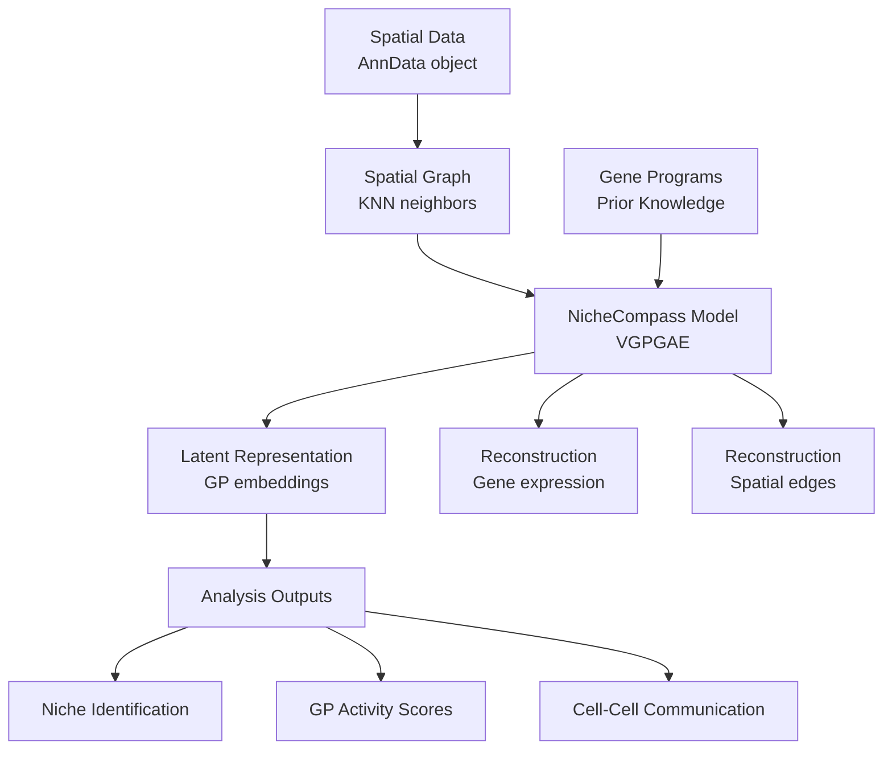
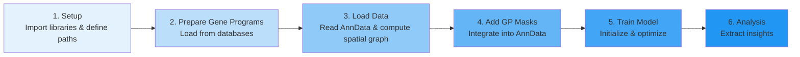

Get up and running with NicheCompass in minutes. This guide walks you through the essential workflow for analyzing spatial multi-omics data, from installation to your first analysis.


NicheCompass (**N**iche **I**dentification based on **C**ellular grap**H** **E**mbeddings of **COM**munication **P**rograms **A**ligned across **S**patial **S**amples) enables end-to-end analysis of spatial multi-omics data including spatial atlas building, niche identification & characterization.

Sources: [README.md](README.md#L1-L10), [index.md](docs/index.md#L1-L10)

## What You'll Learn

This Quick Start covers the complete NicheCompass workflow:
- Installing required dependencies
- Preparing spatial data with gene programs
- Training the NicheCompass model
- Performing initial analysis

By the end, you'll understand the core architecture and be ready to explore advanced features in the full tutorials.

Sources: [mouse_cns_single_sample.ipynb](docs/tutorials/notebooks/mouse_cns_single_sample.ipynb#L10-L25)

## Architecture Overview

NicheCompass uses a Variational Gene Program Graph Autoencoder (VGPGAE) architecture that integrates spatial information with biological prior knowledge through gene programs.



The model leverages **graph convolutional neural networks** to encode spatial relationships and **masked linear decoders** to ensure interpretability of gene program activity. Key components include the encoder with configurable GCN or GAT layers, gene expression decoder, edge reconstruction decoder, and latent GP embeddings.

Sources: [nichecompass.py](src/nichecompass/models/nichecompass.py#L24-L248), [mouse_cns_single_sample.ipynb](docs/tutorials/notebooks/mouse_cns_single_sample.ipynb#L200-L250)

## Prerequisites

NicheCompass requires:
- **Python 3.10**
- **GPU support** recommended (Apple silicon and multi-GPU not yet supported)
- **Virtual environment** (conda, python-venv, or Docker)

**Hardware Requirements**:
- Minimum: 8GB RAM, 4GB GPU memory
- Recommended: 16GB+ RAM, 8GB+ GPU memory

> [!TIP]
> For training on multimodal data (RNA + ATAC-seq), we strongly recommend using conda environments due to bedtools dependency.

Sources: [installation.md](docs/installation.md#L1-L20)

## Installation

### Step 1: Create Virtual Environment

```bash
# Using python-venv (fastest for unimodal training)
python3 -m venv nichecompass_env
source nichecompass_env/bin/activate
pip install uv

# OR using conda (recommended for multimodal training)
conda create -n nichecompass_env python=3.10 -c conda-forge
conda activate nichecompass_env
```

Sources: [installation.md](docs/installation.md#L22-L38)

### Step 2: Install External Dependencies

**Option A: Using environment.yaml (Recommended for beginners)**

```bash
conda env create -f environment.yaml
```

This installs PyTorch 2.0.0 with CUDA 11.7, PyTorch Scatter, PyTorch Sparse, and bedtools.

Sources: [environment.yaml](environment.yaml#L1-L15), [installation.md](docs/installation.md#L60-L70)

**Option B: Manual installation (More control)**

```bash
# Install PyTorch with GPU support
uv pip install torch --index-url https://download.pytorch.org/whl/cu124

# Install PyTorch Geometric extensions
uv pip install pyg_lib torch_scatter torch_sparse -f https://data.pyg.org/whl/torch-2.6.0+cu124.html

# Install bedtools (required for ATAC-seq data)
conda install bedtools=2.30.0 -c bioconda
```

Sources: [installation.md](docs/installation.md#L40-L60)

### Step 3: Install NicheCompass

```bash
# Core installation
uv pip install nichecompass

# With all optional dependencies (tutorials, benchmarking, etc.)
uv pip install nichecompass[all]
```

Sources: [installation.md](docs/installation.md#L72-L80)

## Quick Start Workflow

The complete NicheCompass pipeline follows this sequence:



Sources: [mouse_cns_single_sample.ipynb](docs/tutorials/notebooks/mouse_cns_single_sample.ipynb#L50-L650)

## Step-by-Step Tutorial

### 1. Setup and Configuration

```python
import os
import numpy as np
import scanpy as sc
import squidpy as sq
from nichecompass.models import NicheCompass
from nichecompass.utils import (
    extract_gp_dict_from_omnipath_lr_interactions,
    extract_gp_dict_from_nichenet_lrt_interactions,
    extract_gp_dict_from_mebocost_ms_interactions,
    filter_and_combine_gp_dict_gps_v2,
    add_gps_from_gp_dict_to_adata,
    create_new_color_dict
)

# Define paths
ga_data_folder_path = "data/gene_annotations"
gp_data_folder_path = "data/gene_programs"
so_data_folder_path = "data/spatial_omics"
model_folder_path = "artifacts/single_sample/model"
figure_folder_path = "artifacts/single_sample/figures"
```

Sources: [mouse_cns_single_sample.ipynb](docs/tutorials/notebooks/mouse_cns_single_sample.ipynb#L50-L120)

### 2. Create Prior Knowledge Gene Programs

NicheCompass uses biological prior knowledge through gene programs (GPs). These represent inter- and intracellular communication pathways that make the latent space interpretable.

**Available GP Sources**:

| Database | Type | Description | Example GPs |
|----------|------|-------------|-------------|
| **OmniPath** | Ligand-Receptor | Curated signaling pathways | EGFR-ERBB2, PDGF-PDGFR |
| **NicheNet** | Combined | Ligand-receptor-target interactions | WNT signaling, Notch pathway |
| **MEBOCOST** | Metabolic | Enzyme-sensor interactions | ATP-AMP, Glucose transport |
| **CollecTRI** | TF Regulation | Transcription factor networks | TP53 targets, MYC targets |

```python
species = "mouse"

# Extract gene programs from databases
omnipath_gp_dict = extract_gp_dict_from_omnipath_lr_interactions(
    species=species,
    lr_network_file_path=f"{gp_data_folder_path}/omnipath_lr_network.csv",
    gene_orthologs_mapping_file_path=f"{ga_data_folder_path}/human_mouse_gene_orthologs.csv"
)

nichenet_gp_dict = extract_gp_dict_from_nichenet_lrt_interactions(
    species=species,
    lr_network_file_path=f"{gp_data_folder_path}/nichenet_lr_network_v2_mouse.csv",
    ligand_target_matrix_file_path=f"{gp_data_folder_path}/nichenet_ligand_target_matrix_v2_mouse.csv",
    max_n_target_genes_per_gp=250
)

mebocost_gp_dict = extract_gp_dict_from_mebocost_ms_interactions(
    species=species,
    dir_path=f"{gp_data_folder_path}/metabolite_enzyme_sensor_gps"
)

# Filter and combine gene programs
gp_dicts = [omnipath_gp_dict, nichenet_gp_dict, mebocost_gp_dict]
combined_gp_dict = filter_and_combine_gp_dict_gps_v2(gp_dicts, verbose=True)

print(f"Total gene programs: {len(combined_gp_dict)}")
```

Sources: [gene_programs.py](src/nichecompass/utils/gene_programs.py#L600-L771), [mouse_cns_single_sample.ipynb](docs/tutorials/notebooks/mouse_cns_single_sample.ipynb#L220-L360)

### 3. Load Spatial Data and Compute Neighborhood Graph

```python
# Load AnnData object (pre-processed spatial data)
adata = sc.read_h5ad(f"{so_data_folder_path/starmap_plus_mouse_cns.h5ad")

# Compute spatial neighborhood graph
n_neighbors = 4  # Adjust based on your data's interaction range
sq.gr.spatial_neighbors(
    adata,
    coord_type="generic",
    spatial_key="spatial",
    n_neighs=n_neighbors
)

# Make adjacency matrix symmetric
adata.obsp["spatial_connectivities"] = (
    adata.obsp["spatial_connectivities"].maximum(
        adata.obsp["spatial_connectivities"].T
    )
)

# Add gene program masks to AnnData
add_gps_from_gp_dict_to_adata(
    gp_dict=combined_gp_dict,
    adata=adata,
    gp_targets_mask_key="nichecompass_gp_targets",
    gp_sources_mask_key="nichecompass_gp_sources",
    gp_names_key="nichecompass_gp_names",
    min_genes_per_gp=2
)

print(f"Cells: {adata.n_obs}, Genes: {adata.n_vars}")
```

Sources: [mouse_cns_single_sample.ipynb](docs/tutorials/notebooks/mouse_cns_single_sample.ipynb#L400-L480), [gene_programs.py](src/nichecompass/utils/gene_programs.py#L18-L40)

### 4. Initialize and Train Model

**Key Configuration Parameters**:

| Parameter | Recommended Range | Description |
|-----------|------------------|-------------|
| `conv_layer_encoder` | `"gcnconv"` or `"gatv2conv"` | Graph convolution type (GATv2 is more accurate but slower) |
| `n_neighbors` | 4-10 | Spatial neighborhood size |
| `n_epochs` | 300-500 | Training epochs |
| `n_epochs_all_gps` | 20-50 | Initial training with all GPs active |
| `lambda_edge_recon` | 100000-500000 | Edge reconstruction loss weight |
| `lambda_gene_expr_recon` | 200-500 | Gene expression reconstruction weight |
| `lambda_l1_addon` | 20-50 | De novo GP regularization |

```python
# Initialize NicheCompass model
model = NicheCompass(
    adata=adata,
    counts_key="counts",
    adj_key="spatial_connectivities",
    gp_names_key="nichecompass_gp_names",
    active_gp_names_key="nichecompass_active_gp_names",
    gp_targets_mask_key="nichecompass_gp_targets",
    gp_sources_mask_key="nichecompass_gp_sources",
    latent_key="nichecompass_latent",
    conv_layer_encoder="gcnconv",  # Use "gatv2conv" for better accuracy
    active_gp_thresh_ratio=0.01
)

# Train the model
model.train(
    n_epochs=400,
    n_epochs_all_gps=25,
    lr=0.001,
    lambda_edge_recon=500000,
    lambda_gene_expr_recon=300,
    lambda_l1_masked=0,
    lambda_l1_addon=30,
    edge_batch_size=256,
    use_cuda_if_available=True,
    verbose=True
)

# Compute latent space embedding
sc.pp.neighbors(model.adata, use_rep="nichecompass_latent")
sc.tl.umap(model.adata)

# Save model
model.save(dir_path=model_folder_path, overwrite=True, save_adata=True)
```

Sources: [nichecompass.py](src/nichecompass/models/nichecompass.py#L590-L620), [mouse_cns_single_sample.ipynb](docs/tutorials/notebooks/mouse_cns_single_sample.ipynb#L530-L580)

### 5. Initial Analysis

```python
# Visualize latent space
cell_type_colors = create_new_color_dict(
    adata=model.adata,
    cat_key="cell_type"
)

# UMAP of latent space
sc.pl.umap(
    model.adata,
    color=["cell_type"],
    palette=cell_type_colors,
    title="Cell Types in NicheCompass Latent Space"
)

# Spatial visualization
sc.pl.spatial(
    model.adata,
    color="cell_type",
    palette=cell_type_colors,
    spot_size=40
)

# Get active gene programs
active_gps = model.get_active_gps()
print(f"Active gene programs: {len(active_gps)}")

# Get latent representation
latent = model.get_latent_representation()
print(f"Latent shape: {latent.shape}")
```

Sources: [nichecompass.py](src/nichecompass/models/nichecompass.py#L1264-L1276), [nichecompass.py](src/nichecompass/models/nichecompass.py#L1235-L1250), [mouse_cns_single_sample.ipynb](docs/tutorials/notebooks/mouse_cns_single_sample.ipynb#L700-L750)

> [!TIP]
> Always start with the default hyperparameters. The balance between `lambda_edge_recon` and `lambda_gene_expr_recon` is crucial - higher edge weights improve niche identification while higher gene expression weights improve GP recovery.

## What's Next

Now that you've completed your first NicheCompass analysis, explore these resources:

### Full Tutorials

- **[Single Sample Analysis](notebooks/mouse_cns_single_sample)** - Complete walkthrough for analyzing individual spatial samples
- **[Sample Integration](mouse_cns_sample_integration)** - Learn to combine multiple spatial samples into a unified atlas
- **[Spatial Reference Mapping](mouse_cns_spatial_reference_mapping)** - Map new data to existing spatial references
- **[Multimodal Analysis](mouse_brain_multimodal)** - Integrate RNA and ATAC-seq data simultaneously

Sources: [tutorials/index.md](docs/tutorials/index.md#L1-L12)

### Deep Dive Documentation

- **[NicheCompass Model Architecture](4-nichecompass-model-architecture-and-core-concepts)** - Understanding the VGPGAE design principles
- **[Training Process](15-training-process-and-optimization-strategy)** - Advanced training strategies and optimization
- **[Gene Program Integration](12-prior-knowledge-gene-programs-and-biological-interpretation)** - Customizing gene programs for your research
- **[Hyperparameter Tuning](27-loss-weight-balancing-and-regularization-strategies)** - Fine-tuning model performance

Sources: [index.md](docs/index.md#L20-L66)

### User Guide

- **[User Guide](user_guide/index)** - Best practices and hyperparameter recommendations based on extensive benchmarking
- **[API Reference](api/index)** - Complete API documentation for all functions and classes

Sources: [user_guide/index.md](docs/user_guide/index.md#L1-L14)

## Common Use Cases

NicheCompass supports several analytical workflows. Choose based on your research question:

| Use Case | Tutorial | Key Features |
|----------|----------|--------------|
| **Single sample analysis** | `mouse_cns_single_sample.ipynb` | Niche identification, GP activity, spatial patterns |
| **Sample integration** | `mouse_cns_sample_integration.ipynb` | Multi-sample atlas, batch correction, joint embeddings |
| **Reference mapping** | `mouse_cns_spatial_reference_mapping.ipynb` | Map new samples to references, query analysis |
| **Multimodal analysis** | `mouse_brain_multimodal.ipynb` | RNA + ATAC-seq integration, chromatin accessibility |

Sources: [tutorials/index.md](docs/tutorials/index.md#L1-L12)

## Getting Help

- **Documentation**: [Full docs](https://nichecompass.readthedocs.io/)
- **Issues**: [GitHub Issues](https://github.com/Lotfollahi-lab/nichecompass/issues) for bug reports
- **Contributing**: [Contributing Guide](contributing.md)
- **Citation**: If you find NicheCompass useful, please cite [Birk et al., Nature Genetics 2025](https://doi.org/10.1038/s41588-025-02120-6)

Sources: [README.md](README.md#L12-L30)

---

Ready to dive deeper? Continue to [Installation and Setup](3-installation-and-setup) for detailed environment configuration, or jump straight into the [NicheCompass Model Architecture](4-nichecompass-model-architecture-and-core-concepts) to understand the underlying design principles.