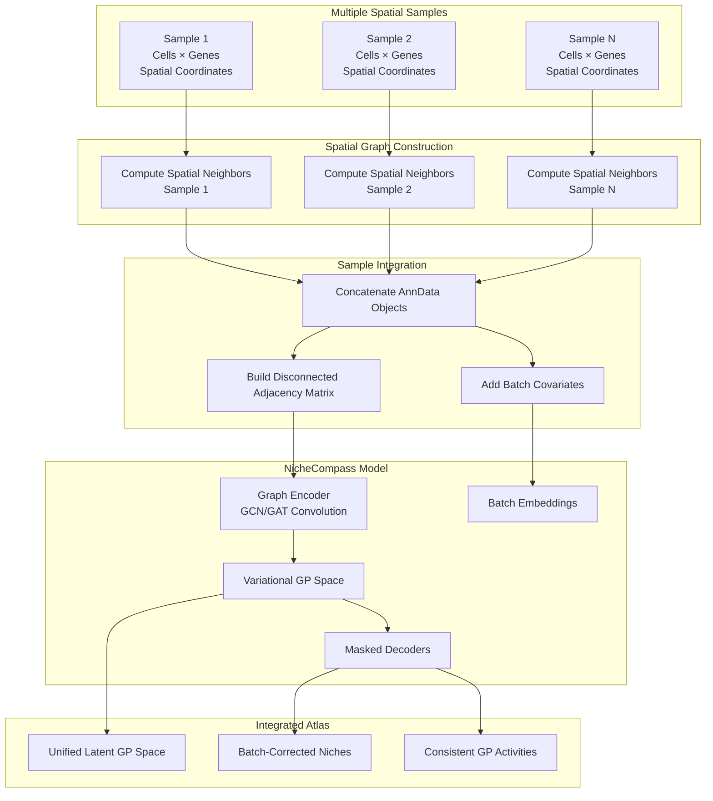
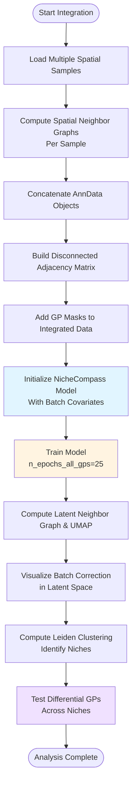

Sample integration and spatial atlas building enables the construction of comprehensive spatial atlases by combining multiple spatial transcriptomics samples into a unified, batch-corrected representation. This workflow leverages NicheCompass's graph-based architecture to preserve spatial relationships within each sample while learning a shared latent space that integrates biological signals across samples, ultimately enabling the identification of consistent niches and cell-cell communication patterns across different experimental batches.


## Architectural Overview

Sample integration in NicheCompass follows a multi-stage architecture where each spatial sample maintains its internal spatial connectivity while the model learns a unified latent representation that accounts for batch effects through categorical covariate embeddings. The key architectural innovation lies in constructing disconnected spatial graphs—each sample's spatial neighbors form a separate connected component—allowing the graph neural network to respect spatial locality while the variational gene program autoencoder learns to extract batch-invariant biological programs.



The architecture leverages **disconnected graph components** for spatial adjacency while enabling **cross-sample information flow** through the encoder-decoder architecture and batch covariate conditioning. This design ensures that spatial relationships within each sample are preserved (edges only exist within samples), while the model learns to extract batch-invariant biological representations through the variational framework.

Sources: [mouse_cns_sample_integration.ipynb](docs/tutorials/notebooks/mouse_cns_sample_integration.ipynb#L1-L200), [nichecompass.py](src/nichecompass/models/nichecompass.py#L1-L150)

## Sample Integration Workflow

The sample integration workflow follows a systematic process from data loading through model training to integrated analysis. Each stage requires careful configuration to ensure proper batch correction while preserving biological signals.



This workflow demonstrates how NicheCompass transforms multiple independent spatial datasets into a unified atlas. The critical integration step occurs during the disconnected adjacency matrix construction, where spatial neighbors are computed separately for each batch and then combined without inter-batch edges, preserving spatial locality while enabling batch covariate learning.

Sources: [mouse_cns_sample_integration.ipynb](docs/tutorials/notebooks/mouse_cns_sample_integration.ipynb#L200-L600), [dataprocessors.py](src/nichecompass/data/dataprocessors.py#L1-L150)

## Data Preparation and Integration

The foundation of successful sample integration lies in proper data preparation, where each spatial sample is processed independently before combination. This approach ensures that spatial relationships are respected while enabling the model to learn batch-corrected representations.

### Loading and Preparing Individual Samples

Each spatial sample is loaded as a separate AnnData object containing gene expression counts, spatial coordinates, and cell type annotations. In the mouse CNS tutorial, three sagittal brain sections are processed, each containing 91k-207k cells with 1022 probed genes. The spatial coordinates are stored under the `spatial` key in `adata.obsm`.

```python
# Process each batch separately
adata_batch_list = []
for batch in batches:
    print(f"Processing batch {batch}...")
    adata_batch = sc.read_h5ad(
        f"{so_data_folder_path}/{dataset}_{batch}.h5ad")
    
    # Compute spatial neighborhood graphs
    sq.gr.spatial_neighbors(adata_batch,
                            coord_type="generic",
                            spatial_key=spatial_key,
                            n_neighs=n_neighbors)
    
    # Make adjacency matrix symmetric
    adata_batch.obsp[adj_key] = (
        adata_batch.obsp[adj_key].maximum(
            adata_batch.obsp[adj_key].T))
    adata_batch_list.append(adata_batch)
```

The critical insight here is that **spatial neighbors are computed per sample** before integration, ensuring that only cells within physical proximity in the same section are considered neighbors. This preserves the spatial structure of each tissue section.

Sources: [mouse_cns_sample_integration.ipynb](docs/tutorials/notebooks/mouse_cns_sample_integration.ipynb#L400-L500)

### Constructing Disconnected Spatial Graphs

The key innovation in NicheCompass's sample integration is the construction of a **disconnected adjacency matrix** where each sample forms its own connected component. This architecture allows the graph neural network to leverage spatial information within samples while preventing artificial edges between samples that would introduce spatial artifacts.

```python
# Combine spatial neighborhood graphs as disconnected components
batch_connectivities = []
len_before_batch = 0
for i in range(len(adata_batch_list)):
    if i == 0: # first batch
        after_batch_connectivities_extension = sp.csr_matrix(
            (adata_batch_list[0].shape[0],
            (adata.shape[0] - adata_batch_list[0].shape[0])))
        batch_connectivities.append(sp.hstack(
            (adata_batch_list[0].obsp[adj_key],
            after_batch_connectivities_extension)))
    elif i == (len(adata_batch_list) - 1): # last batch
        before_batch_connectivities_extension = sp.csr_matrix(
            (adata_batch_list[i].shape[0],
            (adata.shape[0] - adata_batch_list[i].shape[0])))
        batch_connectivities.append(sp.hstack(
            (before_batch_connectivities_extension,
            adata_batch_list[i].obsp[adj_key])))
    else: # middle batches
        before_batch_connectivities_extension = sp.csr_matrix(
            (adata_batch_list[i].shape[0], len_before_batch))
        after_batch_connectivities_extension = sp.csr_matrix(
            (adata_batch_list[i].shape[0],
            (adata.shape[0] - adata_batch_list[i].shape[0] - len_before_batch)))
        batch_connectivities.append(sp.hstack(
            (before_batch_connectivities_extension,
            adata_batch_list[i].obsp[adj_key],
            after_batch_connectivities_extension)))
    len_before_batch += adata_batch_list[i].shape[0]
adata.obsp[adj_key] = sp.vstack(batch_connectivities)
```

This algorithm constructs a **block-diagonal adjacency matrix** where each block corresponds to one sample's spatial connectivity graph. The `SpatialAnnTorchDataset` class validates that the adjacency matrix is symmetric, which is maintained through this construction method.

Sources: [mouse_cns_sample_integration.ipynb](docs/tutorials/notebooks/mouse_cns_sample_integration.ipynb#L450-L550), [datasets.py](src/nichecompass/data/datasets.py#L1-L100)

> [!TIP]
> The disconnected graph structure is critical for spatial integrity—cells from different samples should never have spatial edges, even if they happen to have similar expression profiles. The model learns to align them in latent space through the encoder-decoder architecture and batch covariate conditioning, not through artificial spatial connections.

### Parameter Configuration for Sample Integration

Successful sample integration requires careful parameter configuration, particularly for batch covariates and training strategies. The following table summarizes key parameters specific to sample integration scenarios:

| Parameter | Description | Recommended Value | Notes |
|-----------|-------------|-------------------|-------|
| `cat_covariates_keys` | List of categorical covariate keys | `["batch"]` | Must include batch identifier column |
| `cat_covariates_embeds_injection` | Decoder injection points | `["gene_expr_decoder"]` | Inject batch embeddings into decoder |
| `cat_covariates_embeds_nums` | Number of embedding dimensions | `[3]` (for 3 batches) | Must match number of unique batch values |
| `cat_covariates_no_edges` | Disable edge reconstruction across batches | `[True]` | Prevents modeling inter-batch edges |
| `n_neighbors` | Spatial neighbors per sample | `4-6` | Depends on spatial resolution |
| `n_epochs_all_gps` | Initial training epochs | `25` | Warm-up before GP pruning |
| `lambda_edge_recon` | Edge reconstruction loss weight | `500000` | Higher for spatial preservation |

The batch covariates configuration is particularly important—the `cat_covariates_no_edges` parameter set to `True` ensures that the model doesn't attempt to reconstruct edges between different batch categories, which is appropriate given the disconnected graph structure.

Sources: [mouse_cns_sample_integration.ipynb](docs/tutorials/notebooks/mouse_cns_sample_integration.ipynb#L50-L100), [nichecompass.py](src/nichecompass/models/nichecompass.py#L150-L250)

## Model Training for Integration

Training NicheCompass for sample integration follows the general training workflow with specific considerations for batch correction. The model learns to separate batch effects from biological signals through the interplay of gene program reconstruction, edge reconstruction, and batch covariate conditioning.

### Model Initialization with Batch Covariates

The NicheCompass model is initialized with batch covariate information, which creates learnable embeddings for each batch that are injected into the decoder architecture:

```python
model = NicheCompass(
    adata,
    counts_key=counts_key,
    adj_key=adj_key,
    cat_covariates_embeds_injection=cat_covariates_embeds_injection,
    cat_covariates_keys=cat_covariates_keys,
    cat_covariates_no_edges=cat_covariates_no_edges,
    cat_covariates_embeds_nums=cat_covariates_embeds_nums,
    gp_names_key=gp_names_key,
    active_gp_names_key=active_gp_names_key,
    gp_targets_mask_key=gp_targets_mask_key,
    gp_targets_categories_mask_key=gp_targets_categories_mask_key,
    gp_sources_mask_key=gp_sources_mask_key,
    gp_sources_categories_mask_key=gp_sources_categories_mask_key,
    latent_key=latent_key,
    conv_layer_encoder=conv_layer_encoder,
    active_gp_thresh_ratio=active_gp_thresh_ratio)
```

The initialization creates a model where the encoder processes the disconnected spatial graph, learning batch-invariant representations in the variational gene program space, while the decoder uses batch embeddings to reconstruct gene expression conditioned on both the latent representation and batch information.

Sources: [mouse_cns_sample_integration.ipynb](docs/tutorials/notebooks/mouse_cns_sample_integration.ipynb#L600-L650), [nichecompass.py](src/nichecompass/models/nichecompass.py#L150-L300)

### Training Strategy

The training process for sample integration uses a staged approach to gradually refine the gene program space:

```python
model.train(
    n_epochs=n_epochs,
    n_epochs_all_gps=n_epochs_all_gps,
    lr=lr,
    lambda_edge_recon=lambda_edge_recon,
    lambda_gene_expr_recon=lambda_gene_expr_recon,
    lambda_l1_masked=lambda_l1_masked,
    edge_batch_size=edge_batch_size,
    n_sampled_neighbors=n_sampled_neighbors,
    use_cuda_if_available=use_cuda_if_available,
    verbose=False)
```

The key training parameter is `n_epochs_all_gps=25`, which indicates that the model trains with all gene programs enabled for the first 25 epochs before pruning inactive programs based on the `active_gp_thresh_ratio=0.01`. The `Trainer` class implements this staged training through the `train` method, which manages the GP pruning process and loss computation.

The training involves multiple loss components that balance spatial reconstruction, gene expression reconstruction, and batch effect correction:

- **Edge Reconstruction Loss** (`lambda_edge_recon=500000`): Reconstructs the spatial connectivity, preserving within-sample spatial relationships
- **Gene Expression Reconstruction Loss** (`lambda_gene_expr_recon=300`): Uses negative binomial distribution to reconstruct gene expression conditioned on latent GPs and batch embeddings
- **L1 Regularization** (`lambda_l1_addon=30`): Encourages sparsity in de novo gene program weights

Sources: [mouse_cns_sample_integration.ipynb](docs/tutorials/notebooks/mouse_cns_sample_integration.ipynb#L650-L700), [trainer.py](src/nichecompass/train/trainer.py#L217-L300)

## Analysis of Integrated Spatial Atlas

After training, the integrated spatial atlas can be analyzed to assess batch correction, identify consistent niches, and discover batch-invariant biological programs. The analysis workflow examines both the latent space representation and spatial mapping across samples.

### Evaluating Batch Correction

The first analysis step is to visualize how well batches are integrated in the latent gene program space. Successful integration should show mixing of batches in the latent space while preserving biological structure (cell types cluster together regardless of batch):

```python
# Compute latent neighbor graph
sc.pp.neighbors(model.adata,
                use_rep=latent_key,
                key_added=latent_key)

# Compute UMAP embedding
sc.tl.umap(model.adata,
           neighbors_key=latent_key)

# Visualize batch distribution in latent space
batch_colors = create_new_color_dict(
    adata=model.adata,
    cat_key=cat_covariates_keys[0])
sc.pl.umap(model.adata,
           color=[cat_covariates_keys[0], cell_type_key],
           palette=batch_colors)
```

When integration is successful, cells from different batches should intermix in the latent space for the same cell types, demonstrating that batch effects have been removed while biological differences are preserved. The UMAP visualization in the tutorial shows this effect for the mouse CNS dataset.

Sources: [mouse_cns_sample_integration.ipynb](docs/tutorials/notebooks/mouse_cns_sample_integration.ipynb#L700-L800)

### Identifying Consistent Niches

Niches are identified through Leiden clustering in the latent space, which should capture spatially and functionally consistent cell neighborhoods across samples:

```python
# Compute latent Leiden clustering
sc.tl.leiden(adata=model.adata,
             resolution=latent_leiden_resolution,
             key_added=latent_cluster_key,
             neighbors_key=latent_key)
```

The resolution parameter (e.g., `latent_leiden_resolution=0.2`) controls the granularity of niche identification. Higher values create more niches (finer granularity), while lower values create fewer, larger niches. These niches can then be visualized back in physical space to verify that they correspond to meaningful anatomical regions:

```python
# Visualize niches in physical and latent space
for idx, sample in enumerate(samples):
    sc.pl.spatial(adata=model.adata[model.adata.obs[sample_key] == sample],
                  color=[latent_cluster_key],
                  palette=latent_cluster_colors,
                  spot_size=spot_size,
                  title=f"Niches in Physical Space (Sample: {sample})")
```

Successful integration should show that the same niche appears in similar anatomical locations across different samples, demonstrating that the model has learned spatially consistent cell neighborhoods.

Sources: [mouse_cns_sample_integration.ipynb](docs/tutorials/notebooks/mouse_cns_sample_integration.ipynb#L900-L1100)

### Differential Gene Program Analysis

Niche characterization involves testing which gene programs are differentially active in each niche. The `model.test_differential_gps()` method performs one-vs-rest testing using Bayesian statistics:

```python
# Perform differential GP testing
model.test_differential_gps(
    cat_key=latent_cluster_key,
    selected_cats=None,  # Test all niches
    comparison_cats="rest",  # Compare each niche to all others
    log_bayes_factor_thresh=log_bayes_factor_thresh,
    differential_gp_test_results_key=differential_gp_test_results_key)
```

The results provide:
- **Log Bayes factors**: Quantify evidence for GP enrichment (threshold: |log_BF| > 2.3 for strong evidence)
- **GP activities**: Mean latent values for each GP in each niche
- **Gene weights**: Source and target gene contributions to each GP

This analysis reveals which biological programs drive each niche and whether these programs are consistent across samples or sample-specific.

Sources: [mouse_cns_sample_integration.ipynb](docs/tutorials/notebooks/mouse_cns_sample_integration.ipynb#L1200-L1500), [nichecompass.py](src/nichecompass/models/nichecompass.py#L1-L150)

## Advanced Integration Scenarios

While the mouse CNS tutorial demonstrates the core integration workflow, NicheCompass supports more complex integration scenarios through its flexible architecture.

### Multi-Modal Sample Integration

When samples include paired RNA and ATAC-seq data, the integration workflow extends to incorporate multi-modal information through the multimodal mapping utilities. The key extension involves creating gene-peak masks that link chromatin accessibility peaks to genes based on spatial proximity:

```python
# Generate multimodal mapping
gene_peak_mapping_dict = generate_multimodal_mapping_dict(
    adata, adata_atac,
    gene_region="combined",
    promoter_len=2000)

# Add multimodal masks
add_multimodal_mask_to_adata(
    adata, adata_atac,
    gene_peak_mapping_dict,
    filter_peaks_based_on_genes=True)
```

The NicheCompass model then learns a unified latent space that integrates gene expression, chromatin accessibility, and batch information across samples.

Sources: [multimodal_tutorials.md](docs/tutorials/multimodal_tutorials.md#L1-L6), [multimodal_mapping.py](src/nichecompass/utils/multimodal_mapping.py#L1-L100)

### Cross-Species Integration

For cross-species integration, gene ortholog mappings are used to align gene programs across species:

```python
# Load ortholog mapping
gene_orthologs_mapping_file_path = f"{ga_data_folder_path}/human_mouse_gene_orthologs.csv"

# Use orthologs when extracting GPs
omnipath_gp_dict = extract_gp_dict_from_omnipath_lr_interactions(
    species=species,
    gene_orthologs_mapping_file_path=gene_orthologs_mapping_file_path,
    ...)
```

This enables construction of spatial atlases that span multiple species, facilitating comparative spatial biology.

Sources: [mouse_cns_sample_integration.ipynb](docs/tutorials/notebooks/mouse_cns_sample_integration.ipynb#L200-L300)

## Best Practices and Troubleshooting

Successful sample integration requires attention to several critical factors:

> [!TIP]
> Always verify that the adjacency matrix is block-diagonal after integration—there should be zero edges between different batches. Non-zero inter-batch edges indicate a bug in graph construction and will compromise the spatial integrity of your integration.

### Common Issues and Solutions

| Issue | Symptoms | Solution |
|-------|----------|----------|
| Poor batch mixing | Batches form separate clusters in UMAP | Increase `lambda_gene_expr_recon`, decrease `lambda_edge_recon`, train longer |
| Loss of spatial structure | Cells from same region spread in latent space | Increase `lambda_edge_recon`, check spatial neighbor graph quality |
| Over-correction | Cell types don't cluster biologically | Reduce batch covariate influence, check `cat_covariates_no_edges` |
| Memory issues | Training crashes with large datasets | Reduce `edge_batch_size`, use fewer neighbors, subsample cells |

### Parameter Tuning Guidelines

- **Spatial preservation**: Increase `lambda_edge_recon` (up to 10×) when spatial structure is critical
- **Batch correction**: Adjust `cat_covariates_embeds_nums` to balance batch conditioning
- **GP selection**: Lower `active_gp_thresh_ratio` to include more programs, increase for sparser representations
- **Training stability**: Use `n_epochs_all_gps` for warm-up before GP pruning

Sources: [trainer.py](src/nichecompass/train/trainer.py#L217-L400), [loss weight balancing guide](27-loss-weight-balancing-and-regularization-strategies)

## Next Steps

After completing sample integration and spatial atlas building, several advanced analyses become possible:

- **Spatial Reference Mapping**: Map new samples to your integrated atlas using [Spatial Reference Mapping Across Datasets](21-spatial-reference-mapping-across-datasets)
- **Cell-Cell Communication Analysis**: Analyze communication networks using [Cell-Cell Communication Network Analysis](24-cell-cell-communication-network-analysis)
- **Niche Characterization**: Deep dive into niche-specific programs with [Niche Characterization and Gene Importance Computation](25-niche-characterization-and-gene-importance-computation)

For more detailed tutorials and implementation examples, refer to the complete [Mouse CNS Sample Integration Tutorial](docs/tutorials/notebooks/mouse_cns_sample_integration.ipynb).
