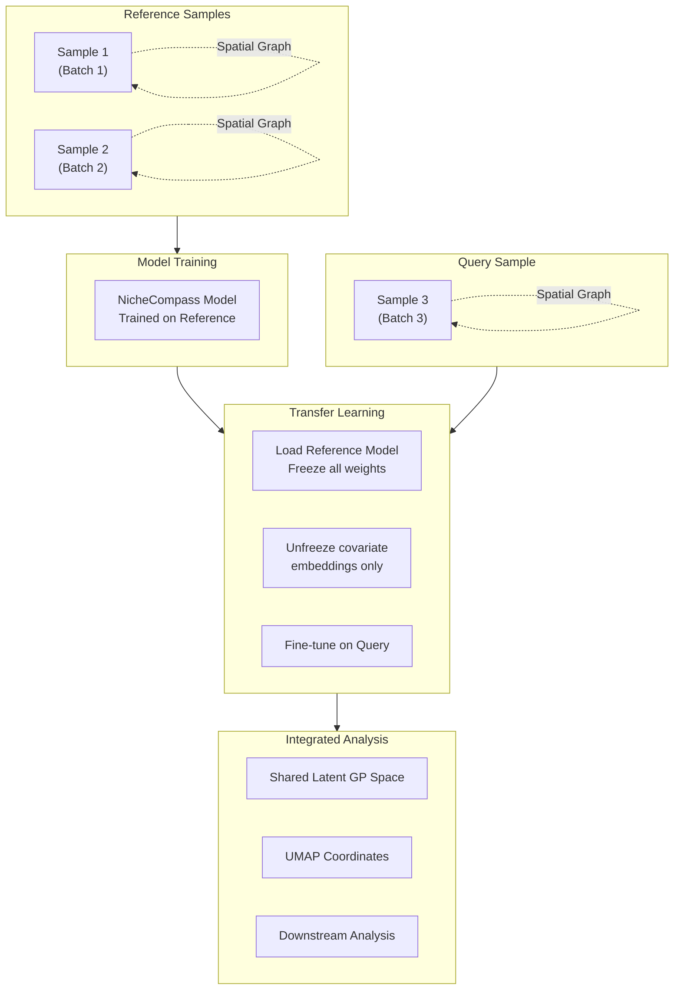
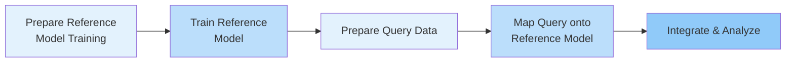

Spatial reference mapping enables you to project new spatial transcriptomics samples onto a pre-trained reference model, facilitating cross-dataset analysis and atlas construction. This capability is particularly valuable for building comprehensive spatial atlases where new samples can be integrated into an existing coordinate system while preserving biological interpretability through gene program representations.

The workflow operates through a **transfer learning paradigm** where a model trained on reference samples captures shared biological patterns, then adapts to query samples by learning only the minimal necessary parameters—specifically the categorical covariate embeddings. This approach maintains the stability of learned gene program representations while accommodating dataset-specific variations.

## Conceptual Architecture

The spatial reference mapping architecture establishes a hierarchical relationship between reference and query datasets through disconnected graph components:



This architecture ensures that **spatial neighborhood structure within each sample** is preserved during graph construction, while allowing biological patterns to be shared across samples through the latent gene program space. The disconnected graph approach prevents spurious edges between physically separated samples while enabling joint analysis in the latent dimension.

## Workflow Overview

The complete spatial reference mapping workflow consists of five sequential stages:



This workflow ensures **systematic integration** while maintaining control over each stage. The separation of reference and query preparation allows for validation of model quality before proceeding to the transfer learning phase.

## Stage 1: Prepare Reference Model Training

The reference model training phase establishes the biological coordinate system that query samples will be mapped onto. This involves three critical preparatory steps: creating interpretable gene program masks, computing spatial connectivity graphs for each reference sample, and integrating them as disconnected components.

### Gene Program Mask Creation

Gene programs serve as the **biological foundation** for interpretable latent representations. The tutorial constructs prior knowledge gene programs from three complementary databases:

| Database | Program Type | Source → Target | Example Application |
|----------|-------------|-----------------|-------------------|
| OmniPath | Ligand-Receptor | Ligand genes → Receptor genes | Cell-cell signaling pathways |
| MEBOCOST | Enzyme-Sensor | Enzyme genes → Sensor genes | Metabolic signaling networks |
| NicheNet | Combined Interaction | Ligand genes → Receptor + Target genes | Extended signaling cascades |

These programs are combined and filtered based on minimum gene requirements:

Sources: [mouse_cns_spatial_reference_mapping.ipynb](docs/tutorials/notebooks/mouse_cns_spatial_reference_mapping.ipynb#L390-L409)

```python
combined_gp_dict = filter_and_combine_gp_dict_gps_v2(
    gp_dicts=[omnipath_gp_dict, nichenet_gp_dict, mebocost_gp_dict],
    verbose=True)
```

### Spatial Graph Construction

A critical distinction in spatial reference mapping is that **each sample maintains its own spatial neighborhood graph**. Rather than connecting cells across different samples, the approach constructs disconnected graph components that preserve spatial relationships within each sample:

Sources: [mouse_cns_spatial_reference_mapping.ipynb](docs/tutorials/notebooks/mouse_cns_spatial_reference_mapping.ipynb#L438-L485)

```python
# Compute spatial neighborhood graphs per sample
for batch in reference_batches:
    sq.gr.spatial_neighbors(adata_batch,
                            coord_type="generic",
                            spatial_key=spatial_key,
                            n_neighs=n_neighbors)
    
    # Make adjacency matrix symmetric
    adata_batch.obsp[adj_key] = (
        adata_batch.obsp[adj_key].maximum(
            adata_batch.obsp[adj_key].T))
```

The disconnected graph construction algorithm creates block-diagonal adjacency matrices:

Sources: [mouse_cns_spatial_reference_mapping.ipynb](docs/tutorials/notebooks/mouse_cns_spatial_reference_mapping.ipynb#L443-L485)

```python
# Combine spatial neighborhood graphs as disconnected components
batch_connectivities = []
for i in range(len(adata_batch_list)):
    if i == 0:  # first batch
        after_batch_connectivities_extension = sp.csr_matrix(
            (adata_batch_list[0].shape[0],
             (adata_reference.shape[0] - adata_batch_list[0].shape[0])))
        batch_connectivities.append(sp.hstack(
            (adata_batch_list[0].obsp[adj_key],
             after_batch_connectivities_extension)))
    # Similar logic for middle and last batches...
adata_reference.obsp[adj_key] = sp.vstack(batch_connectivities)
```

This construction ensures that **message passing during graph neural network operations** propagates information only within each sample's spatial neighborhood, preventing cross-contamination while enabling shared learning in the encoder-decoder architecture.

### Reference Data Annotation

The mapping entity key identifies cells as belonging to the reference dataset, which becomes critical for downstream integration analysis:

Sources: [mouse_cns_spatial_reference_mapping.ipynb](docs/tutorials/notebooks/mouse_cns_spatial_reference_mapping.ipynb#L486-L486)

```python
adata_reference.obs[mapping_entity_key] = "reference"
```

> [!TIP]
> Always verify that your spatial graphs are disconnected across samples before training. Spurious edges between samples can cause the model to learn dataset-specific relationships rather than shared biological patterns, compromising the reference model's utility for mapping new datasets.

## Stage 2: Train Reference Model

The reference model training establishes the baseline biological coordinate system using the prepared reference data. This stage leverages the VGPGAE (Variational Gene Program Graph Autoencoder) architecture to learn interpretable latent representations that capture spatially coherent cellular niches.

### Model Initialization

The model initialization requires specifying architectural parameters that balance representational capacity with generalization:

Sources: [mouse_cns_spatial_reference_mapping.ipynb](docs/tutorials/notebooks/mouse_cns_spatial_reference_mapping.ipynb#L110-L150)

| Parameter Category | Key Parameters | Reference Values | Purpose |
|-------------------|----------------|------------------|---------|
| Architecture | `conv_layer_encoder`, `n_layers_encoder`, `n_hidden_encoder` | `"gcnconv"`, `1`, `auto` | Graph neural network structure |
| Training | `n_epochs`, `lr`, `lambda_edge_recon`, `lambda_gene_expr_recon` | `400`, `0.001`, `500000`, `300` | Optimization configuration |
| Gene Programs | `n_epochs_all_gps`, `active_gp_thresh_ratio`, `n_addon_gp` | `25`, `0.01`, `0` | GP learning strategy |
| Sampling | `edge_batch_size`, `n_sampled_neighbors` | `4096`, `4` | Memory-efficient training |

The high `lambda_edge_recon` value (500,000) relative to gene expression reconstruction (300) reflects the **emphasis on preserving spatial structure** in the learned representations. This weighting ensures that the latent space encodes spatially coherent neighborhoods.

### Training Execution

The training process iteratively optimizes reconstruction objectives:

Sources: [mouse_cns_spatial_reference_mapping.ipynb](docs/tutorials/notebooks/mouse_cns_spatial_reference_mapping.ipynb#L610-L625)

```python
model.train(
    n_epochs=n_epochs,
    n_epochs_all_gps=n_epochs_all_gps,
    lr=lr,
    lambda_edge_recon=lambda_edge_recon,
    lambda_gene_expr_recon=lambda_gene_expr_recon,
    lambda_l1_masked=lambda_l1_masked,
    edge_batch_size=edge_batch_size,
    n_sampled_neighbors=n_sampled_neighbors,
    use_cuda_if_available=use_cuda_if_available
)
```

After training completion, the model is saved for subsequent transfer learning operations:

Sources: [mouse_cns_spatial_reference_mapping.ipynb](docs/tutorials/notebooks/mouse_cns_spatial_reference_mapping.ipynb#L626-L630)

```python
model.save(
    dir_path=f"{model_folder_path}/reference",
    overwrite=True,
    save_adata=True,
    adata_file_name="adata.h5ad"
)
```

> [!TIP]
> Monitor training loss curves carefully. A sudden increase in edge reconstruction loss may indicate graph connectivity issues, while unstable gene expression reconstruction loss suggests inappropriate gene program mask design or loss weight balancing.

## Stage 3: Prepare Query Data

Query data preparation mirrors the reference preparation process but operates on the sample(s) to be mapped onto the reference. The critical distinction is maintaining consistency with the reference's gene program definitions and spatial graph construction methodology.

### Gene Program Mask Application

The same combined gene program dictionary used for reference training must be applied to query data to ensure **latent space compatibility**:

Sources: [mouse_cns_spatial_reference_mapping.ipynb](docs/tutorials/notebooks/mouse_cns_spatial_reference_mapping.ipynb#L780-L794)

```python
add_gps_from_gp_dict_to_adata(
    gp_dict=combined_gp_dict,
    adata=adata_query,
    gp_targets_mask_key=gp_targets_mask_key,
    gp_targets_categories_mask_key=gp_targets_categories_mask_key,
    gp_sources_mask_key=gp_sources_mask_key,
    gp_sources_categories_mask_key=gp_sources_categories_mask_key,
    gp_names_key=gp_names_key,
    min_genes_per_gp=2,
    min_source_genes_per_gp=1,
    min_target_genes_per_gp=1,
    max_genes_per_gp=None,
    max_source_genes_per_gp=None,
    max_target_genes_per_gp=None
)
```

### Spatial Graph Construction

The query sample receives its own disconnected spatial graph, following the identical procedure used for reference samples:

Sources: [mouse_cns_spatial_reference_mapping.ipynb](docs/tutorials/notebooks/mouse_cns_spatial_reference_mapping.ipynb#L730-L762)

```python
# Compute spatial neighborhood graph
sq.gr.spatial_neighbors(adata_batch,
                        coord_type="generic",
                        spatial_key=spatial_key,
                        n_neighs=n_neighbors)

# Make adjacency matrix symmetric
adata_batch.obsp[adj_key] = (
    adata_batch.obsp[adj_key].maximum(
        adata_batch.obsp[adj_key].T))
```

### Query Data Annotation

The query data receives the appropriate mapping entity annotation:

Sources: [mouse_cns_spatial_reference_mapping.ipynb](docs/tutorials/notebooks/mouse_cns_spatial_reference_mapping.ipynb#L763-L763)

```python
adata_query.obs[mapping_entity_key] = "query"
```

This annotation enables **downstream separation visualization** to assess integration quality between reference and query cells in the latent space.

## Stage 4: Map Query onto Reference Model

The transfer learning stage is where spatial reference mapping occurs. A pre-trained reference model is loaded, and only specific components are unfrozen for fine-tuning on the query data. This selective weight freezing preserves the learned biological patterns while adapting to query-specific characteristics.

### Reference Model Loading with Query Data

The critical innovation in this stage is the **selective weight unfreezing strategy**:

Sources: [mouse_cns_spatial_reference_mapping.ipynb](docs/tutorials/notebooks/mouse_cns_spatial_reference_mapping.ipynb#L810-L820)

```python
model = NicheCompass.load(
    dir_path=f"{model_folder_path}/reference",
    adata=adata_query,
    adata_file_name="adata.h5ad",
    gp_names_key=gp_names_key,
    unfreeze_all_weights=False,
    unfreeze_cat_covariates_embedder_weights=True
)
```

This loading strategy preserves the encoder-decoder weights that capture biological relationships while allowing the covariate embedding layer to adapt to query-specific characteristics:

| Component | Frozen/Unfrozen | Rationale |
|-----------|----------------|-----------|
| Encoder weights | Frozen | Preserve gene-to-GP mappings learned from reference |
| Decoder weights | Frozen | Maintain GP-to-gene relationships |
| Covariate embeddings | Unfrozen | Adapt batch covariate to query data |
| Add-on GP weights | Frozen (n_addon_gp=0) | No de novo learning in this configuration |

### Query Fine-tuning

The fine-tuning process optimizes only the unfrozen covariate embedding weights:

Sources: [mouse_cns_spatial_reference_mapping.ipynb](docs/tutorials/notebooks/mouse_cns_spatial_reference_mapping.ipynb#L821-L830)

```python
model.train(
    n_epochs=n_epochs,
    n_epochs_all_gps=n_epochs_all_gps,
    lr=lr,
    lambda_edge_recon=lambda_edge_recon,
    lambda_gene_expr_recon=lambda_gene_expr_recon,
    lambda_l1_masked=lambda_l1_masked,
    edge_batch_size=edge_batch_size,
    n_sampled_neighbors=n_sampled_neighbors,
    use_cuda_if_available=use_cuda_if_available
)
```

Because most parameters are frozen, this training phase is typically **faster and more stable** than the initial reference training. The model adapts its understanding of how the query batch covariate relates to the biological latent space without reconstructing fundamental biological relationships.

After fine-tuning, the adapted model is saved:

Sources: [mouse_cns_spatial_reference_mapping.ipynb](docs/tutorials/notebooks/mouse_cns_spatial_reference_mapping.ipynb#L831-L836)

```python
model.save(
    dir_path=f"{model_folder_path}/query",
    overwrite=True,
    save_adata=True,
    adata_file_name="adata.h5ad"
)
```

## Stage 5: Integrate Reference & Query Data

The final stage creates a unified latent representation combining reference and query data. This integration enables cross-dataset analysis while maintaining the ability to distinguish between reference and query cells.

### Data Concatenation

Reference and query AnnData objects are concatenated with inner join to ensure feature compatibility:

Sources: [mouse_cns_spatial_reference_mapping.ipynb](docs/tutorials/notebooks/mouse_cns_spatial_reference_mapping.ipynb#L855-L857)

```python
adata_batch_list = [adata_reference, adata_query]
adata_reference_query = ad.concat(adata_batch_list, join="inner")
```

### Graph Integration

The spatial graphs are combined as disconnected components, maintaining the block-diagonal structure:

Sources: [mouse_cns_spatial_reference_mapping.ipynb](docs/tutorials/notebooks/mouse_cns_spatial_reference_mapping.ipynb#L859-L882)

```python
# Combine spatial neighborhood graphs as disconnected components
batch_connectivities = []
for i in range(len(adata_batch_list)):
    if i == 0:  # first batch (reference)
        after_batch_connectivities_extension = sp.csr_matrix(
            (adata_batch_list[0].shape[0],
             (adata_reference_query.shape[0] - adata_batch_list[0].shape[0])))
        batch_connectivities.append(sp.hstack(
            (adata_batch_list[0].obsp[adj_key],
             after_batch_connectivities_extension)))
    # Similar logic for query batch...
adata_reference_query.obsp[adj_key] = sp.vstack(batch_connectivities)
```

This integration preserves **within-sample spatial relationships** while enabling joint analysis across samples in the latent space.

### GP Mask Addition

The unified gene program mask is added to the integrated data:

Sources: [mouse_cns_spatial_reference_mapping.ipynb](docs/tutorials/notebooks/mouse_cns_spatial_reference_mapping.ipynb#L884-L899)

```python
add_gps_from_gp_dict_to_adata(
    gp_dict=combined_gp_dict,
    adata=adata_reference_query,
    gp_targets_mask_key=gp_targets_mask_key,
    gp_targets_categories_mask_key=gp_targets_categories_mask_key,
    gp_sources_mask_key=gp_sources_mask_key,
    gp_sources_categories_mask_key=gp_sources_categories_mask_key,
    gp_names_key=gp_names_key,
    min_genes_per_gp=2,
    min_source_genes_per_gp=1,
    min_target_genes_per_gp=1,
    max_genes_per_gp=None,
    max_source_genes_per_gp=None,
    max_target_genes_per_gp=None
)
```

### Latent Representation Computation

The fine-tuned model is loaded with the integrated data to compute unified latent representations:

Sources: [mouse_cns_spatial_reference_mapping.ipynb](docs/tutorials/notebooks/mouse_cns_spatial_reference_mapping.ipynb#L905-L917)

```python
model = NicheCompass.load(
    dir_path=f"{model_folder_path}/query",
    adata=adata_reference_query,
    adata_file_name="adata.h5ad",
    gp_names_key=gp_names_key
)

model.adata.obsm[latent_key], _ = model.get_latent_representation(
    adata=model.adata,
    counts_key=counts_key,
    adj_key=adj_key,
    cat_covariates_keys=cat_covariates_keys,
    only_active_gps=True,
    return_mu_std=True,
    node_batch_size=model.node_batch_size_
)

model.adata.uns[model.active_gp_names_key_] = model.get_active_gps()
```

The latent space is then embedded in UMAP coordinates for visualization:

Sources: [mouse_cns_spatial_reference_mapping.ipynb](docs/tutorials/notebooks/mouse_cns_spatial_reference_mapping.ipynb#L919-L925)

```python
sc.pp.neighbors(model.adata,
                use_rep=latent_key,
                key_added=latent_key)

sc.tl.umap(model.adata,
           neighbors_key=latent_key)
```

## Analysis and Validation

Post-integration analysis validates the quality of spatial reference mapping and enables downstream biological discovery. The tutorial demonstrates several key visualizations and analyses.

### Integration Quality Assessment

The first assessment examines how well reference and query cells integrate in the latent space:

Sources: [mouse_cns_spatial_reference_mapping.ipynb](docs/tutorials/notebooks/mouse_cns_spatial_reference_mapping.ipynb#L1260-L1305)

```python
fig = plt.figure(figsize=(12, 14))
# UMAP showing reference vs query cells in latent space
sc.pl.umap(adata=model.adata,
           color=[mapping_entity_key],
           palette=mapping_entity_colors,
           title="Batches in Latent Space",
           ax=axs[0])
# Spatial plots showing physical location of reference vs query cells
for idx, sample in enumerate(samples):
    sc.pl.spatial(adata=model.adata[model.adata.obs[sample_key] == sample],
                  color=[mapping_entity_key],
                  palette=mapping_entity_colors,
                  title=f"Batches in Physical Space (Sample: {sample})",
                  ax=axs[idx+1])
```


Successful integration shows **mixed reference and query cells** in the latent space, indicating shared biological patterns rather than dataset-specific clustering.

### Batch Effect Assessment

Examining batch covariate annotations reveals whether technical differences have been adequately corrected:

Sources: [mouse_cns_spatial_reference_mapping.ipynb](docs/tutorials/notebooks/mouse_cns_spatial_reference_mapping.ipynb#L1315-L1360)

```python
sc.pl.umap(adata=model.adata,
           color=[cat_covariates_keys[0]],  # 'batch' column
           palette=batch_colors,
           title="Batches in Latent Space",
           ax=axs[0])
```

Inadequate batch correction manifests as **persistent separation by batch** in the latent UMAP, suggesting the need for additional training epochs or adjusted loss weights.

### Cell Type Preservation Analysis

While NicheCompass does not aim for cell type separation (its goal is niche identification), examining cell type distributions validates that biological structure is preserved:

Sources: [mouse_cns_spatial_reference_mapping.ipynb](docs/tutorials/notebooks/mouse_cns_spatial_reference_mapping.ipynb#L1365-L1408)

```python
for cell_type in cell_type_order:
    sc.pl.spatial(adata=model.adata,
                  color=cell_type_key,
                  groups=[cell_type],
                  palette=cell_type_colors,
                  title=f"Cell Type: {cell_type}",
                  ax=ax)
```

> [!TIP]
> The integration quality assessment should focus on biological coherence rather than perfect mixing. Some residual separation by batch is expected and desirable, as it preserves dataset-specific biological differences while enabling cross-dataset comparison.

## Key Configuration Parameters

Successful spatial reference mapping requires careful parameter selection across multiple dimensions:

### Spatial Graph Parameters

| Parameter | Description | Typical Range | Impact |
|-----------|-------------|---------------|--------|
| `n_neighbors` | Number of spatial neighbors | 4-10 | Controls local spatial context captured |
| `spatial_key` | Coordinate key in adata.obsm | "spatial" | Must match data storage |
| `adj_key` | Adjacency matrix key | "spatial_connectivities" | Key for graph operations |

### Training Parameters

| Parameter | Description | Reference Value | Sensitivity |
|-----------|-------------|-----------------|-------------|
| `n_epochs` | Total training epochs | 400 | Higher → better convergence, longer runtime |
| `n_epochs_all_gps` | Epochs before GP filtering | 25 | Affects which GPs remain active |
| `lambda_edge_recon` | Edge reconstruction weight | 500,000 | High → emphasis on spatial structure |
| `lambda_gene_expr_recon` | Gene expression recon weight | 300 | Lower → reduced emphasis on expression accuracy |
| `lr` | Learning rate | 0.001 | Standard for Adam optimizer |

### Transfer Learning Parameters

| Parameter | Description | Setting | Rationale |
|-----------|-------------|---------|-----------|
| `unfreeze_all_weights` | Unfreeze all weights | False | Preserve reference knowledge |
| `unfreeze_cat_covariates_embedder_weights` | Unfreeze covariate embeddings | True | Adapt to query batch |

## Common Issues and Troubleshooting

| Issue | Symptom | Diagnosis | Solution |
|-------|---------|-----------|----------|
| Poor integration | Reference and query cells remain separated | Batch covariate not adequately addressed | Increase training epochs for query fine-tuning |
| Loss of biological signal | Cell types no longer distinguishable | Over-correction of batch effects | Reduce lambda_gene_expr_recon weight or reduce training epochs |
| Graph connectivity errors | Unexpected edges between samples | Graph construction not disconnected | Verify spatial graph combination logic |
| Memory issues during training | Out-of-memory errors | Dataset too large for batch size | Reduce `edge_batch_size` or `n_sampled_neighbors` |

## Comparison with Related Workflows

Spatial reference mapping differs from [Sample Integration and Spatial Atlas Building](20-sample-integration-and-spatial-atlas-building) in its sequential transfer learning approach rather than joint training:

| Aspect | Spatial Reference Mapping | Sample Integration |
|--------|--------------------------|-------------------|
| Training Strategy | Sequential: reference → query fine-tune | Joint: all samples trained together |
| Use Case | Mapping new samples to existing atlas | Building de novo atlas from multiple samples |
| Computational Efficiency | High (reuse pretrained model) | Higher (train from scratch) |
| Flexibility | Easy to add new samples | Requires retraining for new samples |
| Parameter Optimization | Fixed from reference | Joint optimization across samples |

## Advanced Extensions

### Multi-Query Mapping

Multiple query samples can be mapped sequentially:

```python
for query_batch in query_batches:
    # Prepare query data
    adata_query = prepare_query_sample(query_batch)
    
    # Load reference model and fine-tune
    model = NicheCompass.load(
        dir_path=reference_model_path,
        adata=adata_query,
        unfreeze_all_weights=False,
        unfreeze_cat_covariates_embedder_weights=True)
    model.train(n_epochs=n_epochs, ...)
    
    # Add to integrated dataset
    adata_integrated = ad.concat([adata_integrated, adata_query])
```

### Cross-Species Mapping

When mapping across species, ensure **gene ortholog mapping** is applied before gene program mask creation:

Sources: [multimodal_mapping.py](src/nichecompass/utils/multimodal_mapping.py#L35-L100)

```python
# Map genes to orthologs using provided mapping file
gene_orthologs_mapping_file_path = "human_mouse_gene_orthologs.csv"
# This mapping is used during GP extraction
omnipath_gp_dict = extract_gp_dict_from_omnipath_lr_interactions(
    species=species,
    gene_orthologs_mapping_file_path=gene_orthologs_mapping_file_path)
```

## Next Steps

After successful spatial reference mapping, you can proceed with:

- **[Niche Characterization and Gene Importance Computation](25-niche-characterization-and-gene-importance-computation)**: Identify key genes driving niche phenotypes in the integrated dataset
- **[Differential Gene Program Testing](23-differential-gene-program-testing)**: Compare gene program activity between reference and query regions
- **[Cell-Cell Communication Network Analysis](24-cell-cell-communication-network-analysis)**: Analyze ligand-receptor interactions across integrated samples

These downstream analyses leverage the unified latent space to generate biological insights that span multiple spatial datasets.