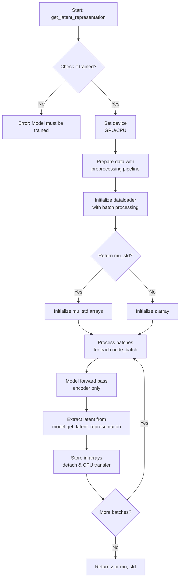
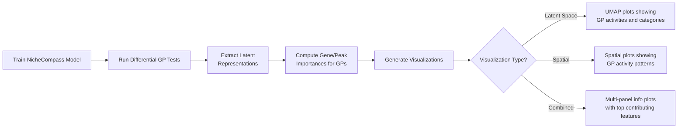

Latent representation extraction and visualization form the cornerstone of interpreting NicheCompass model outputs. The model learns gene program activity scores as latent representations that capture complex biological processes and cell-cell communication patterns. These latent representations can be extracted for downstream analysis, visualization in reduced-dimensional spaces, or mapped back to physical spatial coordinates. This functionality enables researchers to explore biological niches, identify gene programs associated with specific cell types or conditions, and generate publication-ready visualizations that integrate multiple layers of biological information.

## Latent Representation Extraction

The `get_latent_representation()` method extracts gene program scores (latent features) from a trained NicheCompass model. This function serves as the primary interface for accessing the compressed learned representations that capture biological signals in the data. The extraction process supports both deterministic latent features (z) and the probabilistic posterior distribution parameters (μ and σ), providing flexibility for different analytical needs.

Sources: [nichecompass.py](src/nichecompass/models/nichecompass.py#L1264-L1382)

The extraction follows a systematic workflow. First, the method validates that the model has been trained and prepares the data using the same preprocessing pipeline employed during training. This ensures consistency between the training phase and extraction phase. For large datasets, the function implements batch processing to manage memory efficiently, processing data in configurable batch sizes while maintaining the integrity of the latent representations.

The method provides several key configuration options. The `only_active_gps` parameter controls whether to return representations only for gene programs that were identified as active during training (default: True) or for all gene programs including inactive ones. Active gene programs typically provide the most biologically relevant signals while reducing dimensionality. The `return_mu_std` parameter allows access to the variational posterior distribution parameters instead of the sampled latent variable z, which is useful for uncertainty quantification or probabilistic analyses. The `node_batch_size` parameter (default: 64) enables memory-efficient processing of large spatial datasets by processing nodes in batches.

The function returns numpy arrays with dimensions (n_obs × n_gps), where each row represents a cell and each column represents a gene program activity score. These latent representations serve as inputs for downstream visualization and analysis tasks.

Sources: [nichecompass.py](src/nichecompass/models/nichecompass.py#L1264-L1382)

> [!TIP]
> When extracting latent representations for new data (not the training data), ensure that the same preprocessing parameters (counts_key, adj_key, cat_covariates_keys) are used as during training to maintain compatibility with the learned model weights.

## Visualization of Gene Program Activities

NicheCompass provides comprehensive visualization capabilities through the `generate_enriched_gp_info_plots()` function, which creates multi-panel visualizations integrating enriched category information, gene program activity scores, and the expression patterns of top contributing genes or peaks. This function is particularly valuable for interpreting the biological significance of gene programs identified through differential testing.

Sources: [analysis.py](src/nichecompass/utils/analysis.py#L212-L420)

The visualization framework supports multiple feature spaces. The default latent space uses UMAP embeddings computed from the gene program activity scores to show global patterns and relationships between cells. Alternatively, spatial feature spaces can be used by specifying sample identifiers from `adata.obs`, which maps gene program activities back to physical coordinates in the spatial transcriptomics data. This dual-view approach enables researchers to understand both the abstract structure of the latent space and the spatial organization of gene program activities.

The function generates comprehensive info plots with the following panel structure for each gene program:

| Panel | Content | Purpose |
|-------|---------|---------|
| 1 | Enriched category (cell type/condition) | Shows which category the GP is enriched in |
| 2 | Gene program activity scores | Displays spatial or latent distribution of GP activity |
| 3+ | Top contributing genes/peaks | Shows expression of the most important features for each GP |

Sources: [analysis.py](src/nichecompass/utils/analysis.py#L406-L632)

The visualization configuration is highly customizable. Users can specify the number of top enriched gene programs to visualize using `n_top_enriched_gp_start_idx` and `n_top_enriched_gp_end_idx` parameters. The `n_top_genes_per_gp` and `n_top_peaks_per_gp` parameters control how many of the most important contributing features (genes for RNA data, peaks for ATAC-seq data) are displayed for each gene program. The `feature_spaces` parameter accepts a list that can include "latent" for UMAP visualizations or sample names from `adata.obs[sample_key]` for spatial visualizations, allowing users to generate plots in multiple views simultaneously.

Color mapping is intelligently handled based on the biological context. Enriched categories use a provided `cat_palette` dictionary for consistent coloring across all plots. Gene program activity scores use a diverging "RdBu" colormap (red-white-blue) to show positive and negative activations. Omics features use sequential colormaps—"Blues" for positively contributing genes and "Reds" for negatively contributing genes—making it easy to identify activation patterns. When `scale_omics_ft=True`, the function applies z-score scaling to genes and peaks and switches to a symmetric "RdBu" colormap, which is useful for comparing relative expression patterns across features.

Sources: [analysis.py](src/nichecompass/utils/analysis.py#L212-L420)

> [!TIP]
> When visualizing gene programs in spatial coordinates, use the `spot_size` parameter to adjust point sizes based on your data density. Larger datasets or higher-resolution spatial data typically benefit from smaller spot sizes to prevent overlapping points.

## Integration with Spatial Data

The visualization framework seamlessly integrates latent representations with spatial transcriptomics data through scanpy's plotting infrastructure. This integration enables researchers to map abstract gene program activities back to their physical locations within tissues, revealing spatial patterns of biological processes and cell-cell communication.

For spatial visualizations, the function filters the AnnData object to cells from a specific sample (`adata[adata.obs[sample_key] == feature_space]`) and generates spatial scatter plots using `sc.pl.spatial()`. The `spot_size` parameter controls the size of each cell representation in the plot, which should be adjusted based on tissue density and the desired level of visual detail. The gene program activity scores are extracted from `adata.obs` and displayed using a continuous color scale that highlights regions of high and low activity.

Sources: [analysis.py](src/nichecompass/utils/analysis.py#L506-L532)

The spatial plotting workflow supports both the original expression data and the derived gene program scores. For genes and peaks, the function plots the original expression or accessibility counts. This provides a direct view of the input data that contributed to the gene program activation. The use of directional colormaps (Blues for positive contributions, Reds for negative contributions) helps researchers quickly identify which features are driving the observed spatial patterns of gene program activity.

When working with multi-sample datasets or spatial atlases, the ability to visualize gene programs across multiple samples provides insights into conserved and sample-specific patterns. The `generate_enriched_gp_info_plots()` function accepts multiple feature spaces, enabling generation of visualizations for both the latent UMAP (showing global relationships) and each individual spatial sample (showing local spatial organization) in a single function call.

Sources: [analysis.py](src/nichecompass/utils/analysis.py#L212-L420)

## Workflow Example: Extracting and Visualizing Gene Programs

A typical workflow for extracting and visualizing latent representations involves several sequential steps. After training the model, researchers extract the latent representations for analysis, visualize them in reduced-dimensional space, and optionally map them back to spatial coordinates. This workflow enables interpretation of the learned gene programs and their biological relevance.

The practical implementation involves calling the appropriate methods in sequence. First, latent representations are extracted using `model.get_latent_representation()` and stored in `adata.obsm[latent_key]`. These representations can then be used to compute UMAP embeddings using scanpy's standard dimensionality reduction functions. For spatial visualizations, the gene program scores are already accessible in `adata.obs` after extraction and can be directly plotted using the visualization functions.

Sources: [nichecompass.py](src/nichecompass/models/nichecompass.py#L1264-L1382), [analysis.py](src/nichecompass/utils/analysis.py#L212-L420)

The visualization generation requires specification of the differential testing results key to identify which gene programs are enriched for different categories. The `cat_palette` parameter provides consistent color mappings for categories across all visualizations. By adjusting the range of enriched gene programs (via `n_top_enriched_gp_start_idx` and `n_top_enriched_gp_end_idx`), researchers can focus on the most statistically significant programs or explore additional candidates.

For comprehensive analysis, researchers typically generate visualizations in both latent and spatial feature spaces. The latent space view reveals global relationships and clustering patterns, while spatial views show the physical organization of gene program activities. Together, these perspectives provide a complete understanding of how gene programs organize in both abstract and physical dimensions.

Sources: [analysis.py](src/nichecompass/utils/analysis.py#L212-L420)

## Parameter Configuration Guide

Successful latent representation extraction and visualization requires appropriate parameter selection based on dataset characteristics and analysis goals. The following table summarizes key parameters and their recommended usage scenarios.

Sources: [nichecompass.py](src/nichecompass/models/nichecompass.py#L1264-L1382), [analysis.py](src/nichecompass/utils/analysis.py#L212-L420)

| Parameter | Type | Default | Recommended Usage |
|-----------|------|---------|-------------------|
| `only_active_gps` | bool | True | Use True for most analyses; set to False only when comparing inactive programs |
| `return_mu_std` | bool | False | Set True for uncertainty quantification or probabilistic analyses |
| `node_batch_size` | int | 64 | Increase for large datasets (>100k cells) to balance memory and speed |
| `dtype` | type | np.float64 | Use np.float32 for memory efficiency with very large datasets |
| `feature_spaces` | list | ["latent"] | Include sample names for spatial views alongside "latent" |
| `n_top_genes_per_gp` | int | 3 | Increase (5-10) for deeper biological interpretation |
| `n_top_peaks_per_gp` | int | 0 | Set >0 only for multi-modal models with ATAC data |
| `scale_omics_ft` | bool | False | Set True when comparing relative expression patterns |
| `spot_size` | float | 30. | Adjust based on spatial data density (10-100 range) |

For large-scale datasets (>500k cells), increasing `node_batch_size` to 256 or 512 can significantly improve extraction speed while using moderate memory. When memory is constrained, using `dtype=np.float32` reduces memory requirements by 50% with minimal impact on visualization quality. The `feature_spaces` parameter should be customized based on analysis needs—include both "latent" and spatial sample IDs when generating comprehensive multi-view reports.
