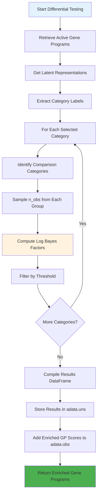

Differential Gene Program Testing is a statistical analysis method that identifies which gene programs are differentially active across biological categories in spatial transcriptomics data. This capability enables researchers to discover biological processes that distinguish cell types, disease states, tissue regions, or experimental conditions by comparing gene program activity scores computed from the trained NicheCompass model. The analysis leverages Bayesian statistical methods to quantify the evidence for enrichment, providing both statistical significance (p-values) and strength of evidence (log Bayes Factors).

## Statistical Foundations and Hypothesis Testing

The differential testing framework implements a Bayesian hypothesis comparison approach rather than traditional frequentist statistics. For each gene program and category pair, the method compares two competing hypotheses:

- **Hypothesis H0**: The normalized gene program/latent scores of observations in the category under consideration (z₀) are higher than the normalized scores of observations in the comparison categories (z₁)
- **Hypothesis H1**: The normalized gene program/latent scores of comparison category observations (z₁) are higher than or equal to the scores of the category under consideration (z₀)

The log Bayes Factor quantifies the strength of evidence supporting H₀ over H₁. Higher positive values indicate stronger evidence that the gene program is enriched in the category of interest. The implementation adapts methodology from scArches, establishing continuity with established best practices in single-cell gene program analysis [nichecompass.py](src/nichecompass/models/nichecompass.py#L830-L872).

The statistical computation uses probability calculations based on the complementary error function (erfc), which provides numerical stability when comparing distributions. For each gene program comparison:

```
to_reduce = - (z₀ - z₁) / √(2(σ₀² + σ₁²))
p_h0 = mean(0.5 × erfc(to_reduce))
p_h1 = 1.0 - p_h0
log_bayes_factor = log(p_h0 + ε) - log(p_h1 + ε)
```

Sources: [nichecompass.py](src/nichecompass/models/nichecompass.py#L973-L988)

## Differential Testing Workflow

The differential gene program testing process follows a structured workflow that integrates with the trained NicheCompass model's latent representations. This workflow enables systematic comparison of gene program activities across predefined biological categories.



The workflow begins by extracting active gene programs and computing latent representations from the trained model. For each category under investigation, the method systematically compares against specified comparison groups, performs statistical testing using the log Bayes Factor metric, and aggregates results into a structured DataFrame for downstream analysis and visualization.

Sources: [nichecompass.py](src/nichecompass/models/nichecompass.py#L830-L1052)

## Core Parameters and Configuration

The `run_differential_gp_tests` method provides extensive configuration options to tailor the analysis to specific research questions and data characteristics.

| Parameter | Type | Default | Description |
|-----------|------|---------|-------------|
| `cat_key` | str | required | Key in `adata.obs` storing category labels for comparison |
| `selected_cats` | str/list | None | Categories to test (None = all categories in column) |
| `comparison_cats` | str/list | "rest" | Comparison groups ("rest" = all other categories) |
| `selected_gps` | str/list | None | Gene programs to test (None = all active programs) |
| `n_sample` | int | 10000 | Number of observations sampled per group for computation |
| `log_bayes_factor_thresh` | float | 2.3 | Threshold for considering gene programs enriched |
| `key_added` | str | "nichecompass_differential_gp_test_results" | Storage key in `adata.uns` |
| `seed` | int | 0 | Random seed for reproducible sampling |
| `adata` | AnnData | None | AnnData object (None = uses model's stored adata) |

The default log Bayes Factor threshold of 2.3 corresponds to "strong evidence" according to conventional Bayesian interpretation scales. This threshold balances sensitivity (detecting true differences) with specificity (avoiding false positives). Researchers may adjust this threshold based on their specific requirements: lower thresholds for exploratory analysis to identify candidate patterns, higher thresholds for confirmatory analysis requiring stronger evidence.

Sources: [nichecompass.py](src/nichecompass/models/nichecompass.py#L830-L873)

> [!TIP]
> When using `"rest"` as the comparison category, each category is compared against all other categories combined. For pairwise comparisons between specific categories, provide the exact category names in the `comparison_cats` parameter. This enables more focused biological questions (e.g., comparing disease subtypes against healthy controls).

## Results Structure and Interpretation

The differential testing results are stored as a structured pandas DataFrame in `adata.uns[key_added]`, containing comprehensive statistical information for each category-gene program pair that exceeds the enrichment threshold.

### Results DataFrame Columns

| Column | Description |
|--------|-------------|
| `category` | The biological category under investigation |
| `gene_program` | Name of the gene program tested |
| `p_h0` | Probability that category scores > comparison scores |
| `p_h1` | Probability that comparison scores >= category scores |
| `log_bayes_factor` | Log Bayes Factor quantifying enrichment evidence |

The DataFrame is sorted by absolute log Bayes Factor in descending order, prioritizing the most strongly enriched gene programs for inspection. This ordering helps researchers focus on the most biologically significant findings first. In addition to the DataFrame, the method automatically adds the scores of all enriched gene programs to `adata.obs`, enabling immediate visualization and further analysis.

### Interpretation Guidelines

- **Log Bayes Factor > 2.3**: Strong evidence for enrichment in the category
- **Log Bayes Factor ≈ 0**: No substantial evidence for difference
- **Log Bayes Factor < -2.3**: Strong evidence for depletion in the category (relative to comparison)
- **p_h0 close to 1.0**: High probability the category has higher activity
- **p_h0 close to 0.0**: Low probability the category has higher activity

The method also handles edge cases robustly: if either group has zero activity for a gene program, the log Bayes Factor is set to 0 to avoid division by zero and ensure meaningful statistics only for programs with measurable activity.

Sources: [nichecompass.py](src/nichecompass/models/nichecompass.py#L989-L1052)

## Implementation Details: Step-by-Step Walkthrough

### 1. Initial Setup and Validation

The method begins by verifying that the model has been trained and retrieving necessary components:

```python
self._check_if_trained(warn=True)
np.random.seed(seed)

# Get active gene programs
active_gps = list(adata.uns[self.active_gp_names_key_])
```

This validation step ensures statistical testing is only performed on models with learned representations. The random seed ensures reproducible results across multiple runs.

Sources: [nichecompass.py](src/nichecompass/models/nichecompass.py#L909-L914)

### 2. Gene Program Selection and Latent Representation Extraction

For the selected gene programs (or all active programs if not specified), the method retrieves indices and weights, then computes latent representations:

```python
selected_gps_idx, selected_gps_weights, chrom_access_gp_weights = \
    self.get_gp_data(selected_gps=selected_gps)

mu, std = self.get_latent_representation(
    adata=adata,
    counts_key=self.counts_key_,
    adj_key=self.adj_key_,
    cat_covariates_keys=self.cat_covariates_keys_,
    only_active_gps=False,
    return_mu_std=True,
    node_batch_size=self.node_batch_size_)
mu_selected_gps = mu[:, selected_gps_idx]
std_selected_gps = std[:, selected_gps_idx]
```

The latent representation provides the gene program activity scores that serve as the basis for differential comparison. Setting `only_active_gp=False` ensures all relevant programs are included regardless of their training-time activation status.

Sources: [nichecompass.py](src/nichecompass/models/nichecompass.py#L923-L937)

### 3. Category Identification and Masking

The method identifies all unique categories and creates boolean masks for the category of interest and comparison categories:

```python
cat_values = adata.obs[cat_key].replace(np.nan, "NaN")
cats = cat_values.unique()

cat_mask = cat_values == cat
if comparison_cats == "rest":
    comparison_cat_mask = ~cat_mask
else:
    comparison_cat_mask = cat_values.isin(comparison_cats)
```

The replacement of NaN values ensures proper handling of missing category labels. The masking strategy efficiently isolates observations for statistical comparison without creating subset copies of large arrays.

Sources: [nichecompass.py](src/nichecompass/models/nichecompass.py#L939-L957)

### 4. Random Sampling for Statistical Computation

To ensure computational efficiency with large datasets, the method samples observations equally from both groups:

```python
cat_idx = np.random.choice(cat_mask.sum(), n_sample)
comparison_cat_idx = np.random.choice(comparison_cat_mask.sum(), n_sample)

mu_selected_gps_cat_sample = mu_selected_gps_cat[cat_idx]
std_selected_gps_cat_sample = std_selected_gps_cat[cat_idx]
mu_selected_gps_comparison_cat_sample = mu_selected_gps_comparison_cat[comparison_cat_idx]
std_selected_gps_comparison_cat_sample = std_selected_gps_comparison_cat[comparison_cat_idx]
```

This sampling strategy maintains statistical power while controlling computational cost, especially important for large spatial transcriptomics datasets with hundreds of thousands of observations.

Sources: [nichecompass.py](src/nichecompass/models/nichecompass.py#L958-L967)

### 5. Log Bayes Factor Computation

The core statistical calculation computes the log Bayes Factor for each gene program:

```python
to_reduce = - (mu_selected_gps_cat_sample - mu_selected_gps_comparison_cat_sample) / \
             np.sqrt(2 * (std_selected_gps_cat_sample**2 + std_selected_gps_comparison_cat_sample**2))
to_reduce = 0.5 * erfc(to_reduce)
p_h0 = np.mean(to_reduce, axis=0)
p_h1 = 1.0 - p_h0
epsilon = 1e-12
log_bayes_factor = np.log(p_h0 + epsilon) - np.log(p_h1 + epsilon)
```

The epsilon term prevents numerical errors when probabilities approach zero. The use of `erfc` (complementary error function) provides stable numerical computation of the tail probabilities needed for the Bayesian hypothesis comparison.

Sources: [nichecompass.py](src/nichecompass/models/nichecompass.py#L969-L988)

### 6. Results Compilation and Filtering

After computing statistics for all category-gene program pairs, the method compiles results into a DataFrame and filters for enriched programs:

```python
results = pd.DataFrame(results)
results["abs_log_bayes_factor"] = np.abs(results["log_bayes_factor"])
results = results[results["abs_log_bayes_factor"] > log_bayes_factor_thresh]
results.sort_values(by="abs_log_bayes_factor", ascending=False, inplace=True)
results.reset_index(drop=True, inplace=True)
results.drop("abs_log_bayes_factor", axis=1, inplace=True)
adata.uns[key_added] = results
```

The filtering step ensures only biologically meaningful differences are retained in the final results, reducing noise and focusing interpretation on the most relevant findings.

Sources: [nichecompass.py](src/nichecompass/models/nichecompass.py#L995-L1005)

### 7. Enriched Program Score Storage

For visualization and downstream analysis, the method adds scores of enriched gene programs to the AnnData object:

```python
enriched_gps = results["gene_program"].unique().tolist()
enriched_gps_idx = [selected_gps.index(gp) for gp in enriched_gps]

enriched_gps_gp_scores = pd.DataFrame(
    mu_selected_gps[:, enriched_gps_idx],
    columns=enriched_gps,
    index=adata.obs.index)
new_cols = [col for col in enriched_gps_gp_scores.columns 
            if col not in adata.obs.columns]
if new_cols:
    adata.obs = pd.concat([adata.obs, enriched_gps_gp_scores[new_cols]], axis=1)
```

This integration enables immediate spatial visualization of gene program activities using standard scanpy plotting functions, facilitating biological interpretation and hypothesis generation.

Sources: [nichecompass.py](src/nichecompass/models/nichecompass.py#L1006-L1052)

## Visualization of Enriched Gene Programs

The `generate_enriched_gp_info_plots` function creates comprehensive visualizations of the top enriched gene programs, displaying spatial patterns of gene program activity alongside the expression of their constituent genes and peaks.

### Visualization Components

The function generates multi-panel visualizations showing:
- **Enriched category label** identifying which category shows enrichment
- **Gene program activity scores** displayed in the specified feature space (latent or physical space)
- **Top gene expression** showing the most important genes in the program
- **Top peak accessibility** (for ATAC models) showing chromatin accessibility patterns

```mermaid
flowchart LR
    A[Input: Model & Test Results] --> B[Extract Top Enriched GPs]
    B --> C[Compute GP Gene Importances]
    C --> D[Identify Top Genes per GP]
    D --> E[For ATAC: Compute Peak Importances]
    E --> F[For Each Feature Space]
    F --> G[Generate Spatial Plots]
    G --> H[Activity Scores + Gene/Peak Expression]
    H --> I[Save or Display Figures]
```



Sources: [analysis.py](src/nichecompass/utils/analysis.py#L212-L405)

### Visualization Parameters

| Parameter | Default | Description |
|-----------|---------|-------------|
| `n_top_enriched_gp_start_idx` | 0 | Starting index of top enriched programs |
| `n_top_enriched_gp_end_idx` | 10 | Ending index of top enriched programs |
| `feature_spaces` | ["latent"] | Feature spaces for visualization |
| `n_top_genes_per_gp` | 3 | Number of top genes to display per program |
| `n_top_peaks_per_gp` | 0 | Number of top peaks to display (ATAC only) |
| `scale_omics_ft` | False | Whether to scale gene/peak counts |

The flexibility in feature space selection allows researchers to visualize gene program activities either in the learned latent space or in the original physical spatial coordinates, depending on their analytical needs.

Sources: [analysis.py](src/nichecompass/utils/analysis.py#L212-L230)

> [!TIP]
> Set `scale_omics_ft=True` when working with counts that span multiple orders of magnitude. This scaling improves visualization of subtle expression patterns by normalizing the color scale across all genes/peaks. Use the default `False` when working with log-normalized data or when absolute differences are biologically meaningful.

## Practical Application Example

### Basic Usage Scenario

```python
# Run differential tests comparing cell types
enriched_gps = model.run_differential_gp_tests(
    cat_key="cell_type",
    selected_cats=["Microglia", "Astrocytes"],
    comparison_cats="rest",
    n_sample=10000,
    log_bayes_factor_thresh=2.3,
    key_added="cell_type_differential_gp_tests"
)

# Access results
results_df = model.adata.uns["cell_type_differential_gp_tests"]
print(results_df.head())
```

### Custom Pairwise Comparison

```python
# Compare two specific conditions
enriched_gps = model.run_differential_gp_tests(
    cat_key="condition",
    selected_cats="treated",
    comparison_cats="control",
    selected_gps=["IFN_response", "Inflammatory_pathway"],
    n_sample=5000,
    log_bayes_factor_thresh=3.0  # More stringent threshold
)
```

### Visualization Integration

```python
# Generate visualization of top enriched programs
from nichecompass.utils.analysis import generate_enriched_gp_info_plots

generate_enriched_gp_info_plots(
    plot_label="cell_type_comparison",
    model=model,
    sample_key="sample",
    differential_gp_test_results_key="cell_type_differential_gp_tests",
    cat_key="cell_type",
    cat_palette=default_color_dict,
    n_top_enriched_gp_start_idx=0,
    n_top_enriched_gp_end_idx=5,
    feature_spaces=["latent"],
    n_top_genes_per_gp=4,
    save_figs=True,
    figure_folder_path="results/enriched_gps",
    file_format="png"
)
```

Sources: [nichecompass.py](src/nichecompass/models/nichecompass.py#L830-L1052), [analysis.py](src/nichecompass/utils/analysis.py#L212-L405)

## Advanced Features and Considerations

### Multiple Testing Considerations

The method uses a Bayesian framework with log Bayes Factors rather than traditional frequentist p-values, which inherently addresses multiple testing through the Bayesian prior structure. However, researchers should still consider the exploratory nature of the analysis and validate key findings through orthogonal methods.

### Missing Data Handling

Categories with missing values in the `cat_key` column are handled by replacing NaN with "NaN" as a distinct category. This ensures observations with missing labels are excluded from comparisons rather than causing errors in the statistical computation.

Sources: [nichecompass.py](src/nichecompass/models/nichecompass.py#L939)

### Computational Performance

The computational complexity scales linearly with the number of categories, gene programs, and the `n_sample` parameter. For large-scale analyses with many categories and gene programs:
- Use moderate `n_sample` values (5000-10000) for initial exploration
- Restrict `selected_cats` and `selected_gps` to hypotheses of primary interest
- Consider running analyses in parallel for independent category comparisons

### Integration with Spatial Analysis

Differential gene program testing seamlessly integrates with NicheCompass's spatial analysis capabilities. The enriched gene program scores stored in `adata.obs` can be used with scanpy's spatial plotting functions to visualize spatial patterns of differential activity. This integration enables researchers to map enriched biological programs back to tissue architecture, revealing spatial heterogeneity in molecular processes.

For more advanced spatial characterization, the enriched gene programs identified through differential testing can be further analyzed using niche characterization methods described in [Niche Characterization and Gene Importance Computation](25-niche-characterization-and-gene-importance-computation).

Sources: [nichecompass.py](src/nichecompass/models/nichecompass.py#L1029-L1052)

## Common Use Cases and Applications

### Cell Type Marker Discovery

Identify gene programs that distinguish specific cell types from all others:
```python
model.run_differential_gp_tests(
    cat_key="cell_type",
    selected_cats="T_cells",
    comparison_cats="rest"
)
```

### Disease vs. Normal Comparison

Compare disease states against healthy controls to identify disease-associated pathways:
```python
model.run_differential_gp_tests(
    cat_key="disease_status",
    selected_cats="AD",  # Alzheimer's disease
    comparison_cats="Normal"
)
```

### Regional Spatial Analysis

Identify gene programs enriched in specific anatomical regions:
```python
model.run_differential_gp_tests(
    cat_key="anatomical_region",
    selected_cats=["Hippocampus", "Cortex"],
    comparison_cats="rest",
    n_sample=15000
)
```

### Treatment Response Analysis

Compare treated and untreated samples to identify responsive pathways:
```python
model.run_differential_gp_tests(
    cat_key="treatment",
    selected_cats="drug_treated",
    comparison_cats="vehicle_control",
    selected_gps=["pathway1", "pathway2", "pathway3"]
)
```

These use cases demonstrate how differential gene program testing provides a flexible framework for hypothesis-driven biological discovery across diverse experimental designs and research questions.

Sources: [nichecompass.py](src/nichecompass/models/nichecompass.py#L830-L873)

## Best Practices and Recommendations

### Parameter Selection Guidelines

1. **Sampling Size (`n_sample`)**: Use 10,000 for comprehensive analysis, 5,000 for faster exploratory work. Larger samples improve statistical stability at the cost of computation time.

2. **Log Bayes Factor Threshold**: 
   - 2.3: Standard "strong evidence" threshold (recommended)
   - 3.0: More stringent for high-confidence findings
   - 1.5: More permissive for exploratory analysis

3. **Category Selection**: Start with broad comparisons (category vs. "rest") to identify general patterns, then refine to specific pairwise comparisons for focused investigation.

4. **Gene Program Selection**: When using prior knowledge gene programs, include programs from multiple pathways to ensure comprehensive coverage of biological processes. For exploratory analyses with learned programs, include all active programs to discover novel associations.

### Validation Strategies

- **Cross-dataset validation**: Test whether enriched gene programs replicate across independent biological replicates or similar datasets
- **Spatial consistency**: Verify that enriched programs show coherent spatial patterns consistent with known biology
- **Gene-level validation**: Examine expression of individual genes in enriched programs to confirm expected patterns

### Integration with Downstream Analyses

Differential gene program testing results can inform several downstream analyses:

- **Cell-cell communication**: Use enriched programs as seeds for communication network analysis in [Cell-Cell Communication Network Analysis](24-cell-cell-communication-network-analysis)
- **Latent visualization**: Project enriched programs onto latent space visualizations from [Latent Representation Extraction and Visualization](22-latent-representation-extraction-and-visualization)
- **Benchmarking**: Compare differential testing performance with other methods using [Benchmarking and Model Evaluation](26-benchmarking-and-model-evaluation)

## Troubleshooting and Common Issues

### No Enriched Gene Programs Found

**Symptoms**: Results DataFrame is empty or contains very few entries.

**Possible Causes**:
- Log Bayes Factor threshold too high for effect sizes in data
- Categories may not have substantial biological differences
- Gene programs may not be relevant to the biological question

**Solutions**:
- Lower the `log_bayes_factor_thresh` parameter (e.g., to 1.5 or 2.0)
- Verify category labels and ensure meaningful differences exist
- Consider different gene program selections or prior knowledge sources

### Computational Performance Issues

**Symptoms**: Long computation times for large datasets.

**Possible Causes**:
- Large number of categories or gene programs being tested
- High `n_sample` parameter
- Large AnnData objects with many observations

**Solutions**:
- Reduce `n_sample` parameter (e.g., to 5,000)
- Test a subset of categories using `selected_cats`
- Test a subset of gene programs using `selected_gps`

### Unexpected Categories in Results

**Symptoms**: Categories not in `selected_cats` appear in results.

**Possible Causes**: The method only tests categories not present in `comparison_cats`. When using `"rest"` as comparison, all categories except the current one are used as comparison.

**Solutions**: This is expected behavior for enrichment analysis. To test specific category pairs, provide exact category names in both `selected_cats` and `comparison_cats`.
