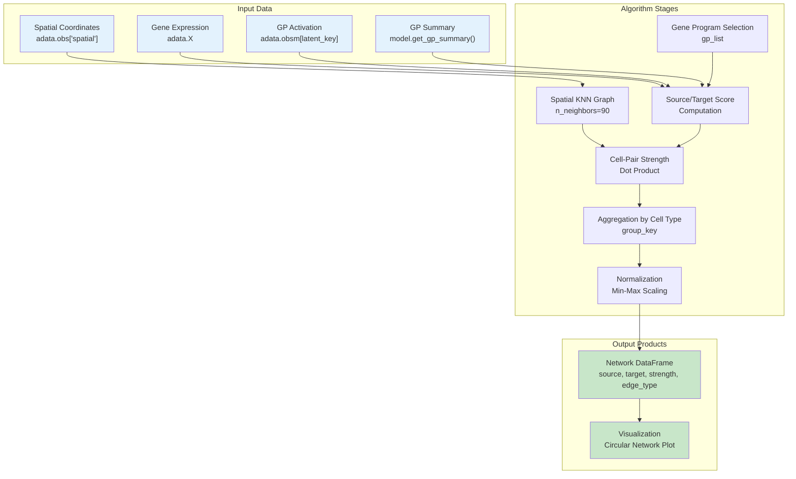

Cell-cell communication (CCC) network analysis in NicheCompass enables the systematic inference and visualization of intercellular signaling events between spatially proximate cell types based on gene program activity. This advanced analytical framework integrates spatial transcriptomics data with gene program priors to reconstruct directed communication networks that capture the strength and specificity of molecular interactions between different cellular populations. The analysis leverages the learned latent representations from the VGPGAE model to quantify communication potential scores, which are then aggregated at the cell-type or niche level to reveal population-level communication patterns.

The CCC network analysis workflow operates on the fundamental premise that effective intercellular signaling requires both spatial proximity and molecular compatibility—specifically, the co-expression of ligand-receptor gene pairs or coordinated activity of signaling pathway gene programs in neighboring cells. By modeling this interaction through learned gene program weights and spatial neighborhood graphs, NicheCompass provides a biologically interpretable framework for hypothesis generation about cellular crosstalk mechanisms in complex tissue microenvironments.

Sources: [analysis.py](src/nichecompass/utils/analysis.py#L871-L1012), [nichecompass.py](src/nichecompass/models/nichecompass.py#L1689-L1987)

## Computational Methodology

The CCC network computation implements a multi-stage pipeline that transforms raw spatial transcriptomics data and model outputs into interpretable communication networks. The core algorithmic framework begins by computing individual cell-level communication potential scores for each gene program of interest, then integrates these scores with spatial neighborhood information to derive cell-pair communication strengths, and finally aggregates and normalizes these strengths to produce population-level network representations.

### Cell-Level Communication Potential Scoring

For each gene program in the analysis set, the algorithm computes two complementary scores per cell: a source score and a target score. The source score quantifies a cell's capacity to send signals based on its expression of source genes (ligands, secreted factors) weighted by the gene program's learned source gene importance parameters. Conversely, the target score quantifies a cell's receptivity to signals based on expression of target genes (receptors, downstream effectors) weighted by the gene program's learned target gene importance parameters. These scores are computed as the normalized product of gene expression levels, GP activation scores from the latent representation, and learned decoder weights.

The mathematical formulation for source and target scores follows: for cell i and gene program gp, the source score is computed as `source_score[i] = mean_j(exp_gene[i,j] / max_exp[j] * weight_source[j] * gp_activation[i])` where j indexes source genes in the gene program. An analogous computation is performed for target scores using target gene weights. This formulation ensures that high scores require both appropriate gene expression and active gene program participation in that cell.

Sources: [analysis.py](src/nichecompass/utils/analysis.py#L941-L975)

### Spatial Integration and Cell-Pair Strength Calculation

Once individual cell scores are computed, the algorithm integrates spatial context by identifying spatial neighborhoods through k-nearest neighbor graph construction. Using the spatial coordinates from `adata.obs['spatial']`, a KNN graph is computed with a default of 90 neighbors, stored under the `spatial_cci` key in `adata.obsp`. This graph defines the allowable communication pairs, respecting physical proximity constraints that are essential for paracrine and juxtacrine signaling.

Cell-pair communication strengths are calculated by taking the dot product of source and target score vectors, which inherently captures the intuition that strong communication requires both an active signal sender and an active signal receiver. This product is then element-wise multiplied with the spatial connectivity matrix to restrict communication to physically adjacent cells. The resulting sparse matrix contains pair-wise communication strengths for all spatially proximate cell pairs.

Sources: [analysis.py](src/nichecompass/utils/analysis.py#L976-L988)

### Population-Level Aggregation and Normalization

To transform cell-level communication strengths into interpretable population-level networks, the algorithm aggregates scores using the `aggregate_obsp_matrix_per_cell_type` utility function. This function performs two key operations: first, it aggregates communication strengths by summing values for each cell type combination, creating a cell-type × cell-type matrix where each entry represents the total communication strength between that pair; second, it can optionally apply group-level filtering to focus on specific sample conditions or experimental groups.

The resulting aggregated values are then normalized to a [0, 1] range using min-max scaling: `normalized_strength = (strength - min_value) / (max_value - min_value)`. This normalization enables comparability across gene programs and facilitates visualization by mapping all communication strengths to a common scale. The final output is a pandas DataFrame with columns for source, target, normalized strength, unscaled strength, and edge type (gene program identifier).

Sources: [analysis.py](src/nichecompass/utils/analysis.py#L989-L1012), [analysis.py](src/nichecompass/utils/analysis.py#L23-L104)

## Architecture and Data Flow

The CCC network analysis implements a sophisticated computational pipeline that coordinates multiple data sources and algorithmic components to transform raw measurements into biologically interpretable communication networks.



The architecture demonstrates how spatial information, expression data, and learned model parameters converge through the algorithm to produce communication networks. Key design decisions include the use of sparse matrix operations for computational efficiency, normalization for cross-program comparability, and modular aggregation functions that support flexible grouping strategies.

Sources: [analysis.py](src/nichecompass/utils/analysis.py#L871-L1012), [nichecompass.py](src/nichecompass/models/nichecompass.py#L1689-L1987)

## Gene Program Summary Integration

The CCC analysis fundamentally relies on gene program summary information extracted from the trained model via the `get_gp_summary()` method. This method retrieves comprehensive metadata about each gene program, including source and target gene assignments, learned decoder weights, and importance scores. The summary DataFrame provides the critical weight vectors that modulate how much each gene contributes to communication potential for its associated gene program.

The GP summary contains several key fields: `gp_source_genes` and `gp_target_genes` (lists of gene names), `gp_source_genes_weights` and `gp_target_genes_weights` (learned decoder weights), and corresponding importance scores. These weights represent the model's learned understanding of which genes are most relevant for each gene program's signaling activity, with higher absolute weights indicating greater biological importance in the context of that program.

Sources: [nichecompass.py](src/nichecompass/models/nichecompass.py#L1689-L1987)

## Implementation and Usage

### Computing Communication Networks

The primary entry point for CCC analysis is the `compute_communication_gp_network()` function, which requires a trained NicheCompass model and a list of gene programs to analyze. The function signature includes parameters for controlling spatial neighborhood size, aggregation grouping, and filtering options.

**Basic usage example:**

```python
from nichecompass.utils import compute_communication_gp_network

# Define gene programs of interest
gp_list = ['WNT_SIGNALING', 'TGF_BETA_PATHWAY', 'NOTCH_SIGNALING']

# Compute communication network
network_df = compute_communication_gp_network(
    gp_list=gp_list,
    model=model,
    group_key='niche',  # Aggregate by niche rather than cell type
    n_neighbors=90      # Spatial neighborhood size
)

# Output structure:
# network_df columns: ['source', 'target', 'strength', 'strength_unscaled', 'edge_type']
```

The function returns a pandas DataFrame where each row represents a directed communication edge between cell types or niches, with the strength indicating the normalized communication intensity and edge_type identifying the associated gene program.

Sources: [analysis.py](src/nichecompass/utils/analysis.py#L871-L1012)

### Parameter Configuration Options

The CCC network computation supports several configurable parameters that influence the analysis scope and output structure:

| Parameter | Type | Default | Description |
|-----------|------|---------|-------------|
| `gp_list` | list | required | List of gene program names for which to compute communication strengths |
| `model` | NicheCompass | required | Trained NicheCompass model instance |
| `group_key` | str | "niche" | Key in `adata.obs` defining aggregation groups (cell types, niches, etc.) |
| `filter_key` | Optional[str] | None | Optional key for additional filtering (e.g., sample condition) |
| `filter_cat` | Optional[str] | None | Category value for filtering when `filter_key` is specified |
| `n_neighbors` | int | 90 | Number of neighbors for spatial KNN graph construction |

The `group_key` parameter is particularly important, as it determines the granularity of the resulting network. Using `'cell_type'` produces traditional cell-type level communication networks, while using `'niche'` produces niche-to-niche communication networks that may reveal higher-order organizational principles in the tissue.

Sources: [analysis.py](src/nichecompass/utils/analysis.py#L871-L913)

### Filtering and Subsetting

The analysis framework supports flexible filtering options to focus on specific biological contexts or experimental conditions. By specifying `filter_key` and `filter_cat`, users can compute communication networks for specific sample groups or tissue regions without recomputing the full spatial graph.

**Example: Condition-specific analysis**

```python
# Compute communication only for tumor samples
tumor_network = compute_communication_gp_network(
    gp_list=gp_list,
    model=model,
    group_key='cell_type',
    filter_key='condition',  # Column with condition labels
    filter_cat='tumor',      # Only analyze tumor samples
    n_neighbors=90
)

# Compute communication only for normal samples
normal_network = compute_communication_gp_network(
    gp_list=gp_list,
    model=model,
    group_key='cell_type',
    filter_key='condition',
    filter_cat='normal',
    n_neighbors=90
)
```

This capability enables comparative analysis of communication patterns across different biological conditions, which is valuable for identifying condition-specific signaling alterations in disease states.

Sources: [analysis.py](src/nichecompass/utils/analysis.py#L891-L892), [analysis.py](src/nichecompass/utils/analysis.py#L989-L992)

## Visualization and Interpretation

### Network Visualization

The `visualize_communication_gp_network()` function provides sophisticated visualization capabilities for communication networks using circular layouts that clearly display directed communication flows between cell types or niches. The visualization uses NetworkX's circular layout algorithm combined with matplotlib customization to produce publication-quality figures.

**Basic visualization example:**

```python
from nichecompass.utils import visualize_communication_gp_network

# Define colors for each cell type/niche
cat_colors = {
    'Niche_A': '#1f77b4',
    'Niche_B': '#ff7f0e',
    'Niche_C': '#2ca02c',
    'Niche_D': '#d62728'
}

# Visualize the network
visualize_communication_gp_network(
    adata=model.adata,
    network_df=network_df,
    cat_colors=cat_colors,
    edge_width_scale=20.0,      # Scale edge thickness by strength
    node_size=500,
    fontsize=14,
    figsize=(18, 16),
    plot_legend=True,
    save=True,
    save_path='communication_network.svg',
    cat_key='niche'
)
```

The visualization uses several visual encodings: edge thickness represents communication strength (scaled by `edge_width_scale`), edge colors distinguish different gene programs, and node positions follow a circular layout with radiating connections that maintain directional information.

Sources: [analysis.py](src/nichecompass/utils/analysis.py#L1014-L1148)

### Visualization Customization Options

The visualization function supports extensive customization through parameters controlling layout, styling, and output formatting:

| Parameter | Type | Default | Description |
|-----------|------|---------|-------------|
| `edge_type_colors` | Optional[dict] | None | Custom color scheme for gene programs (default: colorblind-optimized vega_10) |
| `edge_width_scale` | float | 20.0 | Scaling factor for edge thickness based on strength |
| `node_size` | int | 500 | Size of network nodes |
| `fontsize` | int | 14 | Font size for node labels |
| `figsize` | Tuple[int, int] | (18, 16) | Figure dimensions |
| `plot_legend` | bool | True | Whether to display the legend |
| `connection_style` | str | "arc3, rad = 0.1" | Matplotlib connection style for edges |
| `edge_attr` | str | "strength" | Network edge attribute to use for visualization |

The default edge color scheme uses a colorblind-optimized palette derived from Vega 10 with modifications from Scanpy, ensuring accessibility for viewers with color vision deficiencies. Users can provide custom color dictionaries to match publication requirements or thematic consistency across figures.

Sources: [analysis.py](src/nichecompass/utils/analysis.py#L1034-L1066)

### Chord Diagram Alternative

For alternative visualization approaches, users can employ the `create_cell_type_chord_plot_from_df()` function to generate chord diagrams that display bidirectional communication flows in a circular format. This is particularly useful when emphasizing reciprocal communication relationships or when the network density makes directed edge visualization cluttered.

```python
from nichecompass.utils import create_cell_type_chord_plot_from_df

# Create chord diagram
create_cell_type_chord_plot_from_df(
    adata=model.adata,
    df=network_df,  # Communication network DataFrame
    link_threshold=0.01,  # Minimum strength to display
    cell_type_key='niche',
    plot_label='Gene Program Communication',
    save_fig=True,
    file_path='communication_chord.png'
)
```

Chord diagrams provide a complementary perspective by explicitly showing the magnitude of bidirectional communication between pairs, which can reveal symmetric or asymmetric signaling relationships that might be less obvious in directed network plots.

Sources: [analysis.py](src/nichecompass/utils/analysis.py#L105-L211)

## Advanced Analysis Patterns

### Comparative Communication Analysis

A powerful application of CCC network analysis is comparing communication patterns across different biological conditions, developmental stages, or treatment groups. This comparative approach can reveal condition-specific signaling alterations that may underlie disease mechanisms or treatment responses.

The workflow typically involves computing separate networks for each condition of interest, then performing differential analysis on edge strengths to identify significantly altered communication pathways.

```python
# Compute networks for multiple conditions
conditions = ['control', 'treatment_A', 'treatment_B']
networks = {}

for condition in conditions:
    networks[condition] = compute_communication_gp_network(
        gp_list=gp_list,
        model=model,
        group_key='cell_type',
        filter_key='condition',
        filter_cat=condition
    )

# Identify differential communication
for gp in gp_list:
    for source in networks['control']['source'].unique():
        for target in networks['control']['target'].unique():
            control_strength = networks['control'][
                (networks['control']['source'] == source) & 
                (networks['control']['target'] == target) &
                (networks['control']['edge_type'] == gp)
            ]['strength'].values[0] if len(networks['control'][
                (networks['control']['source'] == source) & 
                (networks['control']['target'] == target) &
                (networks['control']['edge_type'] == gp)
            ]) > 0 else 0
            
            treatment_strength = networks['treatment_A'][
                (networks['treatment_A']['source'] == source) & 
                (networks['treatment_A']['target'] == target) &
                (networks['treatment_A']['edge_type'] == gp)
            ]['strength'].values[0] if len(networks['treatment_A'][
                (networks['treatment_A']['source'] == source) & 
                (networks['treatment_A']['target'] == target) &
                (networks['treatment_A']['edge_type'] == gp)
            ]) > 0 else 0
            
            fold_change = (treatment_strength + 1e-6) / (control_strength + 1e-6)
            # Analyze fold changes to identify altered communication
```

This pattern enables systematic identification of communication pathways that are upregulated or downregulated in response to experimental perturbations, providing mechanistic insights into cellular responses.

Sources: [analysis.py](src/nichecompass/utils/analysis.py#L871-L1012)

### Multi-Scale Communication Analysis

The CCC framework supports analysis at multiple organizational scales by changing the `group_key` parameter. This multi-scale perspective can reveal communication patterns that are consistent across scales or that emerge only at specific levels of organization.

```python
# Compute communication at different scales
scales = {
    'cell_type': model.adata.obs['cell_type'],
    'niche': model.adata.obs['niche'],
    'region': model.adata.obs['region']
}

scale_networks = {}
for scale_name, scale_key in scales.items():
    scale_networks[scale_name] = compute_communication_gp_network(
        gp_list=gp_list,
        model=model,
        group_key=scale_key,
        n_neighbors=90
    )

# Compare communication patterns across scales
for scale_name, network_df in scale_networks.items():
    print(f"\n{scale_name} scale communication:")
    print(network_df.groupby('edge_type')['strength'].agg(['mean', 'max', 'count']))
```

Multi-scale analysis is particularly valuable for understanding how local cell-cell interactions propagate to tissue-level organization, enabling the identification of conserved communication motifs across organizational hierarchies.

Sources: [analysis.py](src/nichecompass/utils/analysis.py#L891-L892)

### Integration with Differential GP Testing

CCC network analysis can be integrated with differential gene program testing to understand how changes in gene program activity relate to altered communication patterns. This combined approach provides a comprehensive view of both the signaling molecules and the communication pathways that are altered in different conditions.

```python
# Run differential GP testing
diff_results = model.run_differential_gp_tests(
    cat_key='condition',
    selected_cats=['tumor'],
    comparison_cats='normal',
    log_bayes_factor_thresh=2.3
)

# Extract significantly differentially active GPs
signif_gps = diff_results['nichecompass_differential_gp_test_results'][
    diff_results['nichecompass_differential_gp_test_results']['log_bayes_factor'] > 2.3
]['gp_name'].unique()

# Compute communication networks for significant GPs
signif_network = compute_communication_gp_network(
    gp_list=signif_gps.tolist(),
    model=model,
    group_key='cell_type',
    filter_key='condition',
    filter_cat='tumor'
)

# Visualize condition-specific communication
visualize_communication_gp_network(
    adata=model.adata,
    network_df=signif_network,
    cat_colors=cat_colors,
    plot_label='Tumor-Specific Communication',
    save_path='tumor_communication.svg'
)
```

This integrated analysis identifies communication pathways mediated by gene programs that are differentially active in the condition of interest, directly linking molecular activity changes to cellular communication alterations.

Sources: [nichecompass.py](src/nichecompass/models/nichecompass.py#L830-L840), [analysis.py](src/nichecompass/utils/analysis.py#L871-L1012)

## Performance Considerations

### Computational Complexity

The CCC network computation involves several computationally intensive steps, particularly for large datasets with many cells and gene programs. The main computational bottlenecks include: (1) spatial KNN graph construction, which scales as O(n log n) for n cells; (2) source and target score computation, which scales as O(n × g × m) where g is the number of genes per program and m is the number of gene programs; and (3) sparse matrix operations for cell-pair strength computation, which scales with the number of edges in the spatial graph.

To optimize performance, the implementation employs sparse matrix operations throughout and caches the spatial KNN graph when possible. The function checks whether a pre-computed graph exists with the same `n_neighbors` parameter and reuses it to avoid redundant computation. For very large datasets, users may consider reducing the neighborhood size or analyzing subsets of gene programs to improve computational efficiency.

Sources: [analysis.py](src/nichecompass/utils/analysis.py#L914-L926)

### Memory Management

The implementation includes explicit memory management to handle large intermediate arrays. After computing source and target scores, the function deletes these intermediate arrays to free memory before proceeding to aggregation steps. The communication strength matrices are stored in sparse CSR format throughout the pipeline to minimize memory overhead.

For datasets with more than approximately 100,000 cells, users should monitor memory usage and consider processing gene programs in batches if memory limitations are encountered. The aggregation step produces dense cell-type × cell-type matrices, which are typically much smaller than the cell-level matrices and therefore pose minimal memory constraints.

Sources: [analysis.py](src/nichecompass/utils/analysis.py#L976-L988)

> [!TIP]
> The communication network computation caches spatial KNN graphs in `model.adata.uns['spatial_cci']` to avoid redundant computation. When analyzing multiple gene programs with the same neighborhood size, this optimization significantly reduces computation time. If you change the `n_neighbors` parameter, a new graph will be computed and cached, overwriting the previous cache.

## Biological Interpretation Guidelines

### Interpreting Communication Strengths

Communication strength values in the output DataFrame represent normalized measures of the intensity of signaling between cell type or niche pairs for a given gene program. However, these values should be interpreted with several considerations: (1) strengths are relative and comparable only within the same gene program and sample context; (2) the normalization is applied per gene program, so strengths cannot be directly compared across different gene programs; and (3) the absolute magnitude depends on experimental factors including sequencing depth, spatial resolution, and gene program prior selection.

For biological interpretation, focus on the relative ranking of communication edges within each gene program rather than absolute strength values. Strong communication edges typically indicate spatially co-localized cell populations with complementary expression of signaling molecules and receptors for the pathway of interest.

Sources: [analysis.py](src/nichecompass/utils/analysis.py#L995-L1004)

### Validating Communication Networks

Validation of inferred communication networks should integrate multiple lines of evidence: (1) spatial colocalization of source and target cell populations in the tissue; (2) expression of known ligand-receptor pairs for the pathway; (3) consistency with known biology from literature and pathway databases; and (4) experimental perturbation results when available.

The NicheCompass framework facilitates validation through integration with spatial visualization tools. Users can overlay communication edge information on spatial coordinates using the spatial gene expression visualization capabilities to visually confirm that predicted communication occurs between spatially adjacent cell populations.

Sources: [analysis.py](src/nichecompass/utils/analysis.py#L1014-L1148)

### Integration with External Knowledge

Communication network predictions can be enriched by integrating with external knowledge sources including known ligand-receptor interaction databases (e.g., CellPhoneDB, NicheNet, OmniPath), pathway annotations (e.g., KEGG, Reactome), and literature-curated interaction databases. This integration helps distinguish between novel predictions and validation of known interactions.

The framework provides utility functions for extracting gene programs from external interaction databases, enabling users to incorporate prior knowledge into the communication analysis. For example, users can create gene programs representing specific ligand-receptor signaling axes and then analyze communication patterns for these programs.

Sources: [analysis.py](src/nichecompass/utils/analysis.py#L105-L211), [mouse_cns_single_sample.ipynb](docs/tutorials/notebooks/mouse_cns_single_sample.ipynb#L1-L100)

## Next Steps

After computing communication networks, several downstream analyses can provide additional insights:

- **[Niche Characterization and Gene Importance Computation](25-niche-characterization-and-gene-importance-computation)**: Extend communication analysis to identify key genes and pathways driving niche-specific communication patterns
- **[Differential Gene Program Testing](23-differential-gene-program-testing)**: Identify gene programs with significantly different activity across conditions, which can explain altered communication patterns
- **[Latent Representation Extraction and Visualization](22-latent-representation-extraction-and-visualization)**: Visualize spatial patterns of gene program activity that underlie communication networks
- **[Single-Sample Niche Identification](19-single-sample-niche-identification)**: Identify spatially coherent cellular niches that serve as communication units

These analyses collectively provide a comprehensive understanding of cellular communication in spatial tissue contexts, from individual gene programs to tissue-level organization.