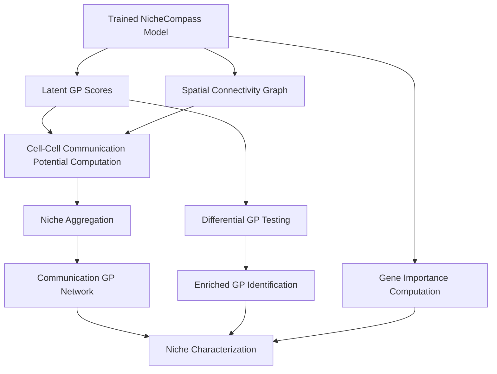
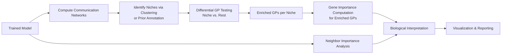

This page provides comprehensive documentation on NicheCompass's advanced analytical capabilities for characterizing spatial niches and computing gene importance scores within gene programs. These features enable researchers to identify functionally distinct tissue microenvironments, understand cell-cell communication patterns, and determine which genes drive specific biological processes within identified niches.

## Overview of Niche Characterization Framework

Niche characterization in NicheCompass leverages the learned gene program representations to identify and analyze spatially coherent cell communities. The framework operates through a hierarchical process where latent gene program scores are aggregated across spatial neighborhoods, enabling the identification of functionally distinct niches based on shared gene program activity patterns. This approach transforms high-dimensional gene expression data into interpretable spatial maps of biological function, allowing researchers to identify microenvironments characterized by specific cellular activities and communication patterns.

The core insight driving this framework is that cells within the same spatial niche should exhibit coordinated activation of gene programs related to their shared functional context. By analyzing the spatial distribution of gene program scores and computing cell-cell communication potentials, NicheCompass can construct comprehensive networks of niche interactions and identify the key molecular players driving these spatially organized biological processes.

Sources: [analysis.py](src/nichecompass/utils/analysis.py#L1-L4), [nichecompass.py](src/nichecompass/models/nichecompass.py#L2-L4)

## Cell-Cell Communication Network Analysis

The foundation of niche characterization lies in computing gene program-specific communication networks between cells. This process quantifies the potential for communication between cell pairs based on coordinated gene program activity and spatial proximity. The `compute_communication_gp_network()` function implements this by first calculating source and target scores for each gene program, then aggregating these scores across spatial neighborhoods to determine cell-pair communication strengths.

The communication potential for a specific gene program is computed by considering three key components: the normalized expression levels of source and target genes associated with that gene program, the learned weights connecting those genes to the gene program in the decoder networks, and the spatial proximity between cells as defined by the neighborhood graph. This approach ensures that communication scores reflect both the molecular capacity for communication (gene expression and pathway connectivity) and the physical possibility of interaction (spatial adjacency).

Sources: [analysis.py](src/nichecompass/utils/analysis.py#L871-L1013)

**Table: Communication Network Computation Components**

| Component | Description | Data Source | Purpose |
|-----------|-------------|-------------|---------|
| Source Gene Scores | Normalized expression × GP source weights × GP activity | `adata.X`, decoder weights | Quantify signaling capacity from source cells |
| Target Gene Scores | Normalized expression × GP target weights × GP activity | `adata.X`, decoder weights | Quantify receptor capacity in target cells |
| Spatial Neighborhood | KNN graph on spatial coordinates | `adata.obsm['spatial']` | Define physically possible interactions |
| Aggregation | Cell-type/group level averaging of cell-pair scores | `adata.obs[group_key]` | Generate interpretable niche-level networks |

The computation pipeline begins by constructing a k-nearest neighbor graph based on spatial coordinates, which defines the physical neighborhoods within which communication can occur. For each gene program, the algorithm retrieves the latent activity scores across all cells and identifies the source and target genes associated with that program through the decoder masks. Source and target scores are computed by combining normalized gene expression, the decoder weights connecting each gene to the gene program, and the gene program's latent activity score for each cell.

These scores are then averaged across all source and target genes for each cell to produce aggregate source and target scores per cell. The cell-pair communication strength is computed as the outer product of these aggregate scores, filtered through the spatial neighborhood graph to ensure only physically adjacent cells are considered. Finally, these cell-pair scores are aggregated across user-defined cell type or niche categories, normalized to the [0,1] range, and returned as a structured DataFrame suitable for network analysis and visualization.

> [!TIP]
> The communication network computation is computationally intensive for large datasets. The function caches the spatial neighborhood graph if the same `n_neighbors` parameter is used, but for different neighborhood sizes, recomputing the graph adds significant overhead. Consider standardizing on a single neighborhood size for multiple analyses.

## Differential Gene Program Testing for Niche Identification

Niche identification often requires identifying which gene programs are specifically enriched in particular spatial regions or cell groups compared to their surroundings or other reference populations. The `run_differential_gp_tests()` function implements a statistical framework for detecting gene programs that show significantly different activity between user-defined categories, such as spatial niches versus the rest of the tissue or one niche type versus another.

This method employs a Bayesian hypothesis testing approach comparing two hypotheses: the null hypothesis (h0) that gene program scores are higher in the category of interest versus the alternative hypothesis (h1) that scores are equal or higher in the comparison group. The evidence for each hypothesis is quantified using log Bayes factors, which provide a principled measure of enrichment that accounts for both the magnitude and variability of gene program scores across groups.

Sources: [nichecompass.py](src/nichecompass/models/nichecompass.py#L830-L1052)

**Table: Differential GP Testing Parameters**

| Parameter | Type | Default | Description |
|-----------|------|---------|-------------|
| `cat_key` | str | required | Key in `adata.obs` defining categories for comparison |
| `selected_cats` | str/list | all categories | Categories to test for GP enrichment |
| `comparison_cats` | str/list | "rest" | Reference group ("rest" for all other categories) |
| `selected_gps` | str/list | all active GPs | Gene programs to test (None for all active) |
| `n_sample` | int | 10000 | Observations to sample per group for statistical testing |
| `log_bayes_factor_thresh` | float | 2.3 | Threshold for considering a GP enriched |
| `key_added` | str | "nichecompass_differential_gp_test_results" | Storage key for results |

The statistical implementation begins by retrieving latent representations (mean and standard deviation) for all cells, which are derived from the variational gene program autoencoder. For each gene program being tested, the method compares distributions between the category of interest and the comparison category by sampling equal numbers of observations from each group (default: 10,000 samples). The log Bayes factor is computed using the difference in mean scores normalized by the combined variance, following an adapted implementation from the scArches project.

Results are stored as a DataFrame in `adata.uns[key_added]` containing columns for category, gene program name, probabilities for each hypothesis (p_h0, p_h1), and the log Bayes factor. Gene programs exceeding the log Bayes factor threshold are considered enriched, and the normalized scores of enriched gene programs across all categories are added to `adata.obs` for visualization and downstream analysis. The method returns a list of all enriched gene programs across tested categories, providing a concise summary of the molecular signature distinguishing each niche or biological region.

Sources: [nichecompass.py](src/nichecompass/models/nichecompass.py#L990-L1029)

## Gene Importance Computation

Understanding which genes drive specific gene program activity is crucial for biological interpretation and hypothesis generation. The `compute_gp_gene_importances()` function provides a quantitative assessment of each gene's contribution to a selected gene program by analyzing the learned decoder weights in the trained model. This analysis distinguishes between genes acting as communication sources (e.g., ligands, signaling molecules) and those acting as targets (e.g., receptors, response genes).

Gene importance scores are computed by normalizing the absolute weights connecting each gene to the gene program in the RNA decoder networks. The normalization is performed gene-wise across all cells, ensuring that importance scores reflect the relative contribution of each gene while accounting for differences in scale between different genes. This approach yields interpretable importance values that sum to 1.0 for each gene program, enabling direct comparison of the relative importance of different genes within the same program.

Sources: [nichecompass.py](src/nichecompass/models/nichecompass.py#L1053-L1106)

**Table: Gene Importance DataFrame Structure**

| Column | Description | Data Type |
|--------|-------------|-----------|
| `gene` | Gene name | string |
| `gene_entity` | "source" or "target" indicating communication role | string |
| `gene_weight` | Raw decoder weight connecting gene to GP | float |
| `gene_importance` | Normalized importance score (sums to 1 per GP/entity) | float |

The importance computation retrieves the decoder weights for the specified gene program through `get_gp_data()`, which returns both source and target gene weights. These weights are normalized by their absolute sums to produce importance scores, with special handling for the case where all weights for a gene are zero (which would cause division by zero). The resulting DataFrame includes both raw weights and normalized importance scores, enabling researchers to understand both the magnitude and relative contribution of each gene.

For gene programs that include chromatin accessibility data (in multi-modal RNA+ATAC datasets), the analogous `compute_gp_peak_importances()` function provides the same analysis for peaks rather than genes, identifying which regulatory regions contribute most to each gene program's activity.

Sources: [nichecompass.py](src/nichecompass/models/nichecompass.py#L1107-L1165)

> [!TIP]
> Gene importance scores can reveal unexpected biological insights. Genes with high importance but low expression may represent key regulators that exert outsized effects through low-abundance signaling molecules. Conversely, highly expressed genes with low importance may represent downstream effects rather than drivers of the gene program activity.

## Comprehensive Gene Program Summaries

For a holistic view of all gene programs and their associated genes, the `get_gp_summary()` function generates a comprehensive DataFrame containing information about every gene program, including its active status, constituent genes with weights and importances, and statistical metrics about program composition. This summary is particularly useful for exploratory analysis, quality assessment, and generating publication-ready tables of gene program annotations.

The summary includes separate information for source and target genes (and peaks for multi-modal models), with genes sorted by their absolute weights within each entity type. This organization enables quick identification of the most important genes for each communication direction. The summary also includes counts of total genes and non-zero genes per entity type, providing metrics of gene program sparsity and complexity.

Sources: [nichecompass.py](src/nichecompass/models/nichecompass.py#L1689-L1965)

**Table: Gene Program Summary DataFrame Columns**

| Column | Description |
|--------|-------------|
| `gp_name` | Gene program name |
| `all_gp_idx` | Index among all gene programs (including inactive) |
| `gp_active` | Boolean indicating if GP is active in model |
| `active_gp_idx` | Index among active gene programs (Int64, NA if inactive) |
| `n_source_genes` | Total number of source genes associated with GP |
| `n_non_zero_source_genes` | Source genes with non-zero decoder weights |
| `n_target_genes` | Total number of target genes associated with GP |
| `n_non_zero_target_genes` | Target genes with non-zero decoder weights |
| `gp_source_genes` | List of source gene names, sorted by weight |
| `gp_target_genes` | List of target gene names, sorted by weight |
| `gp_source_genes_weights` | Corresponding source gene decoder weights |
| `gp_target_genes_weights` | Corresponding target gene decoder weights |
| `gp_source_genes_importances` | Normalized importance scores for source genes |
| `gp_target_genes_importances` | Normalized importance scores for target genes |

For models trained on multi-modal data, additional columns are included for peak information, following the same structure as gene columns but with regulatory region identifiers instead of gene names. The summary includes handling for "addon" gene programs that may have been learned de novo during training rather than being specified from prior knowledge, ensuring complete coverage of all programs in the model.

## Neighbor Importance and Spatial Context

Beyond gene-centric analysis, understanding the spatial context of each cell's latent representation is crucial for niche characterization. The `get_neighbor_importances()` function retrieves the aggregation weights learned by the node label aggregator, which quantify how much importance each cell attributes to its neighboring cells during the reconstruction process. These weights represent a learned measure of spatial influence that reflects the model's understanding of which neighbors are most relevant for predicting a cell's molecular profile.

The neighbor importance matrix is sparse (n_obs × n_obs), where each row represents a cell and the non-zero entries in that row indicate the aggregation weights for that cell's neighbors. This matrix is not symmetric—cell A may attribute high importance to cell B, but cell B may attribute lower importance to cell A, reflecting directional influence patterns rather than reciprocal relationships.

Sources: [nichecompass.py](src/nichecompass/models/nichecompass.py#L1599-L1688)

The implementation processes the entire dataset in batches through the node label aggregator, retrieving the attention coefficients or aggregation weights for each cell-neighbor pair. When using the "one-hop-attention" node label method, the mean across attention heads is computed to produce a single importance score per edge. The global edge index is used to map batch-local indices back to the global cell indices, and the aggregation weights are assembled into a sparse matrix in CSR format for efficient storage and subsequent analysis.

These neighbor importance scores can be used for various downstream analyses: identifying key influential cells in each region, understanding the spatial footprint of influence for each cell, or integrating with communication network analysis to distinguish between strong molecular communication signals and weak spatial influence patterns.

## Visualization and Interpretation Workflow

Putting these analytical components together, researchers can conduct a comprehensive niche characterization workflow that moves from raw data to biological insights. The typical workflow begins with computing communication networks for key gene programs, followed by differential testing to identify enriched programs in spatially defined niches. Gene importance analysis then reveals the molecular drivers of these programs, while neighbor importance provides context on spatial influence patterns.

The visualization function `visualize_communication_gp_network()` complements these analytical tools by creating interpretable network visualizations that can highlight the strength and directionality of communication between different cell types or spatial niches. These visualizations use edge width to represent communication strength and can color edges by gene program type to show multiple communication modalities simultaneously.

Sources: [analysis.py](src/nichecompass/utils/analysis.py#L1014-L1148)

This integrated approach enables researchers to move from descriptive spatial analysis to mechanistic hypotheses about the molecular drivers of niche-specific phenotypes. By combining network analysis, statistical testing, and gene-level interpretation, NicheCompass provides a comprehensive toolkit for spatially resolved functional genomics that bridges the gap between gene expression patterns and higher-order tissue organization.

## Integration with Spatial Analysis Workflows

The niche characterization capabilities described here are designed to integrate seamlessly with other spatial analysis workflows in NicheCompass. After identifying niches through clustering or manual annotation ([Single-Sample Niche Identification](19-single-sample-niche-identification)), the differential testing framework can characterize the molecular signature of each niche. The communication networks can be compared across samples to identify conserved or sample-specific interaction patterns ([Sample Integration and Spatial Atlas Building](20-sample-integration-and-spatial-atlas-building)).

The gene importance analysis complements the [Differential Gene Program Testing](23-differential-gene-program-testing) capabilities by providing a complementary view that focuses on the decoder weights rather than latent score distributions. Together, these approaches provide a multi-faceted understanding of how gene programs are spatially organized and which molecular components drive these spatial patterns.

For researchers working with spatial reference atlases, these tools can be used to characterize how query samples map to reference niches and identify gene programs that distinguish between similar spatial contexts. The communication network analysis can reveal whether the same cell-cell interaction patterns are preserved across different experimental conditions or tissue samples, enabling systematic comparative studies of spatial organization.
