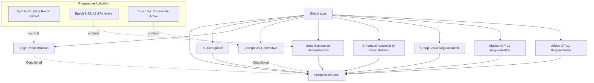
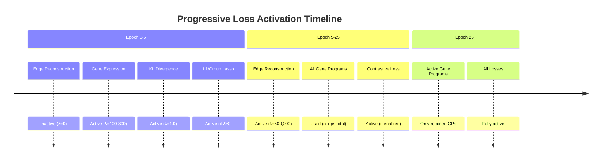
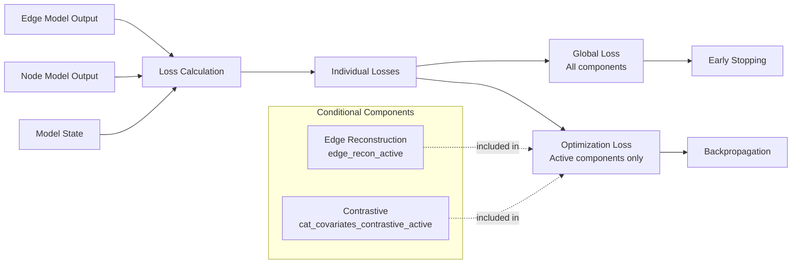

This documentation explains the comprehensive loss balancing and regularization framework that enables NicheCompass to learn interpretable gene programs while preserving spatial relationships and integrating multi-modal omics data. The architecture employs multiple loss components with configurable weights to balance competing objectives during training.

## Loss Component Architecture

The NicheCompass model optimizes a composite loss function combining reconstruction losses, regularization terms, and contrastive objectives. Each component is weighted by a configurable lambda parameter (λ) that controls its influence on the final optimization.



Sources: [vgpgae.py](src/nichecompass/modules/vgpgae.py#L932-L1144), [trainer.py](src/nichecompass/train/trainer.py#L217-L350)

## Reconstruction Losses

### Gene Expression Reconstruction Loss

The primary reconstruction objective uses a **negative binomial distribution** to model count data, which is well-suited for scRNA-seq measurements that exhibit over-dispersion. The loss computes the negative log-likelihood of observed gene expression given predicted mean (μ) and dispersion (θ) parameters:

```
L_gene_expr = λ_gene_expr_recon × NB_loss(x, μ, θ)
```

where λ_gene_expr_recon typically ranges from 100-300 depending on the dataset complexity. This component encourages gene programs to linearly combine to reconstruct observed expression patterns.

Sources: [losses.py](src/nichecompass/modules/losses.py#L169-L214), [vgpgae.py](src/nichecompass/modules/vgpgae.py#L1002-L1014)

### Chromatin Accessibility Reconstruction Loss

For multi-modal integration with scATAC-seq data, a similar negative binomial loss reconstructs chromatin accessibility at peak regions:

```
L_chrom_access = λ_chrom_access_recon × NB_loss(x, μ, θ)
```

with λ_chrom_access_recon typically set to 10-100, reflecting the different scale and characteristics of ATAC-seq data compared to RNA-seq.

Sources: [vgpgae.py](src/nichecompass/modules/vgpgae.py#L1124-L1135)

### Edge Reconstruction Loss

The spatial graph structure is preserved through binary cross entropy loss on edge predictions:

```
L_edge = λ_edge_recon × BCE(edge_logits, edge_labels)
```

Key implementation details:
- **Positive weighting**: Automatically balances positive/negative examples using pos_weight = neg_labels / pos_labels
- **High λ values**: Typically 500,000 to compensate for the small number of edges relative to genes
- **Conditional activation**: Often disabled during initial epochs to pretrain expression reconstruction

Sources: [losses.py](src/nichecompass/modules/losses.py#L123-L168), [vgpgae.py](src/nichecompass/modules/vgpgae.py#L993-L1001)

## Regularization Strategies

### Kullback-Leibler Divergence

The VAE framework uses KL divergence to regularize the latent distribution:

```
L_kl = -0.5 × mean(Σ(1 + 2×logstd - μ² - exp(logstd)²))
```

This encourages encodings to distribute evenly around the latent space center, preventing mode collapse and ensuring smooth transitions between similar observations.

Sources: [losses.py](src/nichecompass/modules/losses.py#L255-L286), [vgpgae.py](src/nichecompass/modules/vgpgae.py#L990-L992)

### Group Lasso Regularization

**Group lasso** enforces sparsity at the gene program level by applying L2 norms within each GP group and L1 across groups:

```
L_group_lasso = λ_group_lasso × Σ(||W_g||₂ × √(n_nonzero_weights_g))
```

where W_g represents weights for gene program g. This eliminates entire gene programs rather than individual genes, promoting biological interpretability.

Sources: [losses.py](src/nichecompass/modules/losses.py#L215-L254), [vgpgae.py](src/nichecompass/modules/vgpgae.py#L1019-L1023)

### L1 Regularization

**L1 regularization** operates on individual gene weights within gene programs:

```
L1_masked = λ_l1_masked × |W_masked| (applied to l1_targets_mask and l1_sources_mask)
L1_addon = λ_l1_addon × |W_addon| (applied to addon gene programs)
```

This encourages gene-level sparsity, ensuring each gene program contains only the most relevant genes. The masks allow selective application to specific gene sets (e.g., target vs source genes).

Sources: [losses.py](src/nichecompass/modules/losses.py#L287-L340), [vgpgae.py](src/nichecompass/modules/vgpgae.py#L1016-L1025)

## Contrastive Learning

### Categorical Covariates Contrastive Loss

For cell types or other categorical annotations, a contrastive loss aligns latent representations:

```
L_contrastive = λ_contrastive × BCE(contrastive_logits, contrastive_labels)
```

The contrastive examples are determined dynamically:
- **Positive examples**: Top `contrastive_logits_pos_ratio × 100%` of edge predictions between different categories (default: 12.5%)
- **Negative examples**: Bottom `contrastive_logits_neg_ratio × 100%` of edge predictions between different categories (default: 0%)

This encourages cells of the same type to cluster while separating different types, even when spatially adjacent.

Sources: [losses.py](src/nichecompass/modules/losses.py#L15-L122), [vgpgae.py](src/nichecompass/modules/vgpgae.py#L1004-L1011)

## Progressive Training Strategy

NicheCompass employs a **curriculum learning approach** where loss components are activated progressively:



> [!TIP]
> The `n_epochs_all_gps` parameter controls when to switch from using all gene programs to only active ones, typically reducing computational cost and focusing learning on the most informative programs.

Sources: [trainer.py](src/nichecompass/train/trainer.py#L340-L358)

## Configuration Parameters

### Lambda Weight Summary

| Parameter | Typical Range | Purpose | Default |
|-----------|---------------|---------|---------|
| `lambda_gene_expr_recon` | 100-300 | Primary reconstruction objective | 100 (trainer) / 300 (model) |
| `lambda_chrom_access_recon` | 10-100 | ATAC-seq reconstruction | 10 (trainer) / 100 (model) |
| `lambda_edge_recon` | 0-500,000 | Spatial graph preservation | 500,000 |
| `lambda_cat_covariates_contrastive` | 0-100,000 | Cell type separation | 0 (trainer) / 100,000 (model) |
| `lambda_group_lasso` | 0-1.0 | GP-level sparsity | 0 |
| `lambda_l1_masked` | 0-1.0 | Gene-level sparsity (prior GPs) | 0 |
| `lambda_l1_addon` | 0-1.0 | Gene-level sparsity (addon GPs) | 0 |

Sources: [vgpgae.py](src/nichecompass/modules/vgpgae.py#L932-L992), [trainer.py](src/nichecompass/train/trainer.py#L217-L310)

### Progressive Training Parameters

| Parameter | Purpose | Default |
|-----------|---------|---------|
| `n_epochs_no_edge_recon` | Epochs before edge loss activation | 0 |
| `n_epochs_no_cat_covariates_contrastive` | Epochs before contrastive loss activation | 5 |
| `n_epochs_all_gps` | Epochs before filtering to active GPs | 25 |

Sources: [trainer.py](src/nichecompass/train/trainer.py#L217-L236)

## Loss Computation Flow

The model distinguishes between two loss aggregations:

1. **global_loss**: Sum of ALL loss components, used for early stopping and model selection
2. **optim_loss**: Sum of components that are actively being optimized (some may be temporarily disabled)



This separation allows components like edge reconstruction to be included in validation metrics even during pretraining phases where they are not actively optimized.

Sources: [vgpgae.py](src/nichecompass/modules/vgpgae.py#L1137-L1144)

## Additional Regularization

### Weight Decay and Gradient Clipping

Beyond the structured loss components, standard regularization techniques are applied:

- **Weight decay**: L2 penalty on all model weights, controlled by `weight_decay` parameter (default: 0)
- **Gradient clipping**: Prevents exploding gradients via `grad_clip_value` parameter (default: 0, disabled)

> [!TIP]
> Gradient clipping is particularly important when using high lambda values for edge reconstruction loss, which can cause large gradient updates during early training epochs.

Sources: [trainer.py](src/nichecompass/train/trainer.py#L222-L223), [trainer.py](src/nichecompass/train/trainer.py#L426-L430)

## Best Practices

### Starting with Default Values

For new datasets, begin with conservative values:
```python
# Conservative initial settings
lambda_gene_expr_recon = 100.0
lambda_edge_recon = 0  # Start without edge reconstruction
lambda_l1_masked = 0.01  # Mild sparsity
lambda_group_lasso = 0.01  # Mild GP sparsity
n_epochs_no_edge_recon = 10  # Pretrain reconstruction
```

### Progressive Weight Adjustment

After initial training, increase regularization strength gradually:
1. Verify reconstruction loss converges
2. Activate edge reconstruction with moderate λ_edge_recon (e.g., 50,000)
3. Monitor if spatial patterns are preserved
4. Increase to full λ_edge_recon (500,000) if needed

### Sparsity Tuning

The balance between L1 and group lasso determines model interpretability:
- **High L1, low group lasso**: Many small gene programs with few genes
- **Low L1, high group lasso**: Fewer, larger gene programs
- **Both moderate**: Intermediate granularity

Sources: [losses.py](src/nichecompass/modules/losses.py#L215-L340)

## Monitoring Loss Components

During training, individual loss components are logged for debugging:

```python
# Example logged components
train_gene_expr_recon_loss
train_edge_recon_loss
train_kl_reg_loss
train_group_lasso_reg_loss
train_masked_gp_l1_reg_loss
train_global_loss  # Sum of all
train_optim_loss   # Sum of active only
```

Use these logs to:
- Verify each component is decreasing appropriately
- Identify if any component is dominating the optimization
- Adjust lambda values if components diverge or plateau

Sources: [trainer.py](src/nichecompass/train/trainer.py#L380-L395)

## Next Steps

To understand how these loss components fit into the overall training workflow, see [Training Process and Optimization Strategy](15-training-process-and-optimization-strategy). For details on the neural network architecture that generates the predictions for these losses, refer to [Loss Functions and Optimization Objectives](8-loss-functions-and-optimization-objectives).