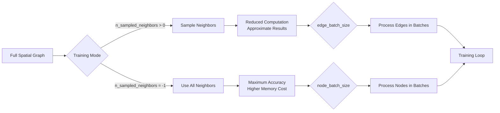
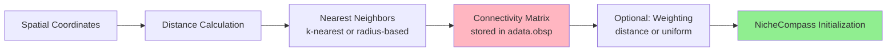
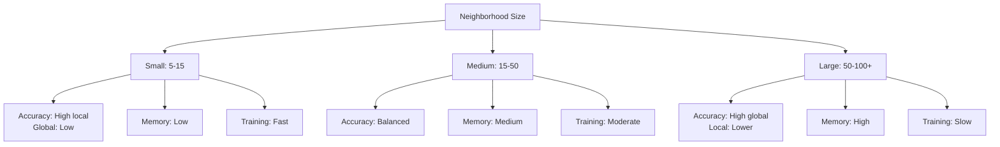

Selecting the appropriate neighborhood graph size is a critical hyperparameter choice in NicheCompass that directly influences model performance, computational efficiency, and biological interpretability. This guide provides systematic approaches for determining optimal neighbor parameters for your spatial multi-omics analysis.

## Understanding Neighborhood Graph Parameters

The neighborhood graph size in NicheCompass is controlled through several interconnected parameters that govern how spatial relationships are encoded and processed during model training. The core parameters include the graph connectivity structure stored in the AnnData object and runtime sampling parameters that affect how neighborhoods are processed during training.

The spatial connectivity graph is stored in `adata.obsp[adj_key]`, where `adj_key` defaults to `"spatial_connectivities"` [nichecompass.py](src/nichecompass/models/nichecompass.py#L193). This adjacency matrix defines the neighborhood structure used by graph neural network layers during information propagation. During training, the `n_sampled_neighbors` parameter (default: -1) controls whether all neighbors are used or a random subset is sampled for computational efficiency [nichecompass.py](src/nichecompass/models/nichecompass.py#L617).

## Node Label Aggregation Methods

The `node_label_method` parameter determines how neighbor information is aggregated during message passing, which indirectly affects the effective neighborhood influence on each cell [nichecompass.py](src/nichecompass/models/nichecompass.py#L228-L231). Three aggregation strategies are available:

| Method | Description | Use Case |
|--------|-------------|----------|
| `one-hop-sum` | Simple summation of neighbor features | Fast computation, suitable for dense uniform neighborhoods |
| `one-hop-norm` | Normalized sum of neighbor features | Default choice, accounts for varying neighborhood sizes |
| `one-hop-attention` | Attention-weighted neighbor aggregation | When neighborhood importance varies significantly |

The choice of aggregation method interacts with your neighborhood size: larger neighborhoods benefit from normalization or attention-based methods to prevent feature saturation, while smaller neighborhoods may perform adequately with simple summation [vgpgae.py](src/nichecompass/modules/vgpgae.py#L176-L179).

## Sampling Strategy and Batch Processing

NicheCompass provides flexible neighbor sampling to balance computational cost with model performance:

The `n_sampled_neighbors` parameter enables sub-sampling during training, which is particularly valuable for datasets with very dense connectivity or limited GPU memory [nichecompass.py](src/nichecompass/models/nichecompass.py#L617). When set to -1 (default), the model uses all neighbors from the spatial graph. Setting a positive integer value randomly samples that many neighbors for each node during each training epoch.

Edge-level and node-level batch processing provide additional control over memory usage. The `edge_batch_size` parameter (default: 256) determines how many edges are processed in each batch during edge reconstruction training, while `node_batch_size` (default: None, auto-set) controls batch size for node-level tasks [nichecompass.py](src/nichecompass/models/nichecompass.py#L610-L611).

## Encoder Architecture and Neighborhood Propagation

The graph encoder architecture parameters influence how many hops of neighborhood information are incorporated into cell representations:

| Parameter | Default | Description |
|-----------|---------|-------------|
| `conv_layer_encoder` | `"gatv2conv"` | Graph convolution type (GATv2 or GCN) |
| `n_layers_encoder` | `1` | Number of graph convolution layers |
| `encoder_n_attention_heads` | `4` | Number of attention heads (GATv2 only) |

The number of encoder layers directly determines the receptive field of each cell in the graph [nichecompass.py](src/nichecompass/models/nichecompass.py#L235-L238). With `n_layers_encoder=1`, each cell's representation incorporates information only from its immediate neighbors. Increasing to 2 or more layers expands the receptive field to multi-hop neighborhoods, capturing broader spatial context but increasing computational complexity.

The `conv_layer_encoder` choice affects how neighbor weights are computed. GATv2 (`"gatv2conv"`) uses learned attention mechanisms to weight neighbor contributions differently for each target cell, potentially capturing more complex spatial patterns [encoders.py](src/nichecompass/nn/encoders.py#L62-L63). GCN (`"gcnconv"`) uses symmetric normalization based on neighborhood degree, which is computationally more efficient but less flexible.

> [!TIP]
> For datasets with heterogeneous cell distributions or anisotropic spatial patterns, GATv2 with multiple attention heads typically outperforms GCN, especially when combined with smaller, more focused neighborhoods (10-30 neighbors). For uniform tissue structures, GCN with larger neighborhoods (30-100 neighbors) may be sufficient and computationally more efficient.

## Graph Construction Pre-processing

The neighborhood graph must be constructed and stored in the AnnData object before model initialization. This is typically done using spatial coordinates through libraries like Squidpy or Scanpy's spatial graph construction functions:

Key considerations during graph construction include:

1. **Neighbor selection method**: k-nearest neighbors (KNN) vs. radius-based approaches
2. **Distance metrics**: Euclidean vs. specialized spatial distances
3. **Weighting schemes**: Uniform weights vs. distance-based decay
4. **Directionality**: Symmetric (undirected) vs. asymmetric (directed) edges

The prepared adjacency matrix is then passed to NicheCompass via the `adj_key` parameter during initialization [dataprocessors.py](src/nichecompass/data/dataprocessors.py#L137).

## Practical Selection Guidelines

Based on common spatial transcriptomics applications, here are evidence-based starting points for neighborhood configuration:

### Small Neighborhoods (5-15 neighbors)
- **Best for**: High-resolution spatial patterning, rare cell type detection
- **Pros**: Preserves fine-grained spatial structure, lower memory footprint
- **Cons**: May miss longer-range spatial context, requires more layers for multi-hop information
- **Recommended encoder**: GATv2 with 1-2 layers
- **Typical use case**: Individual slice analysis with distinct spatial domains

### Medium Neighborhoods (15-50 neighbors)
- **Best for**: Balanced analysis of local and semi-local patterns
- **Pros**: Good trade-off between detail and context, works well with default parameters
- **Cons**: May blur very fine-scale boundaries
- **Recommended encoder**: GATv2 or GCN with 1-2 layers
- **Typical use case**: Standard tissue sections with moderate cell density

### Large Neighborhoods (50-100+ neighbors)
- **Best for**: Global tissue organization, integration across samples
- **Pros**: Captures broad spatial gradients, robust to local noise
- **Cons**: Higher computational cost, may oversmooth local features
- **Recommended encoder**: GCN with 1 layer or GATv2 with neighbor sampling
- **Typical use case**: Sample integration, spatial atlas construction

## Performance Trade-offs and Optimization

Selecting neighborhood size involves balancing accuracy, memory, and computation time:

> [!TIP]
> When working with large graphs (10,000+ cells), start with neighbor sampling (`n_sampled_neighbors=30-50`) and GATv2 encoder. This typically preserves >90% of performance while reducing memory usage by 60-80% compared to using all neighbors. Gradually increase sample size if performance plateaus.

Memory usage scales approximately linearly with neighborhood size and quadratically with batch size. For GPU memory constraints, prioritize reducing `edge_batch_size` before reducing neighborhood size, as smaller batches have less impact on final model quality than smaller neighborhoods.

## Troubleshooting Common Issues

| Symptom | Potential Cause | Recommended Action |
|---------|-----------------|-------------------|
| Poor spatial pattern preservation | Neighborhood too small for tissue organization | Increase neighbors in graph construction |
| Memory overflow during training | Too many neighbors per cell, large batch size | Enable `n_sampled_neighbors`, reduce `edge_batch_size` |
| Training very slow | Dense connectivity, all neighbors used | Implement neighbor sampling, reduce encoder layers |
| Over-smoothed results | Neighborhood too large, too many encoder layers | Reduce neighbors or `n_layers_encoder` |
| Unstable training | Very small neighborhoods with attention mechanism | Switch to GCN or increase neighbors to 10+ |

## Validation Strategies

To empirically validate your neighborhood size selection:

1. **Reconstruction metrics**: Monitor edge reconstruction loss during training—lower loss indicates better preservation of spatial structure [vgpgae.py](src/nichecompass/modules/vgpgae.py#L932-L947)
2. **Latent space visualization**: Use UMAP/t-SNE on latent representations to check if spatial domains are well-separated
3. **Biological validation**: Ensure identified gene programs align with known spatial biology
4. **Cross-sample consistency**: For sample integration tasks, verify that comparable neighborhoods yield similar biological insights

## Related Documentation

For deeper understanding of related concepts, consult these documentation pages:
- [Graph Construction and Neighbor Connectivity](10-graph-construction-and-neighbor-connectivity) - Details on pre-processing steps
- [Encoder Design and Graph Convolution Strategies](6-encoder-design-and-graph-convolution-strategies) - Encoder architecture details
- [Training Process and Optimization Strategy](15-training-process-and-optimization-strategy) - Full training parameter guide
- [Single-Sample Niche Identification](19-single-sample-niche-identification) - Application-focused workflows