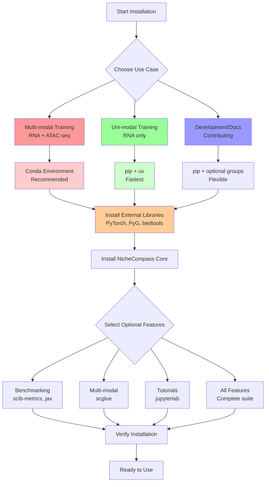

NicheCompass is a comprehensive toolkit for end-to-end analysis of spatial multi-omics data, enabling spatial atlas building, niche identification, and characterization through cellular graph embeddings. This guide walks you through the complete installation process, from environment setup to dependency management, with specialized recommendations for different use cases.


## System Requirements

Before proceeding with installation, ensure your system meets the following requirements:

| Requirement | Specification | Notes |
|------------|---------------|-------|
| **Python Version** | 3.10 | Only Python 3.10 is supported [pyproject.toml](pyproject.toml#L19) |
| **Operating System** | Linux (POSIX) | Primary support for Linux systems [pyproject.toml](pyproject.toml#L24) |
| **GPU Support** | CUDA-compatible GPU | Recommended for training models |
| **GPU Frameworks** | CUDA 11.7+ or 12.4 | Specific versions required for PyTorch compatibility |
| **Memory** | 8GB+ RAM minimum | 16GB+ recommended for multi-modal training |
| **Storage** | 5GB+ free space | For dependencies and model checkpoints |

> [!TIP]
> Apple silicon and multi-GPU training are not yet supported. For optimal performance, use a single NVIDIA GPU with CUDA support.

## Installation Architecture

The installation process follows a modular architecture with multiple pathways depending on your use case:



## Environment Setup

### Virtual Environment Recommendation

We strongly discourage installing NicheCompass directly into your system Python. Instead, create an isolated virtual environment to prevent dependency conflicts and maintain system stability.

#### Option 1: Conda Environment (Recommended for Multi-modal)

Conda provides the most robust environment management for scientific computing workflows, especially when handling complex dependencies like PyTorch and bioinformatics tools.

```bash
# Create conda environment using provided configuration
conda env create -f environment.yaml
```

The provided [environment.yaml](environment.yaml#L1-L15) includes:
- Python 3.10
- PyTorch 2.0.0 with CUDA 11.7
- PyTorch Scatter 2.1.1
- PyTorch Sparse 0.6.17
- bedtools 2.30.0 (for ATAC-seq processing)

Activate your environment:
```bash
conda activate nichecompass
```

#### Option 2: Python venv + uv (Fastest for Uni-modal)

For rapid installation and uni-modal workflows, the `uv` package manager within a Python virtual environment provides significantly faster dependency resolution [docs/installation.md](docs/installation.md#L16-L21):

```bash
# Create and activate virtual environment
python3 -m venv ${/path/to/new/virtual/environment}
source ${/path/to/new/virtual/environment}/bin/activate

# Install uv for fast package management
pip install uv
```

Replace `${/path/to/new/virtual/environment}` with your desired installation path.

## External Library Dependencies

Before installing NicheCompass, you must install several external libraries that are not included in the core package.

### PyTorch Ecosystem

The PyTorch ecosystem forms the foundation for NicheCompass's deep learning capabilities:

| Library | Purpose | Recommended Version |
|---------|---------|-------------------|
| **PyTorch** | Core deep learning framework | 2.0.0+ or 2.6.0+ |
| **PyTorch Scatter** | Efficient scatter operations | 2.1.1+ |
| **PyTorch Sparse** | Sparse tensor operations | 0.6.17+ |

#### Installing PyTorch with CUDA Support

For CUDA-enabled GPU acceleration, install PyTorch using the specific version matching your CUDA setup [docs/installation.md](docs/installation.md#L40-L51):

**For PyTorch 2.6.0 with CUDA 12.4 (Latest Recommended):**
```bash
uv pip install torch --index-url https://download.pytorch.org/whl/cu124
uv pip install pyg_lib torch_scatter torch_sparse -f https://data.pyg.org/whl/torch-2.6.0+cu124.html
```

**For PyTorch 2.0.0 with CUDA 11.7 (Stable/Conda):**
```bash
uv pip install torch==2.0.0+cu117 --extra-index-url https://download.pytorch.org/whl/cu117
uv pip install pyg_lib torch_scatter torch_sparse -f https://data.pyg.org/whl/torch-2.0.0+cu117.html
```

Replace `cu124` or `cu117` with your specific CUDA version if different.

### Bioinformatics Tools

#### bedtools (Multi-modal Only)

Required only for processing paired ATAC-seq data in multi-modal workflows [docs/installation.md](docs/installation.md#L54-L56):

```bash
conda install bedtools=2.30.0 -c bioconda
```

> [!TIP]
> If you're working exclusively with RNA-seq spatial data (uni-modal), you can skip bedtools installation to reduce dependency complexity.

## NicheCompass Installation

### Core Installation

Once external dependencies are installed, proceed with installing the NicheCompass package itself [docs/installation.md](docs/installation.md#L63-L66):

```bash
# Basic installation
uv pip install nichecompass
```

### Optional Dependencies Installation

NicheCompass offers several optional dependency groups to extend functionality for specific use cases [pyproject.toml](pyproject.toml#L55-L87):

#### Installation Options Comparison

| Option | Command | Use Case | Additional Dependencies |
|--------|---------|----------|------------------------|
| **Basic** | `uv pip install nichecompass` | Core spatial analysis | None |
| **All Features** | `uv pip install nichecompass[all]` | Complete functionality | dev, docs, tests, benchmarking, multimodal, tutorials |
| **Benchmarking** | `uv pip install nichecompass[benchmarking]` | Model evaluation and comparison | scib-metrics, pynndescent, scikit-misc, squidpy, jax, jaxlib |
| **Multi-modal** | `uv pip install nichecompass[multimodal]` | RNA + ATAC-seq integration | scglue |
| **Tutorials** | `uv pip install nichecompass[tutorials]` | Running tutorial notebooks | jupyterlab |

#### Installing All Optional Features

For the most complete installation experience [docs/installation.md](docs/installation.md#L68-L70):

```bash
uv pip install nichecompass[all]
```

This installs:
- **Development tools**: pre-commit, twine
- **Documentation**: Sphinx ecosystem with Sphinx Book Theme
- **Testing**: pytest, coverage
- **Benchmarking**: scib-metrics, jax/jaxlib for GPU acceleration
- **Multi-modal**: scglue for ATAC-seq integration
- **Tutorials**: JupyterLab for interactive learning

### JAX GPU Support (Benchmarking Enhancement)

For accelerated benchmarking capabilities, enable GPU support for JAX after installation [docs/installation.md](docs/installation.md#L72-L78):

```bash
# For CUDA 12
uv pip install jax[cuda12]

# For CUDA 11
uv pip install jax[cuda11]
```

Replace with your major CUDA version (11 or 12).

## Core Dependencies Overview

NicheCompass's core functionality depends on these essential packages [pyproject.toml](pyproject.toml#L30-L37):

| Dependency | Version | Purpose | Key Features Used |
|------------|---------|---------|------------------|
| **mlflow** | Latest | Experiment tracking | Model versioning, metrics logging |
| **pyreadr** | Latest | Data I/O | R data file reading |
| **scanpy** | Latest | Single-cell analysis | AnnData integration, preprocessing |
| **torch-geometric** | Latest | Graph neural networks | Spatial graph operations |
| **omnipath** | Latest | Pathway database | Cell-cell communication networks |
| **decoupler** | Latest | Gene program analysis | Pathway activity inference |
| **numpy** | Latest | Numerical computing | Array operations |

## Project Structure

Understanding NicheCompass's codebase organization helps in navigating the package after installation:

```
nichecompass/
├── benchmarking/        # Model evaluation and comparison tools
│   ├── cas.py          # Cell atlas scoring
│   ├── clisis.py       # Cell line specificity
│   ├── gcs.py          # Graph community structure
│   ├── mlami.py        # Multi-omics integration
│   ├── metrics.py      # Evaluation metrics
│   ├── nasw.py         # Neighborhood analysis
│   └── utils.py        # Utility functions
├── data/               # Data loading and processing
│   ├── dataloaders.py  # PyTorch DataLoaders
│   ├── dataprocessors.py # Data transformation
│   ├── datareaders.py  # File format readers
│   ├── datasets.py     # Dataset classes
│   └── utils.py        # Data utilities
├── models/             # Model architectures
│   ├── basemodelmixin.py # Base model interface
│   ├── nichecompass.py  # Main NicheCompass model
│   └── utils.py        # Model utilities
├── modules/            # Neural network modules
│   ├── vgaemodulemixin.py # VGAE base module
│   ├── vgpgae.py        # VGPGAE implementation
│   └── losses.py        # Loss functions
├── nn/                 # Neural network layers
│   ├── encoders.py     # Encoder architectures
│   ├── decoders.py     # Decoder architectures
│   ├── aggregators.py  # Graph aggregation
│   ├── layers.py       # Custom layers
│   └── utils.py        # NN utilities
├── train/              # Training infrastructure
│   ├── trainer.py      # Main training loop
│   ├── metrics.py      # Training metrics
│   └── utils.py        # Training utilities
└── utils/              # Analysis utilities
    ├── analysis.py     # Post-training analysis
    ├── gene_programs.py # Gene program handling
    ├── multimodal_mapping.py # Multi-modal mapping
    └── utils.py        # General utilities
```

Sources: [src/nichecompass](src/nichecompass)

## Verification and Testing

### Installation Verification

Confirm your installation is successful by importing NicheCompass:

```python
import nichecompass
print(f"NicheCompass version: {nichecompass.__version__}")
```

### Running Tests

If you installed the testing dependencies, verify functionality with the test suite:

```bash
pytest tests/
```

The test suite validates basic functionality and ensures proper installation of all dependencies.

### Running Tutorial Notebooks

After installing with the `tutorials` extra, launch JupyterLab to explore interactive tutorials:

```bash
jupyter lab
```

Navigate to the tutorials directory to learn about specific workflows:
- Multi-modal data integration
- Sample integration and spatial atlas building
- Single-sample niche identification
- Spatial reference mapping

## Troubleshooting

### Common Installation Issues

| Issue | Likely Cause | Solution |
|-------|--------------|----------|
| **CUDA version mismatch** | PyTorch compiled for different CUDA version | Verify `nvcc --version` matches installed PyTorch CUDA version |
| **Import errors for PyTorch Scatter/Sparse** | Version incompatibility with PyTorch | Install from PyG wheel index matching your PyTorch version |
| **bedtools not found** | Not in PATH after conda install | Ensure bioconda channel is prioritized: `conda config --add channels bioconda` |
| **Out of memory during training** | Insufficient GPU memory | Reduce batch size or use CPU fallback (not recommended) |
| **JAX GPU not working** | Missing CUDA-compatible JAX installation | Reinstall JAX with correct CUDA version specifier |

### Dependency Conflicts

If you encounter dependency conflicts between NicheCompass and other packages in your environment:

1. **Use a fresh environment**: Create a new conda environment or virtual environment
2. **Check version constraints**: Review [pyproject.toml](pyproject.toml) for specific version requirements
3. **Install in order**: External libraries first, then NicheCompass
4. **Use conda-forge**: For bioinformatics dependencies, conda-forge often provides better compatibility

## Next Steps

After successful installation, you're ready to begin your NicheCompass journey:

### For Quick Start
- Proceed to [Quick Start](2-quick-start) for a minimal working example
- Learn about basic spatial data analysis workflow

### For Deep Understanding
- Explore [NicheCompass Model Architecture and Core Concepts](4-nichecompass-model-architecture-and-core-concepts) to understand the VGPGAE framework
- Review [Spatial Data Loading and AnnData Integration](9-spatial-data-loading-and-anndata-integration) for data preparation

### For Specific Workflows
- Multi-modal integration: [RNA and ATAC-seq Joint Modeling](16-rna-and-atac-seq-joint-modeling)
- Sample integration: [Sample Integration and Spatial Atlas Building](20-sample-integration-and-spatial-atlas-building)
- Niche analysis: [Single-Sample Niche Identification](19-single-sample-niche-identification)

### For Advanced Users
- [Benchmarking and Model Evaluation](26-benchmarking-and-model-evaluation) for performance assessment
- [Loss Weight Balancing and Regularization Strategies](27-loss-weight-balancing-and-regularization-strategies) for hyperparameter tuning

## Additional Resources

- **Documentation**: https://nichecompass.readthedocs.io/
- **Source Code**: https://github.com/Lotfollahi-lab/nichecompass
- **Issue Tracker**: https://github.com/Lotfollahi-lab/nichecompass/issues
- **Contributing**: See [contributing guide](https://nichecompass.readthedocs.io/en/latest/contributing.html)
- **Citation**: If you use NicheCompass, please cite [Birk et al., Nature Genetics 2025](https://doi.org/10.1038/s41588-025-02120-6)
