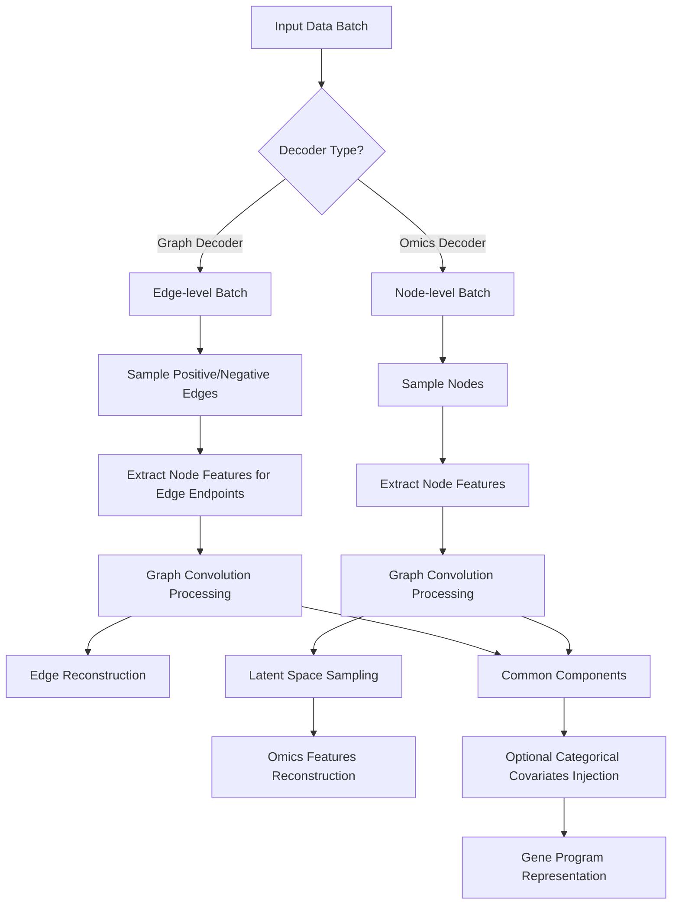
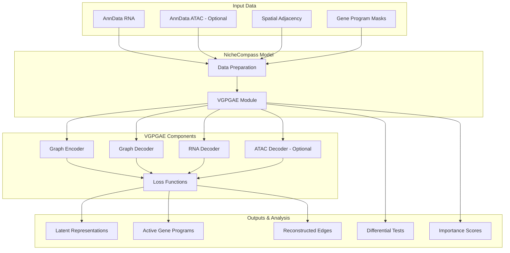

This page provides a comprehensive overview of the NicheCompass model architecture, its core components, and the fundamental concepts that power spatial transcriptomics analysis. NicheCompass is a **Variational Gene Program Graph Autoencoder (VGPGAE)** designed to model cellular niches by integrating spatial gene expression, chromatin accessibility, and prior biological knowledge through gene programs.

## Architectural Foundations

The NicheCompass model implements a sophisticated **graph-based variational autoencoder** that operates on spatial omics data as nodes in a cellular neighborhood graph. At its core, the model learns to represent each cell as a combination of **gene programs**—biological modules that capture coordinated gene expression patterns—which can then be used for downstream analyses including cell-cell communication inference, differential testing, and multi-sample integration.

The architecture follows a modular design where the **NicheCompass** class serves as the high-level API, inheriting model management capabilities from **BaseModelMixin**, while the **VGPGAE** module implements the actual neural network computations. This separation enables flexible experimentation with network components while maintaining a stable user-facing interface.

Sources: [nichecompass.py](src/nichecompass/models/nichecompass.py#L1-L24), [basemodelmixin.py](src/nichecompass/models/basemodelmixin.py#L1-L4), [vgpgae.py](src/nichecompass/modules/vgpgae.py#L1-L4)

## Core Neural Network Architecture

### VGPGAE Module Structure

The **Variational Gene Program Graph Autoencoder** serves as the computational engine of NicheCompass, implementing a sophisticated graph neural network architecture that simultaneously learns gene program representations and reconstructs both node features and graph structure. The module supports both **prior knowledge gene programs** (derived from external databases) and **addon gene programs** (learned de novo during training), enabling a hybrid approach to biological discovery.

The VGPGAE module accepts key architectural parameters including the number of encoder layers, hidden dimensions, number of prior/addon gene programs, and choice of graph convolution layer (GCN or GATv2). The module maintains separate decoders for different reconstruction tasks: a graph decoder for spatial connectivity, a gene expression decoder for RNA-seq data, and optionally a chromatin accessibility decoder for ATAC-seq data.

Sources: [vgpgae.py](src/nichecompass/modules/vgpgae.py#L146-L250), [vgpgae.py](src/nichecompass/modules/vgpgae.py#L32-L35)

### Forward Pass Architecture

The forward pass of VGPGAE demonstrates the model's dual-path architecture designed to handle both edge-level and node-level reconstruction tasks. When processing an edge-level batch, the model focuses on reconstructing spatial relationships between cells. When processing a node-level batch, it concentrates on reconstructing omics features (gene expression and chromatin accessibility).

The model applies **logarithmic transformation** to omics features for encoder input when `log_variational=True`, improving numerical stability. The graph convolution layers process both node features and spatial connectivity information, while categorical covariate embeddings can be injected at multiple points (encoder, gene expression decoder, chromatin accessibility decoder) to incorporate metadata into the representation learning process.

Sources: [vgpgae.py](src/nichecompass/modules/vgpgae.py#L541-L600), [encoders.py](src/nichecompass/nn/encoders.py#L144-L170)

## Encoder Design

### Graph Convolution Encoder

The **Encoder** component implements a variational graph neural network that maps high-dimensional omics features to a low-dimensional latent space representing gene program activities. The encoder supports two graph convolution strategies: **GCN (Graph Convolutional Network)** and **GATv2 (Graph Attention Network version 2)**, with GATv2 being the default choice for its ability to learn attention weights between neighboring cells.

The encoder architecture begins with optional injection of categorical covariate embeddings into the input features, followed by fully-connected layers and graph convolution layers. For GATv2, multiple attention heads can be specified, allowing the model to learn different types of relationships between neighboring cells. The encoder outputs both **mean (mu)** and **log standard deviation (logstd)** parameters for each gene program, defining a Gaussian distribution from which latent representations are sampled during training.

Sources: [encoders.py](src/nichecompass/nn/encoders.py#L55-L68), [encoders.py](src/nichecompass/nn/encoders.py#L144-L180)

> [!TIP]
> The encoder's variational formulation encourages the learned latent space to be smooth and continuous, which enables biological interpolation between cell states and improves generalization to new spatial datasets.

### Categorical Covariate Integration

Categorical covariates such as batch identifiers, tissue regions, or experimental conditions are integrated through learned embeddings that can be injected at multiple points in the network. These embeddings capture discrete metadata information that might otherwise be confounded with biological signals, allowing the model to explicitly model technical and batch effects rather than having them leak into gene program representations.

The injection is controlled by the `cat_covariates_embeds_injection` parameter, which accepts a list specifying which components receive the embeddings: the encoder, the gene expression decoder, the chromatin accessibility decoder, or any combination thereof. This flexibility enables different modeling strategies depending on the analysis goals.

Sources: [nichecompass.py](src/nichecompass/models/nichecompass.py#L205-L210), [encoders.py](src/nichecompass/nn/encoders.py#L144-L150)

## Decoder Architectures

### Graph Decoder for Spatial Connectivity

The **CosineSimGraphDecoder** implements a lightweight decoder that reconstructs spatial edges based on cosine similarity between latent representations of connected cells. This approach encourages the model to learn representations where cells that are spatially close have similar gene program activities, effectively preserving neighborhood structure in the latent space.

The decoder operates by computing the dot product of normalized latent vectors, producing logits that represent the probability of edge existence. During training, the model learns to distinguish true spatial connections (positive edges) from randomly sampled non-connections (negative edges) through binary cross-entropy loss.

Sources: [decoders.py](src/nichecompass/nn/decoders.py#L14-L41), [losses.py](src/nichecompass/modules/losses.py#L123-L167)

### Omics Feature Decoders

#### MaskedOmicsFeatureDecoder

The **MaskedOmicsFeatureDecoder** is the primary decoder for reconstructing omics features from latent gene program representations. It implements a **masked linear architecture** where each gene program has learnable weights only for a predefined subset of genes or chromatin peaks, enforced through binary masks derived from prior biological knowledge.

The decoder applies gene program-specific weights to the latent representation and combines them linearly to reconstruct normalized feature means, which are then scaled by the library size to account for varying sequencing depth. For ATAC-seq data, the decoder supports **dynamic masking** where peaks corresponding to genes that have been regularized out (weight set to zero) are also disabled, ensuring consistency between modalities.

Sources: [decoders.py](src/nichecompass/nn/decoders.py#L65-L138), [decoders.py](src/nichecompass/nn/decoders.py#L133-L170)

#### FCOmicsFeatureDecoder

An alternative **FCOmicsFeatureDecoder** uses a fully-connected architecture without gene program-specific masking, providing more flexibility but reduced biological interpretability. This decoder can be enabled through the `use_fc_decoder` parameter and is typically used for ablation studies or when prior gene program masks are not available.

Sources: [decoders.py](src/nichecompass/nn/decoders.py#L172-L239)

## Loss Functions and Optimization Objectives

NicheCompass employs a **multi-objective loss function** that balances several competing objectives to learn biologically meaningful gene programs while maintaining reconstruction accuracy and spatial structure preservation.

| Loss Component | Purpose | Default Lambda |
|---------------|---------|----------------|
| Gene Expression Reconstruction | Reconstruct RNA-seq counts using negative binomial distribution | 300.0 |
| Chromatin Accessibility Reconstruction | Reconstruct ATAC-seq counts using negative binomial distribution | 100.0 |
| Edge Reconstruction | Preserve spatial connectivity through cosine similarity decoder | 500,000.0 |
| KL Divergence | Encourage smooth, complete latent space representation | Implicit in variational formulation |
| L1 Regularization (Masked) | Enforce sparsity in prior gene program gene weights | User-specified |
| L1 Regularization (Addon) | Enforce sparsity in addon gene program gene weights | 30.0 |
| Group Lasso | Enforce sparsity across gene programs (entire programs can be disabled) | User-specified |
| Categorical Covariates Contrastive | Separate cells by categorical covariates in latent space | User-specified |

Sources: [vgpgae.py](src/nichecompass/modules/vgpgae.py#L932-L1000), [losses.py](src/nichecompass/modules/losses.py#L255-L292)

### KL Divergence Regularization

The **KL divergence loss** encourages encoder outputs to follow a standard normal distribution, preventing overfitting and ensuring the latent space is well-structured for downstream analyses. This is computed using the standard variational autoencoder formulation from Kingma & Welling (2013), summing over gene programs and averaging over nodes in each batch.

Sources: [losses.py](src/nichecompass/modules/losses.py#L255-L292)

### Negative Binomial Reconstruction Loss

Both RNA-seq and ATAC-seq data are modeled using the **negative binomial distribution**, which accounts for over-dispersion common in count data. The reconstruction loss computes the negative log-likelihood under the predicted distribution parameters (mean and dispersion theta), encouraging the model to learn accurate reconstructions of the raw count data.

Sources: [losses.py](src/nichecompass/modules/losses.py#L169-L213)

## Gene Program Concepts

### Prior vs Addon Gene Programs

NicheCompass supports two types of gene programs:

**Prior Gene Programs**: Derived from external databases such as pathway databases (KEGG, Reactome), gene sets from MSigDB, or domain-specific collections. These are provided as input through binary masks indicating which genes belong to which program. Prior gene programs provide biological interpretability by grounding learned representations in known biology.

**Addon Gene Programs**: Learned de novo during training without prior constraints. These capture novel patterns not represented in the prior knowledge, such as cell-type-specific programs, tissue-specific responses, or technical artifacts. The number of addon gene programs is controlled by the `n_addon_gp` parameter (default: 100).

Sources: [nichecompass.py](src/nichecompass/models/nichecompass.py#L191-L204), [vgpgae.py](src/nichecompass/modules/vgpgae.py#L146-L156)

### Active Gene Programs

Not all gene programs are equally relevant for a given dataset. NicheCompass identifies **active gene programs** through a thresholding mechanism based on the aggregated absolute weights of genes in each program. Programs with total weights below a threshold (`active_gp_thresh_ratio`, default: 0.01 for NicheCompass, 0.03 for VGPGAE) relative to the strongest program are considered inactive and excluded from downstream analyses.

The active program determination supports multiple aggregation modes:
- **sum**: Prioritizes programs reconstructing many genes
- **nzmeans**: Normalizes by number of genes, prioritizing strong, focused programs
- **sum+nzmeans**: Combines both approaches (default)

Sources: [vgpgae.py](src/nichecompass/modules/vgpgae.py#L1204-L1260), [nichecompass.py](src/nichecompass/models/nichecompass.py#L231-L234)

### Target vs Source Genes

Gene programs can have different roles in cell-cell communication:

**Target Genes**: Genes that are affected or regulated by the gene program, typically representing downstream effects or responsive genes.

**Source Genes**: Genes that drive or activate the gene program, potentially representing ligands, receptors, or upstream regulators that mediate intercellular signaling.

This distinction is crucial for cell-cell communication analysis, where source programs in one cell type can affect target programs in neighboring cell types. The masks are stored separately and can be used for different regularization strategies.

Sources: [nichecompass.py](src/nichecompass/models/nichecompass.py#L195-L201), [nichecompass.py](src/nichecompass/models/nichecompass.py#L202-L204)

## Multi-modal Data Integration

### RNA and ATAC-seq Joint Modeling

NicheCompass supports **multi-modal analysis** through joint modeling of gene expression (RNA-seq) and chromatin accessibility (ATAC-seq) data from the same spatial locations. The architecture includes parallel decoders for each modality, with the option to link them through **gene-peak masks** that indicate which chromatin peaks are associated with which genes.

The joint modeling enables cross-modal imputation (predicting ATAC from RNA or vice versa), integration of regulatory information (linking accessibility to expression), and more comprehensive characterization of cellular states. The model can be configured to include or exclude each modality's reconstruction loss independently.

Sources: [nichecompass.py](src/nichecompass/models/nichecompass.py#L191-L192), [vgpgae.py](src/nichecompass/modules/vgpgae.py#L158-L163)

### Dynamic Cross-modal Masking

A sophisticated feature of multi-modal integration is **dynamic masking**, where the ATAC decoder's mask is updated based on RNA decoder activity. If a gene is regularized out of a gene program (its weight set to zero), the associated chromatin peaks are also disabled from that program. This ensures consistency between modalities and prevents the model from using accessibility signals for genes that are not considered active in the RNA representation.

Sources: [vgpgae.py](src/nichecompass/modules/vgpgae.py#L541-L547), [decoders.py](src/nichecompass/nn/decoders.py#L133-L145)

## Model Training Strategy

### Staged Training Protocol

NicheCompass implements a **staged training approach** that gradually introduces different loss components:

1. **Initial Phase (first 25 epochs)**: Train with all gene programs enabled to establish robust initial representations
2. **Edge Reconstruction Phase**: If `n_epochs_no_edge_recon` is specified, begin without edge reconstruction loss, then introduce it later
3. **Categorical Contrastive Phase**: If `n_epochs_no_cat_covariates_contrastive` is specified, introduce contrastive loss after initial epochs
4. **Fine-tuning Phase**: Continue training with all active components, potentially with different learning rates or regularization strengths

This staged approach helps stabilize training and prevents the model from converging to poor local optima due to competing objectives early in training.

Sources: [nichecompass.py](src/nichecompass/models/nichecompass.py#L590-L620)

### Batch Sampling Strategy

Training uses sophisticated batch sampling strategies for both edge and node batches:

- **Edge Batches**: Sample a mix of positive (existing spatial edges) and negative (non-edges) connections, with the number controlled by `edge_batch_size` parameter (default: 256)
- **Node Batches**: Sample individual cells along with their neighbors for message passing, with size controlled by `node_batch_size` parameter

This efficient sampling enables training on large spatial datasets while maintaining the computational benefits of mini-batch stochastic gradient descent.

Sources: [vgpgae.py](src/nichecompass/modules/vgpgae.py#L541-L580), [nichecompass.py](src/nichecompass/models/nichecompass.py#L610-L612)

## Key Configuration Parameters

The following table summarizes the most important architectural parameters and their typical values:

| Parameter | Category | Description | Default |
|-----------|----------|-------------|---------|
| `conv_layer_encoder` | Architecture | Graph convolution type: "gcnconv" or "gatv2conv" | "gatv2conv" |
| `n_layers_encoder` | Architecture | Number of graph convolution layers | 1 |
| `n_hidden_encoder` | Architecture | Hidden dimension size | Auto-calculated |
| `encoder_n_attention_heads` | Architecture | Number of attention heads for GATv2 | 4 |
| `n_addon_gp` | Gene Programs | Number of de novo gene programs to learn | 100 |
| `active_gp_thresh_ratio` | Gene Programs | Threshold for determining active programs | 0.01 |
| `active_gp_type` | Gene Programs | Whether to evaluate prior/addon programs separately | "separate" |
| `lambda_gene_expr_recon` | Loss Weight | Weight for RNA reconstruction loss | 300.0 |
| `lambda_chrom_access_recon` | Loss Weight | Weight for ATAC reconstruction loss | 100.0 |
| `lambda_edge_recon` | Loss Weight | Weight for edge reconstruction loss | 500,000.0 |
| `lambda_l1_addon` | Loss Weight | L1 regularization for addon programs | 30.0 |
| `node_label_method` | Graph Processing | Method for aggregating neighbor information | "one-hop-norm" |

Sources: [nichecompass.py](src/nichecompass/models/nichecompass.py#L234-L248), [vgpgae.py](src/nichecompass/modules/vgpgae.py#L165-L190)

> [!TIP]
> The default loss weights reflect the different scales of each component: edge reconstruction receives the highest weight because it operates on binary values, while omics reconstruction receives lower weights because count data has larger magnitude and is modeled through probabilistic likelihoods.

## Latent Space Representation

The latent space learned by NicheCompass represents each cell as a vector of **gene program activities**, where each dimension corresponds to the strength of a specific biological program in that cell. This representation has several desirable properties:

- **Interpretability**: Each dimension maps to a known or learned biological program
- **Smoothness**: The variational formulation encourages local continuity
- **Spatial Preservation**: Edge reconstruction maintains neighborhood relationships
- **Multi-modal Integration**: Captures signals from both RNA and ATAC when available

The latent representation can be extracted for visualization, clustering, trajectory inference, or as input to downstream machine learning models. The `get_latent_representation` method provides flexible options for whether to return only the mean or both mean and variance, and whether to include only active programs.

Sources: [nichecompass.py](src/nichecompass/models/nichecompass.py#L1264-L1276), [vgpgae.py](src/nichecompass/modules/vgpgae.py#L1368-L1374)

## Model Inference and Analysis

Once trained, the NicheCompass model provides a comprehensive API for extracting insights:

- **Gene Program Data**: Retrieve gene program names, weights, and activities through `get_gp_data` and `get_gp_weights`
- **Differential Testing**: Perform statistical tests to identify gene programs that differ between conditions using `run_differential_gp_tests`
- **Importance Scores**: Compute gene or peak importance for specific programs using `compute_gp_gene_importances` or `compute_gp_peak_importances`
- **Edge Reconstruction**: Obtain reconstructed spatial connectivity probabilities using `get_recon_edge_probs`
- **Neighbor Importance**: Analyze which neighbors contribute most to a cell's representation using `get_neighbor_importances`

These analysis capabilities are integrated directly into the model class, providing a seamless workflow from training to biological interpretation.

Sources: [nichecompass.py](src/nichecompass/models/nichecompass.py#L1166-L1170), [nichecompass.py](src/nichecompass/models/nichecompass.py#L1473-L1480)

## Architecture Summary

This architecture enables NicheCompass to learn biologically interpretable representations of spatial omics data that preserve spatial structure, incorporate prior knowledge, and support a wide range of downstream analyses from single-sample niche identification to multi-sample atlas integration.

Sources: [nichecompass.py](src/nichecompass/models/nichecompass.py#L1-L24), [vgpgae.py](src/nichecompass/modules/vgpgae.py#L1-L35)

## Next Steps

Now that you understand the core architecture and concepts of NicheCompass, you can explore specific components in more detail:

- Learn about the **VGPGAE module** implementation and variational inference framework in [Variational Gene Program Graph Autoencoder (VGPGAE)](5-variational-gene-program-graph-autoencoder-vgpgae)
- Dive into **encoder design** and graph convolution strategies in [Encoder Design and Graph Convolution Strategies](6-encoder-design-and-graph-convolution-strategies)
- Understand **decoder architectures** for different data modalities in [Decoder Architectures for Multi-modal Reconstruction](7-decoder-architectures-for-multi-modal-reconstruction)
- Explore the **loss function** formulations and optimization strategies in [Loss Functions and Optimization Objectives](8-loss-functions-and-optimization-objectives)

For practical guidance on preparing data for NicheCompass, continue to [Spatial Data Loading and AnnData Integration](9-spatial-data-loading-and-anndata-integration).