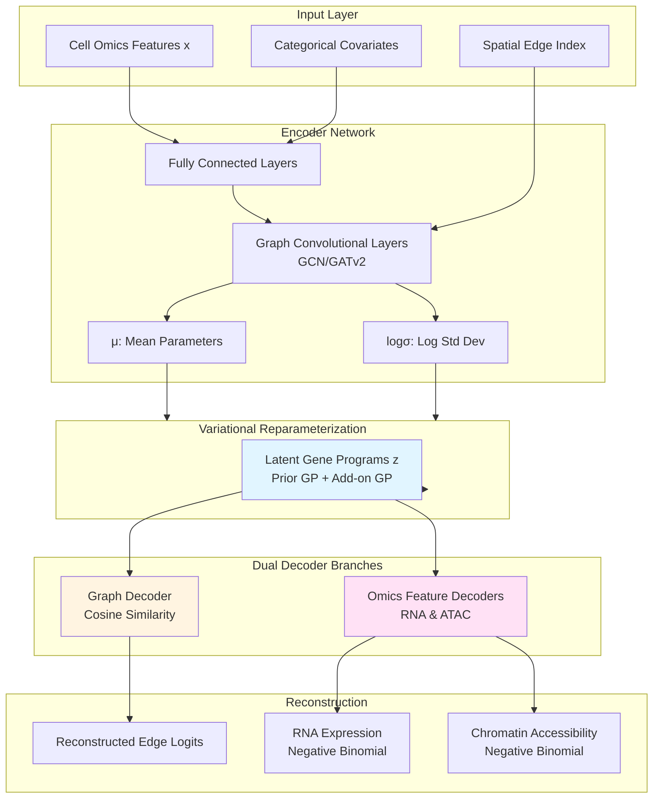

The Variational Gene Program Graph Autoencoder (VGPGAE) is the core neural network architecture powering the NicheCompass framework. This sophisticated variational graph autoencoder learns interpretable gene programs that simultaneously reconstruct multi-omics features and preserve spatial relationships between cells in tissue microenvironments. The architecture combines variational inference with graph neural networks to enable biologically meaningful representations that capture both molecular expression patterns and spatial colocalization.

## Architecture Overview

VGPGAE follows a variational autoencoder design pattern adapted for graph-structured spatial omics data. The architecture consists of three primary components: an encoder that maps cell omics profiles to a latent gene program space, a variational reparameterization mechanism, and dual decoder branches for reconstructing both spatial connectivity and omics features.



The encoder processes spatial omics data through fully connected layers followed by graph convolutional message passing, outputting parameters (μ, logσ) of a latent normal distribution. The reparameterization trick samples latent gene program representations from this distribution during training, while using the mean during inference. Two decoder branches operate in parallel: the graph decoder reconstructs spatial edges using cosine similarity in the latent space, while the omics decoders reconstruct cell expression profiles using masked linear layers constrained by gene program masks.

Sources: [vgpgae.py](src/nichecompass/modules/vgpgae.py#L32-L191), [vgaemodulemixin.py](src/nichecompass/modules/vgaemodulemixin.py#L14-L42), [encoders.py](src/nichecompass/nn/encoders.py#L12-L68)

## Gene Program Latent Space

The latent space of VGPGAE is structured into two distinct types of gene programs, each serving a unique biological purpose:

### Prior Gene Programs
These represent biological knowledge encoded as gene-gene connectivity patterns derived from prior sources like KEGG pathways, Reactome, or gene ontology terms. Prior gene programs provide the model with structured biological constraints and interpretability from the outset.

### Add-on Gene Programs
These are de-novo gene programs learned during training without any prior biological constraints. Add-on gene programs enable the model to discover novel biological processes and technical artifacts that may not be captured in existing databases.

| **Component** | **Dimensionality** | **Source** | **Trainable** | **Biological Interpretation** |
|--------------|-------------------|------------|---------------|------------------------------|
| Prior GP | `n_prior_gp` | External databases | Yes (through decoder weights) | Known biological pathways |
| Add-on GP | `n_addon_gp` | Learned from data | Yes | Novel processes/artifacts |
| Total Latent Space | `n_prior_gp + n_addon_gp` | Combined | Yes | Comprehensive cell states |

The separation into prior and add-on gene programs provides a structured latent space where biological knowledge guides learning while still allowing discovery of novel patterns. During training, L1 and group lasso regularization promote sparsity, ensuring that each gene program activates only for a subset of genes and that only a subset of gene programs remain active.

Sources: [vgpgae.py](src/nichecompass/modules/vgpgae.py#L146-L290), [nichecompass.py](src/nichecompass/models/nichecompass.py#L234-L243)

## Encoder Design

The encoder transforms high-dimensional omics feature vectors into low-dimensional latent gene program representations through a multi-stage architecture that integrates both node features and graph structure.

### Architecture Stages

The encoder implements a two-stage processing pipeline:

**Stage 1: Fully Connected Transformation**
Initial fully connected layers reduce dimensionality and extract relevant features from the raw omics data. The number of fully connected layers is configurable (`n_fc_layers_encoder`), with each layer applying a linear transformation followed by ReLU activation and optional batch normalization.

**Stage 2: Graph Convolutional Message Passing**
Graph convolutional layers aggregate information from neighboring cells using either GCNConv (Graph Convolutional Network) or GATv2Conv (Graph Attention Network v2). This step captures spatial context by incorporating features from nearby cells in the tissue. The number of message passing layers (`n_layers_encoder`) determines the receptive field radius for each cell.

### Categorical Covariate Integration

The encoder supports injection of categorical covariates (e.g., sample identity, batch, cell type annotations) as learned embeddings. These embeddings can be concatenated either at the input level or hidden level of the encoder, enabling the model to adjust latent representations based on known covariates.

| **Parameter** | **Type** | **Default** | **Impact** |
|--------------|----------|-------------|------------|
| `n_fc_layers_encoder` | int | 1 | Depth of initial FC transformation |
| `n_layers_encoder` | int | 1 | Receptive field radius for spatial aggregation |
| `n_hidden_encoder` | int | Configured | Dimensionality of hidden representations |
| `conv_layer_encoder` | str | "gcnconv" | Message passing strategy (gcnconv/gatv2conv) |
| `encoder_n_attention_heads` | int | 4 | Number of attention heads for GATv2Conv |
| `encoder_use_bn` | bool | False | Whether to apply batch normalization to μ |
| `dropout_rate_encoder` | float | 0.0 | Dropout probability for regularization |

The encoder outputs two parallel vectors for each cell: μ (mean) and logσ (log standard deviation), which parameterize the latent gene program distribution. These outputs are then used in the variational reparameterization step.

Sources: [encoders.py](src/nichecompass/nn/encoders.py#L12-L128), [vgpgae.py](src/nichecompass/modules/vgpgae.py#L292-L309)

## Variational Reparameterization

VGPGAE employs the reparameterization trick to enable gradient-based optimization of the variational lower bound. This technique allows the model to sample from the latent distribution while maintaining differentiability for backpropagation.

### Reparameterization Implementation

The VGAEModuleMixin provides the reparameterization logic:

During training, latent gene program scores are sampled as:
```
z = μ + σ ⊙ ε
```
where ε ~ N(0, I) is random noise sampled from a standard normal distribution and ⊙ denotes element-wise multiplication. This formulation decouples the randomness from the learnable parameters, enabling gradients to flow through μ and σ.

During inference, the model deterministically uses the mean (z = μ), removing stochasticity while preserving the learned latent representation.

This design ensures that:
1. The latent space captures uncertainty in gene program activation
2. Training is stable with low variance gradient estimates
3. Inference is fast and deterministic
4. The model naturally regularizes toward the prior distribution through KL divergence

Sources: [vgaemodulemixin.py](src/nichecompass/modules/vgaemodulemixin.py#L14-L42), [vgpgae.py](src/nichecompass/modules/vgpgae.py#L620-L637)

## Dual Decoder Architecture

VGPGAE employs a dual decoder system where each decoder branch serves a distinct reconstruction purpose, enabling the model to learn representations that preserve both spatial relationships and molecular expression patterns.

### Graph Decoder

The graph decoder reconstructs spatial connectivity between cells using cosine similarity in the latent gene program space. This implementation is motivated by the biological observation that cells with similar gene program activities are likely to be spatially co-located.

**Architecture Details:**
- Computes element-wise cosine similarity between latent representations of node pairs
- Operates on both positive edges (actual spatial connections) and negative edges (sampled non-connections)
- Applies dropout regularization during training
- Outputs edge reconstruction logits (sigmoid activation is integrated into the loss)

The graph decoder enables VGPGAE to learn gene programs that preserve spatial tissue architecture, which is crucial for understanding cellular neighborhoods and microenvironmental interactions.

### Omics Feature Decoders

The omics feature decoders reconstruct molecular profiles using masked linear layers constrained by gene program masks. This design enforces biological interpretability by ensuring that each omics feature can only be reconstructed by a specific subset of gene programs.

**Decoder Types:**
1. **Target Decoder**: Reconstructs the cell's own features (autocrine)
2. **Source Decoder**: Reconstructs aggregated neighborhood features (paracrine)

For each modality (RNA, ATAC), both target and source decoders exist, capturing both cell-intrinsic and microenvironmental influences on expression.

**Negative Binomial Distribution:**
Omics features are modeled using Negative Binomial distributions, which naturally account for:
- Over-dispersion in count data (variance > mean)
- Library size differences between cells
- Dropout events in single-cell technologies

The decoders output two parameters for each feature:
- **μ (mean)**: Scaled by library size and learned from gene program activation
- **θ (dispersion)**: Learned per-feature parameter controlling variance

> [!TIP]
> The separation of target and source decoders enables VGPGAE to distinguish between cell-autonomous gene expression and expression influenced by the microenvironment, which is critical for understanding cell-cell communication in spatial transcriptomics data.

Sources: [decoders.py](src/nichecompass/nn/decoders.py#L14-L169), [vgpgae.py](src/nichecompass/modules/vgpgae.py#L311-L540)

## Forward Pass Execution

The forward pass of VGPGAE operates in two distinct modes depending on the decoder being used, enabling efficient training with different batching strategies.

### Graph Decoder Mode

When operating in graph mode, the forward pass processes edge-level batches for spatial edge reconstruction:

1. **Batch Construction**: Sample positive edges (actual connections) and negative edges (non-connections)
2. **Encoder Forward**: Compute μ and logσ for all nodes in the subgraph
3. **Filter Batch**: Extract representations for source and target nodes of sampled edges
4. **Reparameterization**: Sample latent gene program scores z
5. **Graph Decoder**: Compute cosine similarity between node pair representations
6. **Output**: Edge reconstruction logits

Edge batching is computationally efficient because it only requires processing nodes incident to sampled edges rather than the full graph.

### Omics Decoder Mode

When operating in omics mode, the forward pass processes node-level batches for omics feature reconstruction:

1. **Batch Construction**: Sample individual cells (nodes)
2. **Encoder Forward**: Compute μ and logσ for all nodes in the subgraph
3. **Filter Batch**: Extract representations for sampled nodes
4. **Reparameterization**: Sample latent gene program scores z
5. **Node Label Aggregation**: Aggregate neighborhood features using one-hop methods:
   - **one-hop-norm**: Normalize by neighbor count
   - **one-hop-sum**: Simple sum of neighbor features
   - **one-hop-attention**: Attention-weighted aggregation
6. **Omics Decoders**: Reconstruct target and source omics features
7. **Dynamic Masking**: Apply active GP masks to turn off irrelevant connections
8. **Output**: Distribution parameters for RNA and optionally ATAC

Node batching enables reconstruction of gene expression for individual cells, with source decoders using aggregated neighbor information to capture microenvironmental influence.

> [!TIP]
> The dual-mode forward pass allows VGPGAE to efficiently optimize both edge reconstruction and omics reconstruction simultaneously during training, with different batch sizes and sampling strategies optimized for each objective.

Sources: [vgpgae.py](src/nichecompass/modules/vgpgae.py#L541-L930)

## Loss Computation and Optimization

VGPGAE optimizes a composite objective function combining multiple loss components, each serving a specific regularization or reconstruction purpose.

### Loss Components

**1. Edge Reconstruction Loss**
Binary cross entropy loss between true edge labels and reconstructed edge probabilities. High weighting ensures preservation of spatial architecture.

**2. Gene Expression Reconstruction Loss**
Negative binomial negative log-likelihood loss for RNA expression reconstruction. Computed separately for target (cell-intrinsic) and source (microenvironmental) features.

**3. Chromatin Accessibility Reconstruction Loss**
Negative binomial loss for ATAC-seq peak reconstruction when multi-modal data is available.

**4. KL Divergence Regularization**
Regularization term pushing the variational posterior toward the standard normal prior, preventing overfitting and ensuring well-structured latent space.

**5. L1 Regularization**
- **Masked GP L1**: Applied to genes in prior gene programs to promote sparsity
- **Add-on GP L1**: Applied to genes in add-on gene programs to discover focused programs

**6. Group Lasso Regularization**
Encourages entire gene programs to become inactive if their contribution is negligible, improving interpretability.

**7. Categorical Covariates Contrastive Loss**
Contrastive loss ensuring cells with different categorical covariates (e.g., sample, batch) have distinct latent representations, reducing batch effects.

| **Loss Component** | **Purpose** | **Lambda Parameter** | **Default Value** |
|-------------------|-------------|---------------------|-------------------|
| Edge Reconstruction | Preserve spatial structure | `lambda_edge_recon` | 500000 |
| Gene Expression Recon | Reconstruct RNA expression | `lambda_gene_expr_recon` | 300 |
| Chromatin Access Recon | Reconstruct ATAC peaks | `lambda_chrom_access_recon` | 100 |
| Masked GP L1 | Sparse gene programs | `lambda_l1_masked` | 0 |
| Add-on GP L1 | Sparse add-on programs | `lambda_l1_addon` | 30 |
| Group Lasso | Remove inactive programs | `lambda_group_lasso` | 0 |
| Contrastive | Separate categorical covariates | `lambda_cat_covariates_contrastive` | 0 |

The loss function is computed separately for edge and node batches, with components selectively included in backpropagation based on training phase. This enables curriculum learning strategies where certain losses are activated only after pretraining.

Sources: [vgpgae.py](src/nichecompass/modules/vgpgae.py#L932-L1143), [losses.py](src/nichecompass/modules/losses.py)

## Active Gene Program Detection

VGPGAE dynamically identifies which gene programs are active during training, enabling the model to focus computational resources on biologically relevant programs and improve interpretability.

### Activation Detection Mechanism

The model tracks the mean absolute gene program scores across all cells using an exponential moving average (momentum = 0.1). Active gene programs are identified based on their aggregated importance relative to the most active program:

```
active_threshold = active_gp_thresh_ratio × max(gp_importance)
active_gps = gp_importance > active_threshold
```

The importance of each gene program is computed using multiple aggregation strategies:
- **sum**: Sum of absolute gene weights (prioritizes programs affecting many genes)
- **nzmeans**: Mean of non-zero absolute weights (normalizes by number of genes)
- **sum+nzmeans**: Combination balancing both approaches

### Dynamic Masking

Once gene programs are classified as active or inactive, dynamic masks are applied to disable contributions from inactive programs:

1. **Graph Decoder**: Inactive program scores are set to zero before computing edge similarity
2. **Omics Decoders**: Inactive program-to-gene connections are masked out
3. **Cross-modal Consistency**: For ATAC-seq, peaks are turned off if all connected genes are deactivated in RNA

This dynamic masking ensures that:
- Inactive programs do not influence reconstruction
- Computation is efficient (no processing of inactive pathways)
- Interpretation focuses on biologically relevant programs
- Training is stable (reduced noise from irrelevant dimensions)

The active gene program set evolves during training, with programs potentially becoming active or inactive as the model discovers the most relevant biological processes for the dataset.

Sources: [vgpgae.py](src/nichecompass/modules/vgpgae.py#L640-L660), [vgpgae.py](src/nichecompass/modules/vgpgae.py#L1204-L1335)

## Configuration and Customization

VGPGAE offers extensive configuration options allowing customization for different spatial omics datasets and analysis objectives.

### Key Configuration Categories

**Encoder Architecture:**
- Number of fully connected layers (`n_fc_layers_encoder`)
- Number of graph convolutional layers (`n_layers_encoder`)
- Hidden dimensionality (`n_hidden_encoder`)
- Convolution type (`conv_layer_encoder`: "gcnconv" or "gatv2conv")

**Latent Space Design:**
- Number of prior gene programs (`n_prior_gp`)
- Number of add-on gene programs (`n_addon_gp`)
- Active gene program threshold (`active_gp_thresh_ratio`)

**Loss Weighting:**
- Reconstruction loss weights (edge, gene expression, chromatin accessibility)
- Regularization strengths (L1, group lasso, KL divergence)
- Contrastive loss parameters

**Multi-modal Settings:**
- Whether to include ATAC-seq data
- Gene-peak mapping constraints
- Separate decoder masks for each modality

### Training Strategy Parameters

The training process supports curriculum learning through staged loss activation:

```python
# Early training: Focus on omics reconstruction with edge reconstruction disabled
n_epochs_no_edge_recon = 0  # Set > 0 to disable edge reconstruction initially

# Pretraining: Train all gene programs before applying sparsity
n_epochs_all_gps = 25  # Initial epochs without active GP masking

# Contrastive learning: Delay batch correction until model has learned features
n_epochs_no_cat_covariates_contrastive = 5
```

These strategies enable the model to first learn basic gene program structure before refining with sparsity constraints and spatial reconstruction requirements.

Sources: [vgpgae.py](src/nichecompass/modules/vgpgae.py#L146-L290), [nichecompass.py](src/nichecompass/models/nichecompass.py#L590-L628)

## Model Initialization and Integration

VGPGAE is integrated into the broader NicheCompass framework, which handles data processing, model training, and downstream analysis workflows.

### Initialization Pipeline

The NicheCompass model class manages VGPGAE initialization:

1. **Data Validation**: Checks AnnData objects for required attributes (gene program masks, spatial connectivities)
2. **Feature Indexing**: Constructs dictionaries mapping features to gene program associations
3. **Module Instantiation**: Creates VGPGAE module with configured hyperparameters
4. **Device Management**: Handles GPU/CPU placement and data transfer
5. **MLflow Integration**: Logs hyperparameters and metrics for experiment tracking

### Model Access Methods

NicheCompass provides convenient access methods to VGPGAE components:

- `get_latent_representation()`: Extract learned gene program scores
- `get_omics_decoder_outputs()`: Access reconstructed expression distributions
- `get_recon_edge_probs()`: Retrieve reconstructed spatial graph
- `get_active_gps()`: Get list of active gene program names
- `compute_gp_gene_importances()`: Analyze gene contributions to programs
- `get_neighbor_importances()`: Examine cell-cell communication weights

These methods enable downstream analysis including visualization, differential testing, and biological interpretation without needing to directly interact with PyTorch internals.
