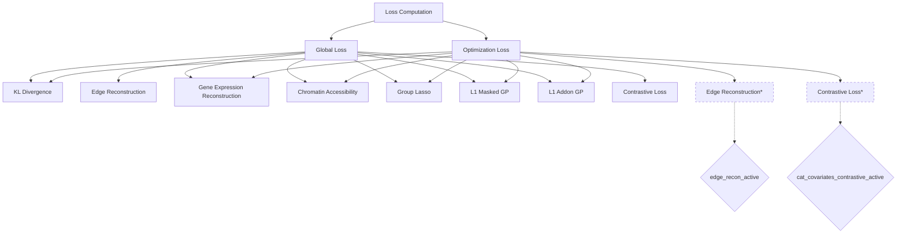

NicheCompass employs a sophisticated multi-objective optimization framework that balances reconstruction fidelity, spatial structure preservation, biological interpretability, and regularization constraints. The loss architecture is designed to simultaneously learn meaningful gene programs while maintaining spatial colocalization patterns across single-cell spatial transcriptomics and multi-omics data.

## Loss Architecture Overview

The optimization framework distinguishes between **global loss** (used for monitoring and early stopping) and **optimization loss** (used for backpropagation). This separation enables progressive training strategies where certain loss components are activated at different stages of training without disrupting convergence monitoring.



## Reconstruction Losses

### Gene Expression Reconstruction (Negative Binomial)

Gene expression reconstruction employs a **negative binomial distribution** to model count data, which is particularly well-suited for scRNA-seq data with overdispersion. The loss function is computed separately for target and source genes, reflecting the gene program architecture where programs can influence genes in both downstream (target) and upstream (source) directions.

The negative binomial likelihood accounts for:
- **Mean parameter (μ)**: Expected expression values from decoder
- **Dispersion parameter (θ)**: Inverse dispersion parameter learned during training  
- **Count data (x)**: Observed expression values

The implementation adapts from the scvi-tools framework, computing the log-likelihood with numerical stability considerations:

```python
log_likelihood_nb = (
    theta * (torch.log(theta + eps) - log_theta_mu_eps)
    + x * (torch.log(mu + eps) - log_theta_mu_eps)
    + torch.lgamma(x + theta)
    - torch.lgamma(theta)
    - torch.lgamma(x + 1))
```

Sources: [losses.py](src/nichecompass/modules/losses.py#L169-L213), [vgpgae.py](src/nichecompass/modules/vgpgae.py#L1008-L1023)

### Chromatin Accessibility Reconstruction

For multi-modal analysis with ATAC-seq data, the **chromatin accessibility reconstruction loss** applies the same negative binomial framework to reconstruct peak accessibility patterns. This loss enforces that gene programs can be combined linearly to reconstruct chromatin accessibility, bridging gene expression and regulatory element activity.

The loss is computed identically to gene expression reconstruction but operates on:
- Target peaks: Peaks associated with gene program targets
- Source peaks: Peaks associated with gene program sources

This dual reconstruction ensures that learned gene programs capture both expression and regulatory dimensions.

Sources: [vgpgae.py](src/nichecompass/modules/vgpgae.py#L1128-L1136)

### Edge Reconstruction (Weighted Binary Cross Entropy)

The **edge reconstruction loss** preserves spatial connectivity by training the model to predict cell-cell relationships from learned gene program representations. This component is critical for maintaining spatial colocalization information.

Key implementation aspects:
- **Positively weighted**: Negative samples are weighted by the ratio of negative to positive labels to handle class imbalance
- **Logit-based computation**: Uses binary cross entropy with logits for numerical stability
- **Edge inclusion mask**: Allows filtering of edges based on categorical covariate constraints

The pos_weight calculation handles the inherent imbalance where non-edges far outnumber actual spatial connections:

```python
pos_labels = (edge_recon_labels == 1.).sum(dim=0)
neg_labels = (edge_recon_labels == 0.).sum(dim=0)
pos_weight = neg_labels / pos_labels
```

Sources: [losses.py](src/nichecompass/modules/losses.py#L123-L168), [vgpgae.py](src/nichecompass/modules/vgpgae.py#L998-L1004)

## Regularization Losses

### Kullback-Leibler Divergence

The **KL divergence loss** regularizes the variational posterior distribution, encouraging encodings to distribute evenly around the center of the latent space. This implementation follows the standard VAE formulation from Kingma & Welling (2013):

$$ \mathcal{L}_{KL} = -\frac{1}{2} \sum_{j=1}^{J} (1 + \log\sigma_j^2 - \mu_j^2 - \sigma_j^2) $$

This regularization:
- Prevents overfitting to specific latent configurations
- Ensures latent space continuity and completeness
- Enables meaningful interpolation between latent representations

The KL loss is computed for both edge-level and node-level batches when `include_edge_kl_loss` is enabled.

Sources: [losses.py](src/nichecompass/modules/losses.py#L255-L285), [vgpgae.py](src/nichecompass/modules/vgpgae.py#L989-L997)

### Group Lasso Regularization

The **group Lasso regularization** enforces gene program-level sparsity by treating each gene program as a group. This is particularly important for interpretability, as it encourages the model to use only a subset of gene programs rather than all available programs.

Implementation details:
- Groups are normalized by the number of non-masked weights per group
- L2 norm is computed per gene program
- Summed across all decoder layers

This approach differs from standard L1 regularization by applying sparsity at the group (gene program) level rather than individual weights, which is more biologically meaningful.

Sources: [losses.py](src/nichecompass/modules/losses.py#L215-L254), [vgpgae.py](src/nichecompass/modules/vgpgae.py#L1029-L1032)

### L1 Regularization for Gene Programs

The **L1 regularization loss** enforces gene-level sparsity within gene programs. Two distinct L1 penalties are applied:

1. **Masked gene programs** (prior knowledge): Applied to gene programs derived from external databases with optional masking for specific target and source gene categories
2. **Addon gene programs** (learned): Applied to de novo gene programs discovered during training

The L1 loss is computed as the layer-wise sum of absolute weights in the RNA decoder layers. An important behavioral note: the model will keep weights non-zero for gene programs with very high scores and turn off weights for gene programs with low scores, creating a natural selection mechanism.

> [!TIP]
> The absolute weights and thus the L1 loss will be higher for highly expressed genes, which means the regularization implicitly accounts for expression level. The model naturally prioritizes keeping connections for highly active gene programs.

Sources: [losses.py](src/nichecompass/modules/losses.py#L287-L340), [vgpgae.py](src/nichecompass/modules/vgpgae.py#L1025-L1042)

## Contrastive Loss

### Categorical Covariates Contrastive Loss

The **categorical covariates contrastive loss** learns to separate observations from different categories while pulling similar observations closer in latent space. This is particularly useful for batch correction or cell type separation.

Mechanism:
- Identifies node pairs from different categorical covariate categories
- Uses top percentiles of logits as positive examples (similar latent representations across categories)
- Uses bottom percentiles as negative examples (dissimilar latent representations)
- Applies binary cross entropy with these contrastive labels

The `contrastive_logits_pos_ratio` and `contrastive_logits_neg_ratio` parameters control the thresholds for determining positive and negative examples, allowing fine-tuning of the contrastive signal strength.

Sources: [losses.py](src/nichecompass/modules/losses.py#L15-L122), [vgpgae.py](src/nichecompass/modules/vgpgae.py#L1006-L1012)

## Loss Composition and Weighting

### Lambda Parameter Configuration

The relative importance of each loss component is controlled by lambda parameters, which are configured during training initialization:

| Lambda Parameter | Default Value | Purpose | Typical Adjustment |
|-----------------|---------------|---------|-------------------|
| `lambda_edge_recon` | 500,000 | Spatial structure preservation | Increase for better spatial fidelity |
| `lambda_gene_expr_recon` | 300 | Gene expression reconstruction | Adjust based on reconstruction quality |
| `lambda_chrom_access_recon` | 100 | Chromatin accessibility reconstruction | Balance with gene expression loss |
| `lambda_group_lasso` | 0.0 | Gene program sparsity | Increase for fewer active programs |
| `lambda_l1_masked` | 0.0 | Gene sparsity in prior programs | Increase for gene-level pruning |
| `lambda_l1_addon` | 30 | Gene sparsity in addon programs | Adjust based on addon program behavior |
| `lambda_cat_covariates_contrastive` | 0.0 | Categorical separation | Enable for batch correction |

Sources: [trainer.py](src/nichecompass/train/trainer.py#L224-L234), [vgpgae.py](src/nichecompass/modules/vgpgae.py#L940-L946)

### Global vs. Optimization Loss

The key distinction between global and optimization loss enables progressive training:

**Global Loss**:
- Includes all loss components
- Used for early stopping criteria
- Tracked for model selection
- Provides complete picture of model behavior

**Optimization Loss**:
- Subset of components controlled by activation flags
- Used for backpropagation
- Enables staged training (e.g., pretraining without edge reconstruction)

The progressive activation strategy controlled by:
- `edge_recon_active`: Activates after `n_epochs_no_edge_recon`
- `cat_covariates_contrastive_active`: Activates after `n_epochs_no_cat_covariates_contrastive`
- `use_only_active_gps`: Switches from all gene programs to only active ones after `n_epochs_all_gps`

Sources: [vgpgae.py](src/nichecompass/modules/vgpgae.py#L1107-L1144), [trainer.py](src/nichecompass/train/trainer.py#L327-L350)

## Training Optimization Strategy

### Optimizer Configuration

NicheCompass uses the **Adam optimizer** with configurable learning rate and weight decay:

```python
params = filter(lambda p: p.requires_grad, self.model.parameters())
self.optimizer = torch.optim.Adam(params,
                                  lr=lr,
                                  weight_decay=weight_decay)
```

The weight decay parameter provides additional L2 regularization beyond the explicit regularization losses.

Sources: [trainer.py](src/nichecompass/train/trainer.py#L314-L317)

### Gradient Clipping

Gradient clipping prevents exploding gradients during training:

```python
if self.grad_clip_value_ > 0:
    torch.nn.utils.clip_grad_value_(self.model.parameters(),
                                    self.grad_clip_value_)
```

This stability mechanism is particularly important during early training phases when loss components are being activated sequentially.

Sources: [trainer.py](src/nichecompass/train/trainer.py#L376-L379)

### Progressive Training Schedule

The training process follows a carefully designed schedule:

1. **Phase 1** (0 to `n_epochs_no_edge_recon`): Pretraining with reconstruction losses only
2. **Phase 2** (after edge reconstruction activation): Full loss composition with edge reconstruction
3. **Phase 3** (after `n_epochs_all_gps`): Switch from all gene programs to active ones only
4. **Phase 4** (after `n_epochs_no_cat_covariates_contrastive`): Add contrastive loss for categorical separation

> [!TIP]
> This progressive approach allows the model to learn basic reconstruction patterns first, then incorporate spatial structure, followed by gene program refinement, and finally categorical separation. Each phase builds upon the previous one, preventing the model from being overwhelmed by competing objectives early in training.

Sources: [trainer.py](src/nichecompass/train/trainer.py#L320-L337)

## Loss Monitoring and Early Stopping

The training process tracks both iteration-level and epoch-level loss metrics:

- **Iteration logs**: Detailed tracking of individual loss components during each batch
- **Epoch logs**: Aggregated metrics for monitoring overall training progress
- **Global loss**: Primary metric for early stopping decisions

The model uses the global loss (not optimization loss) for early stopping, ensuring that all components contributing to model quality are considered when selecting the best model, even if some are temporarily inactive during optimization.

Sources: [trainer.py](src/nichecompass/train/trainer.py#L381-L393)

## Multi-modal Loss Handling

When both RNA and ATAC-seq modalities are present, the loss composition automatically includes both reconstruction losses:

- Gene expression reconstruction: Always active for RNA modality
- Chromatin accessibility reconstruction: Conditionally active when ATAC data present
- Shared regularization: KL divergence, group Lasso, and L1 losses apply across modalities
- Edge reconstruction: Unified across modalities using shared gene program representations

This design ensures that gene programs capture relationships across modalities while maintaining modality-specific reconstruction fidelity.

Sources: [vgpgae.py](src/nichecompass/modules/vgpgae.py#L1128-L1144)

## Next Steps

Understanding the loss architecture is fundamental for effective model training. For practical implementation details, see [Training Process and Optimization Strategy](15-training-process-and-optimization-strategy). For fine-tuning loss weights and regularization parameters, refer to [Loss Weight Balancing and Regularization Strategies](27-loss-weight-balancing-and-regularization-strategies).

To understand how these losses connect to the broader architecture, review [Variational Gene Program Graph Autoencoder (VGPGAE)](5-variational-gene-program-graph-autoencoder-vgpgae) and [NicheCompass Model Architecture and Core Concepts](4-nichecompass-model-architecture-and-core-concepts).