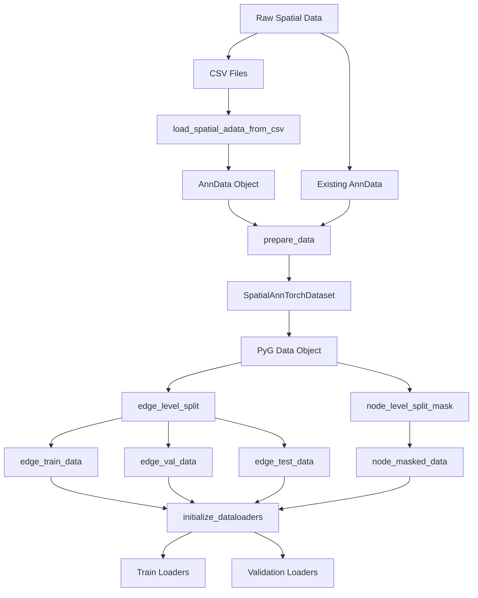

NicheCompass provides a comprehensive data pipeline that transforms spatial transcriptomics data from raw AnnData objects into structured PyTorch Geometric (PyG) format suitable for deep learning on spatial graphs. This integration layer bridges the Scanpy/AnnData ecosystem with graph neural network training, enabling seamless processing of single-sample and multi-sample spatial datasets while supporting multi-modal RNA and ATAC-seq integration.

## AnnData Structure Requirements

NicheCompass expects spatial data to be organized in AnnData objects following the Scanpy convention. The architecture supports flexible storage locations for gene expression counts and spatial connectivity matrices through configurable keys. The primary storage locations include `adata.X` or `adata.layers[counts_key]` for expression matrices and `adata.obsp[adj_key]` for sparse adjacency matrices representing spatial relationships. Optional metadata such as cell types and other categorical covariates are stored in `adata.obs`, enabling the model to leverage biological annotations during training.

For multi-modal integration scenarios, NicheCompass accepts a paired ATAC-seq AnnData object (`adata_atac`) alongside the primary RNA expression data. The framework automatically concatenates features from both modalities at the observation level, ensuring consistent indexing between RNA counts and chromatin accessibility profiles across cells.

## Data Loading from CSV Files

The `load_spatial_adata_from_csv()` function provides a streamlined entry point for creating spatially-annotated AnnData objects from raw CSV files. This function reads three distinct data sources: a gene expression count matrix, a spatial adjacency matrix, and optionally a cell type annotation file.

```python
# Function signature
def load_spatial_adata_from_csv(
    counts_file_path: str,
    adj_file_path: str,
    cell_type_file_path: Optional[str] = None,
    adj_key: str = "spatial_connectivities",
    cell_type_col: str = "cell_type",
    cell_type_key: str = "cell_type"
) -> ad.AnnData
```

The function reads the counts matrix using `anndata.read_csv()`, loads the adjacency matrix from CSV, converts it to a sparse CSR format, and stores it in COO format under `adata.obsp[adj_key]`. If cell type annotations are provided, they are added to `adata.obs[cell_type_key]` using the specified column name from the CSV file.

Sources: [datareaders.py](/src/nichecompass/data/datareaders.py#L12-L54)

## AnnData to PyTorch Geometric Conversion

The `SpatialAnnTorchDataset` class serves as the core adapter between AnnData and PyG formats. This class extracts and transforms the essential components required for graph neural network training: node features (gene expression), edge indices (spatial connectivity), and optional categorical covariates.


### Feature Extraction

The dataset constructor handles multiple storage scenarios for gene expression data. If `counts_key` is provided, expression counts are retrieved from `adata.layers[counts_key]`; otherwise, the default `adata.X` is used. Sparse matrices are automatically converted to dense tensors for PyG compatibility. When paired ATAC-seq data is supplied, the ATAC features are concatenated along the feature dimension, creating a unified multi-modal representation.

Sources: [datasets.py](/src/nichecompass/data/datasets.py#L45-L76)

### Spatial Connectivity Processing

Spatial adjacency matrices are extracted from `adata.obsp[adj_key]` and validated for symmetry, a requirement for undirected graph representation. The adjacency matrix is converted from scipy sparse format to PyTorch SparseTensor format using the utility function `sparse_mx_to_sparse_tensor()`. Edge indices are then extracted as COO tensors representing cell-cell connectivity.

An optional `edge_label_adj_key` parameter allows specification of a separate adjacency matrix for edge reconstruction tasks, enabling different connectivity graphs for message passing versus supervised edge prediction. This dual-graph architecture supports training scenarios where the spatial graph used for neighborhood aggregation differs from the graph used for edge label supervision.

Sources: [datasets.py](/src/nichecompass/data/datasets.py#L77-L96)

### Self-Loop Integration for Autocrine Signaling

Spatial communication models must account for both paracrine signaling (between neighboring cells) and autocrine signaling (within the same cell). NicheCompass handles this through automated self-loop addition when `self_loops=True`. The implementation first removes any existing self-loops to prevent duplication, then systematically adds self-connections to all nodes in the graph. This ensures that each cell can receive information from its own expression state during message passing, which is biologically crucial for modeling self-regulatory processes.

Sources: [datasets.py](/src/nichecompass/data/datasets.py#L97-L104)

### Categorical Covariate Encoding

Categorical metadata such as cell types, tissue regions, or experimental batches are encoded to integer indices using label encoders passed from the model. The `encode_labels()` utility function transforms string labels to numerical indices, handling cases where unseen labels appear in new datasets by assigning them a value of -1. Multiple categorical covariates are stacked along the feature dimension, enabling simultaneous conditioning on multiple discrete variables during training.

Sources: [datasets.py](/src/nichecompass/data/datasets.py#L105-L116), [utils.py](/src/nichecompass/data/utils.py#L10-L44)

## Data Preparation Pipeline

The `prepare_data()` function orchestrates the end-to-end transformation from AnnData objects to training-ready PyG Data objects with proper train/validation/test splits. This pipeline supports both edge-level (for spatial connectivity reconstruction) and node-level (for gene expression reconstruction) evaluation strategies.

```python
def prepare_data(
    adata: AnnData,
    cat_covariates_label_encoders: List[dict],
    adata_atac: Optional[AnnData] = None,
    counts_key: Optional[str] = "counts",
    adj_key: str = "spatial_connectivities",
    cat_covariates_keys: Optional[List[str]] = None,
    edge_val_ratio: float = 0.1,
    edge_test_ratio: float = 0.,
    node_val_ratio: float = 0.1,
    node_test_ratio: float = 0.
) -> dict
```

The function instantiates a `SpatialAnnTorchDataset`, converts it to a PyG Data object, then applies splitting strategies to create separate edge-level and node-level datasets for training and evaluation. The return dictionary contains four distinct PyG Data objects under keys: `edge_train_data`, `edge_val_data`, `edge_test_data`, and `node_masked_data`.

Sources: [dataprocessors.py](/src/nichecompass/data/dataprocessors.py#L133-L221)

## Data Splitting Strategies

NicheCompass implements two complementary splitting strategies to evaluate different aspects of model performance:

### Edge-Level Split for Spatial Reconstruction

The `edge_level_split()` function divides the spatial connectivity graph into training, validation, and test sets for edge reconstruction tasks. This split ensures that edges used for validation and testing are completely withheld from the training set, preventing information leakage. The implementation leverages PyG's `RandomLinkSplit` transform with careful handling of self-loops to avoid replication issues that could corrupt the graph structure.

Key aspects of edge-level splitting:

- Self-loops are temporarily removed before splitting to prevent them from being used as positive edge labels
- If `edge_label_adj` is provided, edge labels indicate whether each edge exists in the supervision graph
- After splitting, self-loops are re-added to all splits for message passing
- The `is_undirected` parameter prevents reverse edge connectivity from leaking across splits

Sources: [dataprocessors.py](/src/nichecompass/data/dataprocessors.py#L17-L97)

### Node-Level Split for Expression Reconstruction

The `node_level_split_mask()` function creates train/validation/test splits at the node level, applying boolean masks (`train_mask`, `val_mask`, `test_mask`) to the PyG Data object. This enables evaluation of gene expression reconstruction performance on held-out cells while maintaining the complete spatial graph structure for neighborhood information flow. The implementation uses PyG's `RandomNodeSplit` transform, with the `split_key` parameter specifying which attribute serves as the ground truth labels for reconstruction.

Node-level splits are particularly valuable for evaluating how well the model learns to predict expression profiles for unseen cells based on their spatial context and the patterns learned from training cells.

Sources: [dataprocessors.py](/src/nichecompass/data/dataprocessors.py#L99-L132)

## DataLoader Initialization

The `initialize_dataloaders()` function creates PyG DataLoader objects for efficient mini-batch training with neighborhood sampling. This function generates separate loaders for node-level tasks (gene expression reconstruction) and edge-level tasks (spatial connectivity prediction).

### Neighbor Sampling Parameters

Two critical parameters control the neighborhood sampling strategy:

| Parameter | Description | Default | Impact |
|-----------|-------------|---------|--------|
| `n_direct_neighbors` | Number of direct neighbors sampled per batch node | -1 (all neighbors) | Controls local context included in each batch |
| `n_hops` | Number of neighbor hops to include | 1 | Determines receptive field size (1 hop = direct neighbors only) |

These parameters enable scaling to large spatial datasets by sampling local subgraphs rather than loading the entire graph into memory for each batch. For spatial transcriptomics datasets where local context is most relevant, `n_hops=1` with `n_direct_neighbors=-1` (including all immediate neighbors) typically provides a good balance between computational efficiency and preserving spatial relationships.

Sources: [dataloaders.py](/src/nichecompass/data/dataloaders.py#L11-L102)

### Edge-Level DataLoaders

LinkNeighborLoaders handle edge reconstruction tasks by sampling subgraphs around source and target nodes of each edge. The `edge_label_index` parameter is filtered to include only edges from the `edge_label_adj` (when provided), ensuring that the dataloader samples from the supervision graph rather than the message passing graph. Negative sampling (`neg_edge_sampling_ratio`) generates non-adjacent node pairs as negative examples for link prediction training.

Sources: [dataloaders.py](/src/nichecompass/data/dataloaders.py#L60-L102)

### Node-Level DataLoaders

NeighborLoaders handle gene expression reconstruction tasks by sampling subgraphs around a set of input nodes specified by training or validation masks. The `input_nodes` parameter restricts sampling to nodes belonging to the current split, ensuring proper evaluation without data leakage. All loaders use `directed=False` to treat the spatial graph as undirected, which is appropriate for cell-cell communication modeling.

Sources: [dataloaders.py](/src/nichecompass/data/dataloaders.py#L27-L58)

## Multi-Modal Integration Support

NicheCompass seamlessly integrates RNA expression data with spatial ATAC-seq measurements through the `adata_atac` parameter in both `SpatialAnnTorchDataset` and `prepare_data()`. The integration process occurs at feature concatenation, where ATAC-seq peak accessibility values are appended to the RNA expression matrix for each cell.

This multi-modal approach enables:

- Joint modeling of gene expression and chromatin accessibility
- Cross-modal information sharing during message passing
- Unified latent representations that capture both transcriptional and regulatory states

The size factors computation in `SpatialAnnTorchDataset` sums features across the concatenated dimension, providing normalization factors that account for both RNA and ATAC modalities in the combined representation.

Sources: [datasets.py](/src/nichecompass/data/datasets.py#L64-L76)

## Complete Data Pipeline Flow

The following diagram illustrates the complete flow from raw spatial data to training-ready PyG DataLoader objects:



Sources: [datareaders.py](/src/nichecompass/data/datareaders.py), [dataprocessors.py](/src/nichecompass/data/dataprocessors.py), [dataloaders.py](/src/nichecompass/data/dataloaders.py)

## Utility Functions

The data pipeline relies on two key utility functions:

### Sparse Matrix Conversion

`sparse_mx_to_sparse_tensor()` converts scipy sparse matrices to PyTorch SparseTensor format, which is required for efficient operations in PyG. The function handles the COO format conversion and type casting to float32, ensuring compatibility with downstream graph operations.

Sources: [utils.py](/src/nichecompass/data/utils.py#L46-L74)

### Label Encoding

`encode_labels()` transforms categorical string labels to integer indices using a provided label encoder dictionary. This function includes robustness checks for unseen labels and warning messages to alert users when label sets are not perfectly aligned between datasets.

Sources: [utils.py](/src/nichecompass/data/utils.py#L10-L44)

## Module Exports

The data integration module is exposed through `nichecompass.data`, providing direct access to all key components:

```python
from nichecompass.data import (
    load_spatial_adata_from_csv,      # CSV loading
    SpatialAnnTorchDataset,           # AnnData adapter
    prepare_data,                     # Main preparation pipeline
    edge_level_split,                 # Edge splitting
    node_level_split_mask,            # Node splitting  
    initialize_dataloaders            # DataLoader creation
)
```

Sources: [data/__init__.py](/src/nichecompass/data/__init__.py)

## Next Steps

Understanding spatial data loading and AnnData integration provides the foundation for exploring how NicheCompass constructs spatial graphs and manages neighbor connectivity. Continue to [Graph Construction and Neighbor Connectivity](10-graph-construction-and-neighbor-connectivity) to learn about the spatial relationship modeling capabilities that operate on the data structures described in this section.

For practical applications of this data pipeline, refer to the [Single-Sample Niche Identification](19-single-sample-niche-identification) and [Sample Integration and Spatial Atlas Building](20-sample-integration-and-spatial-atlas-building) tutorials, which demonstrate end-to-end workflows for spatial analysis.