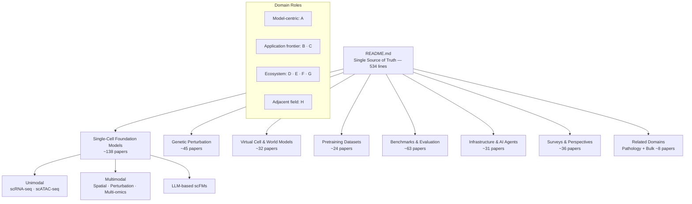

This page introduces the **Awesome Foundation Models for Single-Cell** repository — what it contains, how it is architected, and how to navigate it. As the entry point to this documentation, it explains the repository's role as a curated, continuously updated reading list of foundation-model research for single-cell genomics, and gives you the mental model needed before diving into any specific research domain. No prior experience with either machine learning catalogs or computational biology is assumed.

## What This Repository Is

This is an **awesome-list style knowledge base**: a single, carefully maintained reference document rather than a software codebase. The repository's mission, stated directly in its header, is to provide *"a curated, continuously updated reading list of foundation-model research for single-cell genomics"*. Every entry links to an external paper — the repository itself contains no runnable code. It is an open, community-driven project that welcomes contributions via issues and pull requests, as signaled by its "PRs Welcome" badge and explicit contribution note. The project also carries the official [Awesome](https://awesome.re) badge, indicating it meets the quality standards of the awesome-list ecosystem.

For a beginner developer, the key mental model is this: think of the repository as a **living index card catalog** for a fast-moving research field, where the "cards" are paper citations organized by research theme.

Sources: [README.md](/README.md#L1-L16)

## The Evolutionary Tree: Your Field Map

The repository's single visual asset is its **evolutionary tree diagram** (`figs/evo_tree.png`), which charts how single-cell foundation models have branched and evolved over time. The tree design is credited to the [LLMsPracticalGuide](https://github.com/Mooler0410/LLMsPracticalGuide/tree/main) project, adapting a proven visualization pattern from the broader LLM ecosystem. For newcomers, this diagram is the fastest way to grasp the field's shape at a glance: which model families exist, when they emerged, and how they relate to one another. A dedicated documentation page expands this visual into a full guided walkthrough.


Sources: [README.md](/README.md#L18-L24)

## Repository Architecture: One File Holds Everything

The physical structure is deliberately minimal — a **single-source-of-truth architecture** where `README.md` (534 lines) contains the entire catalog, supported by one image asset and a license file:

```
awesome-foundation-model-single-cell-papers/
├── LICENSE                    # Open-source license
├── README.md                  # ⭐ The entire knowledge base (534 lines, ~375 papers)
└── figs/
    └── evo_tree.png           # Evolutionary tree visualization
```

Inside `README.md`, the content follows a strict layered pattern: header and mission (lines 1–24), a BibTeX citation block (lines 26–37), a self-navigating Catalog table of contents (lines 39–70), and then nine top-level research domains. The Catalog section is a hyperlinked table of contents, so you can jump directly to any domain from the top of the file.

The architecture below shows how the nine domains organize the field — from **model-centric research** at the top, through **application frontiers** in the middle, to the **supporting ecosystem** (data, evaluation, tooling) and adjacent related fields at the base:



> [!TIP]
> Because everything lives in one file, **the Catalog table of contents at lines 39–70 is your fastest navigation tool** — every domain heading in the README is an anchor link, so you never need to scroll or search to reach a section.

Sources: [README.md](/README.md#L39-L70), [README.md](/README.md#L72-L78)

## Catalog Taxonomy at a Glance

Each top-level domain is subdivided by modality or function, and — importantly for your navigation — **each domain maps to a dedicated deep-dive page in this documentation**. The table below summarizes the full taxonomy with approximate entry counts derived from the README's line structure:

| Domain (README anchor) | Subsections | ~Papers | Documentation Page |
|---|---|---|---|
| Single-Cell Foundation Models | scRNA-seq · scATAC-seq · Spatial/Proteomics · Multi-omics · LLM-based | 138 | [Unimodal scRNA-seq Models](5-unimodal-scrna-seq-models), [Single-Cell ATAC-seq Models](6-single-cell-atac-seq-models), [Multimodal and Spatial Models](7-multimodal-and-spatial-models), [LLM-Based Cell Models](8-llm-based-cell-models) |
| Genetic Perturbation | Models/frameworks · Atlases/datasets · Benchmarks | 45 | [Perturbation Prediction Frameworks](9-perturbation-prediction-frameworks), [Perturbation Atlases and Datasets](10-perturbation-atlases-and-datasets), [Perturbation Benchmarks](11-perturbation-benchmarks) |
| Virtual Cell, World Models and Digital Human | Reviews/perspectives · Models/frameworks | 32 | [Virtual Cell Perspectives and Roadmaps](12-virtual-cell-perspectives-and-roadmaps), [Cell World Model Implementations](13-cell-world-model-implementations) |
| Pretraining Datasets and Resources | Atlases/repositories · Multimodal corpora · Formats/frameworks | 24 | [Transcriptomic Atlases and Repositories](14-transcriptomic-atlases-and-repositories), [Multimodal Pretraining Corpora](15-multimodal-pretraining-corpora), [Analysis Frameworks and Data Formats](16-analysis-frameworks-and-data-formats) |
| Benchmarks and Evaluation | Critical evaluations · Data privacy | 63 | [Benchmarking Studies and Critiques](17-benchmarking-studies-and-critiques), [Privacy-Preserving Approaches](18-privacy-preserving-approaches) |
| Infrastructure, Platforms and AI Agents | Platforms · AI agents · Lab-in-the-loop | 31 | [Infrastructure and Model Platforms](19-infrastructure-and-model-platforms), [AI Agents for Discovery](20-ai-agents-for-discovery) |
| Surveys and Perspectives | — | 36 | [Surveys and Open Challenges](21-surveys-and-open-challenges) |
| Related Domains (Pathology · Bulk) | — | 8 | [Related Pathology and Bulk Models](22-related-pathology-and-bulk-models) |

Sources: [README.md](/README.md#L39-L70), [README.md](/README.md#L76-L235), [README.md](/README.md#L237-L290), [README.md](/README.md#L292-L330), [README.md](/README.md#L332-L364), [README.md](/README.md#L366-L435), [README.md](/README.md#L437-L476), [README.md](/README.md#L478-L534)

## Anatomy of a Catalog Entry

Every catalog entry follows one uniform, machine-parseable pattern — which is what makes the list easy to scan, filter, and contribute to:

```
1. [Year Venue] **Model Name: Descriptive paper title** [[paper]](URL-to-publication)
```

| Component | Purpose | Example (from entry for scGPT) |
|---|---|---|
| `[Year Venue]` | Publication year and venue (Nature Methods, NeurIPS, bioRxiv, arXiv…) | `[2024 Nature Methods]` |
| `**Bold title**` | Model name plus paper title | `scGPT: toward building a foundation model…` |
| `[[paper]](URL)` | Direct link to the publication or preprint | `nature.com/articles/s41592-024-02201-0` |
| `[[portal]]`/`[[blog]]`/`[[website]]` | Optional alternate resource link (used sparingly) | CZ CELLxGENE portal link |

Notice that venues span both **peer-reviewed journals** (Nature, Cell, Nature Methods) and **preprint servers** (bioRxiv, arXiv) — the field moves fast enough that preprints are first-class citizens here. Entries are ordered newest-first within each subsection, so scanning the top of any list shows you the research frontier.

> [!TIP]
> Watch for the venue tag as a **credibility signal**: `[bioRxiv]` and `[arXiv]` entries are not yet peer-reviewed, while `[Nature]`, `[Cell]`, or `[NeurIPS]` entries have passed formal review — a useful heuristic when prioritizing what to read first.

Sources: [README.md](/README.md#L81-L124), [README.md](/README.md#L341-L344)

## The Companion Review and Its Classification System

This catalog is not an arbitrary collection — it is the **living companion to a comprehensive review paper**, *"The landscape of single-cell foundation models: design principles, applications, and open challenges"* (currently under review at *Cell*, with full BibTeX provided in the README). The catalog's section structure deliberately mirrors the review's taxonomy, which classifies single-cell foundation models (**scFMs**) along three axes:

1. **By modality** — *unimodal* (one omic type, e.g., scRNA-seq alone), *multimodal* (jointly modeling transcriptomic, epigenomic, proteomic, and spatial data), and *LLM-based* (incorporating large language models or textual biological knowledge).
2. **By pretraining objective** — masked reconstruction, autoregressive generation, contrastive/relational alignment, or supervised prediction.
3. **By research function** — representation learning, perturbation prediction, or world-model simulation.

This is why the domain descriptions in the README read like design-principle statements rather than keyword lists: they are the operational definitions from the review itself.

Sources: [README.md](/README.md#L26-L37), [README.md](/README.md#L74-L78)

## One Navigation Convention to Know

There is exactly one cross-listing rule that could confuse newcomers: **perturbation-trained foundation models are cataloged under Multimodal scFMs, not under the Genetic Perturbation domain**. The README states this explicitly in its Genetic Perturbation introduction, citing models such as X-Cell, SCALE, PerturbGen, STATE, GeneJepa, and Tahoe-x1 as examples. The underlying logic follows the review's classification-first principle: a model's *primary pretraining modality* determines its primary home, while the perturbation domain is reserved for perturbation-*specialized* frameworks, atlases, and benchmarks.

Sources: [README.md](/README.md#L237-L239), [README.md](/README.md#L151-L158)

## Your Path Forward

You now hold the complete mental model: a one-file knowledge base of ~375 papers across nine domains, classified by the taxonomy of its companion review. The recommended reading progression through this documentation follows the catalog's own structure — from orientation, through the core model landscape, outward to applications and ecosystem:

1. **[Quick Start](2-quick-start)** — practical guidance for using and contributing to the repository.
2. **[Evolutionary Tree of Models](3-evolutionary-tree-of-models)** — a guided tour of the visual field map you saw above.
3. **[Taxonomy of Single-Cell Foundation Models](4-taxonomy-of-single-cell-foundation-models)** — the classification system that underpins every section.
4. **Core Model Landscape** — begin with [Unimodal scRNA-seq Models](5-unimodal-scrna-seq-models), the largest and most mature family, then branch into [Single-Cell ATAC-seq Models](6-single-cell-atac-seq-models), [Multimodal and Spatial Models](7-multimodal-and-spatial-models), and [LLM-Based Cell Models](8-llm-based-cell-models).
5. **Application frontiers** — [Perturbation Prediction Frameworks](9-perturbation-prediction-frameworks) and [Virtual Cell Perspectives and Roadmaps](12-virtual-cell-perspectives-and-roadmaps) represent where the field is heading.

If you prefer a top-down grasp of the field before examining individual models, read the Surveys and Perspectives material early via [Surveys and Open Challenges](21-surveys-and-open-challenges); if you are building systems rather than reading theory, the ecosystem layer starting at [Infrastructure and Model Platforms](19-infrastructure-and-model-platforms) is your fast track.
