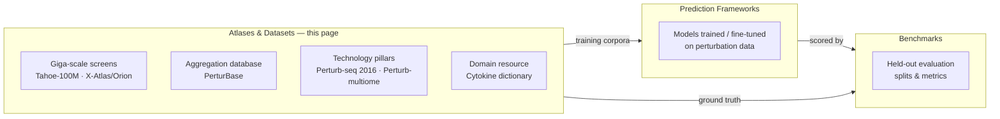
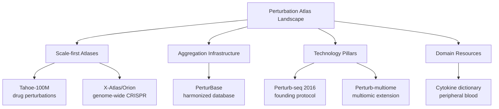

This page documents the **Perturbation atlases and datasets** section of the Awesome Foundation Models for Single-Cell repository — a curated list of six foundational resources that supply the raw experimental data powering the field of single-cell perturbation modeling. While sibling pages catalog the *models* that predict perturbation responses and the *benchmarks* that score them, this page covers the substrate itself: the large-scale Perturb-seq screens, aggregation databases, and domain-specific perturbation dictionaries that make computational perturbation biology possible. For an intermediate developer, this is the "where does the data come from?" layer of the stack.

Sources: [README.md](README.md#L267-L273), [README.md](README.md#L237-L239)

## Position in the Perturbation Knowledge Stack

The repository organizes all perturbation content under a single parent section — "Genetic Perturbation: Models, Atlases and Benchmarks" — which decomposes into a clean three-layer architecture: **data** (atlases), **computation** (prediction frameworks), and **evaluation** (benchmarks). The curated note at the top of that section adds an important fourth actor: perturbation-*trained* foundation models (X-Cell, SCALE, PerturbGen, STATE, GeneJepa, Tahoe-x1) are deliberately routed to the Multimodal scFMs section rather than listed as standalone prediction frameworks. The atlases layer is therefore the dependency root: prediction frameworks consume these datasets for training, and benchmarks slice them into held-out evaluation splits. Understanding this data-first topology clarifies why a data-entry page sits at the center of the perturbation triad.

Sources: [README.md](README.md#L237-L239), [README.md](README.md#L151-L158)

## The Curated Atlas Catalog

The section contains exactly six entries, spanning a decade of methodological evolution — from the 2016 paper that invented pooled single-cell genetic screening to the 2025 giga-scale atlases that industrialized it. The table below preserves the repository's original metadata (year, venue, and linked title) and adds a functional classification to help you navigate by intent rather than by reading order:

| # | Resource | Year / Venue | Functional Role | Scope |
|---|----------|--------------|-----------------|-------|
| 1 | Tahoe-100M | 2025, bioRxiv | Giga-scale perturbation atlas | Context-dependent gene function and cellular modeling at drug-perturbation scale |
| 2 | X-Atlas/Orion | 2025, bioRxiv | Genome-wide screen dataset | Perturb-seq at genome scale via a scalable fix-cryopreserve platform |
| 3 | PerturBase | 2025, Nucleic Acids Research | Aggregation database | Comprehensive database for single-cell perturbation data analysis and visualization |
| 4 | Perturb-multiome | 2025, Science | Multiomic perturbation study | Transcription factor networks and heritability of blood cell phenotypes |
| 5 | Cytokine dictionary | 2025, bioRxiv | Domain-specific atlas | Single-cell cytokine perturbation map of human peripheral blood |
| 6 | Perturb-seq | 2016, Cell | Founding method paper | Dissecting molecular circuits with pooled genetic screens + scRNA profiling |

Note the deliberate span of perturbation *modalities*: although the parent section is titled "Genetic Perturbation," the atlas entries cover drug-induced responses (Tahoe-100M), CRISPR-based genetic screens (X-Atlas, Perturb-seq), and cytokine stimulation (the peripheral blood dictionary). The curation treats "perturbation atlas" broadly — any systematically perturbed single-cell dataset qualifies.

Sources: [README.md](README.md#L267-L273), [README.md](README.md#L237-L239)

## Anatomy of the Atlas Landscape

The six entries cluster into four archetypes that map directly onto how a developer would actually interact with them. **Scale-first atlases** (Tahoe-100M, X-Atlas/Orion) are primary data products: massive, purpose-built screens intended to serve as pretraining corpora and in-silico screening grounds. **Aggregation infrastructure** (PerturBase) is a meta-resource — it harmonizes scattered perturbation experiments into a queryable database with analysis and visualization built in, useful when you need heterogeneous datasets rather than one homogeneous mega-screen. **Technology pillars** (Perturb-seq 2016, Perturb-multiome 2025) anchor the experimental methodology: the former defines the pooled-screen-plus-scRNA-seq protocol, the latter extends it to multiome readouts linking transcription factors to phenotypic heritability. **Domain resources** (the cytokine dictionary) demonstrate that perturbation atlases generalize beyond CRISPR to signaling-molecule space. Each row in the catalog table above corresponds to one of these archetypes, letting you select a resource by data-acquisition strategy.

Sources: [README.md](README.md#L267-L273)

> [!TIP]
> Watch the naming collision: **Tahoe-100M** (the dataset, listed here at line 268) and **Tahoe-x1** (the 3-billion-parameter foundation model trained on perturbation data, listed at line 158 under Multimodal scFMs) are distinct entries in a deliberate data/model split. If you are tracing the lineage of perturbation-trained foundation models, you must cross two catalog sections — the corpus lives on this page, the architecture on [Multimodal and Spatial Models](7-multimodal-and-spatial-models).

The 2016 Perturb-seq entry is not a historical curiosity — it is the methodological keystone that makes every other entry legible. Its protocol (pooled CRISPR perturbations combined with single-cell RNA profiling of each cell's guide identity) is precisely the experimental template that X-Atlas/Orion scales genome-wide, that Perturb-multiome extends with ATAC readouts, and that Tahoe-100M industrializes at drug-screen scale. Reading the founding paper first converts the modern giga-scale entries from opaque benchmarks into comprehensible engineering refinements of a single idea.

Sources: [README.md](README.md#L273), [README.md](README.md#L269-L271)

## Scope Boundaries and Adjacent Pages

Because the perturbation content in this repository is dense and heavily cross-referenced, precise boundary discipline matters when navigating. The table below maps what explicitly belongs to this page versus what the curators route elsewhere — use it to avoid searching the wrong section:

| Content Type | Belongs To | Catalog Destination |
|--------------|-----------|---------------------|
| Giga-scale screens, aggregation DBs, method papers (this page's six entries) | **This page** | — |
| Response-prediction models (GEARS, scGen, diffusion/flow frameworks) | Models and prediction frameworks | [Perturbation Prediction Frameworks](9-perturbation-prediction-frameworks) |
| Foundation models pretrained *on* perturbation data (Tahoe-x1, STATE, GeneJepa) | Multimodal scFMs | [Multimodal and Spatial Models](7-multimodal-and-spatial-models) |
| Evaluation studies, metric critiques, model comparisons | Perturbation benchmarks | [Perturbation Benchmarks](11-perturbation-benchmarks) |
| Perturbation *analysis tooling* (e.g., Pertpy) | Data formats and frameworks | [Analysis Frameworks and Data Formats](16-analysis-frameworks-and-data-formats) |
| Non-perturbative cell atlases (Tabula Sapiens, CELLxGENE) | Transcriptomic atlases | [Transcriptomic Atlases and Repositories](14-transcriptomic-atlases-and-repositories) |

The first row of that boundary table encodes the repository's single most consequential curation decision, stated verbatim in the parent section's intro: perturbation-trained scFMs are *not* prediction frameworks and live under Multimodal scFMs. Similarly, active-discovery workflows that *generate* new perturbation data in a closed loop (e.g., active hit discovery) are cataloged separately under the lab-in-the-loop section, downstream of the agents content.

Sources: [README.md](README.md#L237-L239), [README.md](README.md#L361), [README.md](README.md#L474-L476)

> [!TIP]
> The repository's internal anchors follow a strict convention: the parent section note (line 239) uses a Markdown anchor link to route perturbation-trained scFMs to the Multimodal scFMs section. When navigating the raw README, the fastest disambiguation rule is: *if the entry's contribution is data → this section; if the contribution is architecture → Multimodal scFMs; if the contribution is a scoring protocol → benchmarks.*

## Suggested Reading Path

For a developer building intuition about perturbation modeling infrastructure, the catalog structure suggests a three-step progression through the Deep Dive perturbation block. Begin with the **methodology layer**: read the 2016 Perturb-seq entry on this page to internalize the experimental protocol, then survey the scale-first atlases (Tahoe-100M, X-Atlas/Orion) to see how that protocol industrializes. Proceed to **[Perturbation Prediction Frameworks](9-perturbation-prediction-frameworks)** to understand the computational models that consume these corpora — the models section and this atlas section were curated as explicit data/consumer counterparts. Conclude with **[Perturbation Benchmarks](11-perturbation-benchmarks)**, where the critical-evaluation literature (including "one PCA still rules them all" and linear-baseline critiques) contextualizes what these datasets can and cannot prove about model quality.

From this page you can also branch laterally: if your interest is in perturbation-trained foundation model *architectures* rather than data, go directly to **[Multimodal and Spatial Models](7-multimodal-and-spatial-models)**; if you need the tooling to process these atlases, **[Analysis Frameworks and Data Formats](16-analysis-frameworks-and-data-formats)** catalogs the Pertpy end-to-end analysis framework; and for the broader virtual-cell systems built on top of this data layer, continue to **[Virtual Cell Perspectives and Roadmaps](12-virtual-cell-perspectives-and-roadmaps)** and **[Cell World Model Implementations](13-cell-world-model-implementations)**.
