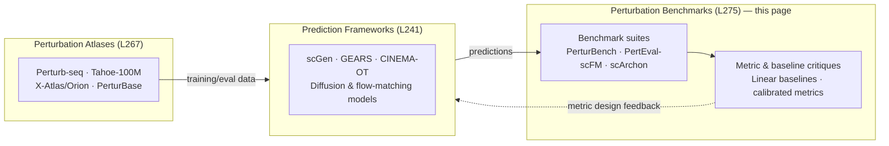
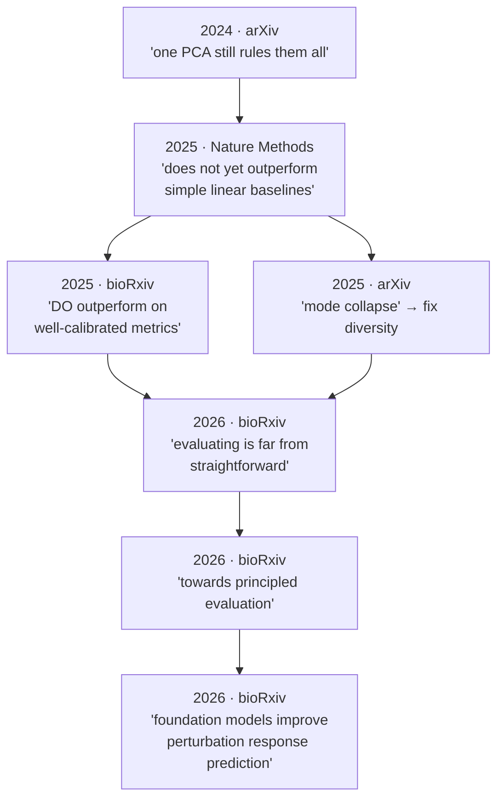

This page documents the `### Perturbation benchmarks` section of the repository's README — a curated collection of **15 papers** that benchmark, stress-test, and critically evaluate computational models for single-cell perturbation response prediction. Unlike the neighboring pages that catalog *prediction frameworks* or *data atlases*, this section captures the field's evaluation methodology itself: benchmark suites, metric-design critiques, and head-to-head comparisons that determine whether deep perturbation models actually deliver on their promise.

Sources: [README.md](README.md#L275-L290)

## Position in the Repository's Perturbation Triad

Within the README's information architecture, this section is the **terminal node** of a three-part decomposition under the parent heading `Genetic Perturbation: Models, Atlases and Benchmarks` ([README.md](README.md#L237-L239)). The parent intro establishes an important scoping rule: perturbation-*trained* single-cell foundation models (X-Cell, SCALE, PerturbGen, STATE, GeneJepa, Tahoe-x1) are deliberately excluded from this triad and listed under Multimodal scFMs instead — meaning everything below this section header is exclusively about models that *predict* perturbations, data that *record* perturbations, or evaluations that *judge* perturbation predictors.

The three subsections form a pipeline: data resources feed prediction frameworks, and benchmarks close the loop by judging both. The prerequisite for reading the diagram below: solid-edge arrows represent data/model flow; the dashed edge represents the metric-design feedback loop that benchmarks exert on framework developers.

This pipeline framing matters for advanced readers because the benchmark entries repeatedly interrogate the *generalization contract* of the frameworks upstream — several section titles explicitly target "unseen perturbations" and "generalizable" prediction, which is precisely the claim that separates perturbation foundation models from classical curve-fitting approaches.

Sources: [README.md](README.md#L237-L274), [README.md](README.md#L50-L53)

## The Benchmark Corpus: Fifteen Curated Entries

The section is a flat, numbered list ordered reverse-chronologically (newest first), from a 2026 bioRxiv preprint down to a 2024 arXiv paper. The table below is the complete, verbatim catalog with venue and a conservative functional descriptor derived strictly from each title.

| # | Year | Venue | Entry | Focus (per title) |
|---|------|-------|-------|-------------------|
| 1 | 2026 | bioRxiv | Towards Principled Evaluation of Single-Cell Perturbation Prediction Models | Evaluation principles |
| 2 | 2026 | Genome Biology | scArchon: a scalable benchmarking framework for assessing single-cell perturbation models | Benchmark framework |
| 3 | 2026 | bioRxiv | Foundation Models Improve Perturbation Response Prediction | FM assessment |
| 4 | 2026 | bioRxiv | Evaluating Single-Cell Perturbation Response Models Is Far from Straightforward | Evaluation critique |
| 5 | 2025 | Nature Methods | Benchmarking algorithms for generalizable single-cell perturbation response prediction | Systematic benchmark |
| 6 | 2025 | Nature Methods | Deep-learning-based gene perturbation effect prediction does not yet outperform simple linear baselines | Baseline critique |
| 7 | 2025 | Nature Biotechnology | Systema: a framework for evaluating genetic perturbation response prediction beyond systematic variation | Evaluation framework |
| 8 | 2025 | bioRxiv | Single Cell Foundation Models Evaluation (scFME) for In-Silico Perturbation | FM evaluation suite |
| 9 | 2025 | bioRxiv | Deep Learning-Based Genetic Perturbation Models Do Outperform Uninformative Baselines on Well-Calibrated Metrics | Metric rebuttal |
| 10 | 2025 | arXiv | Diversity by Design: Addressing Mode Collapse Improves scRNA-seq Perturbation Modeling on Well-Calibrated Metrics | Metric + training fix |
| 11 | 2025 | NeurIPS | PerturBench: Benchmarking Machine Learning Models for Cellular Perturbation Analysis | Benchmark suite |
| 12 | 2025 | ICML | PertEval-scFM: Benchmarking Single-Cell Foundation Models for Perturbation Effect Prediction | FM benchmark |
| 13 | 2025 | BMC Genomics | Benchmarking foundation cell models for post-perturbation RNA-seq prediction | FM benchmark |
| 14 | 2024 | bioRxiv | A systematic comparison of single-cell perturbation response prediction models | Systematic comparison |
| 15 | 2024 | arXiv | Benchmarking Transcriptomics Foundation Models for Perturbation Analysis: one PCA still rules them all | Baseline critique |

Three aggregate signals are worth reading from this distribution. First, **venue quality is unusually high for a 15-item list**: two Nature Methods papers, one Nature Biotechnology, one Genome Biology, plus peer-reviewed NeurIPS and ICML proceedings — evaluation work, not just method papers, is clearing top-tier review in this field. Second, the temporal profile (2 entries in 2024 → 9 in 2025 → 4 already in 2026) shows evaluation methodology consolidating rapidly as a subdiscipline. Third, the list splits cleanly between *constructive* contributions (named frameworks: scArchon, Systema, scFME, PerturBench, PertEval-scFM) and *adversarial* contributions (critiques targeting baselines and metrics) — a duality explored next.

Sources: [README.md](README.md#L275-L290)

## Thematic Taxonomy of Evaluation Work

Cross-cutting the chronological order, the fifteen entries cluster into three functionally distinct categories. The prerequisite for the table: the "clusters" are derived from title semantics only — the repository itself does not tag entries, so treat groupings as a reading aid rather than ground truth.

| Cluster | Entries (by row # above) | Shared concern | Character |
|---------|--------------------------|----------------|-----------|
| **Benchmark suites & frameworks** | 2, 5, 7, 8, 11, 12, 13, 14 | Build reusable evaluation infrastructure (scArchon, Systema, scFME, PerturBench, PertEval-scFM) or run one-off systematic comparisons (5, 13, 14) | Constructive |
| **Baseline & metric critiques** | 1, 4, 6, 9, 10, 15 | Question whether reported wins are real — challenge with linear baselines, PCA, metric calibration, mode-collapse analysis | Adversarial |
| **Verdict papers on foundation models** | 3, 8, 12, 13, 15 | Specifically ask whether *foundation models* (vs. task-specific deep nets) help perturbation prediction | Synthetic |

The overlap between clusters is deliberate signal, not noise: entries 8, 12, 13, and 15 appear in two clusters because the field's central question — "do foundation models improve perturbation prediction?" — is being answered simultaneously by suite builders and by critics. Entry 10 ("Diversity by Design") is the most methodologically interesting hybrid: its title asserts both a *failure-mode diagnosis* (mode collapse) and a *remedy* (diversity by design), validated "on well-calibrated metrics" — the exact metric vocabulary of the critique cluster.

> [!TIP]
> Read entries 6, 9, and 10 as a single three-move argument cluster rather than three independent papers: 6 (Nature Methods) lands the negative result on standard metrics → 9 (bioRxiv) counters that the gap reopens on "well-calibrated" metrics → 10 (arXiv) explains the mechanism as mode collapse that calibrated metrics expose. Evaluating any perturbation model without reading all three risks inheriting whichever metric regime the single paper you read happened to favor.

Sources: [README.md](README.md#L275-L290)

## The Baselines Controversy: A Verifiable Argument Arc

The most striking pattern in this section is that the **titles alone reconstruct a multi-year methodological dispute** — no external knowledge required. The prerequisite for the diagram: each node is a section entry verbatim (abbreviated), and edges represent the chronological challenge-and-response sequence implied by their claims.

Reading the arc left to right: 2024 opens with the provocative claim that plain PCA remains competitive for perturbation analysis (entry 15); 2025 escalates this to a Nature Methods result that deep models fail to beat simple linear baselines (entry 6); the same year produces a direct counterpoint asserting that deep models *do* win once metrics are well-calibrated (entry 9), plus a mechanistic explanation — mode collapse — for why naive metrics mislead (entry 10). By 2026 the dispute matures into methodology: one entry concedes that evaluation "is far from straightforward" (entry 4), another proposes principled evaluation as a research program (entry 1), and the arc closes with a positive verdict that foundation models improve prediction (entry 3).

The engineering takeaway for this audience is architectural: **the controversy was never about model capacity — it was about metric design and generalization splits.** Every named framework in the constructive cluster (PerturBench, PertEval-scFM, Systema, scArchon) exists precisely to pin down these choices so that the entry-6-vs-entry-9 disagreement cannot silently recur.

> [!TIP]
> When you adopt any benchmark from this list, first locate which side of the 2025 controversy its metric regime descends from: suites emphasizing "well-calibrated metrics" (entries 9–10 lineage) will score generative perturbation models more favorably than suites built before that correction (entry 6 lineage). Divergent leaderboard results across suites are usually this single-axis difference, not a reproduction failure.

Sources: [README.md](README.md#L275-L290)

## Boundary Map: What Lives on Adjacent Pages

This section is deliberately narrow, and the repository enforces the boundary structurally. The disambiguation table below maps evaluation-adjacent material to its correct catalog page so you do not mis-file papers or misconfigure your reading list.

| Content pattern | Example from README | Correct catalog page |
|-----------------|---------------------|----------------------|
| Perturbation **prediction methods** (GEARS, scGen, CINEMA-OT, diffusion/flow models) | `### Models and prediction frameworks` (24 entries, L241–L265) | [Perturbation Prediction Frameworks](9-perturbation-prediction-frameworks) |
| Perturbation **data resources** (Tahoe-100M, X-Atlas/Orion, PerturBase, 2016 Perturb-seq) | `### Perturbation atlases and datasets` (6 entries, L267–L273) | [Perturbation Atlases and Datasets](10-perturbation-atlases-and-datasets) |
| Perturbation-trained **scFMs** (X-Cell, SCALE, STATE, Tahoe-x1) | Deferred to Multimodal scFMs per parent-note (L239) | [Multimodal and Spatial Models](7-multimodal-and-spatial-models) |
| Perturbation **analysis tooling** (Pertpy) | Under `Data formats and frameworks` (L361) | [Analysis Frameworks and Data Formats](16-analysis-frameworks-and-data-formats) |
| General scFM **benchmarks** (annotation, integration, scaling laws, embedding-metric critiques) | `### Benchmarks and critical evaluations` (L370–L429) | [Benchmarking Studies and Critiques](17-benchmarking-studies-and-critiques) |
| Virtual-cell **challenge & world-model** evaluations | Under `Virtual Cell, World Models and Digital Human` (L292+) | [Virtual Cell Perspectives and Roadmaps](12-virtual-cell-perspectives-and-roadmaps) |

Two boundaries deserve emphasis for advanced navigators. The **vertical boundary** (L290 → L366 in the README) separates *perturbation-specific* benchmarks — this page — from *general-purpose* scFM benchmarks on annotation, integration, and scaling (page 17). Papers could plausibly belong to either; the repository's cut is by task, not by methodology. The **upstream boundary** (L239) is a scope ruling: perturbation-trained foundation models are treated as *models first*, not benchmarks or perturbation tools, and therefore live on page 7.

Sources: [README.md](README.md#L237-L290), [README.md](README.md#L361), [README.md](README.md#L366-L429)

## Reading Progression for Evaluation Engineers

If your goal is to *evaluate a perturbation model or ship a benchmark of your own*, the section supports a compressed reading path that respects the argument structure documented above. First, read the 2024 baseline warnings (entries 15, 14) to calibrate your skepticism; second, adopt a suite from the constructive cluster — PertEval-scFM (ICML) if you are specifically benchmarking foundation models, PerturBench (NeurIPS) for broader cellular perturbation analysis, or scArchon (Genome Biology) if scalability of the benchmark harness itself is the constraint; third, read the metric-calibration cluster (entries 6, 9, 10) before interpreting any leaderboard; finally, close with the 2026 principled-evaluation entries (1, 4) and the affirmative verdict (3) to position your work within the field's current frontier.

For placement of your own contribution: a new *suite* belongs in this section; a new *predictor* belongs in [Perturbation Prediction Frameworks](9-perturbation-prediction-frameworks); a new *metric-science critique* spanning multiple tasks belongs in [Benchmarking Studies and Critiques](17-benchmarking-studies-and-critiques).

Sources: [README.md](README.md#L275-L290)

## Where to Go Next

Having mapped the evaluation layer of the perturbation stack, the natural continuations are: **[Perturbation Atlases and Datasets](10-perturbation-atlases-and-datasets)** to understand the data contracts your benchmark train/test splits must honor; **[Perturbation Prediction Frameworks](9-perturbation-prediction-frameworks)** to study the models these benchmarks judge; and **[Benchmarking Studies and Critiques](17-benchmarking-studies-and-critiques)** for the broader evaluation-science context (embedding-metric pitfalls, scaling-law audits) that this page's perturbation-specific story sits inside. To see where perturbation benchmarks connect to the field's endgame — world models and the Virtual Cell Challenge — continue to **[Virtual Cell Perspectives and Roadmaps](12-virtual-cell-perspectives-and-roadmaps)**.
