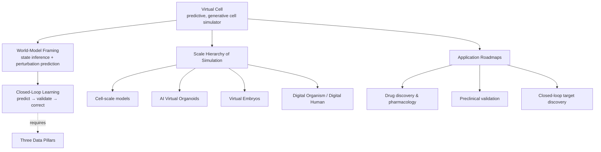
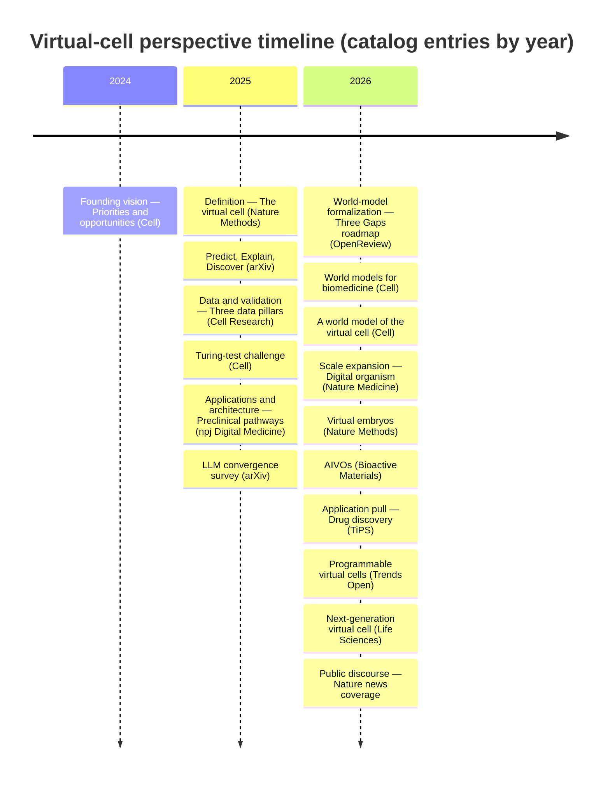
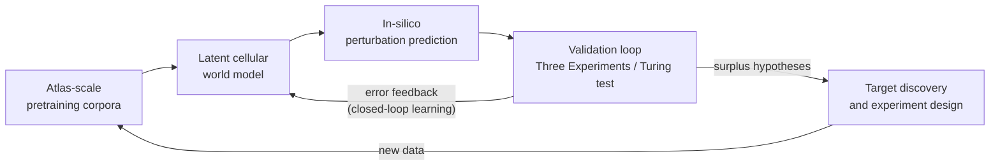

This page documents the **"Reviews, comments, and perspectives"** subsection of the Virtual Cell, World Models and Digital Human catalog section — 17 perspective papers (lines 296–313 of the repository's README) that collectively define what a virtual cell *should be*, how it *should be built*, and how it *should be judged*. Unlike the sibling page, which catalogs concrete implementations, this page captures the field's **roadmap layer**: vision papers, criteria papers, and application agendas published predominantly in top-tier venues. The repository structures its entire catalog around the companion review *"The landscape of single-cell foundation models: design principles, applications, and open challenges"*, and the virtual cell frontier is its forward-looking terminus.

Sources: [README.md](README.md#L10-L12), [README.md](README.md#L22-L24), [README.md](README.md#L292-L294)

## Position in the Catalog: The Two-Layer Split

The catalog splits the virtual cell frontier into two complementary layers, and understanding this split is essential for reading the section correctly. **Layer one — this page** — covers *Reviews, comments, and perspectives* (README lines 296–313): normative papers that define requirements, roadmaps, and evaluation standards. **Layer two — the next catalog page** — covers *Models and frameworks* (README lines 315–330): implemented systems such as CellOS, AlphaCell, VCWorld, and CellForge. The section's own framing sentence establishes the intellectual thesis uniting both layers: virtual cell work consists of *"emerging generative training paradigms that recast scFMs as cellular world models, and efforts toward virtual embryos and digital humans"* — that is, the shift from foundation models as **representation learners** to foundation models as **simulators**.

Sources: [README.md](README.md#L54-L56), [README.md](README.md#L292-L294), [README.md](README.md#L296-L313), [README.md](README.md#L315-L330)

## The Discourse Trajectory: 2024 → 2026

The perspectives corpus shows a quantifiable acceleration in the field's discursive output. The count of perspective papers per year in this subsection is **1 (2024) → 6 (2025) → 10 (2026)** — an order-of-magnitude growth in under three years. The venue distribution is equally telling: the perspectives concentrate in *Cell* (4 papers), *Nature Methods* (2 papers), *Nature*, *Nature Medicine*, *Cell Research*, and *npj Digital Medicine*, indicating that the virtual cell conversation has consolidated at the highest editorial tiers rather than remaining confined to preprints. Only three entries remain as preprints (one OpenReview, two arXiv). For an intermediate developer, this trajectory signals that the roadmap concepts below are stable enough to build against — the definitional churn is settling.

Sources: [README.md](README.md#L297-L313)

## The Founding Vision and Its 2025 Consolidation

Every roadmap in this corpus traces back to a single anchor entry: the 2024 *Cell* perspective **"How to build the virtual cell with artificial intelligence: Priorities and opportunities"** (line 313). This is the field's founding manifesto — the only 2024 entry in the subsection — and it frames the virtual cell as a *construction project* with explicit priorities. The 2025 entries then consolidate the vision along three fronts. **Definitional consolidation** arrives via *The virtual cell* (Nature Methods, line 307) and *Virtual Cells: Predict, Explain, Discover* (arXiv, line 311), the latter title articulating a three-verb contract that recurs across the corpus: prediction is the baseline obligation, explanation the interpretability obligation, and discovery the scientific payoff. **Public-attention consolidation** is marked by the 2026 Nature news commentary *"'Virtual cells' aim to turn raw data into predictive models of biology"* (line 300) — the corpus's single journalism entry, signaling that the concept has crossed from specialist discourse into mainstream scientific media.

| Year | Perspective | Venue | Catalog Role |
|------|-------------|-------|--------------|
| 2024 | How to build the virtual cell with AI: Priorities and opportunities | Cell | Founding manifesto; agenda-setting |
| 2025 | The virtual cell | Nature Methods | Definition consolidation |
| 2025 | Virtual Cells: Predict, Explain, Discover | arXiv | Contract framing: predict → explain → discover |
| 2025 | Large Language Models Meet Virtual Cell: A Survey | arXiv | Architecture convergence (LLM axis) |
| 2026 | 'Virtual cells' aim to turn raw data into predictive models of biology | Nature | Mainstream-visibility marker |

Sources: [README.md](README.md#L300), [README.md](README.md#L307), [README.md](README.md#L311), [README.md](README.md#L313)

## The World-Model Turn: From Metaphor to Testable Criteria

The single most consequential development in the 2026 cohort is the **formalization of the world-model framing**. Three entries convert what was previously a loose metaphor into an auditable specification. *What Makes a Virtual Cell a World Model? Three Gaps, Three Experiments, and a Roadmap* (OpenReview, line 299) is the most explicit: its title promises named gaps, named experiments, and a named roadmap — a criteria paper against which implementations can be checked. *World models for biomedicine* (Cell, line 303) generalizes the framing beyond the cell to biomedicine as a domain, and *A world model of the virtual cell* (Cell, line 304) closes the loop by applying the abstraction specifically to virtual cells in the flagship venue. For developers, the operational takeaway is that "is this a world model?" is becoming an answerable engineering question, not a marketing claim.

Sources: [README.md](README.md#L299), [README.md](README.md#L303-L304)

## Data Supply and the Closed-Loop Imperative

Two 2025 perspectives define the *resource and validation* axes of the roadmap. **Grow AI virtual cells: three data pillars and closed-loop learning** (Cell Research, line 309) makes the supply-side argument: virtual cells cannot be trained from transcriptomic atlases alone but require three named data pillars, with *closed-loop learning* as the training regime that binds them — the prediction/observation feedback cycle shown in the diagram above. **Virtual Cell Challenge: Toward a Turing test for the virtual cell** (Cell, line 312) supplies the demand side: a community benchmark with an explicitly behavioral acceptance criterion. The pairing is architecturally significant — one paper specifies what flows *into* the model, the other specifies what the model must *pass* to count as working. The closed-loop vocabulary also recurs in the application cluster (line 297), making it the most repeated roadmap term in the subsection.

> [!TIP]
> The "three data pillars" are not stocked by this subsection — the supply chain lives elsewhere in the catalog. Perturbation-trained models and atlases are deliberately cross-listed under Multimodal scFMs rather than the perturbation section (line 239 names X-Cell, SCALE, PerturbGen, STATE, GeneJepa, and Tahoe-x1 explicitly), and the atlases themselves sit on the Perturbation Atlases page. When assessing a world-model implementation against the closed-loop requirement, check [Perturbation Atlases and Datasets](10-perturbation-atlases-and-datasets) and [Multimodal and Spatial Models](7-multimodal-and-spatial-models) for the actual training data.

Sources: [README.md](README.md#L239), [README.md](README.md#L309), [README.md](README.md#L312)

## Application Roadmaps: From Pharmacology to the Clinic

A distinct cluster of perspectives translates the virtual cell concept into **application pull** — concrete domains where the simulator is expected to pay for itself. *AI virtual cells for drug discovery and pharmacology* (Trends in Pharmacological Sciences, line 301) targets the pharma pipeline; *AI-driven virtual cell models in preclinical research: technical pathways, validation mechanisms, and clinical translation potential* (npj Digital Medicine, line 308) is the corpus's most operationally explicit title, promising named technical pathways and validation mechanisms rather than just vision; and *The next-generation virtual cell: From spatiotemporal transcriptomic modeling to closed-loop target discovery in complex diseases* (Life Sciences, line 297) sketches a full pipeline from spatial-temporal modeling to target discovery, reusing the closed-loop vocabulary established by the data-pillar paper. Complementing these, *Multimodal artificial intelligence for predictive and programmable virtual cells* (Trends Open, line 302) specifies the architectural *means* — multimodal, programmable systems — rather than the application *ends*.

| Application Domain | Perspective | Venue | Pipeline Stage Addressed |
|--------------------|-------------|-------|--------------------------|
| Drug discovery & pharmacology | AI virtual cells for drug discovery and pharmacology | Trends in Pharmacological Sciences | Compound screening, mechanism of action |
| Preclinical research | AI-driven virtual cell models in preclinical research | npj Digital Medicine | Technical pathway → validation → translation |
| Target discovery | The next-generation virtual cell | Life Sciences | Spatiotemporal modeling → closed-loop target ID |
| Architecture means | Multimodal AI for predictive and programmable virtual cells | Trends Open | Model design (multimodal, programmable) |

Sources: [README.md](README.md#L297), [README.md](README.md#L301-L302), [README.md](README.md#L308)

## Scaling the Simulated Unit: Organoids, Embryos, Digital Organisms

The third roadmap axis extends the **unit of simulation upward** from a single cell to multicellular and organism-level systems — matching the second half of the catalog section's own framing sentence ("efforts toward virtual embryos and digital humans", line 294). Three 2026 entries chart this gradient: *Artificial Intelligence Virtual Organoids (AIVOs)* (Bioactive Materials, line 306) addresses tissue-organoid scale; *Towards predictive virtual embryos with genomics and AI* (Nature Methods, line 305) addresses developmental scale; and *How to build an AI-driven digital organism* (Nature Medicine, line 298) — a second "how to build" paper — addresses whole-organism scale, echoing the founding manifesto's construction-project framing at maximum scope. The consistency of the "how to build" title pattern across scales (lines 298 and 313) suggests the field treats each scale level as a distinct engineering project with its own priorities, rather than as a single continuous model.

| Simulation Scale | Perspective | Venue | Founding/Manifesto Lineage |
|------------------|-------------|-------|----------------------------|
| Single cell | How to build the virtual cell with AI (2024) | Cell | Original manifesto |
| Organoid / tissue | Artificial Intelligence Virtual Organoids (AIVOs) | Bioactive Materials | Scale extension |
| Embryo / development | Towards predictive virtual embryos with genomics and AI | Nature Methods | Scale extension |
| Whole organism | How to build an AI-driven digital organism | Nature Medicine | Second manifesto; maximal scope |

Sources: [README.md](README.md#L294), [README.md](README.md#L298), [README.md](README.md#L305-L306), [README.md](README.md#L313)

## Synthesized Roadmap for Builders

Collapsing the seventeen entries into axes yields a compact specification that an implementation team can treat as a requirements checklist. Each axis has verifiable anchor papers in this subsection, and each maps directly onto a neighboring catalog page that stocks the corresponding supply — which is precisely how the catalog's author arranged the reading order. The roadmap reads: define the contract (**predict, explain, discover**), formalize it as a world model with testable gaps and experiments, secure the three data pillars, wire them into a closed-loop training regime, pass the Turing-test-style challenge, then climb the scale hierarchy toward digital organisms while the pharma and preclinical clusters extract value at each level.

| Roadmap Axis | Core Question | Anchor Perspectives (line refs) | Supply Pages |
|--------------|---------------|--------------------------------|--------------|
| Definition contract | What must a virtual cell do? | Predict, Explain, Discover (L311); The virtual cell (L307) | — |
| World-model criteria | When is it a world model, not just an embedder? | Three Gaps/Three Experiments (L299); World models for biomedicine (L303); A world model of the virtual cell (L304) | [Cell World Model Implementations](13-cell-world-model-implementations) |
| Data supply | What data feeds the closed loop? | Three data pillars and closed-loop learning (L309) | [Perturbation Atlases and Datasets](10-perturbation-atlases-and-datasets) |
| Validation | What proves it works? | Virtual Cell Challenge / Turing test (L312) | [Perturbation Benchmarks](11-perturbation-benchmarks), [Benchmarking Studies and Critiques](17-benchmarking-studies-and-critiques) |
| Scale expansion | How far beyond one cell? | AIVOs (L306); Virtual embryos (L305); Digital organism (L298) | [Multimodal and Spatial Models](7-multimodal-and-spatial-models) |
| Application pull | Who pays for it? | Pharma (L301); Preclinical (L308); Target discovery (L297) | [AI Agents for Discovery](20-ai-agents-for-discovery) |
| Architecture means | What builds it? | Multimodal programmable AI (L302); LLM convergence survey (L310) | [LLM-Based Cell Models](8-llm-based-cell-models) |

> [!TIP]
> Use this page and its sibling as a specification-versus-implementation pair: every roadmap claim here (lines 296–313) can be audited against a concrete system on the next page (lines 315–330). For example, the "Three Gaps, Three Experiments" criteria paper (L299) and the Turing-test challenge (L312) give you a rubric; CellOS, AlphaCell, and VCWorld on the implementations page are the candidates that rubric was written to judge. Reading in catalog order — this page first — mirrors the field's own logical dependency: criteria before systems.

Sources: [README.md](README.md#L296-L313), [README.md](README.md#L315-L330)

## Suggested Reading Progression

Having absorbed the roadmap layer, the natural continuation follows the catalog's own dependency order. Proceed next to **[Cell World Model Implementations](13-cell-world-model-implementations)** to audit the criteria above against real systems, then branch into the supply chain: **[Perturbation Prediction Frameworks](9-perturbation-prediction-frameworks)** and **[Perturbation Atlases and Datasets](10-perturbation-atlases-and-datasets)** for the closed loop's training substrate, **[Perturbation Benchmarks](11-perturbation-benchmarks)** for its validation substrate, and **[LLM-Based Cell Models](8-llm-based-cell-models)** for the architecture-convergence axis. To place the whole frontier in historical context, the **[Evolutionary Tree of Models](3-evolutionary-tree-of-models)** page renders the repository's flagship figure (shown at the top of this page), and **[Surveys and Open Challenges](21-surveys-and-open-challenges)** completes the perspectives picture with field-wide survey literature beyond the virtual cell niche.
