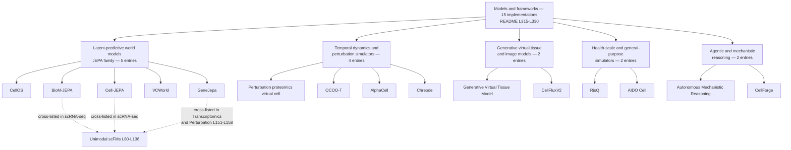

This page is the **reference catalog of concrete cellular world-model implementations** curated in the *awesome-foundation-model-single-cell-papers* repository. Where its sibling page collects conceptual essays, roadmaps, and commentaries, this page catalogs the 15 built systems — simulators, latent-predictive models, generative engines, and agentic frameworks — that operationalize the idea of a "world model" for cell biology. Every entry is sourced directly from the repository's primary artifact, `README.md`, which structures the field according to the review *"The landscape of single-cell foundation models: design principles, applications, and open challenges"* (under review at *Cell*).

Sources: [README.md](README.md#L11-L12), [README.md](README.md#L28-L37)

## Scope: Where This Page Sits in the Catalog

The repository partitions the world-model frontier into a parent chapter, **"Virtual Cell, World Models and Digital Human"**, whose own framing sentence defines the subject: *"Emerging generative training paradigms that recast scFMs as cellular world models, and efforts toward virtual embryos and digital humans."* This chapter has exactly two children, and the page boundary between them is strict: the "Reviews, comments, and perspectives" subsection covers concepts (documented on [Virtual Cell Perspectives and Roadmaps](12-virtual-cell-perspectives-and-roadmaps)), while the "Models and frameworks" subsection — 15 entries spanning lines 315–330 — **is** the present page.

Sources: [README.md](README.md#L292-L294), [README.md](README.md#L296-L313), [README.md](README.md#L315-L330)

For architectural context, the evolutionary tree below (the repository's sole visual asset, adapted with credit from Mooler0410/LLMsPracticalGuide) situates world-model implementations as the newest branch radiating from the established single-cell foundation model lineage:

Sources: [README.md](README.md#L19-L24)

> [!TIP]
> Before consuming this list programmatically, note that section membership is curated, not partitioned: the README explicitly redirects perturbation-trained scFMs to the Multimodal scFMs section (line 239), and several world-model entries appear in two sections by design. Deduplicate by paper URL, never by title.

## The Implementation Inventory

The catalog holds **15 implementations** ordered strictly newest-first — a convention applied uniformly across the entire README. Thirteen entries are dated 2026 and two are dated 2025, making this the fastest-growing frontier in the repository: the section's recency concentration exceeds any other chapter of the catalog. Venue distribution across the 15 entries: six bioRxiv preprints, five arXiv preprints, one *Nature* article, one ICLR paper, one medRxiv preprint, and one industry blog post (GenBio AI). The master inventory below preserves each entry's catalog label and artifact type exactly as maintained upstream.

| # | Implementation | Year | Venue (as cataloged) | Artifact | Focus (from title) |
|---|----------------|------|----------------------|----------|--------------------|
| 1 | Operational perturbation proteomics-based virtual cell model | 2026 | Nature | [paper](https://www.nature.com/articles/s41586-026-11001-9) | proteomics-based operational virtual cell |
| 2 | Generative Virtual Tissue Model | 2026 | bioRxiv | [paper](https://www.biorxiv.org/content/10.64898/2026.08.12.743536v1) | computational design of therapeutic perturbation strategies |
| 3 | AIDO Cell: A General-Purpose Simulator for Cell Biology | 2026 | GenBio AI | [blog](https://genbio.ai/aido-cell-simulator/) | general-purpose cell simulator |
| 4 | RisQ | 2026 | medRxiv | [paper](https://www.medrxiv.org/content/10.64898/2026.07.07.26357373v1) | shared structure of human health across diseases, modalities, time |
| 5 | CellOS | 2026 | bioRxiv | [paper](https://www.biorxiv.org/content/10.64898/2026.06.18.733163v2) | world model of cellular state via joint embedding prediction |
| 6 | Towards Autonomous Mechanistic Reasoning in Virtual Cells | 2026 | bioRxiv (arXiv link) | [paper](https://arxiv.org/abs/2604.11661) | autonomous mechanistic reasoning |
| 7 | OCOO-T | 2026 | arXiv | [paper](https://arxiv.org/abs/2606.12838v1) | scalable transcriptional perturbation response prediction |
| 8 | BioM-JEPA | 2026 | arXiv | [paper](https://arxiv.org/abs/2608.05928) | joint-embedding prediction of graph-connected gene blocks |
| 9 | Cell-JEPA | 2026 | arXiv | [paper](https://arxiv.org/abs/2602.02093) | latent representation learning for transcriptomics |
| 10 | AlphaCell | 2026 | bioRxiv | [paper](https://www.biorxiv.org/content/10.64898/2026.03.02.709176v1) | simulate perturbation-induced cellular dynamics |
| 11 | Chreode | 2026 | arXiv | [paper](https://arxiv.org/abs/2605.28111) | one-step temporal dynamics and perturbation prediction |
| 12 | CellFluxV2 | 2026 | bioRxiv | [paper](https://www.biorxiv.org/content/10.64898/2026.01.19.696785v1) | image generative foundation model for virtual cell |
| 13 | VCWorld | 2026 | ICLR | [paper](https://arxiv.org/abs/2512.00306) | biological world model for virtual cell simulation |
| 14 | GeneJepa | 2025 | bioRxiv | [paper](https://www.biorxiv.org/content/10.1101/2025.10.14.682378v1) | predictive world model of the transcriptome |
| 15 | CellForge | 2025 | arXiv | [paper](https://arxiv.org/abs/2508.02276) | agentic design of virtual cell models |

Sources: [README.md](README.md#L315-L330)

> [!TIP]
> Venue labels are manually maintained strings, not parsed metadata — one entry (row 6) pairs a bioRxiv label with an arXiv link. Tool builders indexing this list should treat the linked artifact as ground truth and the label as advisory.

## A Five-Cluster Paradigm Map

The 15 titles resolve into five internally coherent paradigm clusters — a classification derived strictly from verifiable title signals ("joint embedding prediction", "simulate ... cellular dynamics", "agentic design", and so on), not from external claims. The prerequisite for reading the diagram: solid arrows denote membership in this page's inventory; dashed arrows denote deliberate cross-listings into other catalog sections, which are covered in detail in the section after the cluster analyses.

Sources: [README.md](README.md#L315-L330), [README.md](README.md#L80-L91), [README.md](README.md#L151-L158)

| Paradigm cluster | Members | Verifiable title signal | Implied prediction target |
|------------------|---------|-------------------------|---------------------------|
| Latent-predictive (JEPA family) | CellOS, BioM-JEPA, Cell-JEPA, VCWorld, GeneJepa | "joint embedding prediction", "predictive world model", "latent representation learning" | latent cellular state |
| Dynamics & perturbation simulators | Perturbation-proteomics virtual cell, OCOO-T, AlphaCell, Chreode | "simulate perturbation-induced cellular dynamics", "one-step temporal dynamics", "perturbation response prediction" | post-perturbation / future cell state |
| Generative virtual tissue & image | Generative Virtual Tissue Model, CellFluxV2 | "generative virtual tissue", "image generative foundation model" | tissue-scale or image-space cell states |
| Health-scale & general simulators | RisQ, AIDO Cell | "shared structure of human health", "general-purpose simulator" | cross-disease, cross-modality health trajectories |
| Agentic & mechanistic reasoning | Autonomous Mechanistic Reasoning, CellForge | "autonomous mechanistic reasoning", "agentic design" | reasoning loops over virtual cells; model construction itself |

Sources: [README.md](README.md#L316-L330)

## Cluster Deep Dives

### Latent-Predictive World Models (JEPA Family)

This is the largest and most arXiv-venue-heavy cluster, unified by a shared architectural vocabulary: predicting in **latent space** rather than reconstructing raw expression counts. CellOS frames this most explicitly, describing itself as *"Learning a World Model of Cellular State through Joint Embedding Prediction"*; GeneJepa makes the world-model claim directly in its title (*"A Predictive World Model of the Transcriptome"*); VCWorld carries peer-review weight as the cluster's ICLR-accepted entry; BioM-JEPA extends the paradigm to *graph-connected gene blocks*; and Cell-JEPA targets representation learning for transcriptomics. The density of JEPA-lineage systems (four of five entries carry JEPA/Jepa naming) indicates that joint-embedding predictive architectures — originally formulated for visual world models — have become the dominant template for cellular world models in this catalog.

Sources: [README.md](README.md#L320-L329), [README.md](README.md#L323-L324)

### Temporal Dynamics and Perturbation Simulators

The second cluster orients the world model toward **forward simulation under intervention** — the property that distinguishes a world model from a static encoder. AlphaCell's title states the ambition in full: *"Towards building a World Model to simulate perturbation-induced cellular dynamics"*. Chreode compresses the objective to *"one-step temporal dynamics and perturbation prediction"*, and OCOO-T contributes the *"simple and scalable"* end of the spectrum for transcriptional perturbation response. The *Nature*-published operational perturbation proteomics virtual cell model anchors the cluster with the section's only primary-journal implementation, grounding the simulation paradigm in proteomic measurements rather than transcriptomics alone.

Sources: [README.md](README.md#L316-L327)

### Generative Virtual Tissue and Image-Based Models

Two implementations push the world-model boundary beyond single-cell transcriptomics. The Generative Virtual Tissue Model targets the tissue scale, coupling generation to *"Computational Design of Therapeutic Perturbation Strategies"* — an application-facing framing rare in this section. CellFluxV2 defines the modality frontier: it is cataloged as *"An Image Generative Foundation Model for Virtual Cell Modeling"*, making it the only entry whose output space is explicitly image-valued. Together they indicate that the implementable notion of a "cell world" in this catalog spans scales from organelle-image rendering to tissue-level therapy design.

Sources: [README.md](README.md#L317-L327)

### Health-Scale and General-Purpose Simulators

This cluster operationalizes the "Digital Human" half of the parent chapter's title (line 294). RisQ learns *"the shared structure of human health across diseases, modalities, and time"* — a patient-trajectory scope rather than a single-cell scope — and is the section's only medRxiv entry. AIDO Cell is the catalog's sole industry-published implementation, appearing as a GenBio AI blog post describing a *"General-Purpose Simulator for Cell Biology"*. The asymmetry is meaningful: while the virtual-embryo and digital-organism *visions* live in the perspectives subsection on page 12, their concrete implementation surface in this catalog currently consists of exactly these two entries.

Sources: [README.md](README.md#L294-L294), [README.md](README.md#L318-L319), [README.md](README.md#L296-L313)

### Agentic and Mechanistic Reasoning Frameworks

The smallest cluster is also the most reflexive: rather than simulating cells, these systems simulate or automate the **modeling process itself**. CellForge performs *"Agentic Design of Virtual Cell Models"* — construction automation — while *Towards Autonomous Mechanistic Reasoning in Virtual Cells* targets reasoning autonomy over already-built virtual cells. Their presence at the tail of the newest-first ordering (CellForge, 2025) marks them as the earliest entries of the section, suggesting agentic orchestration is the paradigm that predates and possibly seeds the JEPA and simulator waves that followed.

Sources: [README.md](README.md#L321-L330)

## Cross-Listing Mechanics: World Model as a Cross-Cutting Label

The catalog treats "world model" as a **capability claim that can appear in any modality section**, not as a hard partition. Three consequences follow from lines verified in the README. First, the perturbation chapter carries an explicit redirect: *"Perturbation-trained scFMs such as X-Cell, SCALE, PerturbGen, STATE, GeneJepa and Tahoe-x1 are listed under Multimodal scFMs"* — meaning GeneJepa legitimately appears on both page 9's periphery and here. Second, the unimodal scRNA-seq list already contains world-model-branded systems: Lingshu-Cell (*"A generative cellular world model for transcriptome modeling toward virtual cells"*) plus the dual-listed BioM-JEPA and Cell-JEPA. Third, spatial transcriptomics hosts CellWorld, whose subtitle (*"From Gene-Level Reconstruction to Latent Cell Prediction"*) is the latent-prediction paradigm transplanted into spatial data.

| Catalog location | World-model-branded entries | Governing note |
|------------------|-----------------------------|----------------|
| Models and frameworks — this page | all 15 entries | primary home (L315–L330) |
| Multimodal scFMs → Transcriptomics and Perturbation | GeneJepa; X-Cell, SCALE, PerturbGen, STATE, Tahoe-x1 | explicit redirect note at L239 |
| Unimodal scFMs → scRNA-seq | Lingshu-Cell; BioM-JEPA; Cell-JEPA | modality-first organization |
| Multimodal scFMs → Spatial | CellWorld | spatial-section organization |

Sources: [README.md](README.md#L239-L239), [README.md](README.md#L87-L91), [README.md](README.md#L157-L162), [README.md](README.md#L315-L330)

The practical reading rule for navigation: **this page is the superset view of implementations claiming world-model status; the modality sections are the modality-first views of the same systems.** If you arrived here from [Unimodal scRNA-seq Models](5-unimodal-scrna-seq-models) or [Multimodal and Spatial Models](7-multimodal-and-spatial-models), the overlapping entries above are the joining keys.

Sources: [README.md](README.md#L72-L78), [README.md](README.md#L292-L330)

## Curation and Maintenance Mechanics

Three repository-level conventions govern how this section evolves, all relevant if you intend to contribute. Entries are **appended at the top** of the list in strict reverse-chronological order, so a new 2026 world-model paper would become line 316 and shift everything below. Contributions flow through GitHub issues and pull requests — the repository header explicitly welcomes *"a paper we missed, or a broken link"*. And the taxonomy itself is versioned against the companion *Cell* review: the catalog's section boundaries mirror the review's classification, so submissions that blur the implementation/perspective boundary will land on one side or the other of the page-12/page-13 split based on whether the artifact is a built system or an argument.

| Contribution scenario | Correct landing zone | Mechanism |
|-----------------------|----------------------|-----------|
| New simulator / world-model implementation | Top of L315–L330 list | PR with `1.` list item, newest-first |
| New roadmap essay or perspective | Reviews subsection (page 12) | PR into L296–L313 |
| Broken paper link in this section | Issue referencing the entry's line | Issue or PR fix |
| New perturbation-prediction (non-world-model) model | Perturbation Models section (page 9) | PR into L241–L265 |

Sources: [README.md](README.md#L14-L16), [README.md](README.md#L39-L70), [README.md](README.md#L315-L330)

## Recommended Reading Path

For an advanced developer building on or evaluating these systems, the catalog supports a deliberate traversal. Begin with the conceptual vocabulary on [Virtual Cell Perspectives and Roadmaps](12-virtual-cell-perspectives-and-roadmaps), since the definitions argued there ("what makes a virtual cell a world model") govern why these 15 entries are grouped as they are. Return here for the implementation landscape, then branch by intent: for intervention-prediction mechanics, the neighboring [Perturbation Prediction Frameworks](9-perturbation-prediction-frameworks) and their evaluation counterpart [Perturbation Benchmarks](11-perturbation-benchmarks) form a tightly coupled pair with the simulator cluster above; for skepticism about whether any of this works yet, [Benchmarking Studies and Critiques](17-benchmarking-studies-and-critiques) collects the adversarial evidence; and for deployment surfaces, [Infrastructure and Model Platforms](19-infrastructure-and-model-platforms) plus [AI Agents for Discovery](20-ai-agents-for-discovery) cover the systems these world models would plug into.
