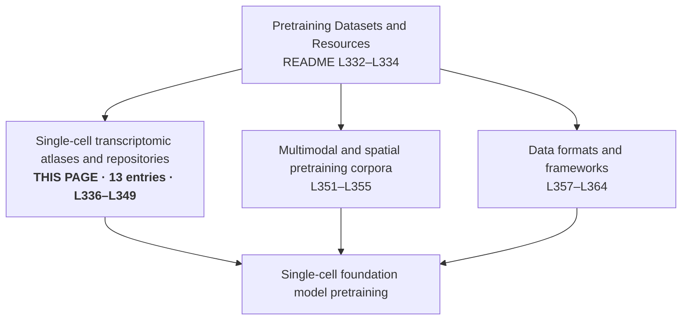
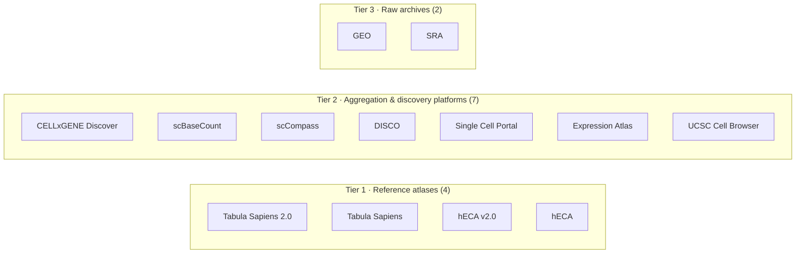
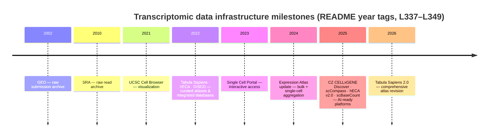

Every single-cell foundation model inherits the statistical structure — and the biases — of the corpus it was pretrained on. This page documents the **supply side** of that equation: the curated transcriptomic atlases, aggregation platforms, and raw-data repositories cataloged in this repository as the substrate for scFM pretraining. The source material is a single 13-entry subsection of the README, ordered newest-first, spanning 24 years of infrastructure evolution — from the raw submission archives of the early 2000s to today's "AI-ready" ensemble cell atlases.

This page sits inside the **Data Foundations** cluster of the Deep Dive track, immediately before its two sibling pages on multimodal corpora and data formats. Readers arriving from the model-centric pages ([Unimodal scRNA-seq Models](5-unimodal-scrna-seq-models) onward) will find here the answer to the question those pages raise implicitly: *where does the training data actually come from?*

Sources: [README.md](/README.md#L332-L334), [README.md](/README.md#L336-L349)

## Position in the Data Foundations Stack

The README groups all data-layer resources under one top-level section, **"Pretraining Datasets and Resources"**, whose framing sentence defines their shared purpose: *"Large-scale atlases, multimodal corpora, and data frameworks used for pretraining and preprocessing single-cell foundation models."* Within that section, three subsections divide the data layer by scope, and the catalog entry for this page is the first of the three:

The prerequisite for reading this diagram is the catalog itself: the README's table of contents declares the same three children under the same parent, so the layering above is the repository's own structure, not an external interpretation. This page covers only the first branch — single-modality transcriptomic data at atlas and repository scale. Anything multimodal (spatial, protein, paired RNA/ATAC *training corpora*) is deliberately deferred to the sibling page, and the tooling that turns these resources into trainable tensors belongs to the formats-and-frameworks page.

Sources: [README.md](/README.md#L332-L334), [README.md](/README.md#L57-L60), [README.md](/README.md#L351-L364)

## The Inventory: 13 Resources, Three Functional Tiers

The 13 entries are not homogeneous. Reading their self-descriptions side by side, they resolve cleanly into three tiers that differ in *what kind of artifact they are*: a scientific reference (an atlas), an engineered system (a platform or database), or a storage primitive (an archive). The README records each entry with a year tag, venue, one-line description, and paper link — one entry additionally carries a live portal link:

| # | Resource | Year · Venue | Self-description (verbatim from README) | Tier |
|---|----------|--------------|------------------------------------------|------|
| 1 | **Tabula Sapiens 2.0** | 2026 · Cell | "A comprehensive transcriptomic atlas of human cell types" | 1 |
| 2 | **scBaseCount** | 2025 · bioRxiv | "An AI agent-curated, uniformly processed, and continually expanding single-cell data repository" | 2 |
| 3 | **hECA v2.0** | 2025 · Scientific Data | "An AI-ready ensemble cell atlas of single-cell RNA and ATAC sequencing data" | 1 |
| 4 | **scCompass** | 2025 · Advanced Science | "An Integrated Multi-Species scRNA-seq Database for AI-Ready" | 2 |
| 5 | **CZ CELLxGENE Discover** | 2025 · Nucleic Acids Research | "A single-cell data platform for scalable exploration, analysis and modeling of aggregated data" | 2 |
| 6 | **Expression Atlas** (update) | 2024 · Nucleic Acids Research | "Insights from sequencing data at both bulk and single cell level" | 2 |
| 7 | **Single Cell Portal** | 2023 · bioRxiv | "An interactive home for single-cell genomics data" | 2 |
| 8 | **Tabula Sapiens** | 2022 · Science | "A multiple-organ, single-cell transcriptomic atlas of humans" | 1 |
| 9 | **hECA** | 2022 · iScience | "The cell-centric assembly of a cell atlas" | 1 |
| 10 | **DISCO** | 2022 · Nucleic Acids Research | "A database of deeply integrated human single-cell omics data" | 2 |
| 11 | **UCSC Cell Browser** | 2021 · Bioinformatics | "Visualize your single-cell data" | 2 |
| 12 | **SRA** | 2010 · Nucleic Acids Research | "The Sequence Read Archive" | 3 |
| 13 | **GEO** | 2002 · Nucleic Acids Research | "Gene Expression Omnibus" | 3 |

The classification above is derived purely from each entry's README description — for example, DISCO is placed in Tier 2 because it self-identifies as "a database of deeply integrated" data rather than a primary atlas, and UCSC Cell Browser in Tier 2 because its stated function is visualization rather than curation. Note also a formatting convention that matters when scanning this file: entries are listed in **strict reverse-chronological order**, so the newest resources (2026, 2025) appear at the top and the two archives anchor the bottom.

Sources: [README.md](/README.md#L337-L349)

## Tier 1 — Curated Reference Atlases

Four entries constitute the reference-atlas tier, and they form two distinct **versioned lineages**, which is the tier's most instructive structural pattern:

| Lineage | First release | Current release | Character of the upgrade |
|---------|--------------|-----------------|---------------------------|
| Tabula Sapiens | [2022 Science](https://doi.org/10.1126/science.abl4896) — "a multiple-organ, single-cell transcriptomic atlas of humans" | [2026 Cell](https://www.cell.com/cell/fulltext/S0092-8674(26)00937-2) — "a comprehensive transcriptomic atlas of human cell types" | From organ coverage → comprehensive *cell-type* coverage |
| hECA | [2022 iScience](https://doi.org/10.1016/j.isci.2022.104318) — "the cell-centric assembly of a cell atlas" | [2025 Scientific Data](https://www.nature.com/articles/s41597-025-06426-2) — "an AI-ready ensemble cell atlas of single-cell RNA and ATAC sequencing data" | From assembly concept → AI-ready, RNA + ATAC ensemble |

Both lineages illustrate the same trajectory: a foundational human atlas published as primary research (Science, iScience) is later re-released as versioned infrastructure in venues that signal dataset-as-product intent (Cell for the flagship revision; *Scientific Data* — a journal explicitly for describable, reusable datasets — for hECA v2.0). The hECA lineage additionally shows modality expansion: v2.0 spans "single-cell RNA **and ATAC** sequencing data," making it the only Tier 1 entry that reaches beyond transcriptomics — though its transcriptomic core keeps it in this page's scope, its full multi-omic role is better understood alongside the sibling corpora page.

Sources: [README.md](/README.md#L337-L345)

## Tier 2 — Aggregation and Discovery Platforms

Seven entries form the platform tier, and their descriptions reveal a **shift from "browse the data" to "train on the data"** across the 2021–2025 window:

| Resource | Year | Primary function (per README) | Modeling-relevant signal |
|----------|------|-------------------------------|---------------------------|
| **CZ CELLxGENE Discover** | 2025 | "Scalable exploration, analysis **and modeling** of aggregated data" | Only entry in the section with a live `[[portal]]` link |
| **scBaseCount** | 2025 | "AI **agent-curated**, uniformly processed, continually expanding" | Automation + uniform preprocessing + growth by design |
| **scCompass** | 2025 | "Integrated **Multi-Species** scRNA-seq Database for AI-Ready" | Cross-species scope, explicit AI-readiness |
| **DISCO** | 2022 | "Deeply integrated human single-cell omics data" | Integration as the core value |
| **Single Cell Portal** | 2023 | "An interactive home for single-cell genomics data" | Human-facing interactivity |
| **Expression Atlas** | 2024 | "Sequencing data at both **bulk and single cell** level" | Bridges bulk and single-cell contexts |
| **UCSC Cell Browser** | 2021 | "Visualize your single-cell data" | Visualization utility |

Three descriptions deserve emphasis. First, CZ CELLxGENE Discover is phrased in explicitly computational terms — "exploration, analysis and **modeling** of aggregated data" — and it is the sole resource in this section accompanied by a live portal link (`cellxgene.cziscience.com`), which makes it the most direct entry point from this page to working infrastructure. Second, scBaseCount's "AI agent-curated, uniformly processed, and continually expanding" is the only description in the entire section that names an *operational pipeline* rather than a static dataset — uniform processing plus continuous expansion is precisely the property profile a pretraining corpus demands. Third, scCompass is the section's only multi-species entry, complementing the otherwise human-centric Tier 1.

> [!TIP]
> When building a pretraining pipeline from this page, CZ CELLxGENE Discover is the pragmatic first stop: it is the only Tier 2 resource whose README description names *modeling* as a first-class capability and the only one with a live `[[portal]]` link (README L341) — every other entry links to a paper alone. For programmatic access, start from the portal and use the paper (NAR 2025) as the schema reference.

Sources: [README.md](/README.md#L338-L348), [README.md](/README.md#L341)

## Tier 3 — Raw Data Archives

The tier-3 pair — **GEO** (Gene Expression Omnibus, 2002) and **SRA** (Sequence Read Archive, 2010) — are the section's oldest entries by more than a decade, and their presence in a 2026-curated foundation-model reading list is not vestigial. They serve a different role from Tiers 1–2: they are the **provenance layer**. Atlases and platforms aggregate and process raw submissions that ultimately live in these archives, so they are where a developer goes to trace a processed cell back to its original sequencing run, retrieve raw reads for reprocessing under a different pipeline, or submit new data that future atlases will aggregate. Their inclusion directly beneath the AI-ready platforms makes the dependency direction legible: everything above them, in some sense, compiles down from them.

Sources: [README.md](/README.md#L348-L349)

## A 24-Year Arc: From Submission Archives to AI-Ready Repositories

Because every entry carries a year tag, the section doubles as a timeline of how the field's data infrastructure evolved. Read in chronological order, the sequence is: raw archives (2002–2010) → visualization (2021) → curated human atlases and integrated databases (2022) → interactive portals (2023) → cross-context aggregation (2024) → **explicitly AI-ready platforms** (2025) → comprehensive atlas revision (2026):

The pattern is consistent with the repository's overall thesis: as foundation models matured (see the model families documented from [Taxonomy of Single-Cell Foundation Models](4-taxonomy-of-single-cell-foundation-models) onward), the data layer reorganized itself around their needs. The vocabulary shift in the resource descriptions is the evidence — "AI-ready" appears in three of the four 2025 entries (scCompass, hECA v2.0) and 2026's flagship atlas revision, a term entirely absent from the pre-2024 entries. The infrastructure did not merely grow; it *rebranded around model consumption*.

Sources: [README.md](/README.md#L337-L349)

## Choosing a Resource: Developer Decision Guide

The three tiers are complements, not competitors — each answers a different engineering question. The following decision table maps common pretraining and analysis tasks to the section's resources, with every recommendation grounded in the README's own descriptions:

| If you need… | Start with | Why (grounded in README description) |
|--------------|-----------|--------------------------------------|
| A human cell-type reference for annotation / embedding evaluation | Tabula Sapiens 2.0 | "Comprehensive transcriptomic atlas of human cell types" |
| A large aggregated pretraining pool | CZ CELLxGENE Discover; scBaseCount | Explicitly built for "modeling of aggregated data"; "uniformly processed, continually expanding" |
| Cross-species transcriptomic data | scCompass | The section's only "Multi-Species" database |
| RNA + ATAC ensemble at atlas scale | hECA v2.0 | "AI-ready ensemble cell atlas of single-cell RNA and ATAC" |
| Continuously growing, uniformly preprocessed data | scBaseCount | "Continually expanding" with uniform processing |
| Interactive data exploration before committing | Single Cell Portal; UCSC Cell Browser; CELLxGENE | "Interactive home"; "visualize your single-cell data" |
| Bulk–single-cell contextual comparison | Expression Atlas | Covers "both bulk and single cell level" |
| Raw reads / provenance tracing | GEO; SRA | The archival substrate beneath all processed resources |

A final structural observation for maintainers and heavy users of this list: the atlas resources here are **living, versioned artifacts**, not frozen snapshots — the Tabula Sapiens and hECA lineages each carry a superseded first release and an active current release within this single section. When citing these resources in reproducibility documentation or dataset manifests, pin the specific version and year rather than the project name, since the README itself distinguishes them as separate entries.

> [!TIP]
> Treat this section's reverse-chronological ordering as a freshness signal when scanning the raw file: line 337 (2026) to line 349 (2002) means the top of the subsection is where newly curated AI-ready resources accumulate. If you are diffing the README over time to detect new data resources, watch lines 337–341 — that is where the 2025–2026 additions landed.

Sources: [README.md](/README.md#L336-L349)

## Where to Go Next

This page covered the single-modality transcriptomic supply side. The natural continuations, in the order they appear in the catalog:

- **[Multimodal Pretraining Corpora](15-multimodal-pretraining-corpora)** — the sibling subsection (README L351–L355) covering paired-omics and spatial training corpora such as SCARF/X-Omics, SpatialCorpus-110M, and SToCorpus-88M. Go here when your pretraining needs exceed transcriptomics alone.
- **[Analysis Frameworks and Data Formats](16-analysis-frameworks-and-data-formats)** — the third data-foundations subsection (README L357–L364): Scanpy/AnnData, Seurat, scvi-tools, and scalable loaders. Go here to convert the resources on this page into trainable tensors.
- **[Perturbation Atlases and Datasets](10-perturbation-atlases-and-datasets)** — perturbation-scale data (Tahoe-100M, X-Atlas/Orion, PerturBase) lives under the Genetic Perturbation cluster, deliberately separated from these observational atlases. Go here for intervention data.
- **[Infrastructure and Model Platforms](19-infrastructure-and-model-platforms)** — when atlas-scale data requires serving and query layers (e.g., the Arc Virtual Cell Atlas work cataloged there), the infrastructure cluster picks up where this page ends.
