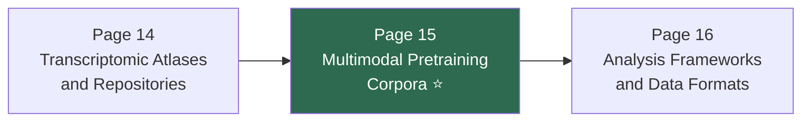
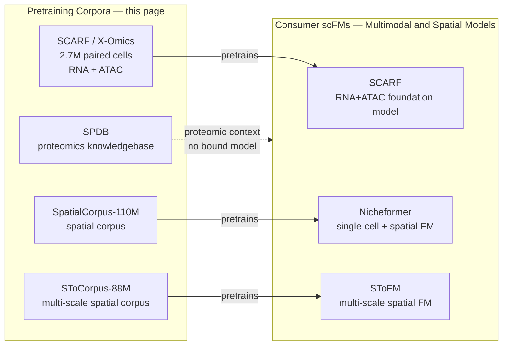

This page documents the **multimodal and spatial pretraining corpora** cataloged by the `awesome-foundation-model-single-cell-papers` repository. While the model-centric pages of this documentation track classify foundation models by architecture and modality, this page focuses on the **raw data fuel** — the large-scale, multi-omic corpora that make multimodal and spatial pretraining possible. The section is deliberately compact: four curated entries spanning paired transcriptome–chromatin data, massive spatial corpora, and single-cell proteomics, each mapped to the foundation model it was built to train.

## Position in the Catalog
This page is the middle node of the repository's **Data Foundations** track, sandwiched between single-omic atlas repositories upstream and data-engineering frameworks downstream. The parent chapter is defined as "Large-scale atlases, multimodal corpora, and data frameworks used for pretraining and preprocessing single-cell foundation models," and the catalog explicitly reserves this page for the multimodal corpora subcategory. Understanding this position prevents content drift: corpora here are pretraining *inputs*, not analysis *tooling*.



The repository itself is a single curated README — the entire catalog lives in one file, with this corpus section at lines 351–355:

```
.
├── LICENSE
├── README.md          ← full catalog; corpus section: L351-L355
└── figs/
    └── evo_tree.png   ← evolutionary tree of scFMs (context image)
```


Sources: [README.md](README.md#L57-L60), [README.md](README.md#L332-L334), [README.md](README.md#L22-L24)

## Boundary Rules: What Belongs Here (and What Doesn't)
The Data Foundations chapter applies a three-way partition, and each boundary is worth stating precisely. **Single-omic transcriptomic atlases** (Tabula Sapiens 2.0, CZ CELLxGENE Discover, hECA, DISCO, GEO/SRA) live on the previous page — they are massive but single-modality. **Processing and loading tooling** (Scanpy/AnnData, scvi-tools, Seurat, scDataset, Pertpy) lives on the next page. Only entries whose defining feature is *modality composition beyond a single omic* — paired RNA+ATAC measurements, spatial transcriptomics, single-cell proteomics — qualify for this page. This mirrors the repository's model taxonomy, where multimodal scFMs are defined as models that "jointly encode complementary modalities — transcriptomic, epigenomic, proteomic, perturbational and spatial."

Sources: [README.md](README.md#L336-L349), [README.md](README.md#L351-L355), [README.md](README.md#L357-L364), [README.md](README.md#L147-L149)

## The Corpus Inventory
The section contains exactly four entries. Three follow a **model-bound naming convention** — the corpus is named after (or paired with) the specific foundation model it trains — while the fourth is a standalone community knowledgebase:

| Corpus | Venue / Year | Modality Composition | Scale | Bound Model | Entry Type |
|---|---|---|---|---|---|
| **SCARF / X-Omics** | bioRxiv 2025 | scRNA-seq + scATAC-seq (paired) | 2.7M cells | SCARF | Model-bound corpus |
| **SpatialCorpus-110M** | Nature Methods 2025 | Spatial transcriptomics | 110M (encoded in name) | Nicheformer | Model-bound corpus |
| **SToCorpus-88M** | ICML 2025 | Spatial transcriptomics, multi-scale | 88M (encoded in name) | SToFM | Model-bound corpus |
| **SPDB** | Nucleic Acids Research 2024 | Single-cell proteomics | Knowledgebase (curated) | None | Community resource |

Sources: [README.md](README.md#L351-L355)

## Model-Bound Corpora: Named Fuel for Named Models
The dominant pattern in this section is **corpus–model co-release**: a foundation model paper ships alongside a named, versioned pretraining corpus, so the data lineage of the published model is explicit. The data flow is unambiguous:



> [!TIP]
> The corpus–model pairing creates a **traceability contract**: if you are reproducing SCARF, Nicheformer, or SToFM, you do not need to reverse-engineer their training data mixture — fetch the corpus artifact registered under the same paper. This is why the catalog records them as named corpora rather than folding them into generic atlases.

Sources: [README.md](README.md#L351-L355), [README.md](README.md#L147-L149)

### SCARF / X-Omics — 2.7M Paired RNA + ATAC Cells
Listed as "SCARF / X-Omics: a 2.7M-cell scRNA-seq/scATAC-seq pretraining corpus," this is the section's only **paired-measurement** entry: each cell carries joint transcriptomic and chromatin-accessibility readouts. Its consumer model, SCARF (Single Cell ATAC-seq and RNA-seq Foundation model), is cataloged separately in the *Multi-omics: RNA, ATAC and Protein* subsection of the multimodal model landscape, making this corpus the concrete data counterpart to that architecture.

Sources: [README.md](README.md#L352), [README.md](README.md#L197)

### SpatialCorpus-110M — Nicheformer's Pretraining Corpus
Cataloged under Nature Methods 2025 as the "Nicheformer pretraining corpus," SpatialCorpus-110M carries its scale in its own name — 110 million spatially resolved cells. Nicheformer is described in the model catalog as "a foundation model for single-cell and spatial omics," meaning the corpus serves dual coverage: it trains representations that span both dissociated single-cell data and spatially contextualized tissue data.

Sources: [README.md](README.md#L353), [README.md](README.md#L180)

### SToCorpus-88M — SToFM's Multi-Scale Spatial Corpus
The ICML 2025 entry pairs SToCorpus-88M with SToFM, which the model catalog describes as "a Multi-scale Foundation Model for Spatial Transcriptomics." The corpus naming again encodes scale (88M), and its consumer model differs architecturally from Nicheformer by targeting **multi-scale** spatial representation — from subcellular molecular structure up through tissue-level organization — which is the distinctive axis this corpus supports.

Sources: [README.md](README.md#L354), [README.md](README.md#L179)

## SPDB: The Knowledgebase Alternative
The fourth entry breaks the model-bound pattern. SPDB (2024, Nucleic Acids Research) is described as "a comprehensive resource and knowledgebase for proteomic data at the single-cell resolution." It is not tied to any specific foundation model in the catalog; instead, it functions as shared community infrastructure — a curated aggregation of single-cell proteomics data that any future proteomic or RNA+protein multimodal model (such as co-assayed RNA+protein approaches like CAPTAIN) could draw from. For developers, treat SPDB as a **discovery layer** rather than a ready-made training corpus: you assemble the pretraining set from it, rather than downloading a fixed corpus artifact.

> [!TIP]
> When evaluating whether a new multimodal corpus belongs on your reading list, classify it first as **model-bound** (fixed artifact, exact reproducibility) or **knowledgebase** (queryable aggregation, assembly required). The catalog's four entries cleanly illustrate both categories.

Sources: [README.md](README.md#L355), [README.md](README.md#L196)

## Structural Pattern: The Scale–Pairing Trade-off
A quantifiable pattern emerges across the four entries: the only corpus built on **paired measurements** is the smallest by roughly two orders of magnitude, while the spatial corpora — unpaired, single-omic-per-spot data — reach 88M–110M scale. This is verifiable directly from the documented figures (2.7M vs. 88M vs. 110M) and reflects a real experimental constraint: jointly assaying RNA and ATAC in the same cell is technically expensive, whereas spatial transcriptomics platforms generate data at industrial scale. The practical consequence for developers planning multimodal pretraining is a fork in the road:

| Strategy | Example Corpus | Scale Achievable | Information Gained |
|---|---|---|---|
| Paired co-assay pretraining | SCARF / X-Omics | 2.7M cells | Within-cell RNA↔ATAC coupling |
| Large-scale single-omic spatial pretraining | SpatialCorpus-110M, SToCorpus-88M | 88M–110M cells | Tissue context at massive scale |

Sources: [README.md](README.md#L352-L354)

## Suggested Reading Progression
To contextualize this page within the Deep Dive track, we recommend this progression. Start with the **taxonomy** to see where multimodal corpora fit in the model design landscape; then study the **consumer models** that these corpora train; return here with that context; and finish with the **frameworks** page to learn how such corpora are loaded and processed at scale:

1. [Taxonomy of Single-Cell Foundation Models](4-taxonomy-of-single-cell-foundation-models) — the classification framework this catalog follows
2. [Multimodal and Spatial Models](7-multimodal-and-spatial-models) — the model-side counterpart of every corpus documented here
3. [Transcriptomic Atlases and Repositories](14-transcriptomic-atlases-and-repositories) — the single-omic predecessor: where massive RNA-only pretraining data lives
4. [Analysis Frameworks and Data Formats](16-analysis-frameworks-and-data-formats) — the engineering layer: AnnData, scDataset, and the tooling that ingests these corpora
