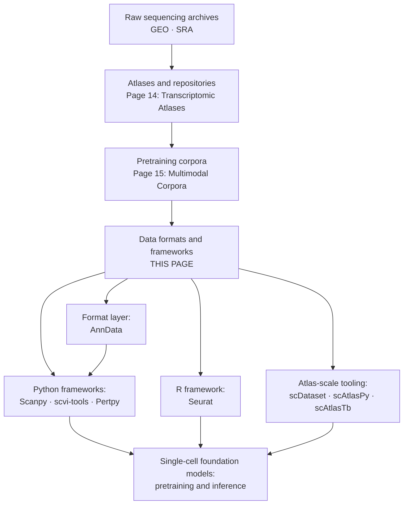
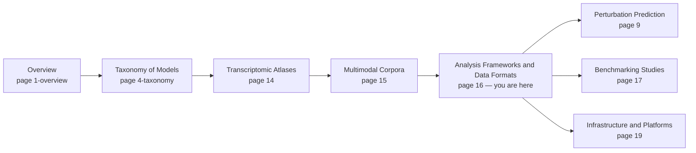

This page maps the **"Data formats and frameworks"** subsection of the curated list *Awesome Foundation Models for Single-Cell*. It collects **seven entries (2018–2026)** that form the software substrate of single-cell foundation models: the file formats that store cell data, the analysis frameworks that manipulate it, and the emerging tooling that makes atlas-scale computation possible. If you are new to this field, treat this page as your **tooling orientation layer** — every foundation model paper you read elsewhere in this catalog assumes fluency with what is documented here.

Sources: [README.md](README.md#L357-L364), [README.md](README.md#L39-L70)

## Where This Page Sits in the Catalog
The repository organizes its data resources under a parent section, *Pretraining Datasets and Resources*, which is explicitly described as covering "large-scale atlases, multimodal corpora, and data frameworks used for pretraining and preprocessing single-cell foundation models." This three-part structure mirrors an actual data pipeline: raw sequencing data flows into curated **atlases** (covered in [Transcriptomic Atlases and Repositories](14-transcriptomic-atlases-and-repositories)), gets packaged into **pretraining corpora** (covered in [Multimodal Pretraining Corpora](15-multimodal-pretraining-corpora)), and is ultimately handled by the **formats and frameworks** on this page. Foundation models never consume raw sequencing output directly — they consume matrices shaped, cleaned, and loaded by the tools listed here, which is exactly why this section exists as the final step of the data foundation.

Sources: [README.md](README.md#L332-L334), [README.md](README.md#L336-L355)

## The Core Stack: AnnData, Scanpy, and Seurat
The two oldest entries in this section are also the most fundamental. **Scanpy / AnnData** (2018, *Genome Biology*) is cataloged as enabling "large-scale single-cell gene expression data analysis," and **Seurat** (2019, *Cell*) as providing "comprehensive integration of single-cell data." Conceptually, both revolve around a data object that pairs a **gene-expression count matrix** (genes × cells) with rich **annotations** — cell metadata, gene metadata, and derived results like embeddings and clusters. AnnData is the Python-side format; Seurat defines its own object in R. For a beginner, the practical takeaway from this catalog's structure is clear: the Python ecosystem (Scanpy → scvi-tools → Pertpy) chains together around AnnData, while Seurat is the dominant choice in R-centric interactive analysis workflows.

| Dimension | Scanpy / AnnData | Seurat |
|---|---|---|
| Language | Python | R |
| Catalog entry | 2018, *Genome Biology* | 2019, *Cell* |
| Data object | AnnData | Seurat object |
| Typical role | Programmatic pipelines, foundation-model workflows | Interactive analysis and exploration |
| Beginner guidance | **Start here** — this is the field's default stack | Read if your lab is R-based |

> [!TIP]
> Learn the AnnData object model once, and most of this catalog unlocks: the Python-side frameworks here (scvi-tools, Pertpy) and even the terabyte-scale training tooling cataloged on the infrastructure page are built around the same data object, so format fluency transfers directly to model work.

Sources: [README.md](README.md#L363-L364)

## Probabilistic Modeling with scvi-tools
The **scvi-tools** entry (2022, *Nature Biotechnology*) is described in the catalog as "a Python library for probabilistic analysis of single-cell omics data." For beginners, this entry marks the conceptual bridge between *analysis* and *foundation models*: scvi-tools packages probabilistic deep-learning models for single-cell data in a form researchers can actually train and apply. It is the framework where the data formats above meet trainable neural models — the same pattern later scaled up by the foundation models cataloged in the model-landscape pages. The catalog also shows this ecosystem maturing into infrastructure: **scvi-hub**, an actionable repository for model-driven single-cell analysis, is cataloged separately under infrastructure work, which makes it a natural follow-up destination.

Sources: [README.md](README.md#L362), [README.md](README.md#L451)

## Perturbation Analysis with Pertpy
**Pertpy** (2025, *Nature Methods*) is the task-specific entry: an "end-to-end framework for perturbation analysis." Perturbation analysis asks how cells respond when genes are disrupted — the same problem addressed by the dedicated models, atlases, and benchmarks cataloged in the perturbation cluster of this repository. Pertpy's inclusion here is architecturally meaningful: it shows the data-frameworks layer growing task-specific tooling that operates on the same data objects as the rest of the stack. Read this entry in parallel with the modeling-side pages rather than in isolation, because the framework and the models solve the same problem from complementary directions.

Sources: [README.md](README.md#L361)

## The 2026 Frontier: Atlas-Scale Data Engineering
The three newest entries share a single theme: **the in-memory ceiling**. Classic frameworks assume your dataset fits in RAM; modern pretraining corpora cataloged in this repository reach tens of millions of cells, and that assumption breaks. The catalog reflects this with:

- **scDataset** (2026, ICML) — "Scalable Data Loading for Deep Learning on Large-Scale Single-Cell Omics": solves the loading problem for model training itself.
- **scAtlasPy** (2026, bioRxiv) — "Atlas-scale single-cell analysis beyond in-memory paradigm": moves whole-atlas analysis out of RAM.
- **scAtlasTb** (2026, bioRxiv) — "Building optimized single-cell reference atlases": optimizes how reference atlases are constructed and stored in the first place.

| Tool | Year · Venue | Problem attacked | Pipeline stage |
|---|---|---|---|
| scAtlasTb | 2026 · bioRxiv | Optimizing reference atlas construction | Storage / preparation |
| scAtlasPy | 2026 · bioRxiv | Analysis beyond in-memory limits | Analysis |
| scDataset | 2026 · ICML | Scalable loading for deep learning | Training input |

> [!TIP]
> Watch the years, not just the names: all three 2026 entries in this section cluster on scale-out problems, and the infrastructure page independently catalogs sibling efforts like AnnData streaming and GPU-accelerated analysis. Memory and scale are where the field currently feels pain — a strong signal for where beginner skills will pay off.

Sources: [README.md](README.md#L358-L360), [README.md](README.md#L448-L450)

## The Seven Entries at a Glance
The table below lists every entry in this section in the repository's own order (newest first), with a beginner-oriented reading priority derived from the architectural layering above.

| Entry (as cataloged) | Year · Venue | Layer | Beginner priority |
|---|---|---|---|
| scAtlasPy: Atlas-scale single-cell analysis beyond in-memory paradigm | 2026 · bioRxiv | Atlas-scale analysis | Advanced — after Scanpy fluency |
| Building optimized single-cell reference atlases with scAtlasTb | 2026 · bioRxiv | Atlas storage/preparation | Advanced |
| scDataset: Scalable Data Loading for Deep Learning on Large-Scale Single-Cell Omics | 2026 · ICML | Training data loading | Intermediate — needed before training |
| Pertpy: an end-to-end framework for perturbation analysis | 2025 · Nature Methods | Task framework | Intermediate — pair with perturbation pages |
| scvi-tools: a Python library for probabilistic analysis of single-cell omics data | 2022 · Nature Biotechnology | Probabilistic modeling | Core — second stop |
| Seurat: Comprehensive integration of single-cell data | 2019 · Cell | Analysis framework (R) | Core for R users |
| Scanpy / AnnData: large-scale single-cell gene expression data analysis | 2018 · Genome Biology | Core stack + format | **First** |

Sources: [README.md](README.md#L357-L364)

## Your Reading Path
For a developer starting from zero, the catalog supports a clean progression. Begin with orientation pages, then walk the Data Foundations trio in pipeline order, and only then branch into the application areas this tooling serves:

Concretely: learn **AnnData/Scanpy** first, add **scvi-tools** when you want to train models, pick up **Pertpy** alongside the perturbation cluster, and save the 2026 scale-out tools for when you genuinely hit memory limits. The surrounding catalog then extends each branch: perturbation work continues in [Perturbation Prediction Frameworks](9-perturbation-prediction-frameworks), [Perturbation Atlases and Datasets](10-perturbation-atlases-and-datasets), and [Perturbation Benchmarks](11-perturbation-benchmarks); evaluation practices live in [Benchmarking Studies and Critiques](17-benchmarking-studies-and-critiques); and deployment-facing tooling continues in [Infrastructure and Model Platforms](19-infrastructure-and-model-platforms).

Sources: [README.md](README.md#L39-L70)

## Where to Go Next
This page closes the Data Foundations trilogy. Your two most valuable immediate moves: first, solidify the sibling context by reading [Transcriptomic Atlases and Repositories](14-transcriptomic-atlases-and-repositories) and [Multimodal Pretraining Corpora](15-multimodal-pretraining-corpora) — the data these frameworks operate on; second, follow the tooling forward into [Infrastructure and Model Platforms](19-infrastructure-and-model-platforms), where the format and scale work documented here continues at deployment scale. If your destination is model-building itself, proceed to the model landscape starting with [Unimodal scRNA-seq Models](5-unimodal-scrna-seq-models).