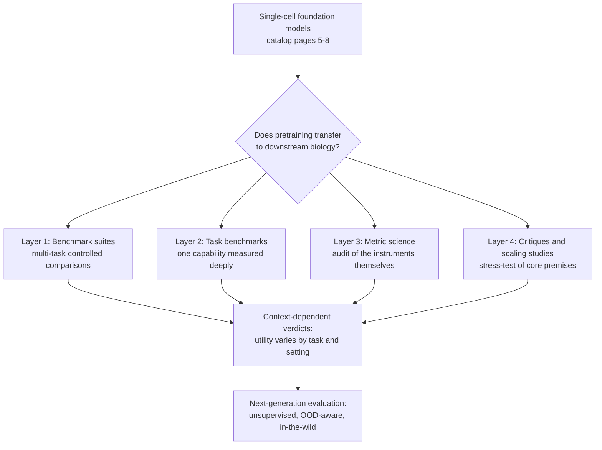
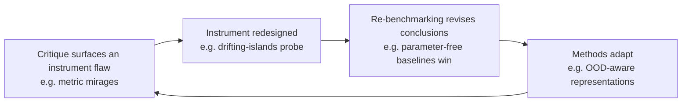

This page maps the **trust layer** of the single-cell foundation-model ecosystem: the benchmark suites, task-specific evaluations, metric audits, and skeptical critiques curated in the repository's *Benchmarks and critical evaluations* subsection. The list positions itself explicitly as "the science of evaluation" alongside the models themselves — a deliberate counterweight to the model landscape documented in [Unimodal scRNA-seq Models](5-unimodal-scrna-seq-models), [Multimodal and Spatial Models](7-multimodal-and-spatial-models), and [LLM-Based Cell Models](8-llm-based-cell-models). Boundary discipline matters here: perturbation-specific benchmarks are cataloged separately under [Perturbation Benchmarks](11-perturbation-benchmarks), and privacy-preserving techniques belong to [Privacy-Preserving Approaches](18-privacy-preserving-approaches), so this page covers only general-purpose evaluation of single-cell foundation models.

Sources: [README.md](README.md#L366-L368), [README.md](README.md#L370-L429)

## Scope and Position in the Catalog

The repository organizes evaluation content under a single top-level section — *Benchmarks and Evaluation* — whose stated scope is "benchmarks, reusability reports, and critical evaluations of single-cell foundation models, plus the science of evaluation and data-privacy considerations." That section splits into two subsections: **Benchmarks and critical evaluations** (59 entries, lines 370–429), which is the subject of this page, and **Data privacy and accessibility** (4 entries), which maps to the neighboring page on privacy-preserving approaches. The section-level framing matters for navigation: evaluation is treated as a first-class discipline in this catalog, not an appendix to the model pages.

Sources: [README.md](README.md#L366-L368), [README.md](README.md#L431-L435)

## The Evaluation Landscape at a Glance

The growth trajectory of this subsection is itself a finding. Entries cluster by publication year as 4 (2023) → 8 (2024) → 21 (2025) → 26 (2026), meaning nearly 80% of the evaluation literature in this list appeared within the last two years — evaluation science is the fastest-compounding segment of the catalog. Publication venues reinforce this signal: the section concentrates heavily in *Nature Methods* (benchmarking biomedical foundation models; scaling studies; multitask integration benchmarking), *Nature Biotechnology* (metric critiques; open-problem benchmarking), *Nature Communications*, *Genome Biology*, and *Nature Machine Intelligence*, with peer-reviewed ML-venue entries at NeurIPS, ICLR, KDD, AAAI, and WSDM. The pattern is consistent: the field's flagship methods journals have become the primary venue for auditing the field's flagship models.

| Year | Entries | Share of section | Character of the entries |
|---|---|---|---|
| 2023 | 4 | ~7% | First-wave audits: reusability reports, deep dives, early LLM evaluations |
| 2024 | 8 | ~14% | Standardized harnesses (BioLLM, scEval), first scaling studies, metric critiques begin |
| 2025 | 21 | ~36% | Metric science matures; task benchmarks proliferate; LLM-facing evaluation arrives |
| 2026 | 26 | ~44% | Dedicated suites (VCBench, SCMBench), scaling-law interrogations, negative results |

Sources: [README.md](README.md#L370-L429)

Conceptually, the 59 entries decompose into a **four-layer evaluation stack**, where each layer answers a different question about the same underlying claim — that foundation-model pretraining transfers to downstream single-cell biology:

Sources: [README.md](README.md#L370-L429)

## Layer 1: Benchmark Suites

The suite layer provides controlled, multi-task comparison harnesses. The most recent entries are purpose-built for foundation models: **VCBench** positions itself as a multi-dimensional benchmark for single-cell foundation models, **SCMBench** pits domain-specific models against foundation models specifically for multi-omics integration, and **CellBench-LS** targets the low-supervision regime that most realistic deployments inhabit. Framework-level entries — **BioLLM** (Patterns 2024) and **BMFM-RNA** (2025) — go further, offering standardized infrastructure for *building and* benchmarking transcriptomic models, which collapses the traditional separation between model development and evaluation tooling.

| Suite | Venue | Coverage focus | Distinctive angle |
|---|---|---|---|
| VCBench | bioRxiv 2026 | Single-cell foundation models | Multi-dimensional evaluation |
| SCMBench | Nature Communications 2026 | Multi-omics integration | Domain-specific vs. foundation models |
| scTranslation | KDD 2026 | Cross-modality translation | Comprehensive modality-translation benchmark |
| CellBench-LS | bioRxiv 2026 | Low-supervision scenarios | Label-scarce evaluation regime |
| BioLLM | Patterns 2024 | scFMs broadly | Standardized integration + benchmarking framework |
| BMFM-RNA | arXiv 2025 | Transcriptomic FMs | Open framework for building and evaluating |
| scEval | Advanced Science 2024 | LLMs in sc-analysis | LLM utility assessment |
| Multitask integration benchmark | Nature Methods 2025 | Multimodal omics integration | Multi-task protocol |

Sources: [README.md](README.md#L371-L396), [README.md](README.md#L409-L423)

## Layer 2: Task-Specific Benchmarks

Where suites trade depth for breadth, task benchmarks do the reverse: each entry interrogates one capability with domain-appropriate protocols. The cell-type-annotation thread is the densest, spanning a WSDM systematic evaluation of foundation models on classification, **scTab**'s cross-tissue scaling study, a hierarchical cross-entropy loss study for atlas-scale annotation, and an early investigation of foundation models on imbalanced cell-type data. Clinical translation is measured by **scDrugMap** (drug response prediction), an empirical evaluation for cancer outcome prediction, and a study showing foundation models predict durable CAR T response despite imperfect cell annotation — the latter being evidence that imperfect preprocessing tolerances matter more than leaderboard deltas in deployment.

| Capability under test | Representative entries |
|---|---|
| Cell-type classification/annotation | WSDM 2025 systematic evaluation; scTab (Nat Commun 2024); hierarchical cross-entropy (Nat Comput Sci 2026); imbalanced-data study (2023) |
| Clustering | scCluBench (AAAI 2026) |
| Multimodal integration | SCMBench (2026); multitask benchmarking (Nat Methods 2025) |
| Modality translation | scTranslation (KDD 2026) |
| Drug response / clinical endpoints | scDrugMap (Nat Commun 2025); cancer outcomes (2025); CAR T response (2026) |
| GRN inference | GeneRNIB living benchmark (2025) |
| Gene embeddings and function | Sequence/expression/network/text embedding comparison (2025); LLM gene-set function (2023); gene-importance scoring (Nat Biotechnol 2026) |
| Spatial transfer | STP-BENCH (2026); multi-scale spatial variation (2026); cross-modality reusability report (NMI 2025) |
| Dynamics and reconstruction | Zero-shot dynamics reconstruction (2026); latent-to-expression reconstruction (2026) |
| DNA language models | BEND (ICLR 2024) |
| LLM biological understanding | CellVerse (NeurIPS 2025); AnnDictionary (Nat Commun 2025); scEval (2024) |
| Virtual-cell perturbation response | In-the-wild perturbation benchmarking (2026) — adjacent to [Perturbation Benchmarks](11-perturbation-benchmarks) |

Sources: [README.md](README.md#L373-L429)

> [!TIP]
> When benchmarking your own model, reserve perturbation-response evaluation questions for the dedicated frameworks cataloged in [Perturbation Benchmarks](11-perturbation-benchmarks) (e.g., PerturBench, PertEval-scFM) — this page's general-purpose suites (VCBench, SCMBench) deliberately exclude that axis to avoid double-counting and metric entanglement.

## Layer 3: Metric Science — Auditing the Instruments

The most intellectually distinctive thread in this section does not evaluate models at all — it evaluates the *rulers*. Three 2024–2025 entries converge on the same conclusion from different angles: "Metric Mirages in Cell Embeddings," "Shortcomings of silhouette in single-cell integration benchmarking" (Nature Biotechnology), and "Limitations of cell embedding metrics assessed using drifting islands" (Nature Biotechnology). Collectively they establish that the standard quantitative vocabulary of integration and embedding quality — silhouette scores, embedding-space separation heuristics — can diverge from biological reality. A 2026 entry extends this line constructively: robustness to *nuisance perturbations* enables **unsupervised evaluation**, sidestepping annotation-dependence entirely. For benchmark designers, this layer is a prerequisite reading list; for benchmark consumers, it explains why rankings frequently disagree.

Sources: [README.md](README.md#L398-L399), [README.md](README.md#L378), [README.md](README.md#L424)

## Layer 4: Critiques — Stress-Testing Core Premises

The critique layer is where the catalog earns its credibility. The entries read as a systematic adversarial audit of the field's founding claims, and their verdicts — legible directly from the titles — are frequently negative:

| Premise under test | Published verdict | Entry |
|---|---|---|
| Pretraining beats trivial baselines | "Parameter-free representations outperform single-cell foundation models on downstream benchmarks" | 2026 arXiv |
| Attention maps encode regulation | "Attention-derived edge scores add no incremental value over gene-level features" | BMC Genomics 2026 |
| Sparse autoencoders uncover regulatory logic | "Organized biological knowledge but minimal regulatory logic" | 2026 arXiv |
| More pretraining data → proportionally better models | "Much pain with little gain" (Nat Methods 2026); "When do scaling laws hold?" | 2026 |
| Zero-shot transfer is reliable | "Zero-shot evaluation reveals limitations" | Genome Biology 2025 |
| Universal embeddings are within reach | "Batch effects remain a fundamental barrier" | 2025 |
| Embeddings are uniformly stable | "Glitch genes: embedding geometry predicts functional fragility" | 2026 |
| Deployment claims survive practice | "Accessible and reproducible deployment reveals the practical boundaries" | 2026 |
| The premise itself is sound | "Fundamental Limitations of Foundation Models in Single-Cell Transcriptomics" | 2025 |

The lineage matters for calibration: the audit began early and repeatedly. The 2023 *reusability report* on transformers learning "transcriptional grammar" and the contemporaneous "Deep Dive into Single-Cell RNA Sequencing Foundation Models" established the skeptical genre before the 2024 "Deeper evaluation of a single-cell foundation model" (Nature Machine Intelligence) formalized single-model forensic evaluation. The 2026 entries then close the loop at scale — not one model, but the paradigm, under test.

Sources: [README.md](README.md#L371-L396), [README.md](README.md#L397-L429)

> [!TIP]
> The single most consequential methodological insight from this layer for practitioners: always baseline against parameter-free representations (PCA-family) before crediting pretraining for downstream gains — the 2026 literature demonstrates this control is not optional if you intend your benchmark to survive review.

## Scaling Science: Data, Diversity, and Ablation Infrastructure

A dedicated sub-cluster interrogates the scaling premise quantitatively. The dataset-size question appears twice with a visible preprint-to-journal arc: a 2024 bioRxiv preprint, "Evaluating the role of pre-training dataset size and diversity on single-cell foundation model performance," and a 2026 Nature Methods publication of near-identical title — the three-year gap suggests the question resisted easy resolution. The verdicts that did land are bracing: scaling up training dataset size yields "much pain with little gain" (Nature Methods 2026), and the companion preprint asks directly "when do scaling laws hold?" — implying the answer is conditional. Complementing data-scaling are architecture-level ablation studies: HEIMDALL provides a modular framework for tokenization ablation, "Delineating the effective use of self-supervised learning in single-cell genomics" (Nature Machine Intelligence 2024) maps which SSL objectives actually pay off, and "Biology-driven insights into the power of single-cell foundation models" (Genome Biology 2025) grounds capability claims in biological rather than proxy metrics.

Sources: [README.md](README.md#L383-L385), [README.md](README.md#L402-L411), [README.md](README.md#L419-L421)

## Robustness, Distribution Shift, and Deployment Realism

The final evaluative axis asks whether published gains survive contact with messy data. The findings here form a coherent threat model: batch effects persist as a "fundamental barrier to universal embeddings" (2025); embedding geometry contains predictable "glitch genes" marking functional fragility (2026); utility is "context-dependent" across analytical tasks (2026); and real-world RNA-seq integration stresses models beyond curated benchmark conditions (2026). Countermeasures appear alongside the threats — USHER guides representations through distribution shifts, and nuisance-perturbation robustness doubles as an unsupervised evaluation signal. The through-line: **robustness measurement is becoming both a diagnostic and a training objective** in this literature.

Sources: [README.md](README.md#L378-L381), [README.md](README.md#L389-L392), [README.md](README.md#L401-L406)

## Interpretability as Evaluation

Two 2025–2026 sparse-autoencoder studies treat mechanistic interpretability as an evaluation instrument: the 2025 entry reports SAEs "reveal interpretable features," while the 2026 follow-up delivers the sharper verdict that models encode "organized biological knowledge but minimal regulatory logic." Combined with the attention-edge-score critique (BMC Genomics 2026) and gene-importance scoring via foundation-model interpretation (Nature Biotechnology 2026), this cluster establishes a pattern: **what a model can explain is now a benchmarked property**, separable from what it can predict.

Sources: [README.md](README.md#L375-L386), [README.md](README.md#L394-L405)

## Meta-Benchmarking and Open Problems

The section closes its loop with entries that benchmark the benchmarking enterprise itself: "Defining and benchmarking open problems in single-cell analysis" (Nature Biotechnology 2025) and "The current landscape and emerging challenges of benchmarking single-cell methods" (Briefings in Bioinformatics 2025) provide field-level roadmap documents, while "Benchmarking biomedical foundation models" (Nature Methods 2026) situates single-cell evaluation within the broader biomedical-AI evaluation discipline. These are the natural entry points for researchers designing new protocols rather than consuming existing ones.

Sources: [README.md](README.md#L371), [README.md](README.md#L397), [README.md](README.md#L416-L417)

## Suggested Reading Pathways

For advanced readers, the evidence supports three targeted progressions through the catalog. **The evaluator's path**: [Taxonomy of Single-Cell Foundation Models](4-taxonomy-of-single-cell-foundation-models) → this page's metric-science and critique layers → [Surveys and Open Challenges](21-surveys-and-open-challenges) for field-level framing. **The builder's path**: model pages ([Unimodal scRNA-seq Models](5-unimodal-scrna-seq-models), [Multimodal and Spatial Models](7-multimodal-and-spatial-models)) → scaling-science entries here → [Infrastructure and Model Platforms](19-infrastructure-and-model-platforms) for deployment tooling. **The trust-and-governance path**: this page → [Privacy-Preserving Approaches](18-privacy-preserving-approaches) → the virtual-cell accountability literature in [Virtual Cell Perspectives and Roadmaps](12-virtual-cell-perspectives-and-roadmaps), which inherits this page's evaluation vocabulary at system scale.
