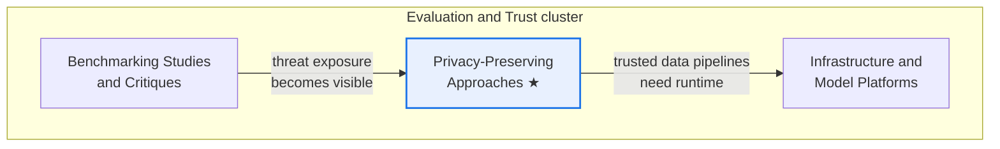
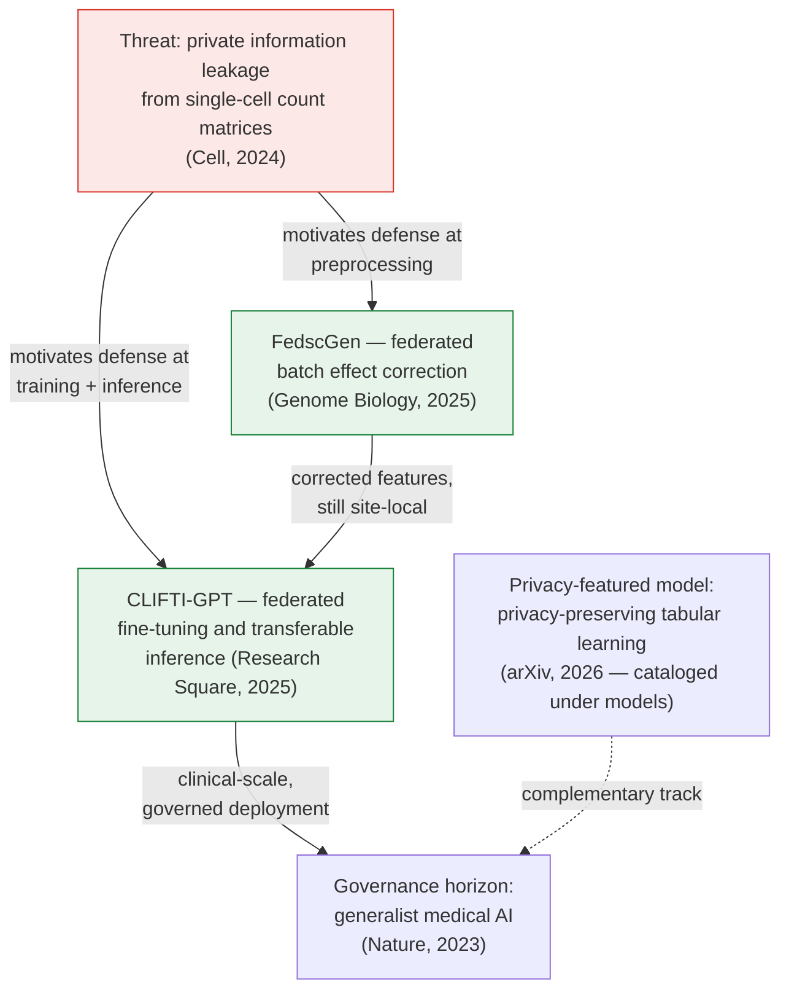
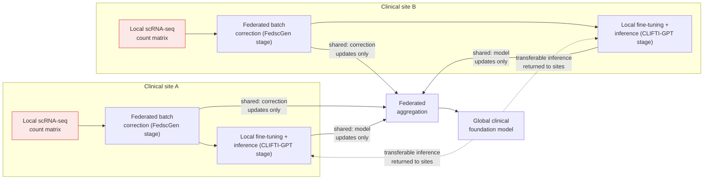

This page curates the repository's **"Data privacy and accessibility"** records — the trust-oriented counterpart to the model-centric catalog. It contains exactly four cataloged entries that form a complete narrative arc: an empirical threat characterization (identity leakage from count matrices), two federated defenses positioned at different stages of the single-cell pipeline, and a strategic governance horizon for medical-scale foundation models. The section sits inside the *Evaluation and Trust* cluster of the review's taxonomy, meaning privacy is treated here as an **evaluation axis** rather than a model design family — a deliberate architectural choice that shapes how you should read the papers.
Sources: [README.md](README.md#L10-L12), [README.md](README.md#L366-L368)

## Position in the Catalog's Trust Architecture

The section header makes the placement explicit: the parent *Benchmarks and Evaluation* section declares its scope as "Benchmarks, reusability reports, and critical evaluations of single-cell foundation models, plus the science of evaluation and **data-privacy considerations**." Privacy therefore arrives *after* the benchmarking critiques ([Benchmarking Studies and Critiques](17-benchmarking-studies-and-critiques)) and *before* deployment infrastructure ([Infrastructure and Model Platforms](19-infrastructure-and-model-platforms)) — the catalog encodes the sequence "measure the threat → trust the data → build the platform." Sources: [README.md](README.md#L366-L368), [README.md](README.md#L63)

## The Four-Entry Threat-and-Defense Stack

The cataloged entries are not a flat list; read as a stack, they cover threat, defense, and governance:

| # | Catalog entry | Venue · Year | Role in trust stack |
|---|---|---|---|
| 1 | **Private information leakage from single-cell count matrices** | Cell · 2024 | Threat characterization — why the problem exists |
| 2 | **FedscGen: privacy-preserving federated batch effect correction of single-cell RNA sequencing data** | Genome Biology · 2025 | Defense — preprocessing stage |
| 3 | **CLIFTI-GPT: Privacy-preserving federated fine-tuning and transferable inference of foundation models on clinical single-cell data** | Research Square · 2025 | Defense — training and inference stage |
| 4 | **Foundation models for generalist medical artificial intelligence** | Nature · 2023 | Governance and scale framing |

Sources: [README.md](README.md#L431-L435)

The entry point is the **threat paper**: *Private information leakage from single-cell count matrices* (Cell, 2024) establishes that single-cell expression matrices are not de-identified data in any meaningful sense — the sparse, high-dimensional per-cell profile acts as a quasi-identifier, so the section's premise is that count matrices themselves are the attack surface, not just associated metadata. This reframing is what makes the two federated entries meaningful rather than incidental: if raw matrices can never safely leave an institution, collaboration protocols must be redesigned around *what* is transmitted.
Sources: [README.md](README.md#L434)

Sources: [README.md](README.md#L431-L435)

## Federated Defense: Two Stages, One Trust Boundary

The two federated papers occupy adjacent, composable stages of the pipeline rather than competing alternatives. **FedscGen** federates *batch effect correction* — the preprocessing step every multi-site scRNA-seq analysis requires — meaning the privacy boundary is enforced before any model training begins. **CLIFTI-GPT** federates *fine-tuning and inference* of foundation models on clinical single-cell data, meaning the boundary is enforced at the deployment end, where patient-level clinical data is most sensitive and regulatory exposure is highest. Together they imply a design in which raw count matrices never transit an institutional boundary at any pipeline stage.
Sources: [README.md](README.md#L433), [README.md](README.md#L432)

| Dimension | FedscGen | CLIFTI-GPT |
|---|---|---|
| Pipeline stage | Preprocessing (batch correction) | Fine-tuning + inference |
| Data domain | Single-cell RNA-seq | Clinical single-cell data on foundation models |
| Defining capability | Privacy-preserving correction across sites | Transferable inference without raw-data export |
| Trust boundary position | Upstream of model training | Downstream, at deployment |
| Venue · Year | Genome Biology · 2025 | Research Square · 2025 |

Sources: [README.md](README.md#L433), [README.md](README.md#L432)

> [!TIP]
> The catalog's ordering encodes a pipeline dependency: FedscGen-style federated correction produces harmonized but still site-local features, which are exactly the input regime CLIFTI-GPT-style federated fine-tuning assumes. Treat them as two layers of one federated lifecycle, not as alternative solutions to pick between.

The lifecycle implied by the two entries, with raw matrices confined to each site:

Sources: [README.md](README.md#L432-L433)

## Governance Horizon and Cross-Catalog Signals

The final entry, *Foundation models for generalist medical artificial intelligence* (Nature, 2023), is the strategic anchor: the GMAI vision argues that medical foundation models will only reach clinical generality if governance, privacy-preserving infrastructure, and accessibility are designed in from the start — which is why the catalog files it under privacy rather than under the medical-AI surveys. It converts the preceding threat-plus-defense pairing into a deployment-level mandate, and it is the oldest entry in the section, predating both federated implementations.
Sources: [README.md](README.md#L435), [README.md](README.md#L431-L435)

One further privacy signal lives outside this section by design: **"Predictive single cell foundation model for gene regulation and aging with privacy-preserving tabular learning"** (arXiv, 2026) is cataloged under the scRNA-seq model families, because its primary contribution is model architecture with privacy as a training constraint rather than privacy as the object of study. Consult it via [Unimodal scRNA-seq Models](5-unimodal-scrna-seq-models) when you need the model-design perspective; the data-accessibility dimension of privacy sits with the atlas repositories in [Transcriptomic Atlases and Repositories](14-transcriptomic-atlases-and-repositories).
Sources: [README.md](README.md#L84), [README.md](README.md#L336-L349)

> [!TIP]
> When contributing new entries, respect this filing logic: papers whose contribution is a privacy *mechanism* (federated protocols, leakage analyses, governance frameworks) belong in this section; papers that merely *use* privacy-preserving training among other contributions belong under their model family. The section stays small and high-signal precisely because of this boundary.

## Recommended Reading Path and Navigation

For an advanced reader, the section rewards reading in threat-first order: start with the Cell 2024 leakage paper to internalize why count matrices are quasi-identifiers, then read FedscGen to see the preprocessing-stage defense, then CLIFTI-GPT for the training/inference-stage defense on clinical data, and close with the Nature 2023 GMAI paper to see how the pieces compose into a governance argument.
Sources: [README.md](README.md#L431-L435)

To continue through the catalog, move **backward** to the sibling critiques in [Benchmarking Studies and Critiques](17-benchmarking-studies-and-critiques) if your concern is evaluation reliability, or **forward** to [Infrastructure and Model Platforms](19-infrastructure-and-model-platforms) to see where privacy-preserving pipelines would physically run. For orientation on the full model landscape this trust cluster evaluates, return to the [Overview](1-overview) and the [Taxonomy of Single-Cell Foundation Models](4-taxonomy-of-single-cell-foundation-models).
Sources: [README.md](README.md#L39-L70)