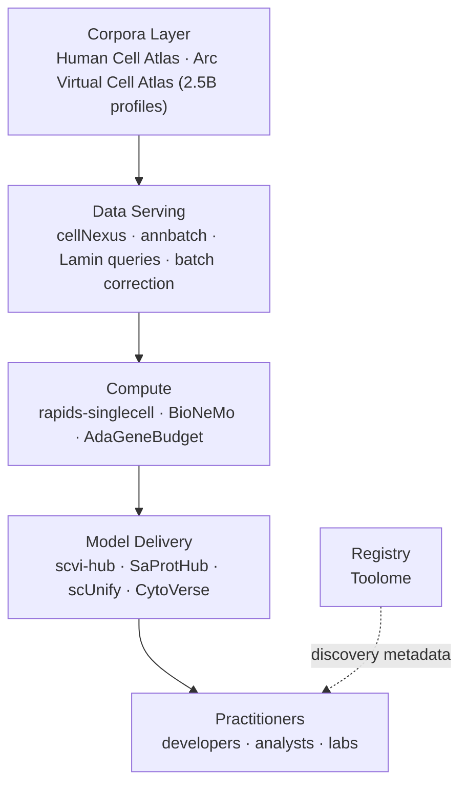

This page covers the systems layer of the single-cell foundation model (scFM) ecosystem: the platforms, model repositories, and scalable infrastructure that turn pretrained cell models from research artifacts into usable engineering services. It maps directly to the **"Infrastructure and platforms"** subsection of the curated reading list, within the broader "Infrastructure, Platforms and AI Agents" section. Entries covering AI-agent systems and lab-in-the-loop discovery are deliberately excluded here and treated on the following page.

Sources: [README.md](README.md#L437-L441), [README.md](README.md#L64-L67)

## Scope: Where Infrastructure Sits in the Landscape

The reading list frames this section as covering "platforms, model repositories, and scalable infrastructure for scFMs" — the connective tissue between the model landscape (documented across the catalog's core model pages) and real-world application. While models define *what* can be computed over single-cell data, infrastructure defines *how* it is stored, streamed, accelerated, served, and discovered. The evolutionary tree below situates the model families that this infrastructure ultimately serves.

Sources: [README.md](README.md#L437-L439), [README.md](README.md#L11-L24)

## The Layered Architecture of the scFM Infrastructure Stack

Across its thirteen entries, the section exhibits a consistent layered pattern recognizable to anyone who has built ML serving systems. At the bottom sits the **corpora layer** (the Human Cell Atlas and the Arc Virtual Cell Atlas with its 2.5B transcriptional profiles). Above it, a **data serving layer** handles quality control, annotation aggregation, terabyte-scale batching, and querying. A **compute layer** provides GPU acceleration and token-budget efficiency. Finally, a **model delivery layer** exposes models through hubs, browsers, and unified inference interfaces, with a standalone **registry layer** for tool discovery. The diagram below traces this dependency flow.

> [!TIP]
> Reading this section as a stack rather than a flat list is the key interpretive move: entries like `annbatch` and `cellNexus` are prerequisites for the delivery-layer tools, since hub-served models still need terabyte-scale training data moved through them.

Sources: [README.md](README.md#L441-L454)

## Data Serving: From Billion-Profile Atlases to Training Batches

The data serving entries attack the scale problem from complementary angles. **annbatch** (2026, arXiv) unlocks terabyte-scale training of biological data stored in AnnData — the de facto container format — by turning on-disk corpora into streaming training batches. **cellNexus** (2026, bioRxiv) builds quality control, annotation, aggregation, and analytical layers on top of Human Cell Atlas data, addressing the curation side of scale. The **Lamin blog entry** (2026) demonstrates a query layer over the 2.5B transcriptional profiles of the Arc Virtual Cell Atlas, showing how billion-profile corpora become addressable. Finally, the Nature Computational Science piece on **informed batch correction** (2026) tackles the harmonization problem that any cross-dataset training pipeline must solve before data can be pooled at scale.

| Entry | Venue/Year | Data-Serving Role | Primary Artifact |
|---|---|---|---|
| annbatch | arXiv 2026 | Streaming training batches from AnnData at terabyte scale | Data loader |
| cellNexus | bioRxiv 2026 | QC, annotation, aggregation layers for Human Cell Atlas | Data platform |
| Lamin / Arc VCA queries | Lamin Blog 2026 | Query access to 2.5B transcriptional profiles | Query interface |
| Informed batch correction | Nat. Comput. Sci. 2026 | Principled integration of heterogeneous batches | Methodology |

> [!TIP]
> Note the boundary: `annbatch` is listed here rather than on the data-formats page because its contribution is *training-scale ingestion* of existing AnnData containers, not format definition itself. Keep that distinction in mind when cross-referencing.

Sources: [README.md](README.md#L444-L448), [README.md](README.md#L64-L67)

## Compute Acceleration and Token-Efficient Inference

The compute entries address cost from two directions: hardware-level parallelism and model-level token economics. **rapids-singlecell** (2026, arXiv) provides GPU-accelerated single-cell analysis at scale, moving the standard analysis stack onto device memory. **BioNeMo** (2024, arXiv) contributes a modular, high-performance library for AI model development in drug discovery — the framework-level option when teams need to train rather than merely run models. **AdaGeneBudget** (2026, bioRxiv) operates at a finer granularity: cell-adaptive gene-token allocation makes scFM inference efficient by spending the token budget where each cell's biology demands it, rather than uniformly across the vocabulary. Together these entries form a cost-control toolkit spanning kernel, framework, and tokenization levels.

| Entry | Venue/Year | Acceleration Level | Mechanism |
|---|---|---|---|
| rapids-singlecell | arXiv 2026 | Kernel / analysis stack | GPU acceleration of single-cell operations |
| BioNeMo framework | arXiv 2024 | Training framework | Modular high-performance model development |
| AdaGeneBudget | bioRxiv 2026 | Model input | Cell-adaptive gene-token allocation |

Sources: [README.md](README.md#L442-L453)

## Model Hubs, Browser Access, and Unified Inference

The delivery layer is where the section's democratization thesis becomes concrete, and it splits into four distinct access models. **scvi-hub** (2025, Nature Methods) is an actionable repository for model-driven single-cell analysis — the closest analogue to a Hugging Face-style hub native to the scvi-tools ecosystem. **SaProtHub** (2025, Nature Biotechnology) and **ColabFold** (2022, Nature Methods) are protein-domain entries, but the list includes them as architectural blueprints: SaProtHub democratizes protein language model training, sharing, and collaboration, while ColabFold remains the canonical example of making heavyweight models accessible to all. **CytoVerse** (2026, bioRxiv) removes installation entirely by running single-cell AI foundation models in the browser. **scUnify** (2026, bioRxiv) abstracts away model choice with a unified framework for zero-shot inference of scFMs. **Toolome** (2026) closes the loop as a registry — a directory of AI tools for biology recording license, paper, and release date for each single-cell foundation model.

| Entry | Venue/Year | Access Model | What the User Gets |
|---|---|---|---|
| scvi-hub | Nat. Methods 2025 | Model repository | Downloadable, model-driven analysis |
| SaProtHub | Nat. Biotechnol. 2025 | Collaborative hub | Shared protein LM training/fine-tuning |
| ColabFold | Nat. Methods 2022 | Notebook service | Zero-setup protein folding |
| CytoVerse | bioRxiv 2026 | Browser runtime | In-browser scFM inference |
| scUnify | bioRxiv 2026 | Unified inference API | Zero-shot inference across scFMs |
| Toolome | Website 2026 | Directory/registry | License, paper, release metadata per model |

Sources: [README.md](README.md#L442-L454)

## Positioning Within This Catalog

This page is the fourth subsection within the ecosystem cluster of the deep-dive catalog, sitting between the evaluation-and-trust pages and the agentic systems that build on top of this infrastructure. The natural reading path starts upstream: the [Analysis Frameworks and Data Formats](16-analysis-frameworks-and-data-formats) page defines the containers (like AnnData) that the serving layer here streams, and the core model pages — [Unimodal scRNA-seq Models](5-unimodal-scrna-seq-models), [Single-Cell ATAC-seq Models](6-single-cell-atac-seq-models), [Multimodal and Spatial Models](7-multimodal-and-spatial-models), and [LLM-Based Cell Models](8-llm-based-cell-models) — define the artifacts this delivery layer serves. Downstream, [AI Agents for Discovery](20-ai-agents-for-discovery) covers the agentic systems that consume this infrastructure to automate analysis, and [Surveys and Open Challenges](21-surveys-and-open-challenges) zooms back out to the field-level perspective. If your concern is whether these platforms can be trusted at scale, pair this page with [Benchmarking Studies and Critiques](17-benchmarking-studies-and-critiques); if governance of shared clinical data matters to you, [Privacy-Preserving Approaches](18-privacy-preserving-approaches) is the companion read.
