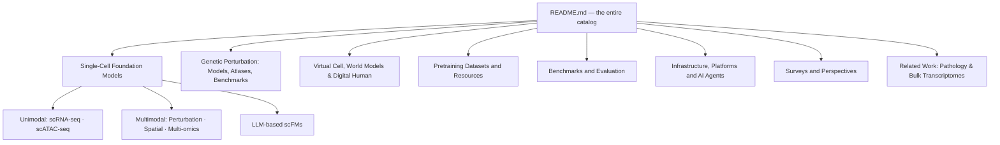
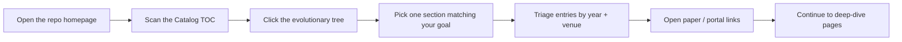

This page takes you from zero to productively using the **Awesome Foundation Models for Single-Cell** repository. Set your expectations correctly from the start: this is a *curated reading catalog*, not a runnable codebase. There is nothing to `pip install`, no model weights to download, and no API to call. The entire deliverable is a single, carefully structured Markdown document — the `README.md` — that indexes roughly **380 research papers** spanning single-cell foundation models, perturbation prediction, virtual cells, datasets, benchmarks, and AI agents. Your workflow here is browser navigation plus a reference manager, and this page teaches you that workflow in under ten minutes.

Sources: [README.md](/README.md#L1-L12)

## The Repository at a Glance

The project carries the standard [awesome-list](https://awesome.re) badge and welcomes pull requests, signaling that it is a community-maintained index rather than a software product. Its structure is deliberately minimal — three files total — because all informational value is concentrated in one artifact:

```
awesome-foundation-model-single-cell-papers/
├── LICENSE                     # Repository licensing terms
├── README.md                   # The complete catalog: 534 lines, ~380 paper entries
└── figs/
    └── evo_tree.png            # Evolutionary tree visual (clickable → high-res PDF)
```

Think of the repository as a **documentation-as-data** architecture: the README is simultaneously the landing page, the table of contents, and the full database. Every piece of content you will ever consume from this project lives in that one file.

Sources: [README.md](/README.md#L1-L8)

To build a mental model before diving in, here is how the README's eight top-level domains relate to each other. The catalog follows the structure of the team's companion review paper, so model-centric collections sit at the top, resource-centric and evaluation-centric collections in the middle, and tangentially related fields at the bottom:



The design principle behind this hierarchy is worth internalizing: **models are grouped by pretraining modality, while everything else is grouped by function** (datasets, evaluation, tooling). Once you know which question you are asking — *"which model?"* vs *"which dataset/benchmark/tool?"* — the correct branch of the tree is unambiguous.

Sources: [README.md](/README.md#L39-L70), [README.md](/README.md#L72-L74)

## How to Read a Catalog Entry

Every entry follows one strict format, so once you decode it once, you can scan hundreds of entries at speed. Here is a real entry taken from the scRNA-seq section, broken down component by component:

| Component | Example | What It Tells You |
|---|---|---|
| Position number | `1.` | Sequential list marker; all lists are ordered **newest-first** |
| Year + venue tag | `[2024 Nature Methods]` | Publication year and peer-review venue (`bioRxiv`/`arXiv` = preprint, treat claims accordingly) |
| Bold title | `**scGPT: toward building a foundation model...**` | Model name before the colon; one-line contribution summary after it |
| Link tag | `[[paper]](URL)` | External link — the actual exit point from the catalog |

Applied to the full entry: `1. [2024 Nature Methods] **scGPT: toward building a foundation model for single-cell multi-omics using generative AI** [[paper]](https://www.nature.com/articles/s41592-024-02201-0)` — you can tell at a glance this is a peer-reviewed 2024 model paper published at Nature Methods.

Sources: [README.md](/README.md#L81), [README.md](/README.md#L116), [README.md](/README.md#L125-L136)

A small but important detail: the link tag is not always `[[paper]]`. The catalog uses **four link types** to distinguish what you are about to open, which matters because some entries point at living web services rather than static PDFs:

| Link Tag | Meaning | Example Entry |
|---|---|---|
| `[[paper]]` | Publication (journal, conference, or preprint) | scGPT at Nature Methods |
| `[[portal]]` | Browsable data platform | CZ CELLxGENE Discover — single-cell data portal |
| `[[blog]]` | Vendor/institutional blog post | AIDO Cell simulator announcement |
| `[[website]]` | Directory or project site | Toolome — AI tools for biology directory |

Sources: [README.md](/README.md#L341), [README.md](/README.md#L318), [README.md](/README.md#L443)

> [!TIP]
> The venue tag doubles as a quality filter. When skimming a long section, scan only the bracketed prefixes first: `[2026 bioRxiv]` entries are recent preprints (cutting-edge but not peer-reviewed), while `[2024 Nature Methods]` entries have survived review. This two-second triage lets you decide whether to read deeply or just bookmark.

## Your First Ten Minutes: A Guided Walkthrough

The fastest path from opening the repository to having five relevant papers in your reading queue looks like this:



Execute the steps as follows:

1. **Open the repo homepage.** The header, badges, and one-paragraph mission statement tell you immediately what this is.
Sources: [README.md](/README.md#L1-L12)
2. **Jump to the `Catalog` section.** Every top-level heading in the README is a clickable anchor — clicking `[Single-Cell Foundation Models](#single-cell-foundation-models)` in the Catalog teleports you down the page without scrolling. Use this as your navigation hub every visit.
Sources: [README.md](/README.md#L39-L70)
3. **Click the evolutionary tree image.** The embedded image links to a full-resolution PDF (`figs/evo_tree.pdf`), which maps how single-cell foundation models evolved from one another — keep it open on a second screen as your visual map.
Sources: [README.md](/README.md#L22-L24)
4. **Enter exactly one section.** Resist reading everything; pick the branch that matches your current task (see the learning-path table below).
Sources: [README.md](/README.md#L39-L70)
5. **Triage, then open.** Filter by year/venue tags, then open `[[paper]]` links for the three to five entries that survive your filter.
Sources: [README.md](/README.md#L81)

## Choose Your Learning Path

Different readers should enter the catalog at different points. The table below maps common goals to the README section you should open first, an illustrative anchor entry, and the dedicated deep-dive documentation page that expands on that territory. Note how each goal lands in exactly one primary section — that is the payoff of the modality-first / function-first split:

| Your Goal | Start in README Section | Illustrative Entry | Continue Reading At |
|---|---|---|---|
| Understand the model landscape broadly | Single-Cell Foundation Models → scRNA-seq | Geneformer, scGPT, scFoundation | [Taxonomy of Single-Cell Foundation Models](4-taxonomy-of-single-cell-foundation-models) |
| Chromatin accessibility work | Single-Cell Foundation Models → scATAC-seq | GET, EpiAgent | [Single-Cell ATAC-seq Models](6-single-cell-atac-seq-models) |
| Spatial transcriptomics or histology | Multimodal → Spatial, Proteomics and Histology | Nicheformer, OmiCLIP | [Multimodal and Spatial Models](7-multimodal-and-spatial-models) |
| Apply LLMs to cells | LLM-based scFMs | Cell2Sentence, GenePT | [LLM-Based Cell Models](8-llm-based-cell-models) |
| Predict gene perturbation outcomes | Genetic Perturbation → Models and prediction frameworks | GEARS, scGen | [Perturbation Prediction Frameworks](9-perturbation-prediction-frameworks) |
| Find perturbation training data | Genetic Perturbation → Perturbation atlases | Tahoe-100M, Perturb-seq | [Perturbation Atlases and Datasets](10-perturbation-atlases-and-datasets) |
| Know if these models actually work | Benchmarks and Evaluation | PerturBench, scEval | [Benchmarking Studies and Critiques](17-benchmarking-studies-and-critiques) |
| Build your own pretraining pipeline | Pretraining Datasets → Data formats and frameworks | scvi-tools, Scanpy | [Analysis Frameworks and Data Formats](16-analysis-frameworks-and-data-formats) |
| Deploy or serve models | Infrastructure, Platforms and AI Agents | scvi-hub, BioNeMo | [Infrastructure and Model Platforms](19-infrastructure-and-model-platforms) |
| Get oriented fast (theory) | Surveys and Perspectives | Transformers in single-cell omics | [Surveys and Open Challenges](21-surveys-and-open-challenges) |

Sources: [README.md](/README.md#L76-L80), [README.md](/README.md#L125-L117), [README.md](/README.md#L138-L145), [README.md](/README.md#L160-L189), [README.md](/README.md#L203-L235), [README.md](/README.md#L241-L265), [README.md](/README.md#L267-L273), [README.md](/README.md#L275-L290), [README.md](/README.md#L357-L364), [README.md](/README.md#L441-L454), [README.md](/README.md#L478-L517)

> [!TIP]
> Beware one deliberate overlap: perturbation-*trained* foundation models (such as Tahoe-x1 and STATE) are cataloged under Multimodal scFMs, not under the Genetic Perturbation section. The README cross-references this explicitly, so if a perturbation model search comes up empty, check the multimodal branch before concluding the catalog lacks it.

## The Evolutionary Tree: Your Visual Map


The repository ships a single visualization — the evolutionary tree of single-cell foundation models, adapted with credit from the LLMsPracticalGuide project. It compresses the catalog's historical narrative into one picture: which model families descended from which, and when major branches (unimodal, multimodal, LLM-based) diverged. For a beginner, this image is the highest-value five minutes in the whole repository — read it *before* reading any paper, because it gives you the vocabulary and lineage context that makes individual entries meaningful. The dedicated page on this topic decodes the tree branch by branch.

Sources: [README.md](/README.md#L18-L24)

## Citing the Project

If this catalog feeds your research, the maintainers ask that you cite their companion review, currently under review at *Cell*. The README includes a ready-to-paste BibTeX block — copy it verbatim into your `.bib` file:

```bibtex
@article{jiang2026landscape,
  title={The Landscape of Single-Cell Foundation Models: Design Principles, Applications, and Open Challenges},
  author={Jiang, Shiyu and Fang, Zhaoyu and Zhang, Yujie and Zhang, Xuting and Kalfon, J{\'e}r{\'e}mie and Wang, Weixu and Fu, Xi and Patel, Aakash and Rizvi, Syed and Lu, Yuancheng Ryan and others},
  year={2026},
  publisher={Preprints}
}
```

This is also an architectural hint about the repository itself: the catalog's section structure mirrors the review's chapter structure, so reading the review alongside the catalog gives you curated narrative plus up-to-date paper links.

Sources: [README.md](/README.md#L26-L37)

## Contributing Back

The repository is explicitly contribution-driven: found a missed paper or a broken link? Open an issue or a pull request. As you use the catalog, you are uniquely positioned to spot the failure modes maintainers care about — a dead `[[paper]]` URL, a new preprint missing from a section, or a model filed under the wrong modality. Because the entire catalog is one Markdown file, contributing requires no build tooling: fork, edit `README.md`, append your entry to the correct section following the exact `[year venue] **Name: description** [[paper]](url)` pattern, and open a PR.

Sources: [README.md](/README.md#L14-L16)

## Where to Go Next

You now know how to navigate, decode, and contribute to the catalog. The recommended progression through this documentation deepens your understanding layer by layer — from the bird's-eye historical view, down into the taxonomy, then into the specific model families and application domains:

1. **[Overview](1-overview)** — if you have not read it yet, it frames why foundation models matter for single-cell genomics.
2. **[Evolutionary Tree of Models](3-evolutionary-tree-of-models)** — a guided decode of the `figs/evo_tree.png` visualization you just downloaded.
3. **[Taxonomy of Single-Cell Foundation Models](4-taxonomy-of-single-cell-foundation-models)** — the classification system that explains *why* the catalog's sections are drawn where they are.
4. **[Unimodal scRNA-seq Models](5-unimodal-scrna-seq-models)** — the largest and most mature branch, and the natural first deep dive.
5. Then branch out to your domain of interest: [Perturbation Prediction Frameworks](9-perturbation-prediction-frameworks), [Virtual Cell Perspectives and Roadmaps](12-virtual-cell-perspectives-and-roadmaps), or [Benchmarking Studies and Critiques](17-benchmarking-studies-and-critiques).

The catalog itself stays useful at every stage: return to it whenever you need the freshest entries, since it is continuously updated with new preprints and publications.
