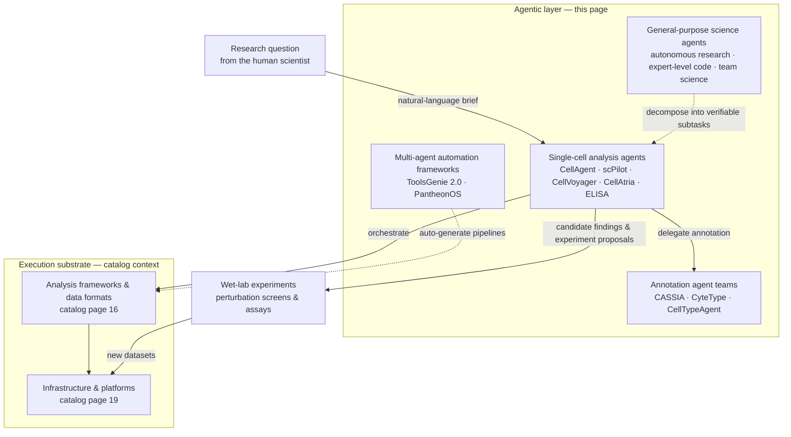
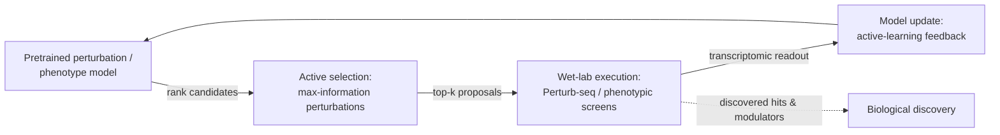

This page documents the agentic-AI layer of the single-cell foundation model ecosystem as cataloged by the OmicsML reading list. The repository is a curated, continuously updated collection of foundation-model research for single-cell genomics, structured as a single `README.md` with anchor-based navigation. The "AI Agents for Discovery" scope covers two README subsections — *AI agents for single-cell discovery* (16 entries) and *Lab-in-the-loop and active discovery* (2 entries) — targeting advanced developers who build agent orchestration on top of single-cell analysis stacks.

Sources: [README.md](README.md#L10-L16), [README.md](README.md#L64-L67)

## Position in the Catalog and Ecosystem

The page sits in the **Ecosystem and Applications** block of the catalog, immediately after [Infrastructure and Model Platforms](19-infrastructure-and-model-platforms) and before [Surveys and Open Challenges](21-surveys-and-open-challenges). In the README, both live inside the parent section *Infrastructure, Platforms and AI Agents*, which groups three subsections: infrastructure platforms (owned by page 19), the AI-agent catalog, and lab-in-the-loop discovery. This placement is architecturally meaningful: agents are positioned as the orchestration tier *above* the infrastructure and platform tier, consuming tools and data rather than providing them.

Sources: [README.md](README.md#L437-L454), [README.md](README.md#L64-L67)

The architecture below reconstructs the dependency graph implied by the catalog's grouping. Every named system and role is taken verifiably from entry titles: analysis agents orchestrate the analysis frameworks cataloged on page 16, annotation teams delegate the cell-labeling task, and the lab-in-the-loop subsection closes the cycle back to physical experiments.

A practical note for contributors: all content for this page lives under two README anchors, `ai-agents-for-single-cell-discovery` and `lab-in-the-loop-and-active-discovery`, both registered in the top-of-file catalog block, so pull requests adding new agent papers should update the entry list and keep the catalog block synchronized.

Sources: [README.md](README.md#L64-L67), [README.md](README.md#L456-L476)

## Functional Taxonomy of the Cataloged Agents

The 16 agent entries cluster cleanly by capability, using only what the entry titles state. This clustering is the fastest way for a developer to locate an architectural reference: the clusters differ in **unit of autonomy** (a single analysis session vs. a full research program), in **interaction mode** (natural language vs. programmatic pipelines), and in **verification surface** (annotation labels vs. open-ended findings).

Sources: [README.md](README.md#L456-L472)

| Cluster | Entries | Cataloged systems | Primary capability |
|---|---|---|---|
| General-purpose autonomous science | 5 | Autonomous biomedical research agent; expert-level empirical-software system; well-scoped verifiable agentic systems; Agentic Laboratories of the Future; in-silico team science | End-to-end research execution beyond single-cell-specific tasks |
| Single-cell analysis agents | 5 | CellAgent, scPilot, CellVoyager, CellAtria, ELISA | Natural-language-driven analysis, autonomous insight generation, data ingestion and standardization |
| Multi-agent automation frameworks | 2 | ToolsGenie 2.0, PantheonOS | Scalable, extensible, evolvable bioinformatics automation |
| Annotation agent teams | 3 | CASSIA, CyteType, CellTypeAgent | Evidence-based, interpretable, trustworthy cell-type annotation |
| Domain viewpoint | 1 | From equations to agents (precision oncology) | Strategic framing of agentic virtual cells in oncology |

Sources: [README.md](README.md#L456-L472)

**General-purpose autonomous science.** Five entries operate at the level of the scientific method itself rather than at the level of a single analysis: an agent performing autonomous biomedical research (Science 2026), a system helping scientists write expert-level empirical software (Nature 2026), a study of agentic systems on well-scoped verifiable problems, a perspective on agentic laboratories as world models for discovery, and an analysis of "in silico team science" (Nature Biotechnology 2026). For system architects, this cluster defines the outer envelope: what a fully autonomous research loop is expected to attempt in computational biology, and where its boundaries of reliability are drawn.

Sources: [README.md](README.md#L457-L463)

**Single-cell analysis agents.** The five-domain-specific entries split into three recurring roles visible from their titles: *orchestrators* that accept natural-language briefs and execute multi-step analyses (CellAgent, ICLR 2025; scPilot, NeurIPS 2025), *autonomous discovery engines* that generate new insights from raw biological data without step-by-step instruction (CellVoyager, Nature Methods 2026; ELISA, with expression-grounded interpretable reasoning), and *data-engineering agents* that handle the unglamorous ingestion-and-standardization front end of scRNA-seq pipelines (CellAtria, npj Artificial Intelligence 2026). These are the systems most directly reusable as references when building an analysis copilot over the tool stacks cataloged on [Analysis Frameworks and Data Formats](16-analysis-frameworks-and-data-formats).

Sources: [README.md](README.md#L461), [README.md](README.md#L464-L465), [README.md](README.md#L471-L472)

**Annotation agent teams.** Three entries attack the single highest-volume, most verifiable task in single-cell analysis: cell-type annotation. CASSIA (Nature Communications 2025) is explicitly a multi-agent LLM for automated *and interpretable* annotation; CyteType frames multi-agent AI as evidence-based annotation; CellTypeAgent targets trustworthiness. The pattern across all three is the same: decompose one annotation decision into roles that gather evidence, propose labels, and critique — a design worth studying before inventing a bespoke multi-agent topology.

Sources: [README.md](README.md#L468-L470)

**Multi-agent automation frameworks.** ToolsGenie 2.0 (scalable, extensible bioinformatics automation) and PantheonOS (an *evolvable* multi-agent framework for automatic genomics discovery) represent the infrastructure-flavored end of the spectrum: rather than solving one analysis, they provide the runtime substrate on which other agents execute. They are the natural companion reads to the platforms cataloged on page 19.

Sources: [README.md](README.md#L466-L467)

> [!TIP]
> The catalog's own evaluation framing — "agentic systems are adept at solving well-scoped, verifiable problems in computational biology" — doubles as a design heuristic. Prefer agent architectures whose success criteria are machine-checkable (annotation accuracy, pipeline validity, ingestion correctness) over open-ended "discovery" claims; three of the four functional clusters converge on exactly such tasks.

Sources: [README.md](README.md#L456-L472)

## Boundary Map: Agents vs. Adjacent Catalog Pages

Several README entries mention agents or agentic techniques but are deliberately *not* on this page, because the catalog organizes by **primary artifact** rather than by technique. Recognizing this rule prevents misfiled contributions and missed references: conversational copilots whose artifact is a language-model-based cell representation belong to [LLM-Based Cell Models](8-llm-based-cell-models); an agentic *builder* whose output is a virtual cell model belongs to [Cell World Model Implementations](13-cell-world-model-implementations); an agent-*curated* repository whose artifact is a dataset belongs to [Transcriptomic Atlases and Repositories](14-transcriptomic-atlases-and-repositories).

Sources: [README.md](README.md#L203-L205), [README.md](README.md#L215-L222), [README.md](README.md#L330), [README.md](README.md#L338), [README.md](README.md#L496)

| Agent-adjacent entry | Why it is agent-related | Catalog home |
|---|---|---|
| scChat, CellWhisperer, InstructCell | Conversational copilots — interactive assistants, not autonomous agents | [LLM-Based Cell Models](8-llm-based-cell-models) |
| CellForge: Agentic Design of Virtual Cell Models | Agentic technique, but the artifact is a virtual cell / world model | [Cell World Model Implementations](13-cell-world-model-implementations) |
| scBaseCount: "AI agent-curated" repository | Agent in the loop, but the artifact is a data repository | [Transcriptomic Atlases and Repositories](14-transcriptomic-atlases-and-repositories) |
| LLM4Cell: Survey of LLM and Agentic Models | Field-wide survey spanning agents and LLMs | [Surveys and Open Challenges](21-surveys-and-open-challenges) |

> [!TIP]
> When scanning the README for agent work, search by primary artifact, not by the keyword "agent": the term also appears in the description of a dataset (scBaseCount, L338) and a world-model builder (CellForge, L330), which the catalog files under data and virtual-cell pages respectively.

Sources: [README.md](README.md#L330), [README.md](README.md#L338)

## Lab-in-the-Loop and Active Discovery

The second subsection of this page contains only two entries, but they are structurally distinct from everything above: here, computation selects *which physical experiment to run next*, and the wet lab's measurement feeds back into the model. This is the closed loop that distinguishes agentic discovery from purely in-silico analysis — the agent (or active-learning framework) proposes experiments, the laboratory executes perturbation screens, and transcriptomic readouts update the selection policy.

Sources: [README.md](README.md#L474-L476)

| Entry | Venue / year | Role in the loop |
|---|---|---|
| Many needles in a haystack: Active hit discovery for perturbation experiments | ICML 2026 | In-loop selection of informative perturbations for hit discovery |
| Active learning framework leveraging transcriptomics identifies modulators of disease phenotypes | Science 2025 | Transcriptomics-guided active learning to prioritize disease-modulator experiments |

Sources: [README.md](README.md#L474-L476)

Both entries presuppose the perturbation-prediction substrate cataloged on [Perturbation Prediction Frameworks](9-perturbation-prediction-frameworks) and the screen datasets of [Perturbation Atlases and Datasets](10-perturbation-atlases-and-datasets): active selection is only as good as the model doing the ranking. Developers entering this area should treat pages 9–11 as the prerequisite stack and this subsection as the orchestration layer that converts those models into experimental plans.

Sources: [README.md](README.md#L241-L273), [README.md](README.md#L474-L476)

## Suggested Reading Path

For an advanced developer approaching this page cold, the catalog supports a deliberate progression: orient in the model landscape first, understand the substrate agents will orchestrate, then study the agents themselves, and finish with the field-level surveys that contextualize open problems.

1. **[Overview](1-overview)** — the review's framing of the single-cell foundation model landscape.
2. **[Taxonomy of Single-Cell Foundation Models](4-taxonomy-of-single-cell-foundation-models)** — the model families (pages 5–8) that agentic systems increasingly invoke as callable tools.
3. **[Analysis Frameworks and Data Formats](16-analysis-frameworks-and-data-formats)** — the tool libraries (Scanpy, Seurat, scvi-tools) that analysis agents orchestrate.
4. **[Infrastructure and Model Platforms](19-infrastructure-and-model-platforms)** — the deployment substrate this page's agents run on top of; read immediately before this page.
5. **[AI Agents for Discovery](20-ai-agents-for-discovery)** — this page.
6. **[Surveys and Open Challenges](21-surveys-and-open-challenges)** — including the LLM4Cell survey covering large language and agentic models for single-cell biology, the field-wide synthesis of everything cataloged here.
