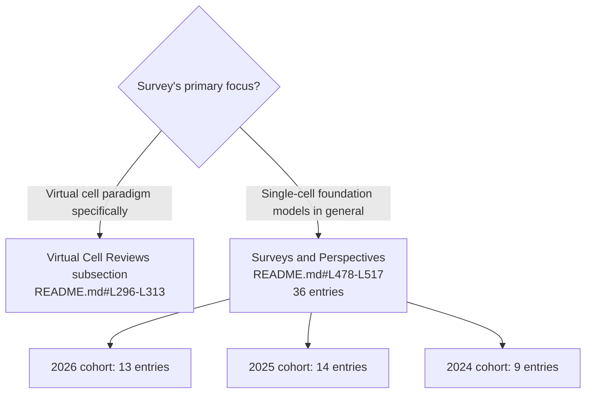
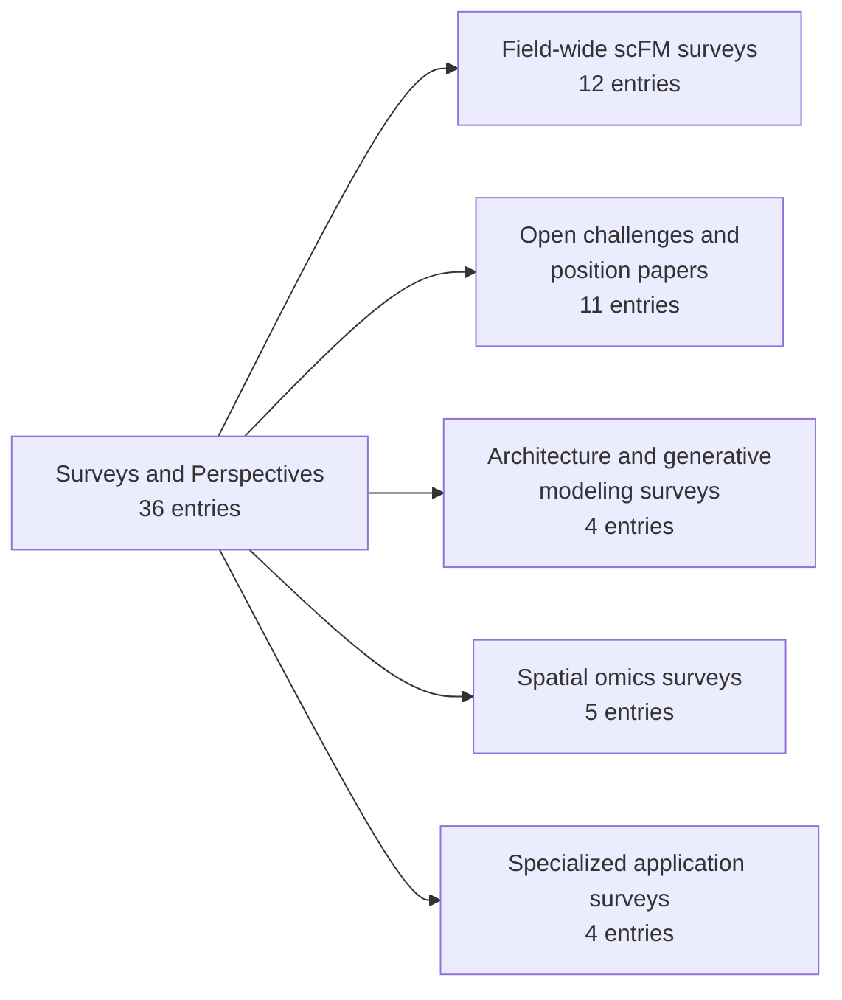

This page documents the **Surveys and Perspectives** section of the repository — the synthesis layer at the end of the catalog, where the collection shifts from inventorying *artifacts* (models, datasets, benchmarks, platforms) to inventorying *interpretation*. It contains **36 curated survey and position papers** that narrate the field's trajectory and codify its unresolved problems. The section is stored as a single flat list in the repository's README, with entries ordered newest-first and linked directly to their source publications. This page's catalog title ("Surveys and Open Challenges") corresponds to the README anchor `#surveys-and-perspectives`.

Sources: [README.md](/README.md#L478-L517), [README.md](/README.md#L39-L70)

## Scope Boundary: What Belongs Here

The section opens with an explicit **routing rule**, and it is the only catalog section that defines its scope by exclusion relative to another section: surveys focused on the *virtual cell paradigm specifically* are redirected to the "Virtual Cell, World Models and Digital Human" section, while this section retains surveys "more focused on single-cell foundation models in general". For an intermediate developer navigating the catalog, this distinction is the single most important piece of context — if a survey's framing centers on cellular world models or digital organisms, it lives in [Virtual Cell Perspectives and Roadmaps](12-virtual-cell-perspectives-and-roadmaps) (README lines 296–313); if it synthesizes the scFM landscape broadly, it lives here.

> [!TIP]
> The routing rule at README.md#L479-L480 works in one direction only: a survey that merely *mentions* virtual cells still belongs in this section if its scope covers single-cell foundation models broadly. Check where the paper's central thesis sits, not its keyword density.

Sources: [README.md](/README.md#L478-L480), [README.md](/README.md#L292-L313)

## Entry Format and Ordering Conventions

Each of the 36 entries follows the repository's uniform citation anatomy: a chronological marker in brackets, a bolded title, and a resource-type tag linking to the publication — `[Year Venue] **Title** [[paper]](link)`. Unlike every other major catalog section, this one contains **no subsections**: it is a single, non-hierarchical list. The ordering is strictly **newest-first** (2026 → 2025 → 2024), which means the field's bleeding edge occupies the top of the list and its foundational retrospectives accumulate at the bottom. All 36 entries carry the `[[paper]]` resource tag; other sections of the repository additionally use `[[website]]`, `[[blog]]`, or `[[portal]]` tags, but none appear here. One formatting variance exists: the first entry (line 482) omits bold on its title, making it the sole deviation from the bolded-title convention used by the remaining 35 entries.

> [!TIP]
> Because ordering is reverse-chronological, a line-number binary search is an efficient retrieval strategy: lines 482–494 hold the 2026 frontier, lines 495–508 the 2025 consolidation, and lines 509–517 the 2024 foundational surveys. Jump directly to the cohort matching your currency needs instead of scanning all 36 entries.

Sources: [README.md](/README.md#L482-L517)

## Thematic Taxonomy of the Collection

Although the section is stored as one chronological list, its contents resolve cleanly into **five recurring themes**. This taxonomy is analytical — the repository itself does not subdivide the list — but it maps how the survey literature partitions the problem space: whole-field synthesis, forward-looking challenge statements, architecture-level methodology, spatial omics as a vertical domain, and specialized application areas. The counts below are exhaustive and mutually exclusive, summing to the section's 36 entries.

| Theme | Count | Example entries (README lines) | Value for developers |
|---|---|---|---|
| Field-wide scFM surveys | 12 | LLM4Cell (L496); Transformers in single-cell omics (L511); Foundation models in omics research: a comprehensive survey (L489); Harnessing the deep learning power of foundation models in single-cell omics (L510) | Orientation maps of the full landscape; fastest path to a structured mental model |
| Open challenges & position papers | 11 | Fifteen challenges for generative AI applications to cell biology (L484); The Human Cell Atlas from a cell census to a unified foundation model (L515); Overcoming barriers to the wide adoption of single-cell LLMs (L500) | Explicit problem statements that define open research and engineering directions |
| Architecture & generative modeling surveys | 4 | Flow matching for generative modelling (L490); Tokenization and deep learning architectures in genomics (L505); Transformers and genome language models (L499); Multimodal foundation transformer models for multiscale genomics (L498) | Design-level guidance on tokenization, transformer variants, and generative training paradigms |
| Spatial omics surveys | 5 | Multimodal spatial omics (L486); Spatial omics at the forefront (L493); Predicting spatial transcriptomics from histology images (L487); A perspective on developing foundation models for spatial transcriptomic data (L507) | Vertical-domain synthesis connecting histology, spatial assays, and computational integration |
| Specialized application surveys | 4 | Computational strategies for cross-species knowledge transfer (L497); LLMs for drug discovery and development (L502); Mini-review on perturbation modelling across single-cell omic modalities (L516); Decoding Cell Fate (L506) | Bridge material linking scFMs to drug discovery, perturbation biology, and cross-species transfer |

Sources: [README.md](/README.md#L482-L517)

## The Open-Challenges Cluster

The catalog page's "Open Challenges" designation is carried substantively by the eleven position and challenge papers in this section. These entries do not survey what exists — they specify what remains unsolved. The most concrete artifact is **"Fifteen challenges for generative AI applications to cell biology"** (2026 Cell), an enumerated problem list, while **"Why machines don't speak biology: Toward native biological language models"** (2026 Cell) argues a foundational representation-level thesis. Adoption-focused challenges appear in **"Overcoming barriers to the wide adoption of single-cell large language models in biomedical research"** (2025 Nature Methods), and architectural evolution is framed by **"From modality-specific to compositional foundation models for cell biology"** (2026 Cell Systems). Roadmap-class entries anchor the cluster's older stratum: the Human Cell Atlas repositioned as a unified foundation model (2024 Nature), causal cell-and-tissue modeling via a Perturbation Cell and Tissue Atlas (2024 Cell), and reference mapping as the future of automated single-cell analysis (2024 Cell).

This cluster also connects back to the repository's own synthesis artifact: the catalog's structure follows the companion review **"The Landscape of Single-Cell Foundation Models: Design Principles, Applications, and Open Challenges"**, currently under review at Cell and citable via the BibTeX block at README lines 30–37. The section's external surveys complement that in-house review with independent perspectives on the same open problems.

Sources: [README.md](/README.md#L483-L494), [README.md](/README.md#L500-L515), [README.md](/README.md#L26-L37)

## Temporal Cohorts and Venue Landscape

The section's 36 entries distribute across three temporal cohorts, and the cohort structure itself is informative: the 2026 stratum (13 entries) shows the survey wave maturing into comprehensive syntheses and challenge enumerations; the 2025 stratum (14 entries) is the largest, marking peak consolidation; the 2024 stratum (9 entries) contains the foundational retrospectives that defined the field's vocabulary. Venue concentration is equally telling — the collection draws overwhelmingly from the **Nature portfolio** and **Cell Press**, signaling that the survey literature has consolidated into top-tier venues rather than remaining in preprint form (the 2025 cohort contains exactly one arXiv entry, LLM4Cell).

| Cohort | Entries | README lines | Character |
|---|---|---|---|
| 2026 | 13 | L482–L494 | Comprehensive surveys, challenge enumerations, spatial omics wave |
| 2025 | 14 | L495–L508 | Consolidation: multimodal FMs, adoption barriers, tokenization reviews |
| 2024 | 9 | L509–L517 | Foundational retrospectives defining the field's framing |

| Venue cluster | Entries | Examples |
|---|---|---|
| Nature portfolio (Nature, Nature Methods, Nature Biotechnology, Nature Machine Intelligence, Nature Reviews Genetics, Nature Reviews Molecular Cell Biology) | 12 | L485, L490, L491, L494, L495, L497, L498, L499, L500, L510, L511, L515 |
| Cell Press (Cell, Cell Systems, Cancer Cell, Patterns) | 8 | L483, L484, L486, L492, L493, L502, L513, L514 |
| Briefings in Bioinformatics | 4 | L482, L488, L489, L517 |
| Other journals and venues | 12 | National Science Review, CSBJ, Quantitative Biology, Genome Biology, arXiv, ACL, Bioinformatics, Experimental & Molecular Medicine, EXO |

Sources: [README.md](/README.md#L482-L517)

## Recommended Reading Progression

As the catalog's synthesis layer, this section works best as either a **starting orientation** or a **capstone consolidation** — read it first to acquire the field's vocabulary, or last to situate everything you have already cataloged. If your goal is understanding open problems before studying implementations, read this page, then descend into the core model landscape via [Taxonomy of Single-Cell Foundation Models](4-taxonomy-of-single-cell-foundation-models). If you arrived here after traversing the catalog, proceed to the adjacent related-work page [Related Pathology and Bulk Models](22-related-pathology-and-bulk-models) to close out the boundary domains. Challenge statements about evaluation methodology in this section pair naturally with the empirical counterpart in [Benchmarking Studies and Critiques](17-benchmarking-studies-and-critiques), and roadmap discussions touching agentic systems connect forward to [AI Agents for Discovery](20-ai-agents-for-discovery).

| Step | Catalog page | Rationale |
|---|---|---|
| Orient | [Overview](1-overview) → [Evolutionary Tree of Models](3-evolutionary-tree-of-models) | Establish the landscape vocabulary this section's surveys assume |
| Synthesize | [Surveys and Open Challenges](21-surveys-and-open-challenges) *(this page)* | Acquire field-wide framing and open problem statements |
| Cross-reference | [Virtual Cell Perspectives and Roadmaps](12-virtual-cell-perspectives-and-roadmaps) | The parallel survey collection for virtual-cell-scoped perspectives, per the routing rule |
| Empirical counterpart | [Benchmarking Studies and Critiques](17-benchmarking-studies-and-critiques) | Challenge statements here vs. measured evidence there |
| Continue catalog | [Related Pathology and Bulk Models](22-related-pathology-and-bulk-models) | Next page in sequence; the catalog's final related-work boundary |

The repository actively maintains this list: contributions, missed papers, and broken links are solicited via issues or pull requests. If you identify a survey absent from the 36 entries, this section is designed to absorb it.
