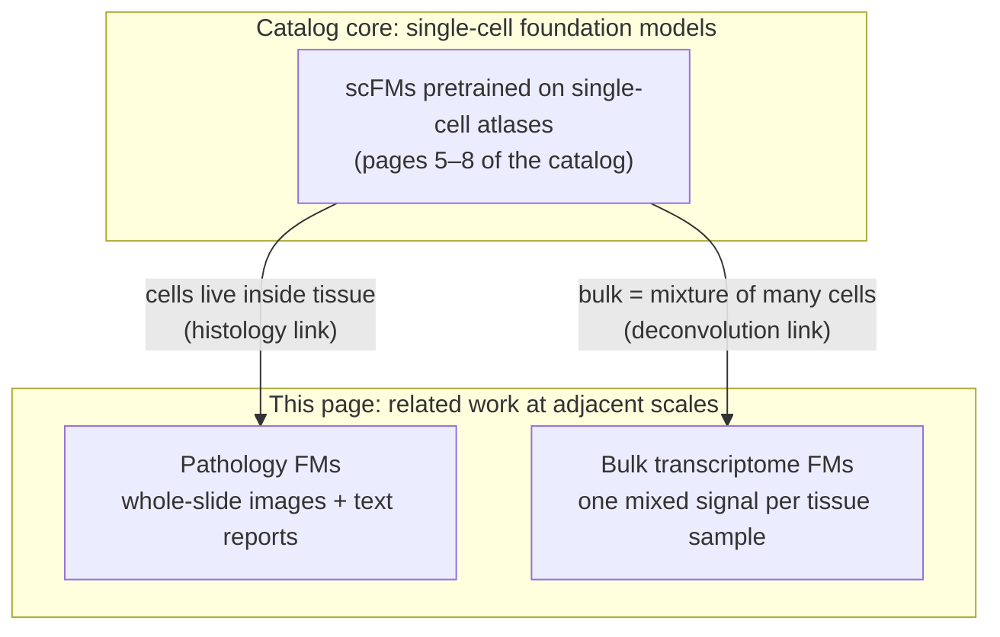

This page documents the final two sections of the curated reading list: **Foundation Models for Pathology (related work)** and **Foundation Models for Bulk Transcriptome**. These sections are deliberately positioned at the end of the catalog as *adjacent* research areas — they apply the same "foundation model" playbook (large-scale pretraining, transferable representations) to biological data types that are **not single-cell**: digitized tissue images and mixed-population gene expression profiles. For a beginner, this page explains what these neighboring fields are, what the listed papers contribute, and how they relate back to the single-cell core of the catalog.

Sources: [README.md](README.md#L519-L533), [README.md](README.md#L69-L70)

## Why These Sections Exist

The repository's stated scope is a reading list of foundation-model research for **single-cell genomics**, structured around a companion review titled *"The landscape of single-cell foundation models: design principles, applications, and open challenges"*. The pathology section is explicitly framed in the file itself: its entries are *"outside the scope of the single-cell review above but are kept here as closely related work"* — the bulk transcriptome section sits immediately after it under the same logic. In other words, these are curated **on-ramps**: if you came to single-cell foundation models from a pathology or bulk-omics background (or want to migrate in the other direction), the maintainers signal that these five plus three papers are the canonical bridges.

> [!TIP]
> The "(related work)" label is a scope boundary, not a quality judgment. Everything else in this catalog feeds the single-cell review; these two sections are appendices of intentionally adjacent material. When citing or extending this list, keep that separation intact.

The following concept map shows where this page sits relative to the catalog's core:

Reading the diagram left to right: the core catalog models learn representations from **individual cells**, while the two related sections operate one scale up — pathology models look at **tissue images**, and bulk models look at **aggregated molecular signals** from many cells at once.

Sources: [README.md](README.md#L11-L11), [README.md](README.md#L69-L70), [README.md](README.md#L519-L521)

## Foundation Models for Pathology

**Computational pathology in one paragraph**: pathologists diagnose disease by examining tissue under a microscope; when that tissue is digitized into massive images called *whole-slide images* (WSIs), machine learning can be applied to them. A pathology foundation model is pretrained on large collections of these images — sometimes paired with text such as diagnostic reports — so it learns general visual representations of tissue morphology that transfer to many downstream tasks (classification, detection, survival prediction).

The repository lists **five papers** (2023–2024, all published in top-tier venues) with no intro text beyond the scoping note. Here is the verbatim inventory, organized by what each paper's title tells you:

| # | Paper focus (year, venue) | Input data | Task pattern |
|---|---|---|---|
| 1 | Joint segmentation, detection and recognition of biomedical objects **across nine modalities** (2024, Nature Methods) | Biomedical images, 9 imaging modalities | Multi-task universal vision model |
| 2 | **Whole-slide** foundation model for digital pathology **from real-world data** (2024, Nature) | Whole-slide images | Slide-level pretraining at scale |
| 3 | **General-purpose** foundation model for computational pathology (2024, Nature Medicine) | Pathology images | General-purpose image encoder |
| 4 | **Visual-language** foundation model for computational pathology (2024, Nature Medicine) | Pathology images + text | Image–text alignment |
| 5 | Visual-language model trained on **medical Twitter** data (2023, Nature Medicine) | Pathology images + social-media captions | Weakly-supervised image–text alignment |

Sources: [README.md](README.md#L519-L527)

Three design patterns emerge from this list, and they mirror the pretraining-strategy taxonomy used for single-cell models elsewhere in the catalog. First, entries 1–3 represent **vision-only pretraining**: the model sees images alone and learns representations through tasks like masked modeling or supervised prediction — the pathology analog of unimodal scRNA-seq models. Second, entries 4–5 represent **vision-language pretraining**: images are paired with free text (reports, or in the 2023 paper, the alt-text that clinicians wrote on social media), and the model learns a *joint* space where an image and its description land close together. Third, the spread of data sources is instructive: entry 2 emphasizes **real-world data** (routine clinical archives) and entry 5 uses **social media**, showing that the field scrounges scale wherever it can find it — a theme beginners will recognize from the data-hungry single-cell world.

> [!TIP]
> The repository provides paper links only — no code or model weights — so you must search the literature for implementations. Four of these papers are widely known in the community under model acronyms (the whole-slide model as Virchow, the general-purpose encoder as UNI, the vision-language models as CONCH and PLIP), which makes finding their open-source releases straightforward once you know the mappings.

Sources: [README.md](README.md#L519-L527)

## Foundation Models for Bulk Transcriptome

**Bulk transcriptomics in one paragraph**: a bulk RNA-seq experiment measures, for every gene, the *average* expression across the millions of cells in a tissue sample — you get one mixed signal per sample rather than one profile per cell. This is cheaper, older, and far more common in clinical settings (hospitals routinely profile tumors in bulk), which is why foundation models for bulk data matter even in a single-cell-centric catalog. Entry 3 of this section also introduces **DNA methylation** — an epigenetic layer measuring chemical marks on DNA — as a second bulk modality.

The section contains **three papers**, all from 2026, and unlike the pathology section it has no introductory note:

| # | Paper (year, venue) | Input data | Contribution |
|---|---|---|---|
| 1 | **BulkFormer**: large-scale foundation model for bulk transcriptomes (2026, Cell Systems) | Bulk gene expression | Dedicated large-scale bulk FM |
| 2 | Generalizable AI predicting **immotherapy outcomes across cancers and treatments** (2026, Nature Medicine) | Transcriptomic profiles | Clinical outcome prediction, cross-cancer transfer |
| 3 | **Bimodal masked language modeling** for bulk RNA-seq and DNA methylation (2026, ICML) | Bulk RNA-seq + DNA methylation | Two-modality joint pretraining |

Sources: [README.md](README.md#L529-L533)

The youth of this section is its most notable structural fact: every entry is dated 2026, while the pathology section's entries all date from 2023–2024. Bulk-transcriptome foundation models are thus a **newer frontier** — the field has one flagship named model (BulkFormer), one clinical-application demonstration (immunotherapy outcomes, notable because it claims *generalizability across cancers and treatments*), and one methodological contribution (bimodal masked language modeling, published at a machine-learning venue rather than a medical journal). The venue spread — Cell Systems, Nature Medicine, ICML — signals that this area is jointly claimed by biology, medicine, and ML communities, exactly like the single-cell field itself.

Sources: [README.md](README.md#L529-L533)

## Pathology vs. Bulk: A Side-by-Side View

Because this page combines two sections, a direct comparison clarifies why they are kept together as "related work" despite being quite different in nature:

| Dimension | Pathology section | Bulk transcriptome section |
|---|---|---|
| Data type | **Images** (whole slides, multi-modal microscopy) ± text | **Molecular vectors** (gene expression, methylation) |
| Entry count | 5 papers | 3 papers |
| Year range | 2023–2024 (mature) | 2026 (emerging) |
| Venues | Nature Methods, Nature, Nature Medicine | Cell Systems, Nature Medicine, ICML |
| Pretraining signal | Visual appearance; image–text pairs | Expression patterns; two-omics co-modeling |
| Relationship to single-cell | Cells live **inside** the tissue these models see | Bulk profiles are **mixtures** of single-cell profiles |

The pairing is not arbitrary: both sections represent foundation models applied to data where the **single cell is not the unit of observation** — either because the unit is an image of tissue, or because the unit is a molecular average over many cells. That shared contrast with the catalog's core is what earns them the "related work" designation.

Sources: [README.md](README.md#L519-L533), [README.md](README.md#L69-L70)

## Connecting Back to the Single-Cell Core

Neither section is an island. The catalog itself shows the interfaces: pathology images appear inside the main single-cell landscape wherever models jointly model **spatial data and histology** (the "Spatial, Proteomics and Histology" grouping under multimodal scFMs), and bulk-to-single-cell translation is the implicit bridge that makes bulk foundation models clinically relevant — a bulk model can be validated or refined using single-cell references, and single-cell models can be aggregated to simulate bulk profiles. The critical-evaluation literature in the catalog similarly warns against assuming representations transfer freely across these scale boundaries.

For your reading path, this page is catalog position 22 of 22 — the deliberate end of the tour. Sensible continuations:

- Deepen the modality interface: [Multimodal and Spatial Models](7-multimodal-and-spatial-models) covers the single-cell models that already touch histology, the closest core-catalog neighbor to the pathology section.
- Ground your expectations: [Benchmarking Studies and Critiques](17-benchmarking-studies-and-critiques) collects the evaluation literature that applies equally to related-work models.
- Zoom back out: [Evolutionary Tree of Models](3-evolutionary-tree-of-models) offers the visual map of how the whole landscape fits together, or restart with [Overview](1-overview).
- Continue the frontier theme: [Surveys and Open Challenges](21-surveys-and-open-challenges) catalogs where the field — including its adjacent disciplines — says it is heading next.
