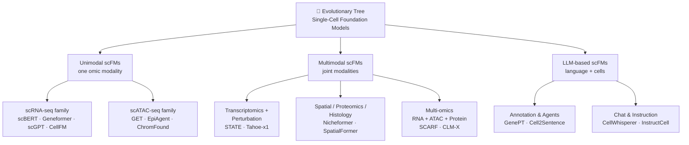

This page introduces the **evolutionary tree of single-cell foundation models** — the master visual that maps how the field grew from early transformer experiments into today's sprawling ecosystem of specialized model families. You will learn what the figure shows, how to read it branch by branch, and how each branch connects to the deeper catalog pages. No prior knowledge of single-cell biology or foundation models is required.

Sources: [README.md](/README.md#L10-L24)

## What Is the Evolutionary Tree of Models?

An **evolutionary tree** is a diagram convention borrowed from the large language model (LLM) community: a chronological trunk from which model *families* branch out, with individual models as leaves. This repository adapts that convention — the figure is explicitly credited to the [LLMsPracticalGuide](https://github.com/Mooler0410/LLMsPracticalGuide/tree/main) project, whose famous "Evolutionary Tree of Language Models" popularized this style [README.md](/README.md#L18-L20). Where the LLM tree organizes branches by architecture (encoder-only, decoder-only), this tree organizes branches by **pretraining modality** — the type of biological data a model was trained on.

The figure below is the complete tree, embedded directly from the repository (`figs/evo_tree.png`, the repo's only image asset):

Sources: [README.md](/README.md#L18-L24)

> [!TIP]
> The tree is a *navigation aid*, not a genealogy claim. "Family" membership means a model shares a pretraining modality (e.g., all scRNA-seq models form one branch), not that one model literally descends from another. Read it the way you would read a map of a city's districts — by neighborhood, not by street-level history.

## How to Read the Tree: The Taxonomy Behind the Branches

The tree's structure follows the repository's organizing review, *"The landscape of single-cell foundation models: design principles, applications, and open challenges"*. Every model in the catalog is placed into one of three top-level families based on the modalities it was pretrained on [README.md](/README.md#L72-L74):

- **Unimodal scFMs** — trained on a single omic modality (scRNA-seq gene expression, or scATAC-seq chromatin accessibility)
- **Multimodal scFMs** — trained jointly on complementary modalities (transcriptomics + perturbation, spatial/histology, or RNA + ATAC + protein together)
- **LLM-based scFMs** — trained by incorporating large language models or textual biological knowledge into cellular representations

Within the unimodal branches, models further differentiate by their **pretraining objective**: masked reconstruction, autoregressive generation, contrastive/relational alignment, or supervised prediction [README.md](/README.md#L76-L78). The diagram below shows the tree's architecture as the catalog encodes it:

Sources: [README.md](/README.md#L39-L70), [README.md](/README.md#L72-L78)

## The Main Branches and Their Landmark Models

The table below summarizes each branch of the tree with its defining property and the landmark models you will encounter most often in the literature. Landmarks are listed chronologically within each branch, so each row doubles as a mini evolution history.

| Tree Branch | Pretraining Data | Landmark Models (earliest → latest) | Pretraining Objective Examples |
|---|---|---|---|
| **Unimodal: scRNA-seq** | Single-cell gene expression | scBERT (2022) → Geneformer (2023) → scGPT, scFoundation (2024) → CellFM, TranscriptFormer (2025) → GeneformerV2 (2026) | Masked reconstruction, autoregressive generation |
| **Unimodal: scATAC-seq** | Chromatin accessibility | GET (2025) → EpiAgent, ChromFound, EpiFoundation (2025) → CLM-Access (2026) | Peak-to-gene alignment, reconstruction |
| **Multimodal: Transcriptomics + Perturbation** | Expression under genetic/chemical perturbation | STATE (2026) → Tahoe-x1 (2025, 3B params) | Perturbation-conditioned modeling |
| **Multimodal: Spatial, Proteomics, Histology** | Spatial transcriptomics, tissue images | Nicheformer (2025) → Novae, SToFM (2025) → SpatialFormer (2026) | Cross-modality alignment |
| **Multimodal: Multi-omics (RNA+ATAC+Protein)** | Co-assayed multi-omic cells | SCARF (2025) → CLM-X, CAPTAIN (2026) | Modality-specific reconstruction |
| **LLM-based scFMs** | Cells + natural language knowledge | Cell2Sentence, LangCell (2024) → GenePT, CellWhisperer (2025) → OCellus (2026) | Text-derived embeddings, chat interfaces |

Sources: [README.md](/README.md#L80-L136), [README.md](/README.md#L138-L145), [README.md](/README.md#L151-L201), [README.md](/README.md#L203-L235)

## Evolution Milestones: A Chronological Walk

The trunk of the tree — time itself — shows three distinct growth phases. Each milestone below is a dated catalog entry you can trace back to its paper.

| Phase | Year | Milestone | Why It Matters |
|---|---|---|---|
| **Sprouting** | 2022 | scBERT — early large-scale transformer pretraining for cell-type annotation | Proof that masked-language-model pretraining works on single-cell data |
| **First flowering** | 2023 | Geneformer, tGPT, xTrimoGene, CellPLM | Transfer learning to network biology; scaling and efficiency competition; objectives diversify |
| **Mainstreaming** | 2024 | scGPT and scFoundation published in Nature Methods; GEARS for perturbation; first LLM-cell hybrids (Cell2Sentence, LangCell) | Foundation-model paradigm becomes the field's default; perturbation and language branches emerge |
| **Scaling & specialization** | 2025 | CellFM pretrained on 100M cells; TranscriptFormer spans 1.5B years of evolution; Tahoe-x1 reaches 3B parameters; chat-based CellWhisperer | Scale-up race; spatial and chat sub-branches thicken |
| **Maturation & world models** | 2026 | GeneformerV2, scPRINT-2, universal cell embeddings in Nature; AlphaCell and CellOS target cellular *world models* | Consolidation of flagship families; a new frontier branch grows toward simulated cells |

Sources: [README.md](/README.md#L134), [README.md](/README.md#L124-L127), [README.md](/README.md#L116-L117), [README.md](/README.md#L230-L234), [README.md](/README.md#L263), [README.md](/README.md#L103-L107), [README.md](/README.md#L158), [README.md](/README.md#L222), [README.md](/README.md#L85-L97), [README.md](/README.md#L320-L325)

## Frontier Branches Growing Beyond the Core Tree

Two newer branches extend past the three modality families and are becoming disciplines of their own. The **genetic perturbation branch** covers prediction frameworks, large-scale perturbation atlases, and benchmarks — noting that perturbation-trained scFMs (STATE, Tahoe-x1, GeneJepa) are cataloged under the multimodal branch [README.md](/README.md#L237-L239). The **virtual cell branch** recasts foundation models as cellular *world models* — generative simulators that predict how cells respond to perturbations over time, an emerging paradigm with its own dedicated catalog section [README.md](/README.md#L292-L294).

This history starts earlier than the transformer era: perturbation modeling traces back to Perturb-seq (2016) for scalable pooled genetic screens and scGen (2019) for predicting single-cell perturbation responses — the roots from which today's perturbation branch grew.

Sources: [README.md](/README.md#L237-L239), [README.md](/README.md#L273), [README.md](/README.md#L265), [README.md](/README.md#L292-L294)

## Mapping the Tree to the Catalog

Every branch of the tree corresponds to one or more catalog sections, so the figure works as a visual index. Use this mapping table to jump from any branch you find interesting to its detailed page.

| Tree Branch | Catalog Concept | Deep-Dive Page |
|---|---|---|
| Whole tree structure & design principles | The three-family taxonomy | [Taxonomy of Single-Cell Foundation Models](4-taxonomy-of-single-cell-foundation-models) |
| Unimodal: scRNA-seq | Unimodal scFMs → scRNA-seq | [Unimodal scRNA-seq Models](5-unimodal-scrna-seq-models) |
| Unimodal: scATAC-seq | Unimodal scFMs → scATAC-seq | [Single-Cell ATAC-seq Models](6-single-cell-atac-seq-models) |
| Multimodal: Spatial / Multi-omics | Multimodal scFMs | [Multimodal and Spatial Models](7-multimodal-and-spatial-models) |
| LLM-based scFMs | LLM-based scFMs | [LLM-Based Cell Models](8-llm-based-cell-models) |
| Perturbation frontier | Models, atlases, benchmarks | [Perturbation Prediction Frameworks](9-perturbation-prediction-frameworks) |
| Virtual cell frontier | World models | [Cell World Model Implementations](13-cell-world-model-implementations) |
| Soil (pretraining data) | Atlases and corpora | [Transcriptomic Atlases and Repositories](14-transcriptomic-atlases-and-repositories) |

Sources: [README.md](/README.md#L39-L70)

> [!TIP]
> Treat the tree as your progress tracker. After reading any deep-dive page, return to the figure and locate that branch — landmark names you just studied will now anchor your mental map, and unexplored branches become your reading queue.

## Suggested Reading Path

For a beginner following the tree from trunk to leaves, the catalog's structure suggests this progression: first understand **why** the field branched this way ([Taxonomy of Single-Cell Foundation Models](4-taxonomy-of-single-cell-foundation-models)), then walk the dominant scRNA-seq trunk ([Unimodal scRNA-seq Models](5-unimodal-scrna-seq-models)) before its epigenomic sibling ([Single-Cell ATAC-seq Models](6-single-cell-atac-seq-models)). From there, widen into joint-modality branches ([Multimodal and Spatial Models](7-multimodal-and-spatial-models), [LLM-Based Cell Models](8-llm-based-cell-models)), then explore the frontier ([Perturbation Prediction Frameworks](9-perturbation-prediction-frameworks), [Cell World Model Implementations](13-cell-world-model-implementations)). If you want the application-oriented view first, jump directly to [Infrastructure and Model Platforms](19-infrastructure-and-model-platforms) or [Benchmarking Studies and Critiques](17-benchmarking-studies-and-critiques).
