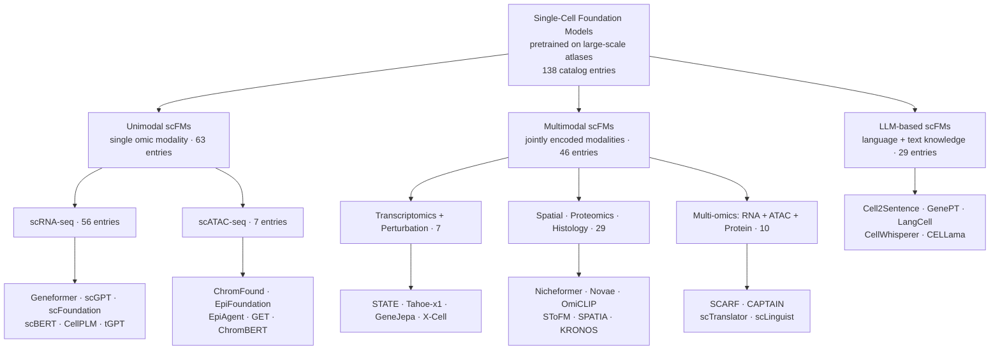
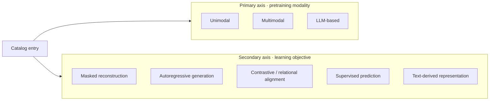
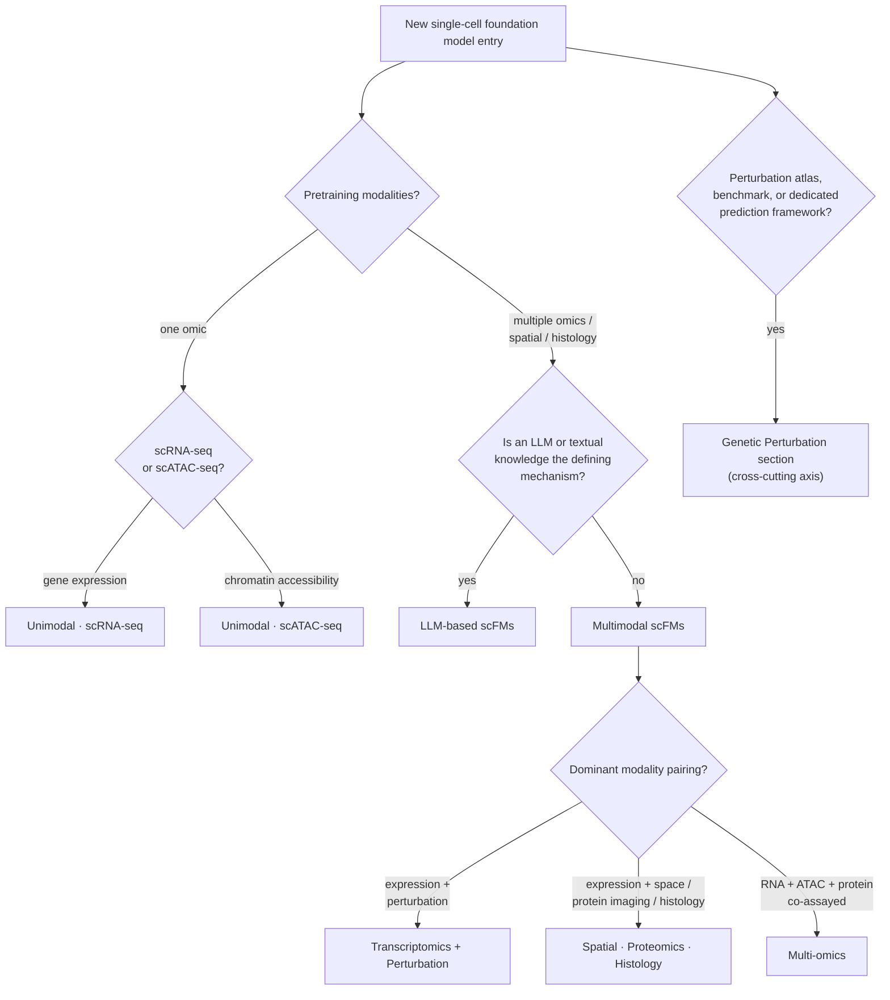

This page explains the classification system that organizes the model landscape cataloged in this repository. Every entry in the **Single-Cell Foundation Models** section is positioned along two orthogonal axes: the *pretraining modality* the model consumes (the primary axis) and the *learning objective* it optimizes (the secondary axis). Mastering this two-dimensional grid is the key to navigating the four deep-dive model pages that follow, and to predicting where any new paper will land in the catalog.

Sources: [README.md](README.md#L1-L12), [README.md](README.md#L39-L70)

## The Classification Principle: Modality First

The catalog explicitly states its organizing rule: single-cell foundation models "are grouped by the modalities they are pretrained on." This is a deliberate design choice — among all attributes of a single-cell foundation model (architecture, parameter count, downstream task), the pretraining modality is the most stable and consequential one, because it determines what biological information a model can possibly represent. The modality-first principle yields three primary classes: **unimodal** (a single omic), **multimodal** (jointly encoding complementary data types), and **LLM-based** (models where language-model or textual knowledge integration is the defining mechanism). A defining quote from the catalog captures the shared premise of all three classes: these models are "pretrained on large-scale atlases to learn transferable representations of cellular state."

Sources: [README.md](README.md#L72-L74)

The full taxonomy resolves into six leaf categories. The counts below are taken directly from the catalog's entry lists, which are verifiable line-by-line: 56 scRNA-seq entries, 7 scATAC-seq entries, 7 transcriptomics+perturbation entries, 29 spatial/proteomics/histology entries, 10 multi-omics entries, and 29 LLM-based entries — **138 curated model entries** in the core taxonomy alone.

Sources: [README.md](README.md#L76-L146), [README.md](README.md#L147-L201), [README.md](README.md#L203-L235)

The repository also ships an **evolutionary tree** figure that visualizes the historical lineage of these model families, adapted with credit from the LLMsPracticalGuide project. It complements the taxonomy tree above: the taxonomy classifies models *statically* by design attributes, while the evolutionary tree arranges them *chronologically* by lineage.

Sources: [README.md](README.md#L18-L24)

## Primary Class I: Unimodal scFMs

Unimodal models are "trained within a single omic modality (scRNA-seq or scATAC-seq)." This class contains the oldest and largest branch of the landscape — the transcriptomic branch stretches from scBERT (2022) through Geneformer (2023) and scGPT/scFoundation (2024) to the 2026 generation of billion-parameter models — and splits cleanly along the transcriptomic/epigenomic boundary. The catalog assigns this class four learning objectives: "masked reconstruction, autoregressive generation, contrastive/relational alignment, or supervised prediction."

| Sub-family | Pretraining input | Representative entries | Catalog span |
|---|---|---|---|
| scRNA-seq | Gene expression counts per cell | scBERT, Geneformer, xTrimoGene, tGPT, scGPT, scFoundation, CellPLM, CellFM, SCimilarity, TranscriptFormer, GeneMamba | 2022 → 2026 |
| scATAC-seq | Chromatin accessibility peaks | CLM-Access, Atacformer, ChromFound, EpiFoundation, EpiAgent, GET, ChromBERT | 2025 → 2026 |

The asymmetry between the two sub-families (56 vs 7 entries) reflects data availability: scRNA-seq atlases are vastly larger and more standardized than single-cell chromatin accessibility data, so the epigenomic branch matured roughly two years later.

Sources: [README.md](README.md#L76-L146)

## Primary Class II: Multimodal scFMs

Multimodal models "jointly encode complementary modalities — transcriptomic, epigenomic, proteomic, perturbational and spatial — through modality-specific reconstruction, cross-modality alignment, or task-informed supervision." The catalog partitions this class into three sub-categories that correspond to different *pairing strategies* rather than a single schema: expression+perturbation (training signal from genetic or chemical perturbation responses), expression+space/image (aligning transcriptomics with tissue coordinates, protein imaging, or histology), and co-assayed multi-omics (RNA, ATAC and protein measured jointly). Note that several members of the first sub-category — STATE, Tahoe-x1 (scaled to 3B parameters), GeneJepa, X-Cell — are among the largest and most recent models in the entire catalog.

| Sub-category | Modality pairing | Representative entries | Typical objective |
|---|---|---|---|
| Transcriptomics + Perturbation | expression + perturbation response | STATE, Tahoe-x1, GeneJepa, X-Cell, PertGen, SCALE | conditional generation / transport |
| Spatial, Proteomics and Histology | expression + spatial coordinates / images | Nicheformer, Novae, OmiCLIP, SToFM, SPATIA, HEIST, KRONOS, scGPT-spatial | cross-modality alignment |
| Multi-omics: RNA, ATAC and Protein | co-assayed omic layers | SCARF, CAPTAIN, scTranslator, scLinguist, CLM-X, HoloCell | modality-specific reconstruction |

Sources: [README.md](README.md#L147-L201)

## Primary Class III: LLM-based scFMs

The third class is defined not by how many omics a model consumes but *how* it leverages language technology: these models "incorporate large language models or textual biological knowledge into cellular representation learning." Their objective set extends the standard families with a fifth mechanism unique to this class — **text-derived representation**, where biological meaning is injected through natural-language embeddings or instructions. The class spans a wide integration spectrum: Cell2Sentence converts expression profiles into text for direct LLM consumption; GenePT derives gene embeddings from GPT text embeddings; LangCell pre-trains joint language-cell representations; and agentic copilots such as CellWhisperer, scChat and InstructCell wrap LLMs around single-cell workflows for conversational analysis.

| Integration pattern | Mechanism | Representative entries |
|---|---|---|
| Cells-as-text | serialize expression into language tokens | Cell2Sentence, CELLama, C2S-Scale |
| Text-derived gene/cell embeddings | LLM embeddings as biological priors | GenePT, scELMo, sciLaMA, scKITE |
| Joint cell-language pretraining | aligned multimodal (cell+text) training | LangCell, CellHermes, CellTok, OKR-Cell |
| LLM copilots / agents | instruction-following analysis interfaces | CellWhisperer, scChat, InstructCell, scReader |

Sources: [README.md](README.md#L203-L235)

## The Secondary Axis: Learning Objectives

Within every modality class, the catalog's class definitions repeatedly cite the same small set of objective families — the secondary axis of the taxonomy. A model's catalog position is therefore a tuple: *(modality class, objective family)*. The table below maps each objective to concrete, line-verifiable examples across the three classes.

| Objective family | Mechanism | Unimodal example | Multimodal example | LLM-based example |
|---|---|---|---|---|
| Masked reconstruction | mask-and-predict corruption recovery | scBERT, Single-cell Masked Autoencoder, scPRINT | GeneJepa (predictive latent) | — |
| Autoregressive generation | next-token / next-gene prediction | tGPT, scMulan, scGPT | X-Cell (diffusion LM) | PGL, RVQ-Alpha |
| Contrastive / relational alignment | pull related views together | Divide-and-Conquer Contrastive, scConcept, scPROTEIN | scCLIP, OmiCLIP | LangCell |
| Supervised / task-informed prediction | label-driven objectives | scPretrain, scCello (ontology-guided) | STATE | mLLMCelltype |
| Text-derived representation | meaning from natural language | — | scGenePT | GenePT, scELMo |

Sources: [README.md](README.md#L78), [README.md](README.md#L149), [README.md](README.md#L205)

> [!TIP]
> Multi-class membership is a real pattern, not an error: BioM-JEPA and Cell-JEPA appear in both the scRNA-seq list and the Virtual Cell "Models and frameworks" list, and GeneJepa appears in both Transcriptomics+Perturbation and Virtual Cell. The catalog convention is *primary listing by taxonomy class, cross-listing when a model also serves as a world-model implementation*. When searching the catalog, check both locations.

Sources: [README.md](README.md#L90-L91), [README.md](README.md#L157), [README.md](README.md#L323-L329)

## Cross-Cutting Catalog Axes: Where Model Classes End

The taxonomy deliberately separates *what a model is* (the three classes above) from *what it is for and what it needs*. The remaining catalog sections — Genetic Perturbation, Virtual Cell and World Models, Pretraining Datasets, Benchmarks and Evaluation, Infrastructure and AI Agents — are orthogonal slices that can apply to any model class. This is why, for example, perturbation benchmarks and perturbation atlases live outside the model-class section entirely: they describe evaluation instruments and training resources, not models.

> [!TIP]
> The catalog has one explicit disambiguation rule that trips up new readers: **perturbation-trained scFMs (X-Cell, SCALE, PerturbGen, STATE, GeneJepa, Tahoe-x1) are cataloged under Multimodal scFMs, not under the Genetic Perturbation section**. The Genetic Perturbation section holds dedicated perturbation *prediction frameworks* (GEARS, scGen, Squidiff), *atlases* (Tahoe-100M, Perturb-seq, X-Atlas) and *benchmarks* — models whose identity is "multimodal foundation model" stay upstairs.

Sources: [README.md](README.md#L237-L239), [README.md](README.md#L292-L294), [README.md](README.md#L332-L334), [README.md](README.md#L366-L368), [README.md](README.md#L437-L439)

Applying the taxonomy to a new paper reduces to the following decision flow, which mirrors exactly how the catalog's six leaf categories were constructed:

Sources: [README.md](README.md#L39-L70)

Each cross-cutting axis has its own deep-dive page in this documentation set, with scope boundaries matching the catalog's section intros:

| Cross-cutting axis | Catalog scope | Deep-dive page |
|---|---|---|
| Genetic perturbation | prediction frameworks, atlases, benchmarks | [Perturbation Prediction Frameworks](9-perturbation-prediction-frameworks) |
| Virtual cell | perspectives, roadmaps, world-model implementations | [Virtual Cell Perspectives and Roadmaps](12-virtual-cell-perspectives-and-roadmaps) |
| Pretraining data | atlases, multimodal corpora, formats | [Transcriptomic Atlases and Repositories](14-transcriptomic-atlases-and-repositories) |
| Evaluation | benchmarks, critiques, privacy | [Benchmarking Studies and Critiques](17-benchmarking-studies-and-critiques) |
| Ecosystem | infrastructure, platforms, AI agents | [Infrastructure and Model Platforms](19-infrastructure-and-model-platforms) |

> [!TIP]
> Entries within every catalog section are ordered **newest-first** (2026 entries at the top, descending to foundational works like scGen 2019 at the bottom). The taxonomy is therefore also a timeline: the top of each list is the current research frontier, and each section's tail documents the field's origin points.

Sources: [README.md](README.md#L81-L136), [README.md](README.md#L242-L265)

## Navigating Forward

With the taxonomy internalized, the recommended reading path is to descend from the three primary classes into the four leaf deep-dives, in order of increasing integration complexity. Start with the dominant branch, then the epigenomic minority branch, then the multimodal and language-integrated classes.

- [Unimodal scRNA-seq Models](5-unimodal-scrna-seq-models) — the 56-entry transcriptomic branch, oldest and largest
- [Single-Cell ATAC-seq Models](6-single-cell-atac-seq-models) — the 7-entry epigenomic branch
- [Multimodal and Spatial Models](7-multimodal-and-spatial-models) — perturbation-paired, spatial, and co-assayed multi-omics models
- [LLM-Based Cell Models](8-llm-based-cell-models) — language-integrated representation learning and copilots

For historical context on how these classes emerged from one another, revisit the evolutionary tree visualization on [Evolutionary Tree of Models](3-evolutionary-tree-of-models). When you reach the point of choosing or evaluating models for a concrete task, the cross-cutting pages — [Perturbation Prediction Frameworks](9-perturbation-prediction-frameworks) and [Benchmarking Studies and Critiques](17-benchmarking-studies-and-critiques) — provide the application and validation layer on top of this taxonomy.
