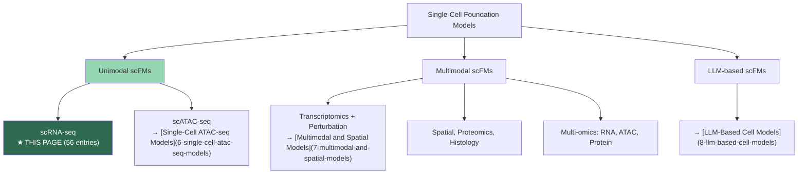
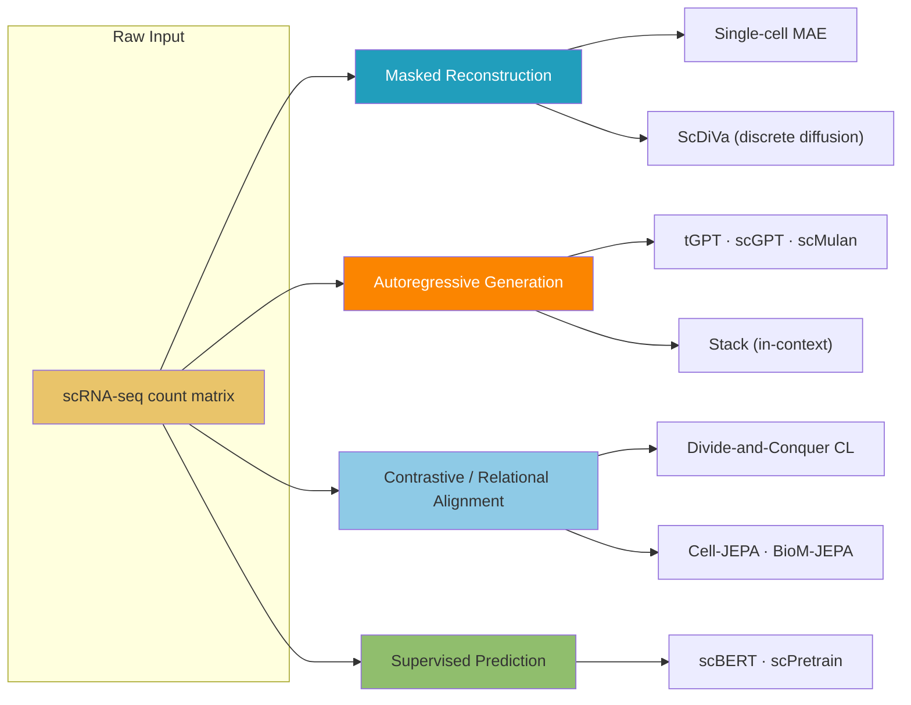

This page catalogs foundation models pretrained **exclusively on scRNA-seq data** — the largest and most mature family in the single-cell foundation model landscape. It is extracted directly from the repository's curated reading list, which follows the review *"The landscape of single-cell foundation models: design principles, applications, and open challenges"*. You'll find a taxonomy positioning map, a training-paradigm breakdown, a 56-entry paper catalog organized by era, and architectural signals worth tracking if you're selecting or building on these models.

Sources: [README.md](README.md#L10-L12), [README.md](README.md#L72-L80)

## Position in the Taxonomy

The repository organizes all single-cell foundation models (scFMs) by **the modality they are pretrained on**. Unimodal scFMs sit at one extreme: a single omic input, learned entirely from transcriptomic structure. This page covers only the `scRNA-seq` leaf; the `scATAC-seq` leaf, multimodal families, and LLM-based models are cataloged on their own pages.

The catalog's unimodal definition is precise: models trained within a single omic modality, learning representations through one of four mechanisms (detailed in the next section). Note that entries are grouped by **pretraining input**, not downstream task — so several spatial-adjacent or proteomics-adjacent titles appear here because their core representations are transcriptomic.

Sources: [README.md](README.md#L72-L80), [README.md](README.md#L138-L146)

## The Evolutionary Tree

The repository opens with an evolutionary tree of single-cell foundation models, credited to [Mooler0410/LLMsPracticalGuide](https://github.com/Mooler0410/LLMsPracticalGuide/tree/main). The scRNA-seq branch visible on the left side of this tree corresponds to the catalog on this page — it's worth cross-referencing the visual lineage against the entries below. For a guided walkthrough of the full tree, see [Evolutionary Tree of Models](3-evolutionary-tree-of-models).

Sources: [README.md](README.md#L18-L24)

## Training Paradigm Landscape

> [!TIP]
> The repository's one-sentence definition of unimodal scFMs encodes the entire design space: **masked reconstruction, autoregressive generation, contrastive/relational alignment, or supervised prediction**. These four objectives determine how a model tokenizes genes, what its pretraining loss looks like, and which downstream fine-tuning strategy it supports — making them the most important axis when comparing papers in this catalog.

| Paradigm | Mechanism | Representative catalog entries |
|---|---|---|
| **Masked reconstruction** | Corrupt gene tokens, train encoder to recover them | Single-cell Masked Autoencoder, ScDiVa, Exceiver |
| **Autoregressive generation** | Predict next gene/expression token sequentially | tGPT, scGPT, scMulan, TranscriptFormer, Stack |
| **Contrastive / relational alignment** | Pull similar cell representations together without token reconstruction | Divide-and-Conquer Contrastive Learning, scConcept, Cell-JEPA, BioM-JEPA |
| **Supervised / task-informed** | Optimize directly for annotation or classification objectives | scBERT (cell type annotation), scPretrain, scCello (ontology-guided) |

Sources: [README.md](README.md#L76-L80)

## The Paper Catalog by Era

The scRNA-seq list spans **2022–2026** and is maintained in reverse-chronological order. Reading it era-by-era reveals the field's trajectory: early transformer language-model transfers, a 2024 scaling wave, and a 2025–2026 frontier exploring efficiency (Mamba/JEPA), world-model framing, and cross-species generalization.

### Foundational Era (2022–2023) — 12 entries

| Model | Venue | Year | Entry point | Signature signal |
|---|---|---|---|---|
| scBERT | Nature Machine Intelligence | 2022 | [[paper]](https://www.nature.com/articles/s42256-022-00534-z) | Pretrained LM for cell type annotation |
| Exceiver | arXiv | 2022 | [[paper]](https://arxiv.org/abs/2210.14330) | Single-cell gene expression language model |
| scPretrain | Bioinformatics | 2022 | [[paper]](https://academic.oup.com/bioinformatics/article/38/6/1607/6499287) | Multi-task self-supervised cell-type classification |
| Geneformer | Nature | 2023 | [[paper]](https://www.nature.com/articles/s41586-023-06139-9) | Transfer learning for network biology predictions |
| xTrimoGene | NeurIPS | 2023 | [[paper]](https://openreview.net/forum?id=gdwcoBCMVi) | Efficient & scalable representation learner |
| tGPT | iScience | 2023 | [[paper]](https://www.cell.com/iscience/fulltext/S2589-0042(23)00613-2) | Generative pretraining on large-scale transcriptomes |
| scPoli | Nature Methods | 2023 | [[paper]](https://www.nature.com/articles/s41592-023-02035-2) | Population-level integration across samples |
| MuSe-GNN | NeurIPS | 2023 | [[paper]](https://openreview.net/forum?id=4UCktT9XZx) | Unified gene representation from biological graphs |
| Single-cell MAE | NeurIPS Workshop | 2023 | [[paper]](https://openreview.net/pdf?id=2mq6uezuGj) | Masked autoencoder + interpretable immunophenotyping |
| Divide-and-Conquer CL | bioRxiv | 2023 | [[paper]](https://arxiv.org/pdf/2306.04371.pdf) | Large-scale contrastive cell representation |
| CellPolaris | bioRxiv | 2023 | [[paper]](https://www.biorxiv.org/content/10.1101/2023.09.25.559244v1) | GRN transfer learning for cell fate |
| scHyena | arXiv | 2023 | [[paper]](https://arxiv.org/abs/2310.02713) | Full-length transcript analysis (sequence-model architecture) |

Sources: [README.md](README.md#L125-L136), [README.md](README.md#L134-L136)

### Scaling Era (2024) — 13 entries

| Model | Venue | Year | Entry point | Signature signal |
|---|---|---|---|---|
| CancerFoundation | bioRxiv | 2024 | [[paper]](https://www.biorxiv.org/content/10.1101/2024.11.01.621087v1) | Drug resistance deciphering |
| AIDO.Cell | bioRxiv | 2024 | [[paper]](https://www.biorxiv.org/content/10.1101/2024.11.28.625303v1) | Dense representations, transcriptome-scale context |
| scCello | NeurIPS | 2024 | [[paper]](https://neurips.cc/virtual/2024/poster/94537) | Cell-ontology guided pretraining |
| scMulan | RECOMB | 2024 | [[paper]](https://link.springer.com/chapter/10.1007/978-1-0716-3989-4_57) | Multitask generative pretrained LM |
| scGPT | Nature Methods | 2024 | [[paper]](https://www.nature.com/articles/s41592-024-02201-0) | Generative AI foundation model |
| scFoundation | Nature Methods | 2024 | [[paper]](https://www.nature.com/articles/s41592-024-02305-7) | Large-scale transcriptomic pretraining |
| SATURN | Nature Methods | 2024 | [[paper]](https://www.nature.com/articles/s41592-024-02191-z) | Universal embeddings across species |
| scPROTEIN | Nature Methods | 2024 | [[paper]](https://www.nature.com/articles/s41592-024-02214-9) | Deep graph contrastive embeddings |
| GeneCompass | Cell Research | 2024 | [[paper]](https://www.nature.com/articles/s41422-024-01034-y) | Knowledge-informed cross-species pretraining |
| Cell-niche graph learning | bioRxiv | 2024 | [[paper]](https://www.biorxiv.org/content/10.1101/2024.02.21.581428v1) | Bio-inspired graph learning in spatial atlases |
| scmFormer | PubMed | 2024 | [[paper]](https://pubmed.ncbi.nlm.nih.gov/38483032/) | Multi-task transformer integration |
| Metadata-as-language | Blog | 2024 | [[paper]](https://www.nxn.se/valent/2024/2/4/single-cell-metadata-as-language) | Single-cell metadata treated as language |
| CellPLM | ICLR | 2024 | [[paper]](https://openreview.net/forum?id=BKXvPDekud) | Pretraining beyond single cells |

Sources: [README.md](README.md#L112-L124)

### Frontier Era (2025–2026) — 31 entries

| Model | Venue | Year | Entry point | Signature signal |
|---|---|---|---|---|
| scRep | bioRxiv | 2026 | [[paper]](https://www.biorxiv.org/content/10.64898/2026.08.31.747784v1) | Latent-space self-distillation |
| scDMC | Genome Biology | 2026 | [[paper]](https://link.springer.com/article/10.1186/s13059-026-04193-w) | Interpretable dual-stream architecture |
| scVision | arXiv | 2026 | [[paper]](https://arxiv.org/abs/2607.14163) | Vision FM via spatial gene cartography |
| Privacy-preserving tabular FM | arXiv | 2026 | [[paper]](https://arxiv.org/abs/2607.19400) | Gene regulation & aging, private tabular learning |
| Universal cell embedding | Nature | 2026 | [[paper]](https://www.nature.com/articles/s41586-026-10689-z) | Foundation for cell biology embeddings |
| MaxToki | bioRxiv | 2026 | [[paper]](https://www.biorxiv.org/content/10.64898/2026.03.30.715396v1) | Temporal model for aging trajectories |
| Lingshu-Cell | arXiv | 2026 | [[paper]](https://arxiv.org/abs/2603.25240) | Generative cellular world model |
| CellVQ | Nature Communications | 2026 | [[paper]](https://www.nature.com/articles/s41467-026-70071-5) | Comprehensive interpretable FM |
| ScDiVa | arXiv | 2026 | [[paper]](https://arxiv.org/abs/2602.03477) | Masked discrete diffusion (identity + expression) |
| BioM-JEPA | arXiv | 2026 | [[paper]](https://arxiv.org/abs/2608.05928) | JEPA over graph-connected gene blocks |
| Cell-JEPA | arXiv | 2026 | [[paper]](https://arxiv.org/abs/2602.02093) | Latent representation learning |
| Stack | bioRxiv | 2026 | [[paper]](https://www.biorxiv.org/content/10.64898/2026.01.09.698608v1) | In-context learning of cell biology |
| scLong | Nature Communications | 2026 | [[paper]](https://www.nature.com/articles/s41467-026-69102-y) | Billion-parameter, long-range gene context |
| RegFormer | Nature Communications | 2026 | [[paper]](https://www.nature.com/articles/s41467-026-72198-x) | Gene regulatory hierarchy backbone |
| GeneformerV2 | Nature Computational Science | 2026 | [[paper]](https://www.nature.com/articles/s43588-026-00972-4) | Scaling + quantization, resource-efficient |
| Latent Diffusion | ICML | 2026 | [[paper]](https://arxiv.org/abs/2511.02986) | Latent diffusion expression generation |
| scPRINT-2 | bioRxiv | 2025 | [[paper]](https://www.biorxiv.org/content/10.64898/2025.12.11.693702v1) | Next-gen FMs and benchmarks |
| Cross-scale FM | bioRxiv | 2025 | [[paper]](https://www.biorxiv.org/content/10.1101/2025.05.16.653447v2.abstract) | Learning across biological scales |
| PULSAR | bioRxiv | 2025 | [[paper]](https://www.biorxiv.org/content/10.1101/2025.11.24.685470v1) | Multi-scale, multicellular biology |
| scConcept | bioRxiv | 2025 | [[paper]](https://www.biorxiv.org/content/10.1101/2025.10.14.682419v1) | Contrastive pretraining beyond reconstruction |
| scPEFT | Nature Machine Intelligence | 2025 | [[paper]](https://www.nature.com/articles/s42256-025-01170-z) | Parameter-efficient fine-tuning toolkit |
| scNET | Nature Methods | 2025 | [[paper]](https://www.nature.com/articles/s41592-025-02627-0) | PPI-integrated gene/cell embeddings |
| TranscriptFormer | Science | 2025 | [[paper]](https://www.science.org/doi/10.1126/science.aec8514) | Cross-species atlas, 1.5B years evolution |
| TEDDY | arXiv | 2025 | [[paper]](https://arxiv.org/abs/2503.03485) | Family of FMs for cell biology |
| Tabula | NeurIPS | 2025 | [[paper]](https://openreview.net/forum?id=Vk2sfKAdeu) | Tabular self-supervised pretraining |
| scPRINT | Nature Communications | 2025 | [[paper]](https://www.nature.com/articles/s41467-025-58699-1) | 50M-cell pretraining, gene network prediction |
| CellFM | Nature Communications | 2025 | [[paper]](https://www.nature.com/articles/s41467-025-59926-5) | 100M human cells pretraining |
| Cell-GraphCompass | National Science Review | 2025 | [[paper]](https://academic.oup.com/nsr/article/12/10/nwaf255/8172492) | Graph-structure foundation model |
| SCimilarity | Nature | 2025 | [[paper]](https://www.nature.com/articles/s41586-024-08411-y) | Scalable similar-cell search |
| EVA | bioRxiv | 2025 | [[paper]](https://www.biorxiv.org/content/10.1101/2025.05.02.651839v1) | Immuno-inflammation drug development |
| GeneMamba | arXiv | 2025 | [[paper]](https://arxiv.org/abs/2504.16956) | Bidirectional Mamba, efficient context |

Sources: [README.md](README.md#L81-L96), [README.md](README.md#L97-L111)

## Catalog Statistics

> [!TIP]
> When evaluating maturity of a model before adoption, the venue column is a useful proxy: journal acceptance at Nature/Cell-family venues generally indicates peer-validated benchmarks, while arXiv/bioRxiv entries mark active research frontiers you can follow before official release.

| Dimension | Distribution |
|---|---|
| **By year** | 2022: 3 · 2023: 9 · 2024: 13 · 2025: 15 · 2026: 16 — **Total: 56** |
| **By venue type** | Peer-reviewed journals: 23 · Preprints (arXiv/bioRxiv): 23 · ML/CS conferences (NeurIPS, ICLR, ICML, RECOMB): 8 · Other: 2 |
| **Publication velocity** | Pre-2024 entries (12) vs. 2025–2026 entries (31) — the field roughly tripled in the last two catalog years |

Sources: [README.md](README.md#L80-L136)

## Developer's Lens: Architectural Signals Worth Tracking

Beyond individual papers, the catalog reveals four recurring architectural themes. If you're choosing a base model for fine-tuning (see [scPEFT](https://www.nature.com/articles/s42256-025-01170-z)) or designing a successor, these clusters represent the current design space.

| Architecture family | Motivation | Catalog exemplars |
|---|---|---|
| **Transformer scaling** | Capacity via parameter/data scale | scFoundation, CellFM (100M cells), scPRINT (50M cells), scLong (billion-param), GeneformerV2 |
| **Efficient sequence models** | Linear-time or long-context attention | xTrimoGene, scHyena, GeneMamba (bidirectional Mamba) |
| **Graph / network-informed encoders** | Inject gene regulatory or PPI structure | MuSe-GNN, Cell-GraphCompass, RegFormer, scNET, BioM-JEPA |
| **Joint-embedding (JEPA-style)** | Predict in latent space, avoid pixel-level reconstruction | Cell-JEPA, BioM-JEPA, scConcept |

A complementary cross-cutting axis is **organism coverage**: SATURN and SATURN-style universal embeddings target cross-species integration, GeneCompass injects cross-species regulatory knowledge, and TranscriptFormer extends the atlas across 1.5 billion years of evolution — evidence that "unimodal" refers to modality, not to a single training distribution.

Sources: [README.md](README.md#L97-L111), [README.md](README.md#L112-L124), [README.md](README.md#L125-L136)

## Suggested Reading Progression

This page covers the transcriptomic-only subset of the unimodal family. Natural next steps follow the catalog's structure:

1. **[Single-Cell ATAC-seq Models](6-single-cell-atac-seq-models)** — the sibling unimodal branch (chromatin accessibility: CLM-Access, Atacformer, ChromFound, EpiFoundation, EpiAgent, GET, ChromBERT).
2. **[Multimodal and Spatial Models](7-multimodal-and-spatial-models)** — models that jointly encode transcriptomics with perturbational, spatial, proteomic, or epigenomic inputs.
3. **[LLM-Based Cell Models](8-llm-based-cell-models)** — approaches leveraging large language models for cell representation.
4. For the conceptual framework unifying all four families, return to **[Taxonomy of Single-Cell Foundation Models](4-taxonomy-of-single-cell-foundation-models)**.

If your goal is applied work — perturbation response prediction, virtual cell simulation, or benchmark selection — proceed to the dedicated sections starting at [Perturbation Prediction Frameworks](9-perturbation-prediction-frameworks) and [Benchmarking Studies and Critiques](17-benchmarking-studies-and-critiques).
