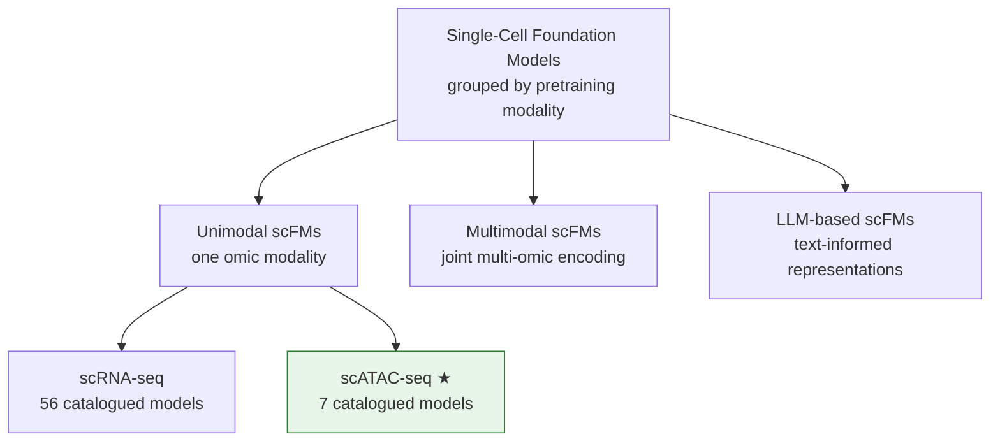
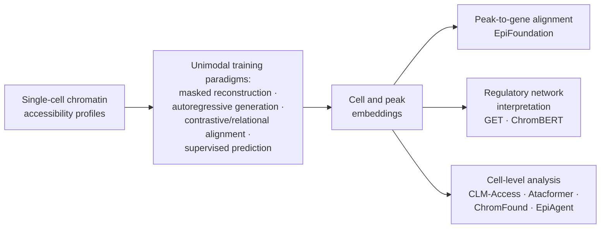

This page documents the **unimodal scATAC-seq branch** of the OmicsML catalog of single-cell foundation models — a curated reading list that follows the review *"The landscape of single-cell foundation models: design principles, applications, and open challenges"*. Here you will find the seven foundation models pretrained exclusively on single-cell chromatin accessibility data, their publication venues, the design motifs they declare, and clear boundaries separating them from multimodal work that also consumes ATAC-seq.

Sources: [README.md](/README.md#L10-L12), [README.md](/README.md#L138-L145)

## Scope and Taxonomy Position

The repository organizes single-cell foundation models **by the modality they are pretrained on**: unimodal (a single omic), multimodal (jointly modeling transcriptomic, epigenomic, proteomic, and spatial data), and LLM-based. Within the unimodal branch, models "learn representations through masked reconstruction, autoregressive generation, contrastive/relational alignment, or supervised prediction" — this is the training-paradigm vocabulary that applies to both unimodal sub-branches, scRNA-seq and scATAC-seq.

The diagram below situates this page within the catalog's taxonomy, using the entry counts verified in the README:

The repository also ships a canonical visualization of the field's evolution, useful for anchoring the ATAC branch within the broader model landscape:

Sources: [README.md](/README.md#L39-L49), [README.md](/README.md#L72-L78), [README.md](/README.md#L22-L24)

## The Seven-Model Catalog

The `scATAC-seq` section lists exactly **seven entries**. Each entry records a publication year, venue, model name, and a direct paper link — the full verifiable surface of the catalog entry format. The table below is a faithful expansion of that section:

| Model | Year | Venue | Declared focus (from title) | Paper |
|---|---|---|---|---|
| **CLM-Access** | 2026 | AAAI | High-dimensional single-cell ATAC-seq analysis | [link](https://ojs.aaai.org/index.php/AAAI/article/view/37046) |
| **Atacformer** | 2025 | bioRxiv | Transformer-based analysis and interpretation of ATAC-seq | [link](https://www.biorxiv.org/content/10.1101/2025.11.03.685753v1) |
| **ChromFound** | 2025 | NeurIPS | Universal foundation model for chromatin accessibility | [link](https://arxiv.org/abs/2505.12638) |
| **EpiFoundation** | 2025 | bioRxiv | Peak-to-gene alignment | [link](https://www.biorxiv.org/content/10.1101/2025.02.05.636688v2) |
| **EpiAgent** | 2025 | Nature Methods | Single-cell epigenomics | [link](https://www.nature.com/articles/s41592-025-02822-z) |
| **GET** | 2025 | Nature | Foundation model of transcription across human cell types | [link](https://www.nature.com/articles/s41586-024-08391-z) |
| **ChromBERT** | 2025 | Cell Genomics | Interpretable representations of transcriptional regulatory networks | [link](https://www.cell.com/cell-genomics/fulltext/S2666-979X(25)00386-6) |

> [!TIP]
> The catalog quantifies a striking **modality asymmetry**: the scRNA-seq sibling section holds 56 entries versus 7 here — roughly an 8:1 ratio. For developers selecting a starting point, this means the unimodal ATAC-seq landscape is a frontier with fewer, more recent options, not a saturated field where exhaustive benchmarking against dozens of predecessors is required.

Sources: [README.md](/README.md#L138-L145), [README.md](/README.md#L81-L136)

## Publication Timeline and Venue Signal

All seven entries fall within a **two-year publication window (2025–2026)**, confirming this is the youngest branch of the unimodal landscape — the scRNA-seq branch, by contrast, stretches back to 2022. The venue distribution splits cleanly into three classes, each carrying a different signal about maturity and review status:

| Venue class | Models | What the signal means |
|---|---|---|
| High-impact journals | GET (*Nature*), EpiAgent (*Nature Methods*), ChromBERT (*Cell Genomics*) | Peer-reviewed validation at top life-science venues |
| ML conferences | ChromFound (NeurIPS), CLM-Access (AAAI) | Method-driven contributions vetted by the ML community |
| Preprints | Atacformer, EpiFoundation (bioRxiv) | Most recent entries, still under community review |

For an intermediate developer planning adoption, this distribution implies: three models have journal-grade evidence trails, two have ML-conference vetting, and the two preprints represent the current technical frontier whose claims are not yet peer-reviewed.

Sources: [README.md](/README.md#L138-L145)

## Design Motifs: What Distinguishes ATAC-seq Pretraining

Because the catalog encodes each model's positioning in its title, the seven entries reveal distinct **design motifs** — each addressing a known challenge of chromatin accessibility data: extreme dimensionality (hundreds of thousands of sparse peaks), the need to connect accessible peaks to target genes, and the goal of interpretable transcriptional regulation. The table below grounds every motif in the exact title text:

| Design motif | Representative model | Catalog title claim |
|---|---|---|
| Accessibility universality | ChromFound | "Towards A Universal Foundation Model for Single-Cell Chromatin Accessibility Data" |
| High-dimensional efficiency | CLM-Access | "specialized foundation model for high-dimensional single-cell ATAC-seq analysis" |
| Peak-to-gene alignment | EpiFoundation | "A Foundation Model for Single-Cell ATAC-seq via Peak-to-Gene Alignment" |
| Epigenomic generality | EpiAgent | "foundation model for single-cell epigenomics" |
| Cross-cell-type transcription | GET | "A foundation model of transcription across human cell types" |
| Interpretable regulatory networks | ChromBERT | "interpretable representations for context-specific transcriptional regulatory networks" |
| Transformer-based analysis | Atacformer | "transformer-based foundation model for analysis and interpretation of ATAC-seq data" |

The concept map below relates these motifs as a pipeline: raw chromatin accessibility profiles are consumed by the four unimodal training paradigms defined in the catalog, producing embeddings that different models push toward either regulatory interpretation or cell-level analysis:

> [!TIP]
> **Peak-to-gene alignment** is the only explicitly named biological prior across all seven titles. When evaluating EpiFoundation against accessibility-only approaches, this is the architectural differentiator to scrutinize: it directly links open chromatin regions to putative target genes, bridging the epigenomic input modality toward transcriptomic semantics.

Sources: [README.md](/README.md#L138-L145), [README.md](/README.md#L76-L78)

## Boundary: Where Multimodal ATAC Work Lives

Several cataloged models combine ATAC-seq with other omics — for example **SCARF** ("Single Cell ATAC-seq and RNA-seq Foundation model") and **CLM-X** (a "flexible multi-way Transformer for unified scRNA-seq and scATAC-seq analysis"). These are deliberately **excluded from this page**: the catalog files them under the *Multi-omics: RNA, ATAC and Protein* subsection of the multimodal branch, and they are covered in depth on the multimodal page. Keeping this boundary sharp prevents misclassification when you cite or benchmark against this catalog.

Sources: [README.md](/README.md#L191-L201)

## Suggested Reading Progression

To build complete context around this branch, follow the catalog's own structure:

1. **[Taxonomy of Single-Cell Foundation Models](4-taxonomy-of-single-cell-foundation-models)** — the modality-based grouping logic that defines what "unimodal" means here.
2. **[Unimodal scRNA-seq Models](5-unimodal-scrna-seq-models)** — the sibling branch; its 56 entries are the maturity benchmark against which the seven ATAC models should be read.
3. **[Multimodal and Spatial Models](7-multimodal-and-spatial-models)** — the mandatory next stop for RNA+ATAC joint models such as SCARF and CLM-X.
4. **[Evolutionary Tree of Models](3-evolutionary-tree-of-models)** — the visual companion to the taxonomy if you prefer a top-down view first.
