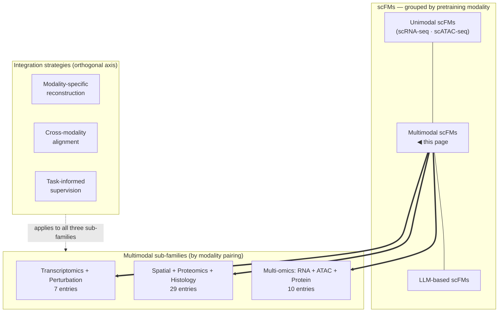
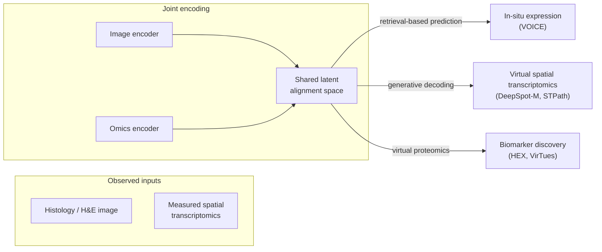

This page documents the **multimodal branch** of the single-cell foundation model landscape: models that jointly encode complementary modalities — transcriptomic, epigenomic, proteomic, perturbational and spatial — through modality-specific reconstruction, cross-modality alignment, or task-informed supervision. The catalog currently curates **46 entries** in this family, organized into three sub-families: *Transcriptomics and Perturbation* (7), *Spatial, Proteomics and Histology* (29), and *Multi-omics: RNA, ATAC and Protein* (10). Because the source repository is a curated reading list rather than a codebase, this page treats the catalog itself as the architecture under analysis — reconstructing the design space, the integration patterns, and the boundaries that separate this family from its neighbors.

Sources: [README.md](README.md#L147-L150)

## Position in the Model Taxonomy

Before reading the diagram below, note two prerequisites: the catalog's top-level grouping criterion is the **set of modalities a model is pretrained on** — unimodal (a single omic), multimodal (jointly modeling transcriptomic, epigenomic, proteomic, and spatial signals), and LLM-based (models incorporating text or language-model priors). Within the multimodal branch, the catalog applies a second axis: the *specific modality pairing* being coupled. The diagram makes both axes explicit.

The three integration strategies — reconstruction, alignment, and task-informed supervision — are declared by the catalog as applying across the whole multimodal family rather than being owned by any single sub-family. You can verify this from titles alone: alignment appears in spatial models (`ST-Align`, `OmiCLIP`, `scCLIP`), reconstruction in multi-omics (`CellWorld`, `HoloCell`), and task-informed supervision in perturbation coupling (`STATE`, `PertFormer`).

| Sub-family | Entries | Modality coupling | Defining signal in titles |
|---|---|---|---|
| Transcriptomics + Perturbation | 7 | Expression ↔ genetic/compound perturbation | "predicting perturbation responses", "conditional transport" |
| Spatial + Proteomics + Histology | 29 | Expression ↔ tissue coordinates ↔ image ↔ protein | "spatial transcriptomics", "from histology", "spatial proteomics" |
| Multi-omics: RNA + ATAC + Protein | 10 | Transcriptome ↔ chromatin ↔ proteome | "unified scRNA-seq and scATAC-seq", "translating transcriptomes to proteomes" |

Sources: [README.md](README.md#L72-L74), [README.md](README.md#L147-L150), [README.md](README.md#L151-L201)

## Sub-family I: Transcriptomics and Perturbation

This is the smallest sub-family (7 entries) and the one with the most deliberate catalog placement. The perturbation section header explicitly notes: *"Perturbation-trained scFMs such as X-Cell, SCALE, PerturbGen, STATE, GeneJepa and Tahoe-x1 are listed under Multimodal scFMs"* — meaning these models are treated as **transcriptome–perturbation multimodal models first**, and only their downstream prediction frameworks belong to the dedicated perturbation section. For an advanced reader, this placement encodes a real architectural claim: these systems bake perturbation response into pretraining, rather than layering prediction on top of a frozen expression model.

> [!TIP]
> When searching this repository for STATE, Tahoe-x1, or SCALE, look here — not in the Genetic Perturbation section. The catalog's own cross-listing note (README.md#L239) is the authoritative placement rule.

| Model | Venue / Year | Coupling signal (from title) |
|---|---|---|
| [scDEBART](https://openreview.net/forum?id=pJyidZg93y) | 2026 ICML | In silico perturbation responses via large-scale differential expression learning |
| [X-Cell](https://www.biorxiv.org/content/10.64898/2026.03.18.712807v1) | 2026 bioRxiv | Causal perturbation prediction across cellular contexts via diffusion language models |
| [SCALE](https://arxiv.org/abs/2603.17380) | 2026 arXiv | Conditional atlas-level endpoint transport for virtual cell perturbation prediction |
| [PerturbGen](https://www.biorxiv.org/content/10.64898/2026.03.04.709254v1) | 2026 bioRxiv | Predicting how perturbations reshape cellular trajectories |
| [STATE](https://www.cell.com/cell/fulltext/S0092-8674(26)00921-9) | 2026 Cell | Cellular responses to perturbation across diverse contexts |
| [GeneJepa](https://www.biorxiv.org/content/10.1101/2025.10.14.682378v1) | 2025 bioRxiv | Predictive world model of the transcriptome |
| [Tahoe-x1](https://www.biorxiv.org/content/10.1101/2025.10.23.683759v1) | 2025 bioRxiv | Perturbation-trained scFM scaled to 3B parameters |

Note the methodological spread visible in the titles alone: diffusion-based generation (X-Cell), optimal-transport-style endpoint modeling (SCALE), trajectory prediction (PerturbGen), and joint-embedding predictive architectures (GeneJepa). Tahoe-x1's title also signals the scale dimension — it is the perturbation counterpart to the parameter-scaling race documented in the unimodal branch.

Sources: [README.md](README.md#L151-L158), [README.md](README.md#L237-L239)

## Sub-family II: Spatial, Proteomics, and Histology

The largest sub-family (29 entries) spans a verifiable **scale axis** that its own titles make explicit: from *subcellular molecular* to *multicellular landscapes* ([SpatialFormer](https://www.nature.com/articles/s43588-026-01016-7)), *single-cell resolved* brain atlases ([BrainBeacon](https://www.biorxiv.org/content/10.1101/2025.07.08.663729v1)), *across scales* spatial proteomics ([VirTues](https://www.nature.com/articles/s41586-026-10884-y)), and *multi-scale* tissue modeling ([SToFM](https://arxiv.org/abs/2507.11588), [TERRA](https://www.biorxiv.org/content/10.64898/2026.07.29.741565v1)). Analytically, the entries cluster into five distinguishable engineering patterns, each verifiable from title semantics: **native spatial pretraining**, **graph/topology-based modeling**, **vision–omics translation** (inferring molecular profiles from histology), **spatial proteomics**, and **spatial multimodal generation**.

The vision–omics translation pattern deserves its own module-level view, since it dominates recent entries. The prerequisite for reading the diagram: these systems pair an image encoder (histology/H&E) with an omics encoder (spatial expression), couple them in a joint latent space, then either retrieve or decode *virtual* molecular measurements at locations where only the image exists.

The following tables decompose all 29 entries by pattern. Placement follows the catalog exactly; pattern labels are derived strictly from title text.

**Native spatial transcriptomics pretraining** — models pretrained on spatially resolved expression as a first-class signal:

| Model | Venue / Year | Scope signal (from title) |
|---|---|---|
| [SpatialFormer](https://www.nature.com/articles/s43588-026-01016-7) | 2026 Nat. Comput. Sci | Subcellular molecular → multicellular landscapes |
| [CellWorld](https://arxiv.org/abs/2608.06659) | 2026 arXiv | Gene-level reconstruction → latent cell prediction |
| [TERRA](https://www.biorxiv.org/content/10.64898/2026.07.29.741565v1) | 2026 bioRxiv | Multi-scale human tissue modeling |
| [xVERSE](https://www.biorxiv.org/content/10.64898/2026.04.12.718016v1) | 2026 bioRxiv | Transcriptomics-native universal cell representation, virtual cell synthesis |
| [STORM](https://arxiv.org/abs/2604.03630) | 2026 arXiv | Spatial transcriptomics + histology for discovery and clinical prediction |
| [OmniCell](https://www.biorxiv.org/content/10.64898/2025.12.29.696804v1) | 2025 bioRxiv | Unified single-cell and spatial transcriptomics |
| [scGPT-spatial](https://www.biorxiv.org/content/10.1101/2025.02.05.636714v1) | 2025 bioRxiv | Continual pretraining of a unimodal scFM for spatial data |
| [SToFM](https://arxiv.org/abs/2507.11588) | 2025 ICML | Multi-scale spatial transcriptomics |
| [Nicheformer](https://www.nature.com/articles/s41592-025-02814-z) | 2025 Nat. Methods | Single-cell and spatial omics |
| [AIDO.Tissue](https://www.biorxiv.org/content/10.1101/2025.07.04.663102v1) | 2025 bioRxiv | Spatial cell-guided pretraining |
| [stFormer](https://www.biorxiv.org/content/10.1101/2024.09.27.615337v7) | 2024 bioRxiv | Foundation model for spatial transcriptomics |
| [BrainBeacon](https://www.biorxiv.org/content/10.1101/2025.07.08.663729v1) | 2025 bioRxiv | Cross-species, single-cell resolved brain spatial transcriptomics |

Two entries in this group encode an architectural transition worth noting: `scGPT-spatial` demonstrates **continual pretraining** (extending an existing unimodal checkpoint into the spatial domain), while `OmniCell` demonstrates **unified pretraining** (single-cell and spatial jointly from the start).

Sources: [README.md](README.md#L160-L189)

**Graph and topology-based modeling** — spatial structure as explicit graph structure rather than sequence tokens:

| Model | Venue / Year | Topology signal (from title) |
|---|---|---|
| [Novae](https://www.nature.com/articles/s41592-025-02899-6) | 2025 Nat. Methods | Graph-based foundation model for spatial transcriptomics |
| [HEIST](https://arxiv.org/abs/2506.11152) | 2025 arXiv | Graph foundation model for spatial transcriptomics *and proteomics* |
| [SpatialFusion](https://www.biorxiv.org/content/10.64898/2026.03.16.712056v1) | 2026 bioRxiv | Lightweight multimodal model, pathway-informed spatial niche mapping |
| [SWITCH](https://www.nature.com/articles/s43588-025-00891-w) | 2025 Nat. Comput. Sci | Integrative deep learning of spatial multi-omics |

Sources: [README.md](README.md#L160-L189)

**Vision–omics translation** — image-to-molecule prediction, the pattern diagrammed above:

| Model | Venue / Year | Direction (from title) |
|---|---|---|
| [VOICE](https://arxiv.org/abs/2608.08366) | 2026 arXiv (KDD 2027 Oral) | Direct + retrieval-based prediction of in-situ single-cell expression from vision |
| [DeepSpot-M](https://www.medrxiv.org/content/10.64898/2026.06.19.26356060v1) | 2026 medRxiv | Transcriptome-wide *virtual* spatial transcriptomics from histology |
| [HEX](https://www.nature.com/articles/s41591-025-04060-4) | 2026 Nat. Medicine | Virtual spatial proteomics from histopathology; biomarker discovery in lung cancer |
| [SpaFoundation](https://www.biorxiv.org/content/10.1101/2025.08.07.669202v1) | 2025 bioRxiv | Spatial gene expression inferred from tissue images |
| [STPath](https://www.nature.com/articles/s41746-025-02020-3) | 2025 npj Digital Medicine | Generative integration of spatial transcriptomics + whole-slide images |
| [OmiCLIP](https://www.nature.com/articles/s41592-025-02707-1) | 2025 Nat. Methods | Visual–omics contrastive bridging of histopathology and spatial transcriptomics |
| [ST-Align](https://arxiv.org/abs/2411.16793) | 2024 arXiv | Image–gene alignment |
| [Integrating Histology with Spatial Molecular Programs](https://www.biorxiv.org/content/10.64898/2026.06.01.729028v1) | 2026 bioRxiv | Histology ↔ spatial molecular programs (unnamed entry in catalog) |

Sources: [README.md](README.md#L160-L189)

**Spatial proteomics** — protein-channel analogues of the expression models:

| Model | Venue / Year | Signal (from title) |
|---|---|---|
| [VirTues](https://www.nature.com/articles/s41586-026-10884-y) | 2026 Nature | Virtual tissues foundation model; spatial proteomics across scales |
| [Spatium](https://www.biorxiv.org/content/10.64898/2026.07.23.740264v1) | 2026 bioRxiv | Protein language foundation model for spatial proteomics |
| [KRONOS](https://arxiv.org/abs/2506.03373) | 2025 arXiv | Foundation model for spatial proteomics |

Sources: [README.md](README.md#L160-L189)

**Spatial multimodal generation** — models generating or translating across spatial modalities:

| Model | Venue / Year | Signal (from title) |
|---|---|---|
| [SPATIA](https://arxiv.org/abs/2507.04704) | 2025 arXiv | Multimodal *generation* and prediction of spatial cell phenotypes |
| [SpaTranslator](https://www.biorxiv.org/content/10.1101/2025.11.15.688644v1) | 2025 bioRxiv | Universal spatial multi-omics cross-modality *translation* |
| [CellWorld](https://arxiv.org/abs/2608.06659) | 2026 arXiv | Reconstruction → latent cell prediction (also listed above for pretraining scope) |

Sources: [README.md](README.md#L160-L189)

## Sub-family III: Multi-omics — RNA, ATAC, and Protein

The third sub-family (10 entries) couples the *molecular* omics layers: transcriptome, chromatin accessibility, and proteome. Titles split these models into two verifiable design postures. **Joint embedding** postures train a single backbone over multiple co-measured or co-assayed layers (SCARF on paired ATAC/RNA, CAPTAIN on co-assayed RNA/protein, CLM-X with a "flexible multi-way Transformer" for unified scRNA-seq/scATAC-seq analysis). **Cross-modality translation** postures train generative mappings between modality pairs (scTranslator translating transcriptomes to proteomes; scLinguist performing "cross-modality translation" with a hyena backbone).

| Model | Venue / Year | Posture | Modality pair (from title) |
|---|---|---|---|
| [RegFM](https://www.biorxiv.org/content/10.64898/2026.08.17.744355v1) | 2026 bioRxiv | Regulation-centric | Human transcriptional regulation |
| [HoloCell](https://www.biorxiv.org/content/10.64898/2026.06.07.730684v1) | 2026 bioRxiv | Generative | Holistic cellular modeling |
| [CLM-X](https://www.biorxiv.org/content/10.64898/2026.02.17.704943v1) | 2026 bioRxiv | Joint embedding | RNA + ATAC via multi-way Transformer |
| [Bayesian HPO for scGPT fine-tuning](https://academic.oup.com/bioinformatics/article/42/7/btag374/8707330) | 2026 Bioinformatics | Fine-tuning study | Multi-omics integration on top of scGPT |
| [CAPTAIN](https://www.nature.com/articles/s41467-026-72882-y) | 2026 Nat. Commun | Joint embedding | Co-assayed RNA + protein |
| [SCARF](https://www.biorxiv.org/content/10.1101/2025.04.07.647689v1) | 2025 bioRxiv | Joint embedding | ATAC-seq + RNA-seq |
| [scLinguist](https://www.biorxiv.org/content/10.1101/2025.09.30.679123v1) | 2025 bioRxiv | Translation | Cross-modality translation (hyena backbone) |
| [scTranslator](https://www.nature.com/articles/s41551-025-01528-z) | 2025 Nat. Biomed. Eng | Translation | Transcriptome → proteome |
| [PertFormer](https://www.biorxiv.org/content/10.1101/2024.12.19.629561v2) | 2024 bioRxiv | Multimodal predictive | Zero-shot functional perturbations + cell fate dynamics |
| [scCLIP](https://openreview.net/pdf?id=KMtM5ZHxct) | 2023 NeurIPS Workshop | Contrastive alignment | Multi-modal contrastive integration pretraining |

Observe the early-to-late trajectory inside this table: scCLIP (2023) established contrastive integration; SCARF and PertFormer (2024–2025) matured joint and predictive formulations; 2026 entries (CLM-X, CAPTAIN, HoloCell, RegFM) push toward unified multi-way architectures and holistic generative modeling.

Sources: [README.md](README.md#L191-L201)

## The Model–Corpus Co-Design Pattern

> [!TIP]
> Three entries on this page are inseparable from pretraining corpora cataloged under Data Foundations: SToFM↔SToCorpus-88M, Nicheformer↔SpatialCorpus-110M, and SCARF↔X-Omics (2.7M cells). When evaluating these models, read the corpus paper on [Multimodal Pretraining Corpora](15-multimodal-pretraining-corpora) first — the corpus entry is the pretraining-data specification for the model entry here.

This co-design pattern is systematic, not coincidental: spatial and multi-omics domains lack a universal public corpus comparable to what unimodal transcriptomics enjoys, so several multimodal model papers *ship their own corpus* as a contribution. The pairing is visible by matching entries across catalog sections:

| Model (this page) | Paired corpus (Data Foundations) | Corpus scale |
|---|---|---|
| [SToFM](https://arxiv.org/abs/2507.11588) | [SToCorpus-88M](https://arxiv.org/abs/2507.11588) | 88M |
| [Nicheformer](https://www.nature.com/articles/s41592-025-02814-z) | [SpatialCorpus-110M](https://www.nature.com/articles/s41592-025-02814-z) | 110M |
| [SCARF](https://www.biorxiv.org/content/10.1101/2025.04.07.647689v1) | [SCARF / X-Omics](https://www.biorxiv.org/content/10.1101/2025.04.07.647689v1) | 2.7M cells |

Sources: [README.md](README.md#L179-L181), [README.md](README.md#L351-L355)

## Where This Family Ends: Adjacent Territories

Three boundaries keep this page well-scoped, each enforced by explicit catalog decisions. First, models whose multimodality is **text-mediated** — incorporating LLMs or textual biological knowledge into cellular representation learning — belong to [LLM-Based Cell Models](8-llm-based-cell-models), even when they touch spatial data (e.g., OCellus, spEMO, CELLama). Second, perturbation *prediction frameworks* built atop foundation models (flow matching, diffusion solvers, benchmark suites) belong to [Perturbation Prediction Frameworks](9-perturbation-prediction-frameworks); only perturbation-*trained* foundation models live here, per the catalog's cross-listing note. Third, the pretraining corpora underlying this family are cataloged under [Multimodal Pretraining Corpora](15-multimodal-pretraining-corpora), not duplicated here.

The recommended reading path for an advanced developer entering this branch: ground the vocabulary with [Unimodal scRNA-seq Models](5-unimodal-scrna-seq-models) and [Single-Cell ATAC-seq Models](6-single-cell-atac-seq-models), study the modality-coupling strategies on this page, then proceed to [LLM-Based Cell Models](8-llm-based-cell-models) for the text-augmented branch, and finally [Multimodal Pretraining Corpora](15-multimodal-pretraining-corpora) to examine the data substrate that makes multimodal pretraining feasible.
