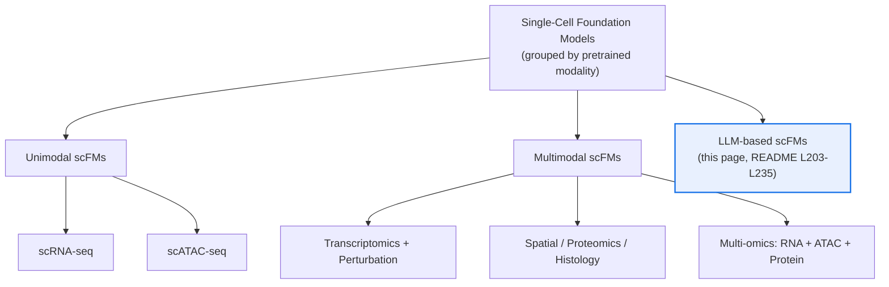
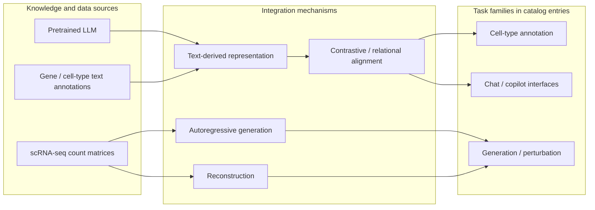

This page documents the **LLM-based scFMs** category of the *Awesome Foundation Models for Single-Cell* catalog — the third and final family of the **Core Model Landscape**. It covers the 29 curated papers (2024–2026) filed under the repository section `### LLM-based scFMs`, which the catalog defines as: *"Models that incorporate large language models or textual biological knowledge into cellular representation learning — through reconstruction, autoregressive generation, contrastive/relational alignment, or text-derived representation."* Throughout this page, **scFM** denotes a single-cell foundation model, following the repository's own naming convention.

Sources: [README.md](README.md#L203-L205), [README.md](README.md#L39-L49)

## Position in the Model Landscape

The catalog organizes all single-cell foundation models by the modalities they are pretrained on, producing three families: **unimodal** (a single omic), **multimodal** (jointly modeling multiple omics), and **LLM-based** (language knowledge integrated into cellular representation learning). The LLM-based family closes the *Single-Cell Foundation Models* branch of the catalog — it is the last section before the catalog pivots to perturbation-specific resources. Structurally, this means the category is scoped by *knowledge source* (LLMs/text) rather than by *data modality*, which distinguishes it from the two families preceding it in [Unimodal scRNA-seq Models](5-unimodal-scrna-seq-models) and [Multimodal and Spatial Models](7-multimodal-and-spatial-models).

The repository's evolutionary tree situates all three families — including the LLM-based lineage — within the field's historical development (credited to Mooler0410/LLMsPracticalGuide):

The following diagram, derived from the catalog structure, shows where this page sits relative to its sibling families. Read it as a navigation map: each leaf is a dedicated catalog section, and the highlighted node is the material documented here.

Sources: [README.md](README.md#L72-L78), [README.md](README.md#L41-L49), [README.md](README.md#L18-L24)

## The Integration Design Space

The section's one-line definition enumerates **four integration mechanisms** that constitute the design space of this field: reconstruction, autoregressive generation, contrastive/relational alignment, and text-derived representation. Comparing this enumeration with the unimodal scFM definition reveals a deliberate structural choice — the unimodal family lists *"masked reconstruction, autoregressive generation, contrastive/relational alignment, or supervised prediction"*, meaning the LLM-based category **inherits three of the four training objectives** and swaps the fourth (*supervised prediction* → *text-derived representation*). The catalog therefore treats language integration not as a separate architecture, but as an alternative knowledge pathway plugged into the same objective taxonomy.

The flow below maps how textual knowledge and single-cell data converge on the four mechanisms and fan out into the downstream task families represented in the catalog entries. Prerequisite for reading it: the left column lists the two input sources (pretrained LLMs + curated gene/cell-type text; count matrices), the middle column the four mechanisms from the section definition, and the right column the task families that recur across entry titles (annotation, chat/copilot interfaces, generation and perturbation).

> [!TIP]
> The four mechanisms are not mutually exclusive in practice — entry titles such as *OKR-Cell* ("Robust Cross-Modal Cell-Language Pre-training") and *CellTok* ("Early-Fusion Multimodal Large Language Model ... via Tokenization") describe systems that combine alignment with generative tokenization, so read the mechanism labels below as primary integration pathways rather than strict partitions.

Sources: [README.md](README.md#L203-L205), [README.md](README.md#L76-L78)

## Curated Catalog: 29 Models Across Six Integration Families

The catalog does not subdivide this section internally, so the grouping below is an analytical classification derived strictly from entry titles, covering **all 29 entries** with no omissions. Each family corresponds to a distinct point in the integration design space described above. Entries are listed newest-first, matching the repository's reverse-chronological ordering.

| Family | Model | Year | Venue |
|---|---|---|---|
| **F1: Cell–text representation alignment** | OKR-Cell | 2026 | bioRxiv |
| | scKITE | 2026 | arXiv |
| | GenePT Revisited | 2026 | ICLR Workshop |
| | CELLama | 2026 | Advanced Science |
| | CellHermes | 2025 | bioRxiv |
| | CellTok | 2025 | bioRxiv |
| | sciLaMA | 2025 | ICML |
| | scMMGPT | 2025 | arXiv |
| | scELMo | 2025 | Patterns |
| | GenePT | 2025 | Nature Biomedical Engineering |
| | LangCell | 2024 | ICML |
| | Joint embedding of transcriptomes and text | 2024 | ICLR Workshop |
| | Cell2Sentence | 2024 | ICML |
| **F2: Natural-language interfaces** | OCellus | 2026 | bioRxiv |
| | scChat | 2026 | AIChE Journal |
| | TissueNarrator* | 2025 | bioRxiv |
| | Cell2Text | 2025 | arXiv |
| | InstructCell | 2025 | arXiv |
| | CellWhisperer | 2025 | Nature Biotechnology |
| | scReader | 2024 | arXiv |
| **F3: LLM-driven annotation** | mLLMCelltype | 2025 | bioRxiv |
| | Assessing GPT-4 for cell type annotation | 2024 | Nature Methods |
| **F4: LLM-based generative transcriptomics** | RVQ-Alpha | 2026 | bioRxiv |
| | PGL | 2026 | bioRxiv |
| | TissueNarrator | 2025 | bioRxiv |
| **F5: LLM-informed perturbation modeling** | LangPert | 2025 | ICLR Workshop |
| | LLM-informed gene embeddings | 2024 | ICLR Workshop |
| **F6: Hybrid bridging and scale** | spEMO | 2026 | Nature Biomedical Engineering |
| | C2S-Scale | 2025 | bioRxiv |
| | scMPT | 2025 | arXiv |

\**TissueNarrator appears in both F2 and F4 because its title ("Generative Modeling of Spatial Transcriptomics with Large Language Models") evidences both a language-generation output and LLM-driven generation of expression data; counted once, total is 29.*

Several title-level patterns merit attention from an implementation standpoint. First, **F1 is the largest family (13 entries)**, indicating that aligning cell and language embedding spaces is the dominant integration strategy — anchored by the peer-reviewed *GenePT* ("embedding model for single-cell biology built from ChatGPT") and its 2026 follow-up, whose title poses the field's core open question verbatim: *"Do Better Text Embeddings Make Better Gene Embeddings?"* Second, **F2 establishes a distinct product genre** — conversational exploration of single-cell data (*CellWhisperer*: "chat-based exploration", *scChat*: "Co-Pilot", *InstructCell*: "instruction following"). Third, **F3 demonstrates evaluation maturity**: the section includes both a consensus-annotation method (mLLMCelltype) and a critical Nature Methods assessment of GPT-4 for the same task, showing the catalog pairs capability papers with their scrutiny. Fourth, **F5 is deliberately minimal (2 entries)** — the catalog routes most LLM-flavored perturbation work to a different section, as detailed below.

Sources: [README.md](README.md#L207-L235)

## Venue and Timeline Distribution

The 29 entries distribute across ten publication venues, revealing where this subfield's validated results concentrate versus where frontier work is still preprint-stage. Preprints (bioRxiv + arXiv) account for 15 of 29 entries (~52%), while peer-reviewed anchors concentrate in machine-learning conferences (ICML ×3, ICLR Workshop ×4) and Nature-family journals (Nature Biomedical Engineering ×2, Nature Biotechnology ×1, Nature Methods ×1).

| Venue | Count | Venue | Count |
|---|---|---|---|
| bioRxiv | 9 | Nature Biomedical Engineering | 2 |
| arXiv | 6 | Nature Biotechnology | 1 |
| ICLR Workshop | 4 | Nature Methods | 1 |
| ICML | 3 | Patterns | 1 |
| Advanced Science | 1 | AIChE Journal | 1 |

The temporal distribution confirms this is a live research frontier rather than a settled area: **2024 → 6 entries** (the founding wave: Cell2Sentence, LangCell, scReader, GPT-4 assessment), **2025 → 14 entries** (the consolidation wave), **2026 → 9 entries** (the current wave, including knowledge-enhanced variants like scKITE and OKR-Cell). For developers selecting a starting point, the 2024 ICML/Nature Methods entries provide the peer-reviewed foundations, while 2026 preprints indicate where the design space is actively moving.

Sources: [README.md](README.md#L207-L235)

## Boundary Discipline: Adjacent Topics Filed Elsewhere

This catalog is taxonomy-strict, and several topics that superficially belong to "LLM-based cell models" are intentionally cross-filed into other sections. The README itself makes this explicit: a parenthetical note states that perturbation-trained scFMs (X-Cell, SCALE, PerturbGen, STATE, GeneJepa, Tahoe-x1) are listed under Multimodal scFMs, and LLM-embedding-based perturbation predictors (*Scouter*, *scGenePT*) appear in the perturbation models section rather than here. Recognizing these boundaries prevents redundant reading and directs you to the correct catalog page.

| Topic appearing LLM-related | Example entries | Correct catalog location |
|---|---|---|
| LLM embeddings for perturbation prediction | Scouter, scGenePT | [Perturbation Prediction Frameworks](9-perturbation-prediction-frameworks) |
| Perturbation-trained scFMs | X-Cell, STATE, Tahoe-x1 | [Multimodal and Spatial Models](7-multimodal-and-spatial-models) |
| LLM evaluation/benchmarking | CellVerse, AnnDictionary, scEval | [Benchmarking Studies and Critiques](17-benchmarking-studies-and-critiques) |
| LLM agentic systems | CellAgent, CASSIA, scPilot | [AI Agents for Discovery](20-ai-agents-for-discovery) |
| LLM×single-cell surveys | LLM4Cell, LLMs Meet Virtual Cell | [Surveys and Open Challenges](21-surveys-and-open-challenges) |

> [!TIP]
> Treat the LLM-based scFMs section as scoped to **LLMs as a pathway into cellular representation learning** (embeddings, generation, interfaces) — not as a catch-all for every LLM-in-genomics paper. The repository's own filing decisions (LLM perturbation work → perturbation section; LLM agent frameworks → agents section) are the authoritative routing signals when you are deciding where a new paper belongs.

Sources: [README.md](README.md#L237-L239), [README.md](README.md#L259-L262), [README.md](README.md#L400-L404), [README.md](README.md#L456-L472), [README.md](README.md#L478-L496)

## Provenance and Maintenance

The entire catalog — including this section — is the reading-list companion to the review *"The landscape of single-cell foundation models: design principles, applications, and open challenges"* (currently under review at *Cell*; full BibTeX in the README). The list is community-maintained: the maintainers explicitly welcome issues and pull requests for missed papers or broken links, which matters for you as a reader because the 2026-heavy entry distribution will keep shifting. When citing the catalog itself, use the review citation block rather than ad-hoc attribution.

Sources: [README.md](README.md#L11-L16), [README.md](README.md#L26-L37)

## Reading Progression

Based on the catalog structure, the recommended path through this material is:

1. **Before this page**: [Taxonomy of Single-Cell Foundation Models](4-taxonomy-of-single-cell-foundation-models) establishes the modality-based grouping that positions the LLM-based family; [Multimodal and Spatial Models](7-multimodal-and-spatial-models) covers the preceding family, whose contrastive-alignment objectives reappear here in cell–text form.
2. **After this page**: [Perturbation Prediction Frameworks](9-perturbation-prediction-frameworks) is the catalog's immediate continuation and the correct destination for LLM-informed perturbation work (Scouter, scGenePT, LangPert-adjacent methods).
3. **For evaluation**: cross-check any LLM-based model you adopt against [Benchmarking Studies and Critiques](17-benchmarking-studies-and-critiques), which contains dedicated LLM assessments (CellVerse: *"Do Large Language Models Really Understand Cell Biology?"*).
4. **For the broader picture**: [Surveys and Open Challenges](21-surveys-and-open-challenges) aggregates dedicated surveys (LLM4Cell) and the field-level critiques, and [AI Agents for Discovery](20-ai-agents-for-discovery) extends the interface-oriented F2 family into autonomous multi-agent systems.
